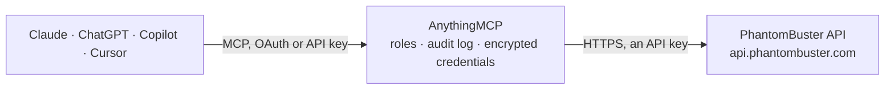

<!-- Generated by scripts/export-github-catalog.mjs in the anythingmcp-website repository. Do not edit by hand. -->

# PhantomBuster MCP connector

PhantomBuster lead extraction and outreach automation: list, launch, schedule and stop agents (Phantoms), follow their runs and read the results, leads lists and stored leads, and plan usage. The AnythingMCP connector gives Claude, ChatGPT, Microsoft Copilot, Cursor and Gemini 29 MCP tools for PhantomBuster: 20 read and 9 can change data.

**Category:** [Data Enrichment](../enrichment.md) · **Tools:** 29 · **Setup guide:** [anythingmcp.com](https://anythingmcp.com/guides/phantombuster-to-mcp) · [Deutsch](https://anythingmcp.com/de/guides/phantombuster-to-mcp) · [Italiano](https://anythingmcp.com/it/guides/phantombuster-to-mcp) · [Español](https://anythingmcp.com/es/guides/phantombuster-to-mcp) · [日本語](https://anythingmcp.com/ja/guides/phantombuster-to-mcp) · [Русский](https://anythingmcp.com/ru/guides/phantombuster-to-mcp) · [中文](https://anythingmcp.com/zh/guides/phantombuster-to-mcp)

## Start without code

No installation and no terminal: AnythingMCP Cloud runs the PhantomBuster connector for you, operated by helpcode.ai in Frankfurt, Germany.

1. **Click the button above** and create an account or sign in. The PhantomBuster connector opens, ready to install.
2. **Paste the API key or token from your PhantomBuster account.** Every click is in the [step-by-step guide](https://anythingmcp.com/guides/phantombuster-to-mcp).
3. **Click Install.** AnythingMCP shows the address of your MCP server.
4. **Add that address to your assistant:** [Claude](https://anythingmcp.com/guides/connect-phantombuster-to-claude) · [ChatGPT](https://anythingmcp.com/guides/connect-phantombuster-to-chatgpt) · [Microsoft Copilot](https://anythingmcp.com/guides/connect-phantombuster-to-copilot) · [Cursor](https://anythingmcp.com/guides/connect-phantombuster-to-cursor) · [Gemini CLI](https://anythingmcp.com/guides/connect-phantombuster-to-gemini) · [Meta Muse](https://anythingmcp.com/guides/connect-phantombuster-to-muse).
5. **Ask your first question**, for example: *What leads did container 7890 from agent 112 return, any professional_emails present?*

Prefer help with the setup? [Talk to us](https://anythingmcp.com/contact).

## How it works

- **The AI client** speaks MCP (Streamable HTTP) to AnythingMCP and only sees tool names, descriptions and results. It never gets the PhantomBuster credentials.
- **AnythingMCP** checks the client's role, builds the call from the tool definition, adds the credentials (an API key), calls PhantomBuster, logs the call and returns the result.
- **PhantomBuster** sees an ordinary API client with the rights of the account the credentials belong to.

## Tools

| Tool | What it does | Access |
|---|---|---|
| [`phantombuster_get_org`](#phantombuster_get_org) | The workspace (org) the API key belongs to: id, name, plan, time zone, s3Folder (needed to build result file URLs) and the daily limits of the plan. | read |
| [`phantombuster_get_org_resources`](#phantombuster_get_org_resources) | Plan usage of the workspace: execution time, email credits, AI credits, captcha, SERP credits and storage used today and this month, with the plan limits… | read |
| [`phantombuster_list_running_containers`](#phantombuster_list_running_containers) | Runs (containers) that are executing right now in the workspace, across all agents. | read |
| [`phantombuster_export_agent_usage`](#phantombuster_export_agent_usage) | CSV export of execution time and resource use per agent over the last N days (at most about 6 months). | read |
| [`phantombuster_export_container_usage`](#phantombuster_export_container_usage) | CSV export of every run (container) over the last N days with its duration and resource use, optionally for one agent only. | read |
| [`phantombuster_list_agent_groups`](#phantombuster_list_agent_groups) | Folders (agent groups) of the dashboard and the order of the agents inside them. | read |
| [`phantombuster_list_agents`](#phantombuster_list_agents) | All agents (Phantoms set up in the workspace) with id, name, script, launch type and schedule, last run end type and exit code, running count and s3Folder. | read |
| [`phantombuster_get_agent`](#phantombuster_get_agent) | One agent with its full settings: script, saved argument (input), schedule (launchType, repeatedLaunchTimes), notifications, limits, s3Folder and… | read |
| [`phantombuster_get_agent_output`](#phantombuster_get_agent_output) | Status and console output of the most recent run of an agent: containerId, status (starting, running, finished, launch error, never launched), progress,… | read |
| [`phantombuster_list_deleted_agents`](#phantombuster_list_deleted_agents) | Agents that were deleted from the workspace, with their former ids and names. | read |
| [`phantombuster_list_containers`](#phantombuster_list_containers) | Runs (containers) of one agent, newest first: id, status, launch type, start and end time, exit code and end type. | read |
| [`phantombuster_get_container`](#phantombuster_get_container) | One run (container): status, launch and end time, exit code, end type and retry number; optionally its output and result object. | read |
| [`phantombuster_get_container_output`](#phantombuster_get_container_output) | Console output (log) of one run of an agent, as JSON or as plain text. | read |
| [`phantombuster_get_container_result`](#phantombuster_get_container_result) | The result object of one run: the data the Phantom produced (often a JSON string of rows, or links to the result CSV and JSON files). | read |
| [`phantombuster_list_scripts`](#phantombuster_list_scripts) | Scripts (Phantom code) the workspace owns: id, name, default branch and dates. | read |
| [`phantombuster_get_script`](#phantombuster_get_script) | One script by id: name, org, branches and manifest (the argument fields an agent of this script accepts). | read |
| [`phantombuster_list_lead_lists`](#phantombuster_list_lead_lists) | Leads lists of the workspace storage (beta API): id, name, description, the saved filter that defines the list, tags and dates. | read |
| [`phantombuster_get_lead_list`](#phantombuster_get_lead_list) | One leads list of the workspace storage by id: name, description, tags and the saved filter. | read |
| [`phantombuster_list_leads_in_list`](#phantombuster_list_leads_in_list) | Leads that match a leads list (beta API), page by page: name, LinkedIn profile and company, job title, location, emails and the rest of the stored lead fields. | read |
| [`phantombuster_launch_agent`](#phantombuster_launch_agent) | Starts a run of an agent now (adds it to the launch queue) and returns the containerId of the new run. | write |
| [`phantombuster_launch_agent_soon`](#phantombuster_launch_agent_soon) | Schedules one run of an agent within the next N minutes (a one-time delayed launch). | write |
| [`phantombuster_abort_agent`](#phantombuster_abort_agent) | Stops the running run(s) of an agent. | write |
| [`phantombuster_save_agent`](#phantombuster_save_agent) | Updates an agent's settings (with agent_id) or creates a new agent from a script (without agent_id, with script_id): name, saved argument, schedule, time… | write |
| [`phantombuster_save_lead_list`](#phantombuster_save_lead_list) | Creates a leads list (without list_id) or replaces the filter, name and description of one (with list_id). | read |
| [`phantombuster_save_lead`](#phantombuster_save_lead) | Stores one lead in the workspace storage (beta API), or updates the lead with the same LinkedIn profile URL. | write |
| [`phantombuster_delete_leads`](#phantombuster_delete_leads) | Deletes leads from the workspace storage by id. | write |
| [`phantombuster_delete_lead_list`](#phantombuster_delete_lead_list) | Deletes a leads list (the saved filter; the leads stay in storage). | write |
| [`phantombuster_delete_agent`](#phantombuster_delete_agent) | Deletes an agent with its schedule; its past runs and result files are no longer shown. | write |
| [`phantombuster_unschedule_all_agents`](#phantombuster_unschedule_all_agents) | Emergency stop: turns off the automatic launch of every agent in the workspace (all become manual). | write |

## Tool reference

Every parameter as the AI client sees it in `tools/list`. Source: [`packages/backend/src/adapters/intl/phantombuster.json`](../../../packages/backend/src/adapters/intl/phantombuster.json).

### `phantombuster_get_org`

The workspace (org) the API key belongs to: id, name, plan, time zone, s3Folder (needed to build result file URLs) and the daily limits of the plan. Needs no ids; checks the key.

**Access:** read · **Call:** `GET /orgs/fetch`

No parameters.

### `phantombuster_get_org_resources`

Plan usage of the workspace: execution time, email credits, AI credits, captcha, SERP credits and storage used today and this month, with the plan limits and the next reset times.

**Access:** read · **Call:** `GET /orgs/fetch-resources`

No parameters.

### `phantombuster_list_running_containers`

Runs (containers) that are executing right now in the workspace, across all agents.

**Access:** read · **Call:** `GET /orgs/fetch-running-containers`

No parameters.

### `phantombuster_export_agent_usage`

CSV export of execution time and resource use per agent over the last N days (at most about 6 months). Returns CSV text.

**Access:** read · **Call:** `GET /orgs/export-agent-usage`

| Parameter | Type | Required | Description |
|---|---|---|---|
| `days` | string | yes | Number of days to export, e.g. "30". At most 6 months. |

### `phantombuster_export_container_usage`

CSV export of every run (container) over the last N days with its duration and resource use, optionally for one agent only. Returns CSV text.

**Access:** read · **Call:** `GET /orgs/export-container-usage`

| Parameter | Type | Required | Description |
|---|---|---|---|
| `days` | string | yes | Number of days to export, e.g. "7". At most 6 months. |
| `agent_id` | string | no | Only export the runs of this agent. |

### `phantombuster_list_agent_groups`

Folders (agent groups) of the dashboard and the order of the agents inside them.

**Access:** read · **Call:** `GET /orgs/fetch-agent-groups`

No parameters.

### `phantombuster_list_agents`

All agents (Phantoms set up in the workspace) with id, name, script, launch type and schedule, last run end type and exit code, running count and s3Folder. Filter by ids or by the input and output types the agents handle.

**Access:** read · **Call:** `GET /agents/fetch-all`

| Parameter | Type | Required | Description |
|---|---|---|---|
| `agent_ids` | string | no | Only these agents: one id, or several comma-separated. |
| `input_types` | string | no | Only agents that consume this input type, e.g. profileUrl or companyUrl. |
| `output_types` | string | no | Only agents that produce this output type, e.g. fullName, job or company. |
| `with_argument` | `true` \| `false` | no | Set to "true" to include each agent's saved launch argument (its input settings). |

### `phantombuster_get_agent`

One agent with its full settings: script, saved argument (input), schedule (launchType, repeatedLaunchTimes), notifications, limits, s3Folder and orgS3Folder, number of launches. Proxy credentials are removed.

**Access:** read · **Call:** `GET /agents/fetch`

| Parameter | Type | Required | Description |
|---|---|---|---|
| `agent_id` | string | yes | Agent (Phantom) id, as returned by phantombuster_list_agents. |
| `with_manifest` | `true` \| `false` | no | Set to "true" to include the script manifest, which describes the argument fields the Phantom accepts. |

### `phantombuster_get_agent_output`

Status and console output of the most recent run of an agent: containerId, status (starting, running, finished, launch error, never launched), progress, output text and outputPos. Pass from_output_pos and prev_container_id to read only what is new since the last call.

**Access:** read · **Call:** `GET /agents/fetch-output`

| Parameter | Type | Required | Description |
|---|---|---|---|
| `agent_id` | string | yes | Agent (Phantom) id, as returned by phantombuster_list_agents. |
| `from_output_pos` | number | no | Return the output from this character position on (the outputPos of the previous answer). |
| `prev_container_id` | string | no | The containerId of the previous answer, so the output continues from that run. |

### `phantombuster_list_deleted_agents`

Agents that were deleted from the workspace, with their former ids and names.

**Access:** read · **Call:** `GET /agents/fetch-deleted`

No parameters.

### `phantombuster_list_containers`

Runs (containers) of one agent, newest first: id, status, launch type, start and end time, exit code and end type.

**Access:** read · **Call:** `GET /containers/fetch-all`

| Parameter | Type | Required | Description |
|---|---|---|---|
| `agent_id` | string | yes | Agent (Phantom) id, as returned by phantombuster_list_agents. |
| `limit` | string | no | Maximum number of runs to return, e.g. "10". |
| `mode` | `all` \| `finalized` | no | all (default) or finalized (only runs that ended). |
| `before_ended_at` | string | no | Only runs that ended before this time (Unix milliseconds), for the next page: the endedAt of the oldest run of the previous answer. |

### `phantombuster_get_container`

One run (container): status, launch and end time, exit code, end type and retry number; optionally its output and result object.

**Access:** read · **Call:** `GET /containers/fetch`

| Parameter | Type | Required | Description |
|---|---|---|---|
| `container_id` | string | yes | Container (run) id, from phantombuster_list_containers, phantombuster_get_agent_output (containerId) or phantombuster_launch_agent. |
| `with_output` | `true` \| `false` | no | Set to "true" to include the console output. |
| `with_result_object` | `true` \| `false` | no | Set to "true" to include the result object (the data the run produced). |
| `with_runtime_events` | `true` \| `false` | no | Set to "true" to include the runtime events (progress steps and warnings). |

### `phantombuster_get_container_output`

Console output (log) of one run of an agent, as JSON or as plain text.

**Access:** read · **Call:** `GET /containers/fetch-output`

| Parameter | Type | Required | Description |
|---|---|---|---|
| `container_id` | string | yes | Container (run) id, from phantombuster_list_containers, phantombuster_get_agent_output (containerId) or phantombuster_launch_agent. |
| `mode` | `json` \| `raw` | no | json (default) or raw (plain text). |

### `phantombuster_get_container_result`

The result object of one run: the data the Phantom produced (often a JSON string of rows, or links to the result CSV and JSON files).

**Access:** read · **Call:** `GET /containers/fetch-result-object`

| Parameter | Type | Required | Description |
|---|---|---|---|
| `container_id` | string | yes | Container (run) id, from phantombuster_list_containers, phantombuster_get_agent_output (containerId) or phantombuster_launch_agent. |

### `phantombuster_list_scripts`

Scripts (Phantom code) the workspace owns: id, name, default branch and dates. The Phantoms of the PhantomBuster store belong to the org "phantombuster"; that list is several MB, so filter it with script_ids.

**Access:** read · **Call:** `GET /scripts/fetch-all`

| Parameter | Type | Required | Description |
|---|---|---|---|
| `org` | string | no | Org whose scripts to list; leave empty for the workspace's own scripts. "phantombuster" lists the public store (large). |
| `script_ids` | string | no | Only these script ids, comma-separated. |
| `exclude` | `modules` \| `non-modules` | no | modules: leave module scripts out; non-modules: return only modules. |

### `phantombuster_get_script`

One script by id: name, org, branches and manifest (the argument fields an agent of this script accepts). The scriptId of an agent comes from phantombuster_get_agent.

**Access:** read · **Call:** `GET /scripts/fetch`

| Parameter | Type | Required | Description |
|---|---|---|---|
| `script_id` | string | yes | Script id, e.g. the scriptId of an agent. |
| `branch` | string | no | Branch to read, default the script's default branch. |
| `environment` | `staging` \| `release` | no | staging or release (default). |

### `phantombuster_list_lead_lists`

Leads lists of the workspace storage (beta API): id, name, description, the saved filter that defines the list, tags and dates.

**Access:** read · **Call:** `GET /org-storage/lists/fetch-all`

No parameters.

### `phantombuster_get_lead_list`

One leads list of the workspace storage by id: name, description, tags and the saved filter.

**Access:** read · **Call:** `GET /org-storage/lists/fetch`

| Parameter | Type | Required | Description |
|---|---|---|---|
| `list_id` | string | yes | Leads list id from phantombuster_list_lead_lists. |

### `phantombuster_list_leads_in_list`

Leads that match a leads list (beta API), page by page: name, LinkedIn profile and company, job title, location, emails and the rest of the stored lead fields. Read-only, although the API takes it as a POST.

**Access:** read · **Call:** `POST /org-storage/leads/by-list/{list_id}`

| Parameter | Type | Required | Description |
|---|---|---|---|
| `list_id` | string | yes | Leads list id from phantombuster_list_lead_lists. |
| `page_size` | integer | no | Leads per page, e.g. 50. |
| `offset` | integer | no | Number of leads to skip (page_size times the page number), default 0. |
| `order` | `ASC` \| `DESC` | no | ASC or DESC by creation date. |
| `include_total_count` | boolean | no | Also return the total number of leads in the list. |
| `with_companies` | boolean | no | Also return the company each lead works for. |

### `phantombuster_launch_agent`

Starts a run of an agent now (adds it to the launch queue) and returns the containerId of the new run. The Phantom acts on the connected accounts (LinkedIn, Sales Navigator, ...) with its saved settings, unless argument replaces them. Confirm with the user first.

**Access:** write · **Call:** `POST /agents/launch`

| Parameter | Type | Required | Description |
|---|---|---|---|
| `agent_id` | string | yes | Agent (Phantom) id, as returned by phantombuster_list_agents. |
| `argument` | object | no | Launch argument (the Phantom's input settings) as an object, replacing the saved one for this run. Leave it out to use the saved settings. Field names come from the script manifest (phantombuster_get_agent with with_manifest). |
| `bonus_argument` | object | no | Fields merged over the saved argument for this run only, e.g. {"numberOfProfiles": 10}. |
| `save_argument` | boolean | no | Also save argument as the agent's default settings. |
| `max_instance_count` | integer | no | Only launch when fewer than this many runs of the agent are already running (1 avoids parallel runs). |

### `phantombuster_launch_agent_soon`

Schedules one run of an agent within the next N minutes (a one-time delayed launch).

**Access:** write · **Call:** `POST /agents/launch-soon`

| Parameter | Type | Required | Description |
|---|---|---|---|
| `agent_id` | string | yes | Agent (Phantom) id, as returned by phantombuster_list_agents. |
| `minutes` | integer | yes | Launch within this many minutes. |
| `argument` | object | no | Launch argument for that run, as in phantombuster_launch_agent. Leave it out to use the saved settings. |

### `phantombuster_abort_agent`

Stops the running run(s) of an agent. soft_abort lets the Phantom finish its current step and save what it has.

**Access:** write · **Call:** `POST /agents/stop`

| Parameter | Type | Required | Description |
|---|---|---|---|
| `agent_id` | string | yes | Agent (Phantom) id, as returned by phantombuster_list_agents. |
| `soft_abort` | boolean | no | Ask the Phantom to stop cleanly instead of killing the run. |
| `switch_to_manual_launch` | boolean | no | Also turn off the agent's schedule (launch type becomes manual). |

### `phantombuster_save_agent`

Updates an agent's settings (with agent_id) or creates a new agent from a script (without agent_id, with script_id): name, saved argument, schedule, time limit and notifications. Fields left out keep their value. Saving never launches a run.

**Access:** write · **Call:** `POST /agents/save`

| Parameter | Type | Required | Description |
|---|---|---|---|
| `agent_id` | string | no | Agent to update. Leave it out to create a new agent. |
| `script_id` | string | no | Script the new agent runs (an id from phantombuster_list_scripts or the store). Required when creating. |
| `name` | string | no | Agent name. |
| `argument` | object | no | Default launch argument (input settings) as an object; see the script manifest for the fields. |
| `launch_type` | `manually` \| `repeatedly` \| `once` \| `after agent` | no | manually, repeatedly (needs repeated_launch_preset or repeated_launch_times), once (needs launch_once_at) or after agent (needs launch_after_agent_id). |
| `repeated_launch_preset` | string | no | Schedule preset when launch_type is repeatedly, e.g. "Once per day", "Twice per day", "Once per week". |
| `repeated_launch_times` | object | no | Custom schedule when launch_type is repeatedly: {"timezone": "Europe/Berlin", "minute": [0], "hour": [9], "day": [1..31], "dow": ["mon",...], "month": ["jan",...]}. |
| `launch_once_at` | number | no | Launch time (Unix milliseconds) when launch_type is once. |
| `launch_after_agent_id` | string | no | Agent whose end triggers this one, when launch_type is after agent. |
| `execution_time_limit` | number | no | Stop each run after this many seconds. |
| `max_retry_number` | integer | no | How often a failed run is retried. |
| `notifications` | object | no | Notification settings, e.g. {"mailAutomaticExitError": true, "webhook": "https://..."}. |

### `phantombuster_save_lead_list`

Creates a leads list (without list_id) or replaces the filter, name and description of one (with list_id). A list is a saved filter over the stored leads, so it updates itself as Phantoms store new leads.

**Access:** read · **Call:** `POST /org-storage/lists/save`

| Parameter | Type | Required | Description |
|---|---|---|---|
| `list_id` | string | no | List to update. Leave it out to create a new list. |
| `name` | string | yes | List name. |
| `filter` | object | yes | Filter object, e.g. {"and": [{"filter": {"location": {"entity": "lead", "operator": "contains", "valueToCompare": "Berlin"}}}]} or {"__global_search__": "text"}. See the instructions for the operators. |
| `description` | string | no | What the list contains, in words. |
| `tags` | string[] | no | Tags of the list. |

### `phantombuster_save_lead`

Stores one lead in the workspace storage (beta API), or updates the lead with the same LinkedIn profile URL. Fields left out are not changed.

**Access:** write · **Call:** `POST /org-storage/leads/save`

| Parameter | Type | Required | Description |
|---|---|---|---|
| `linkedin_profile_url` | string | yes | LinkedIn profile URL of the lead (the key that identifies it). |
| `first_name` | string | no | First name. |
| `last_name` | string | no | Last name. |
| `company_name` | string | no | Current company. |
| `company_website` | string | no | Website of the company. |
| `job_title` | string | no | Current job title. |
| `location` | string | no | Location (city, country). |
| `professional_emails` | string[] | no | Work email addresses. |
| `personal_emails` | string[] | no | Personal email addresses. |
| `phone_numbers` | string[] | no | Phone numbers. |

### `phantombuster_delete_leads`

Deletes leads from the workspace storage by id. Cannot be undone. Installed switched off.

**Access:** write · **Call:** `POST /org-storage/leads/delete-many`

| Parameter | Type | Required | Description |
|---|---|---|---|
| `lead_ids` | string[] | yes | Ids of the leads to delete (the id field of the leads from phantombuster_list_leads_in_list). |

### `phantombuster_delete_lead_list`

Deletes a leads list (the saved filter; the leads stay in storage). Installed switched off.

**Access:** write · **Call:** `POST /org-storage/lists/delete`

| Parameter | Type | Required | Description |
|---|---|---|---|
| `list_id` | string | yes | Leads list id. |

### `phantombuster_delete_agent`

Deletes an agent with its schedule; its past runs and result files are no longer shown. Installed switched off.

**Access:** write · **Call:** `POST /agents/delete`

| Parameter | Type | Required | Description |
|---|---|---|---|
| `agent_id` | string | yes | Agent (Phantom) id, as returned by phantombuster_list_agents. |

### `phantombuster_unschedule_all_agents`

Emergency stop: turns off the automatic launch of every agent in the workspace (all become manual). Running runs continue. Installed switched off.

**Access:** write · **Call:** `POST /agents/unschedule-all`

No parameters.

## Run it yourself

AnythingMCP is open source (AGPL-3.0). [Run it with Docker](../../../README.md#run-it-yourself), open **Connectors → Store**, pick **PhantomBuster** and enter `PHANTOMBUSTER_API_KEY`, then add your MCP server URL to the AI client.

[← Data Enrichment connectors](../enrichment.md) · [All categories](../README.md)
