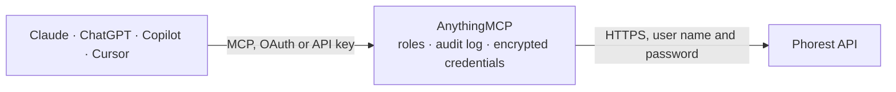

<!-- Generated by scripts/export-github-catalog.mjs in the anythingmcp-website repository. Do not edit by hand. -->

# Phorest MCP connector

Phorest salon and spa software: branches, staff and timetables, services and categories, clients with service and product history, appointments, free appointment slots, products and stock, gift vouchers and reviews. The AnythingMCP connector gives Claude, ChatGPT, Microsoft Copilot, Cursor and Gemini 23 MCP tools for Phorest: 20 read and 3 can change data.

**Category:** [Scheduling](../scheduling.md) · **Tools:** 23 · **Setup guide:** [anythingmcp.com](https://anythingmcp.com/guides/phorest-to-mcp) · [Deutsch](https://anythingmcp.com/de/guides/phorest-to-mcp) · [Italiano](https://anythingmcp.com/it/guides/phorest-to-mcp) · [Español](https://anythingmcp.com/es/guides/phorest-to-mcp) · [日本語](https://anythingmcp.com/ja/guides/phorest-to-mcp) · [Русский](https://anythingmcp.com/ru/guides/phorest-to-mcp) · [中文](https://anythingmcp.com/zh/guides/phorest-to-mcp)

## Start without code

No installation and no terminal: AnythingMCP Cloud runs the Phorest connector for you, operated by helpcode.ai in Frankfurt, Germany.

1. **Click the button above** and create an account or sign in. The Phorest connector opens, ready to install.
2. **Paste the API key or token from your Phorest account.** Every click is in the [step-by-step guide](https://anythingmcp.com/guides/phorest-to-mcp).
3. **Click Install.** AnythingMCP shows the address of your MCP server.
4. **Add that address to your assistant:** [Claude](https://anythingmcp.com/guides/connect-phorest-to-claude) · [ChatGPT](https://anythingmcp.com/guides/connect-phorest-to-chatgpt) · [Microsoft Copilot](https://anythingmcp.com/guides/connect-phorest-to-copilot) · [Cursor](https://anythingmcp.com/guides/connect-phorest-to-cursor) · [Gemini CLI](https://anythingmcp.com/guides/connect-phorest-to-gemini) · [Meta Muse](https://anythingmcp.com/guides/connect-phorest-to-muse).
5. **Ask your first question**, for example: *What was the last visit date and client id for Maria Rossi (maria.rossi@lumenspa.co.uk)?*

Prefer help with the setup? [Talk to us](https://anythingmcp.com/contact).

## How it works

- **The AI client** speaks MCP (Streamable HTTP) to AnythingMCP and only sees tool names, descriptions and results. It never gets the Phorest credentials.
- **AnythingMCP** checks the client's role, builds the call from the tool definition, adds the credentials (user name and password), calls Phorest, logs the call and returns the result.
- **Phorest** sees an ordinary API client with the rights of the account the credentials belong to.

## Tools

| Tool | What it does | Access |
|---|---|---|
| [`phorest_list_branches`](#phorest_list_branches) | List the branches (salons) of the Phorest business with branch id, name, address and time zone. | read |
| [`phorest_list_staff`](#phorest_list_staff) | List the staff members of a branch with staff id, name, category, work schedule flags and archived state. | read |
| [`phorest_get_staff`](#phorest_get_staff) | Get one staff member of a branch by id with name, contact data, staff category, gender, online booking flags and archived state. | read |
| [`phorest_list_staff_timetables`](#phorest_list_staff_timetables) | List staff working hours (timetables) of a branch between two dates, at most one month apart, with each staff member's shifts and activity type. | read |
| [`phorest_list_services`](#phorest_list_services) | List the services offered by a branch (cuts, colours, treatments) with service id, name, category, duration and price. | read |
| [`phorest_get_service`](#phorest_get_service) | Get one branch service by id with name, category, duration, price, tax and online booking settings. | read |
| [`phorest_list_service_categories`](#phorest_list_service_categories) | List the service categories of a branch with id and name. | read |
| [`phorest_list_clients`](#phorest_list_clients) | Search the clients of the business by e-mail, mobile, first or last name (~Jo% for prefix search), external id or change time. | read |
| [`phorest_get_client`](#phorest_get_client) | Get one client by id with contact data, address, birth date, notes, marketing and reminder consents, credit account, loyalty card, preferred staff and first… | read |
| [`phorest_get_client_service_history`](#phorest_get_client_service_history) | List the services a client has had: date, branch, service, staff member and price. | read |
| [`phorest_get_client_product_history`](#phorest_get_client_product_history) | List the retail products a client has bought: date, branch, product, quantity and price. | read |
| [`phorest_list_appointments`](#phorest_list_appointments) | List appointments of a branch in a date range of at most one month, with client, service, staff, room, start and end time, price and state. | read |
| [`phorest_get_appointment`](#phorest_get_appointment) | Get one appointment by id with client, service, staff, room, times, price, deposit, state and booking id. | read |
| [`phorest_check_availability`](#phorest_check_availability) | Find free appointment slots in a branch for one client's chosen services between two times. | read |
| [`phorest_list_products`](#phorest_list_products) | List retail and professional products of a branch with name, barcode, type, price, cost and stock levels. | read |
| [`phorest_list_vouchers`](#phorest_list_vouchers) | List gift vouchers of the business with serial number, client, original and remaining balance, issue and expiry dates. | read |
| [`phorest_get_voucher`](#phorest_get_voucher) | Get one gift voucher by id with serial number, client, original and remaining balance, issue and expiry dates. | read |
| [`phorest_list_reviews`](#phorest_list_reviews) | List client reviews of a branch with rating, text, client, staff and date. | read |
| [`phorest_list_rooms`](#phorest_list_rooms) | List the rooms of a branch (treatment rooms, stations) with id and name. | read |
| [`phorest_list_payment_types`](#phorest_list_payment_types) | List the extra payment types configured for the business (beyond cash and card) with id and name. | read |
| [`phorest_create_client`](#phorest_create_client) | Create a client in the Phorest business with name, mobile, e-mail and consents. | write |
| [`phorest_create_booking`](#phorest_create_booking) | Book appointments for a client in a branch: one schedule per service with staff and start time, usually taken from phorest_check_availability. | write |
| [`phorest_cancel_appointments`](#phorest_cancel_appointments) | Cancel one or more appointments of a branch by id. | write |

## Tool reference

Every parameter as the AI client sees it in `tools/list`. Source: [`packages/backend/src/adapters/intl/phorest.json`](../../../packages/backend/src/adapters/intl/phorest.json).

### `phorest_list_branches`

List the branches (salons) of the Phorest business with branch id, name, address and time zone. Call it first: almost every other tool needs a branch_id.

**Access:** read · **Call:** `GET /branch`

| Parameter | Type | Required | Description |
|---|---|---|---|
| `page` | integer | no | Page number, starting at 0. |
| `size` | integer | no | Records per page, up to 200. |

### `phorest_list_staff`

List the staff members of a branch with staff id, name, category, work schedule flags and archived state. Use the ids to filter appointments and timetables.

**Access:** read · **Call:** `GET /branch/{branch_id}/staff`

| Parameter | Type | Required | Description |
|---|---|---|---|
| `branch_id` | string | yes | Branch id from phorest_list_branches. |
| `updated_after` | string | no | Only staff changed after this time, e.g. 2026-10-01T00:00:00.00Z. |
| `updated_before` | string | no | Only staff changed before this time. |
| `fetch_archived` | boolean | no | true to include archived staff. |
| `page` | integer | no | Page number, starting at 0. |
| `size` | integer | no | Records per page, up to 200. |

### `phorest_get_staff`

Get one staff member of a branch by id with name, contact data, staff category, gender, online booking flags and archived state.

**Access:** read · **Call:** `GET /branch/{branch_id}/staff/{staff_id}`

| Parameter | Type | Required | Description |
|---|---|---|---|
| `branch_id` | string | yes | Branch id from phorest_list_branches. |
| `staff_id` | string | yes | Staff id. |

### `phorest_list_staff_timetables`

List staff working hours (timetables) of a branch between two dates, at most one month apart, with each staff member's shifts and activity type.

**Access:** read · **Call:** `GET /branch/{branch_id}/staff/worktimetable`

| Parameter | Type | Required | Description |
|---|---|---|---|
| `branch_id` | string | yes | Branch id from phorest_list_branches. |
| `from_date` | string | yes | First day, yyyy-MM-dd. |
| `to_date` | string | yes | Last day (inclusive), yyyy-MM-dd, at most one month after from_date. |
| `activity_type` | string | no | Only this type of work activity. |
| `page` | integer | no | Page number, starting at 0. |
| `size` | integer | no | Records per page, up to 1000. |

### `phorest_list_services`

List the services offered by a branch (cuts, colours, treatments) with service id, name, category, duration and price. Use the service ids for availability and bookings.

**Access:** read · **Call:** `GET /branch/{branch_id}/service`

| Parameter | Type | Required | Description |
|---|---|---|---|
| `branch_id` | string | yes | Branch id from phorest_list_branches. |
| `category_id` | string | no | Only services of this service category. |
| `include_archived` | boolean | no | true to include archived services. |
| `fetch_online_category` | boolean | no | true to add the online booking categories. |
| `page` | integer | no | Page number, starting at 0. |
| `size` | integer | no | Records per page, up to 200. |

### `phorest_get_service`

Get one branch service by id with name, category, duration, price, tax and online booking settings.

**Access:** read · **Call:** `GET /branch/{branch_id}/service/{service_id}`

| Parameter | Type | Required | Description |
|---|---|---|---|
| `branch_id` | string | yes | Branch id from phorest_list_branches. |
| `service_id` | string | yes | Service id. |
| `fetch_online_category` | boolean | no | true to add the online booking categories. |

### `phorest_list_service_categories`

List the service categories of a branch with id and name. Use the id to filter phorest_list_services.

**Access:** read · **Call:** `GET /branch/{branch_id}/service-category`

| Parameter | Type | Required | Description |
|---|---|---|---|
| `branch_id` | string | yes | Branch id from phorest_list_branches. |
| `page` | integer | no | Page number, starting at 0. |
| `size` | integer | no | Records per page, up to 200. |

### `phorest_list_clients`

Search the clients of the business by e-mail, mobile, first or last name (~Jo% for prefix search), external id or change time. Returns client id, name, contact data, consents, loyalty and last visit.

**Access:** read · **Call:** `GET /client`

| Parameter | Type | Required | Description |
|---|---|---|---|
| `email` | string | no | Exact e-mail address. |
| `phone` | string | no | Mobile number. |
| `first_name` | string | no | First name; exact (John) or prefix with ~ and % (~Jo%). |
| `last_name` | string | no | Last name; exact (Doe) or prefix with ~ and % (~Do%). |
| `external_id` | string | no | Id the client has in another system. |
| `updated_after` | string | no | Only clients changed after this time, e.g. 2026-10-01T00:00:00.00Z. |
| `updated_before` | string | no | Only clients changed before this time. |
| `include_archived` | boolean | no | true to include archived clients. |
| `include_deleted` | boolean | no | true to include deleted clients. |
| `include_linked_clients` | boolean | no | With phone: also return clients linked to the matches. |
| `page` | integer | no | Page number, starting at 0. |
| `size` | integer | no | Records per page, up to 200. |

### `phorest_get_client`

Get one client by id with contact data, address, birth date, notes, marketing and reminder consents, credit account, loyalty card, preferred staff and first and last visit.

**Access:** read · **Call:** `GET /client/{client_id}`

| Parameter | Type | Required | Description |
|---|---|---|---|
| `client_id` | string | yes | Client id from phorest_list_clients. |

### `phorest_get_client_service_history`

List the services a client has had: date, branch, service, staff member and price. Use it to see a client's visit history.

**Access:** read · **Call:** `GET /client/{client_id}/service-history`

| Parameter | Type | Required | Description |
|---|---|---|---|
| `client_id` | string | yes | Client id. |
| `page` | integer | no | Page number, starting at 0. |
| `size` | integer | no | Records per page, up to 200. |

### `phorest_get_client_product_history`

List the retail products a client has bought: date, branch, product, quantity and price.

**Access:** read · **Call:** `GET /client/{client_id}/product-history`

| Parameter | Type | Required | Description |
|---|---|---|---|
| `client_id` | string | yes | Client id. |
| `page` | integer | no | Page number, starting at 0. |
| `size` | integer | no | Records per page, up to 200. |

### `phorest_list_appointments`

List appointments of a branch in a date range of at most one month, with client, service, staff, room, start and end time, price and state. Filter by staff, room, client or change time.

**Access:** read · **Call:** `GET /branch/{branch_id}/appointment`

| Parameter | Type | Required | Description |
|---|---|---|---|
| `branch_id` | string | yes | Branch id from phorest_list_branches. |
| `from_date` | string | no | First day, yyyy-MM-dd. |
| `to_date` | string | no | Last day (inclusive), yyyy-MM-dd, at most one month after from_date. |
| `staff_id` | string | no | Only this staff member. |
| `room_id` | string | no | Only this room. |
| `client_id` | string | no | Only this client. |
| `group_booking_id` | string | no | Only this group booking. |
| `updated_from` | string | no | Only appointments changed at or after this time (ISO 8601). |
| `updated_to` | string | no | Only appointments changed at or before this time. |
| `fetch_canceled` | boolean | no | true to include canceled appointments. |
| `fetch_deleted` | boolean | no | true to include deleted appointments. |
| `fetch_notes` | boolean | no | true to include appointment notes. |
| `sort` | string | no | property,direction with appointmentDate or creationDate, e.g. appointmentDate,asc. |
| `page` | integer | no | Page number, starting at 0. |
| `size` | integer | no | Records per page, up to 200. |

### `phorest_get_appointment`

Get one appointment by id with client, service, staff, room, times, price, deposit, state and booking id.

**Access:** read · **Call:** `GET /branch/{branch_id}/appointment/{appointment_id}`

| Parameter | Type | Required | Description |
|---|---|---|---|
| `branch_id` | string | yes | Branch id from phorest_list_branches. |
| `appointment_id` | string | yes | Appointment id. |

### `phorest_check_availability`

Find free appointment slots in a branch for one client's chosen services between two times. Returns start times with the staff, room and service schedule of each slot. Nothing is booked.

**Access:** read · **Call:** `POST /branch/{branch_id}/appointments/availability`

| Parameter | Type | Required | Description |
|---|---|---|---|
| `branch_id` | string | yes | Branch id from phorest_list_branches. |
| `start_time` | string | yes | Earliest start to consider, ISO 8601, e.g. 2026-10-08T09:00:00Z. |
| `end_time` | string | yes | Latest time to consider, ISO 8601. |
| `service_selections` | object[] | yes | Services to book: [{"serviceId": "...", "staffId": "optional preferred staff"}]. |
| `client_id` | string | no | Client id, when the client is known. |
| `online_only` | boolean | no | true to consider only staff bookable online. |

### `phorest_list_products`

List retail and professional products of a branch with name, barcode, type, price, cost and stock levels. Search by name or barcode, or list only out-of-stock or low-stock items.

**Access:** read · **Call:** `GET /branch/{branch_id}/product`

| Parameter | Type | Required | Description |
|---|---|---|---|
| `branch_id` | string | yes | Branch id from phorest_list_branches. |
| `search` | string | no | Product name or barcode. |
| `product_type` | string | no | Only this product type, e.g. RETAIL or PROFESSIONAL. |
| `out_of_stock` | boolean | no | true for out-of-stock products only. |
| `low_stock` | boolean | no | true for low-stock products only. |
| `include_archived` | boolean | no | true to include archived products. |
| `archived_only` | boolean | no | true for archived products only. |
| `updated_from` | string | no | Changed at or after this time (ISO 8601). |
| `updated_to` | string | no | Changed at or before this time. |
| `page` | integer | no | Page number, starting at 0. |
| `size` | integer | no | Records per page, up to 200. |

### `phorest_list_vouchers`

List gift vouchers of the business with serial number, client, original and remaining balance, issue and expiry dates. Filter by client or serial number; used vouchers are left out unless asked.

**Access:** read · **Call:** `GET /voucher`

| Parameter | Type | Required | Description |
|---|---|---|---|
| `client_id` | string | no | Only vouchers of this client. |
| `serial_number` | string | no | Voucher serial number. |
| `include_used` | boolean | no | true to include fully used vouchers. |
| `updated_from` | string | no | Changed at or after this time (ISO 8601). |
| `updated_to` | string | no | Changed at or before this time. |
| `page` | integer | no | Page number, starting at 0. |
| `size` | integer | no | Records per page, up to 200. |

### `phorest_get_voucher`

Get one gift voucher by id with serial number, client, original and remaining balance, issue and expiry dates.

**Access:** read · **Call:** `GET /voucher/{voucher_id}`

| Parameter | Type | Required | Description |
|---|---|---|---|
| `voucher_id` | string | yes | Voucher id. |

### `phorest_list_reviews`

List client reviews of a branch with rating, text, client, staff and date. Filter by client, client or staff name, or review date.

**Access:** read · **Call:** `GET /branch/{branch_id}/review`

| Parameter | Type | Required | Description |
|---|---|---|---|
| `branch_id` | string | yes | Branch id from phorest_list_branches. |
| `client_id` | string | no | Only reviews by this client. |
| `client_name` | string | no | Client first name or surname. |
| `staff_name` | string | no | Staff first name or surname. |
| `review_date` | string | no | Date of review, yyyy-MM-dd. |
| `page` | integer | no | Page number, starting at 0. |
| `size` | integer | no | Records per page, up to 200. |

### `phorest_list_rooms`

List the rooms of a branch (treatment rooms, stations) with id and name. Use the id to filter appointments.

**Access:** read · **Call:** `GET /branch/{branch_id}/room`

| Parameter | Type | Required | Description |
|---|---|---|---|
| `branch_id` | string | yes | Branch id from phorest_list_branches. |
| `include_archived` | boolean | no | true to include archived rooms. |
| `page` | integer | no | Page number, starting at 0. |
| `size` | integer | no | Records per page, up to 200. |

### `phorest_list_payment_types`

List the extra payment types configured for the business (beyond cash and card) with id and name.

**Access:** read · **Call:** `GET /paymenttype`

| Parameter | Type | Required | Description |
|---|---|---|---|
| `page` | integer | no | Page number, starting at 0. |
| `size` | integer | no | Records per page, up to 200. |

### `phorest_create_client`

Create a client in the Phorest business with name, mobile, e-mail and consents. Returns the new client with its id. Check with phorest_list_clients first to avoid duplicates.

**Access:** write · **Call:** `POST /client`

| Parameter | Type | Required | Description |
|---|---|---|---|
| `first_name` | string | yes | First name. |
| `last_name` | string | yes | Last name. |
| `mobile` | string | no | Mobile number with country code. |
| `email` | string | no | E-mail address. |
| `notes` | string | no | Client notes. |
| `birth_date` | string | no | Birth date, yyyy-MM-dd. |
| `gender` | string | no | FEMALE, MALE or OTHER. |
| `sms_marketing_consent` | boolean | no | Client agreed to marketing SMS. |
| `email_marketing_consent` | boolean | no | Client agreed to marketing e-mails. |
| `sms_reminder_consent` | boolean | no | Client agreed to SMS reminders. |
| `email_reminder_consent` | boolean | no | Client agreed to e-mail reminders. |
| `creating_branch_id` | string | no | Branch the client belongs to. |
| `external_id` | string | no | Id in another system. |

### `phorest_create_booking`

Book appointments for a client in a branch: one schedule per service with staff and start time, usually taken from phorest_check_availability. Returns the booking with its appointments.

**Access:** write · **Call:** `POST /branch/{branch_id}/booking`

| Parameter | Type | Required | Description |
|---|---|---|---|
| `branch_id` | string | yes | Branch id from phorest_list_branches. |
| `client_id` | string | yes | Client id. |
| `service_schedules` | object[] | yes | [{"serviceId": "...", "staffId": "...", "startTime": "2026-10-08T10:00:00Z"}] per service. |
| `note` | string | no | Note added to the booking. |
| `force_selected_time` | boolean | no | true to book at the given time even if Phorest would not offer it. |

### `phorest_cancel_appointments`

Cancel one or more appointments of a branch by id. The appointments are marked canceled in the Phorest appointment book; the client may be notified by Phorest.

**Access:** write · **Call:** `POST /branch/{branch_id}/appointment/cancel`

| Parameter | Type | Required | Description |
|---|---|---|---|
| `branch_id` | string | yes | Branch id from phorest_list_branches. |
| `appointment_ids` | string[] | yes | Appointment ids to cancel. |

## Run it yourself

AnythingMCP is open source (AGPL-3.0). [Run it with Docker](../../../README.md#run-it-yourself), open **Connectors → Store**, pick **Phorest** and enter `PHOREST_API_URL`, `PHOREST_BUSINESS_ID`, `PHOREST_USERNAME`, `PHOREST_PASSWORD`, then add your MCP server URL to the AI client.

[← Scheduling connectors](../scheduling.md) · [All categories](../README.md)
