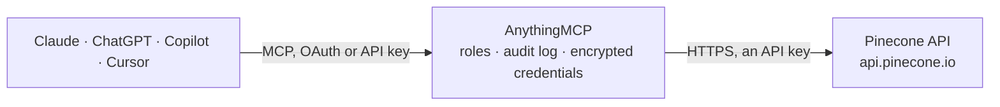

<!-- Generated by scripts/export-github-catalog.mjs in the anythingmcp-website repository. Do not edit by hand. -->

# Pinecone MCP connector

Let your AI search your Pinecone vector database: list indexes, run semantic and keyword search, query and fetch records, check namespaces and stats, embed and rerank with Pinecone Inference, chat … The AnythingMCP connector gives Claude, ChatGPT, Microsoft Copilot, Cursor and Gemini 17 MCP tools for Pinecone: 14 read and 3 can change data.

**Category:** [Databases](../database.md) · **Tools:** 17 · **Setup guide:** [anythingmcp.com](https://anythingmcp.com/guides/pinecone-to-mcp) · [Deutsch](https://anythingmcp.com/de/guides/pinecone-to-mcp) · [Italiano](https://anythingmcp.com/it/guides/pinecone-to-mcp) · [Español](https://anythingmcp.com/es/guides/pinecone-to-mcp) · [日本語](https://anythingmcp.com/ja/guides/pinecone-to-mcp) · [Русский](https://anythingmcp.com/ru/guides/pinecone-to-mcp) · [中文](https://anythingmcp.com/zh/guides/pinecone-to-mcp)

## Start without code

No installation and no terminal: AnythingMCP Cloud runs the Pinecone connector for you, operated by helpcode.ai in Frankfurt, Germany.

1. **Click the button above** and create an account or sign in. The Pinecone connector opens, ready to install.
2. **Paste the API key or token from your Pinecone account.** Every click is in the [step-by-step guide](https://anythingmcp.com/guides/pinecone-to-mcp).
3. **Click Install.** AnythingMCP shows the address of your MCP server.
4. **Add that address to your assistant:** [Claude](https://anythingmcp.com/guides/connect-pinecone-to-claude) · [ChatGPT](https://anythingmcp.com/guides/connect-pinecone-to-chatgpt) · [Microsoft Copilot](https://anythingmcp.com/guides/connect-pinecone-to-copilot) · [Cursor](https://anythingmcp.com/guides/connect-pinecone-to-cursor) · [Gemini CLI](https://anythingmcp.com/guides/connect-pinecone-to-gemini) · [Meta Muse](https://anythingmcp.com/guides/connect-pinecone-to-muse).
5. **Ask your first question**, for example: *Find invoice INV-2026-045 in index invoices-vec and show amount, status and due date.*

Prefer help with the setup? [Talk to us](https://anythingmcp.com/contact).

## How it works

- **The AI client** speaks MCP (Streamable HTTP) to AnythingMCP and only sees tool names, descriptions and results. It never gets the Pinecone credentials.
- **AnythingMCP** checks the client's role, builds the call from the tool definition, adds the credentials (an API key), calls Pinecone, logs the call and returns the result.
- **Pinecone** sees an ordinary API client with the rights of the account the credentials belong to.

## Tools

| Tool | What it does | Access |
|---|---|---|
| [`pinecone_list_indexes`](#pinecone_list_indexes) | List the indexes of the Pinecone project: name, index_host (pass it to every data tool), readiness, deployment (serverless cloud and region, pod or BYOC),… | read |
| [`pinecone_describe_index`](#pinecone_describe_index) | Describe one index: index_host (pass it to the data tools), readiness, deployment, schema (dimension, metric, embedding model and field map of integrated… | read |
| [`pinecone_describe_index_stats`](#pinecone_describe_index_stats) | Get statistics of an index: total record count, record count per namespace, dimension, metric, vector type and fullness (pod indexes). | read |
| [`pinecone_list_namespaces`](#pinecone_list_namespaces) | List the namespaces of an index with their record counts, 100 per page; call again with pagination_token = pagination.next until it is missing. | read |
| [`pinecone_search_records`](#pinecone_search_records) | Semantic search with plain text on an integrated index (one created with a hosted embedding model; its schema shows a semantic_text field): Pinecone embeds… | read |
| [`pinecone_search_documents`](#pinecone_search_documents) | Search a document index (the newer index type with a typed schema) with one or more scoring methods: full-text (type text or query_string) on string fields,… | read |
| [`pinecone_query_vectors`](#pinecone_query_vectors) | Find the records most similar to a stored record (by id) or to a query vector you pass, optionally with a metadata filter. | read |
| [`pinecone_fetch_vectors`](#pinecone_fetch_vectors) | Fetch stored records by id: id and metadata of each. | read |
| [`pinecone_list_vector_ids`](#pinecone_list_vector_ids) | List the record ids in a namespace (serverless indexes), optionally only those starting with a prefix such as doc1#; up to 100 per page, call again with… | read |
| [`pinecone_upsert_records`](#pinecone_upsert_records) | Add or replace text records in an integrated index; Pinecone embeds the text with the index's model. | write |
| [`pinecone_update_metadata`](#pinecone_update_metadata) | Set metadata fields on one stored record; fields not named stay as they are and the vector is unchanged. | write |
| [`pinecone_delete_vectors`](#pinecone_delete_vectors) | Delete stored records by id. | write |
| [`pinecone_list_models`](#pinecone_list_models) | List the embedding and reranking models Pinecone hosts, with type, vector type, dimensions, maximum input and batch size and supported parameters. | read |
| [`pinecone_embed`](#pinecone_embed) | Turn texts into vectors with a Pinecone-hosted embedding model, e.g. to query an index that stores your own vectors with pinecone_query_vectors. | read |
| [`pinecone_rerank`](#pinecone_rerank) | Reorder documents by relevance to a query with a Pinecone-hosted reranking model: returns each document's index in the input list and a relevance score,… | read |
| [`pinecone_list_assistants`](#pinecone_list_assistants) | List the Pinecone Assistants of the project: name, status, instructions, metadata, host and region, and when they were created. | read |
| [`pinecone_chat_assistant`](#pinecone_chat_assistant) | Ask a Pinecone Assistant a question: it answers from the files uploaded to it and returns the answer with citations (file name and pages). | read |

## Tool reference

Every parameter as the AI client sees it in `tools/list`. Source: [`packages/backend/src/adapters/intl/pinecone.json`](../../../packages/backend/src/adapters/intl/pinecone.json).

### `pinecone_list_indexes`

List the indexes of the Pinecone project: name, index_host (pass it to every data tool), readiness, deployment (serverless cloud and region, pod or BYOC), schema (vector dimension and metric, the embedding model of integrated indexes, text and metadata fields), deletion protection and tags. Read-only.

**Access:** read · **Call:** `GET /indexes`

No parameters.

### `pinecone_describe_index`

Describe one index: index_host (pass it to the data tools), readiness, deployment, schema (dimension, metric, embedding model and field map of integrated indexes, text and metadata fields), read capacity, deletion protection and tags. Read-only.

**Access:** read · **Call:** `GET /indexes/{index_name}`

| Parameter | Type | Required | Description |
|---|---|---|---|
| `index_name` | string | yes | The index name, from pinecone_list_indexes. |

### `pinecone_describe_index_stats`

Get statistics of an index: total record count, record count per namespace, dimension, metric, vector type and fullness (pod indexes). Optionally count only records matching a metadata filter (pod indexes). Read-only.

**Access:** read · **Call:** `POST https://{index_host}.pinecone.io/describe_index_stats`

| Parameter | Type | Required | Description |
|---|---|---|---|
| `index_host` | string | yes | The index_host value returned by pinecone_list_indexes or pinecone_describe_index: the index host without https:// and without the trailing .pinecone.io, e.g. my-index-abc1234.svc.aped-4627-b74a. |
| `filter` | object | no | Metadata filter, e.g. {"genre": {"$eq": "drama"}, "year": {"$gte": 2020}}. Operators: $eq, $ne, $gt, $gte, $lt, $lte, $in, $nin, $exists, $and, $or. |

### `pinecone_list_namespaces`

List the namespaces of an index with their record counts, 100 per page; call again with pagination_token = pagination.next until it is missing. Read-only.

**Access:** read · **Call:** `GET https://{index_host}.pinecone.io/namespaces`

| Parameter | Type | Required | Description |
|---|---|---|---|
| `index_host` | string | yes | The index_host value returned by pinecone_list_indexes or pinecone_describe_index: the index host without https:// and without the trailing .pinecone.io, e.g. my-index-abc1234.svc.aped-4627-b74a. |
| `prefix` | string | no | Only namespaces whose name starts with this. |
| `limit` | integer | no | Namespaces per page, 1 to 100 (default 100). |
| `pagination_token` | string | no | pagination.next from the previous page. |

### `pinecone_search_records`

Semantic search with plain text on an integrated index (one created with a hosted embedding model; its schema shows a semantic_text field): Pinecone embeds the text and returns the most similar records with _id, _score and their fields, optionally reranked. At most 100 hits are passed on. For indexes that store your own vectors use pinecone_query_vectors; for document indexes use pinecone_search_documents. Read-only.

**Access:** read · **Call:** `POST https://{index_host}.pinecone.io/records/namespaces/{namespace}/search`

| Parameter | Type | Required | Description |
|---|---|---|---|
| `index_host` | string | yes | The index_host value returned by pinecone_list_indexes or pinecone_describe_index: the index host without https:// and without the trailing .pinecone.io, e.g. my-index-abc1234.svc.aped-4627-b74a. |
| `namespace` | string | no | Namespace to use (default __default__, the default namespace). See pinecone_list_namespaces. |
| `text` | string | yes | The search text, e.g. a question in natural language. |
| `top_k` | integer | no | Number of records to return, 1 to 100 (default 10). |
| `filter` | object | no | Metadata filter, e.g. {"genre": {"$eq": "drama"}, "year": {"$gte": 2020}}. Operators: $eq, $ne, $gt, $gte, $lt, $lte, $in, $nin, $exists, $and, $or. |
| `fields` | string[] | no | Only return these record fields, e.g. ["chunk_text", "title"]. Default: all stored fields. |
| `rerank` | object | no | Rerank the hits, e.g. {"model": "bge-reranker-v2-m3", "rank_fields": ["chunk_text"], "top_n": 5}. Uses Pinecone Inference and costs extra. |

### `pinecone_search_documents`

Search a document index (the newer index type with a typed schema) with one or more scoring methods: full-text (type text or query_string) on string fields, text embedded by a field's own model (embed, sparse_embed), or a vector you pass. Returns the matching documents with _id, _score and the fields asked for, at most 100. Read-only.

**Access:** read · **Call:** `POST https://{index_host}.pinecone.io/namespaces/{namespace}/documents/search`

| Parameter | Type | Required | Description |
|---|---|---|---|
| `index_host` | string | yes | The index_host value returned by pinecone_list_indexes or pinecone_describe_index: the index host without https:// and without the trailing .pinecone.io, e.g. my-index-abc1234.svc.aped-4627-b74a. |
| `namespace` | string | no | Namespace to use (default __default__, the default namespace). See pinecone_list_namespaces. |
| `score_by` | object[] | yes | Scoring clauses, e.g. [{"type": "text", "fields": ["content"], "query": "refund policy"}] for keyword search or [{"type": "embed", "fields": ["body"], "query": "how do refunds work"}] for semantic search. Several clauses only when all are text or query_string. |
| `top_k` | integer | no | Number of documents to return, 1 to 100 (default 10). |
| `include_fields` | string[] | no | Fields to return per match, e.g. ["title", "content"]. Without it only _id and _score come back. Avoid ["*"] on indexes with vector fields. |
| `filter` | object | no | Metadata filter, e.g. {"genre": {"$eq": "drama"}, "year": {"$gte": 2020}}. Operators: $eq, $ne, $gt, $gte, $lt, $lte, $in, $nin, $exists, $and, $or. |

### `pinecone_query_vectors`

Find the records most similar to a stored record (by id) or to a query vector you pass, optionally with a metadata filter. Returns ids, scores and metadata; vector values are never returned. At most 100 matches. For text queries on integrated indexes pinecone_search_records is simpler. Read-only.

**Access:** read · **Call:** `POST https://{index_host}.pinecone.io/query`

| Parameter | Type | Required | Description |
|---|---|---|---|
| `index_host` | string | yes | The index_host value returned by pinecone_list_indexes or pinecone_describe_index: the index host without https:// and without the trailing .pinecone.io, e.g. my-index-abc1234.svc.aped-4627-b74a. |
| `namespace` | string | no | Namespace to use. Leave out for the default namespace (named __default__ in listings). |
| `id` | string | no | Use the vector of this stored record as the query (give either id or vector). |
| `vector` | number[] | no | A query vector with exactly the index's dimension, e.g. from pinecone_embed. |
| `sparse_vector` | object | no | Optional sparse query vector for hybrid or sparse indexes: {"indices": [10, 45], "values": [0.5, 0.3]}. |
| `top_k` | integer | no | Number of matches, 1 to 100 (default 10). |
| `filter` | object | no | Metadata filter, e.g. {"genre": {"$eq": "drama"}, "year": {"$gte": 2020}}. Operators: $eq, $ne, $gt, $gte, $lt, $lte, $in, $nin, $exists, $and, $or. |
| `include_metadata` | boolean | no | Return each match's metadata (default true). |

### `pinecone_fetch_vectors`

Fetch stored records by id: id and metadata of each. Vector values are left out. Up to 100 ids per call. Read-only.

**Access:** read · **Call:** `GET https://{index_host}.pinecone.io/vectors/fetch`

| Parameter | Type | Required | Description |
|---|---|---|---|
| `index_host` | string | yes | The index_host value returned by pinecone_list_indexes or pinecone_describe_index: the index host without https:// and without the trailing .pinecone.io, e.g. my-index-abc1234.svc.aped-4627-b74a. |
| `ids` | string[] | yes | Record ids to fetch, e.g. ["doc1#chunk1", "doc1#chunk2"], at most 100. |
| `namespace` | string | no | Namespace to use. Leave out for the default namespace (named __default__ in listings). |

### `pinecone_list_vector_ids`

List the record ids in a namespace (serverless indexes), optionally only those starting with a prefix such as doc1#; up to 100 per page, call again with pagination_token = pagination.next until it is missing. Read-only.

**Access:** read · **Call:** `GET https://{index_host}.pinecone.io/vectors/list`

| Parameter | Type | Required | Description |
|---|---|---|---|
| `index_host` | string | yes | The index_host value returned by pinecone_list_indexes or pinecone_describe_index: the index host without https:// and without the trailing .pinecone.io, e.g. my-index-abc1234.svc.aped-4627-b74a. |
| `namespace` | string | no | Namespace to use. Leave out for the default namespace (named __default__ in listings). |
| `prefix` | string | no | Only ids starting with this, e.g. doc1#. |
| `limit` | integer | no | Ids per page, 1 to 100 (default 100). |
| `pagination_token` | string | no | pagination.next from the previous page. |

### `pinecone_upsert_records`

Add or replace text records in an integrated index; Pinecone embeds the text with the index's model. A record with an existing _id is replaced. Before calling, show the user the index, namespace and records and ask them to confirm; never call it without that confirmation. Records are searchable a few seconds later. At most 96 records per call.

**Access:** write · **Call:** `POST https://{index_host}.pinecone.io/records/namespaces/{namespace}/upsert`

| Parameter | Type | Required | Description |
|---|---|---|---|
| `index_host` | string | yes | The index_host value returned by pinecone_list_indexes or pinecone_describe_index: the index host without https:// and without the trailing .pinecone.io, e.g. my-index-abc1234.svc.aped-4627-b74a. |
| `namespace` | string | no | Namespace to use (default __default__, the default namespace). See pinecone_list_namespaces. |
| `records_ndjson` | string | yes | The records as newline-delimited JSON, one object per line, each with _id, the text field named in the index's field map (e.g. chunk_text) and optional metadata fields, e.g. {"_id": "faq-1", "chunk_text": "Refunds take 5 days.", "category": "billing"} then a newline and the next record. |

### `pinecone_update_metadata`

Set metadata fields on one stored record; fields not named stay as they are and the vector is unchanged. Before calling, show the user the record id and the fields that will change and ask them to confirm; never call it without that confirmation.

**Access:** write · **Call:** `POST https://{index_host}.pinecone.io/vectors/update`

| Parameter | Type | Required | Description |
|---|---|---|---|
| `index_host` | string | yes | The index_host value returned by pinecone_list_indexes or pinecone_describe_index: the index host without https:// and without the trailing .pinecone.io, e.g. my-index-abc1234.svc.aped-4627-b74a. |
| `id` | string | yes | The record id. |
| `set_metadata` | object | yes | Metadata fields to set, e.g. {"status": "archived", "year": 2024}. |
| `namespace` | string | no | Namespace to use. Leave out for the default namespace (named __default__ in listings). |

### `pinecone_delete_vectors`

Delete stored records by id. It cannot be undone. Installed switched off; an admin turns it on deliberately. Before calling, show the user the index, namespace and ids and ask them to confirm; never call it without that confirmation.

**Access:** write · **Call:** `POST https://{index_host}.pinecone.io/vectors/delete`

| Parameter | Type | Required | Description |
|---|---|---|---|
| `index_host` | string | yes | The index_host value returned by pinecone_list_indexes or pinecone_describe_index: the index host without https:// and without the trailing .pinecone.io, e.g. my-index-abc1234.svc.aped-4627-b74a. |
| `ids` | string[] | yes | Record ids to delete, at most 1000. |
| `namespace` | string | no | Namespace to use. Leave out for the default namespace (named __default__ in listings). |

### `pinecone_list_models`

List the embedding and reranking models Pinecone hosts, with type, vector type, dimensions, maximum input and batch size and supported parameters. Use the model names with pinecone_embed and pinecone_rerank. Read-only.

**Access:** read · **Call:** `GET /models`

| Parameter | Type | Required | Description |
|---|---|---|---|
| `type` | `embed` \| `rerank` | no | Only embedding or only reranking models. |
| `vector_type` | `dense` \| `sparse` | no | Only models producing this vector type. |

### `pinecone_embed`

Turn texts into vectors with a Pinecone-hosted embedding model, e.g. to query an index that stores your own vectors with pinecone_query_vectors. Returns one vector per input, which is long: embed only what you need (at most 10 inputs here). Billed to the Pinecone account per token.

**Access:** read · **Call:** `POST /embed`

| Parameter | Type | Required | Description |
|---|---|---|---|
| `model` | string | no | Embedding model, the same one the index was built with, e.g. llama-text-embed-v2, multilingual-e5-large, pinecone-sparse-english-v0 (see pinecone_list_models). |
| `inputs` | object[] | yes | Texts as objects, e.g. [{"text": "How do refunds work?"}]. |
| `input_type` | `query` \| `passage` | no | query for search queries (default), passage for documents to store. |
| `truncate` | `END` \| `NONE` | no | END cuts inputs that are too long (default for most models); NONE returns an error instead. |
| `dimension` | integer | no | Output dimension for models that support several, e.g. 1024, 768, 512 or 384 for llama-text-embed-v2. |

### `pinecone_rerank`

Reorder documents by relevance to a query with a Pinecone-hosted reranking model: returns each document's index in the input list and a relevance score, best first, optionally with the document. Useful after a search or for any list of passages. Billed to the Pinecone account per request.

**Access:** read · **Call:** `POST /rerank`

| Parameter | Type | Required | Description |
|---|---|---|---|
| `model` | string | no | Reranking model, e.g. bge-reranker-v2-m3, cohere-rerank-3.5, pinecone-rerank-v0 (see pinecone_list_models). |
| `query` | string | yes | The question or search text. |
| `documents` | object[] | yes | Documents to rank, e.g. [{"id": "a", "text": "..."}, {"id": "b", "text": "..."}]. By default the text field is ranked. |
| `top_n` | integer | no | Return only the best n documents. Default: all. |
| `rank_fields` | string[] | no | Fields of the documents to rank on, e.g. ["chunk_text"]; default ["text"]. Most models accept one field. |
| `return_documents` | boolean | no | Also return each document in the answer (default false, the index is enough). |
| `truncate` | `END` \| `NONE` | no | END cuts query and document pairs that are too long; NONE returns an error instead. |

### `pinecone_list_assistants`

List the Pinecone Assistants of the project: name, status, instructions, metadata, host and region, and when they were created. Use the name with pinecone_chat_assistant. Read-only.

**Access:** read · **Call:** `GET /assistant/assistants`

No parameters.

### `pinecone_chat_assistant`

Ask a Pinecone Assistant a question: it answers from the files uploaded to it and returns the answer with citations (file name and pages). Pass earlier turns in messages for a follow-up. Answers can take 10 to 30 seconds; very long ones may time out. Billed to the Pinecone account per token. Read-only: it changes no files.

**Access:** read · **Call:** `POST https://{assistant_host}/assistant/chat/{assistant_name}`

| Parameter | Type | Required | Description |
|---|---|---|---|
| `assistant_name` | string | yes | The assistant's name, from pinecone_list_assistants. |
| `messages` | object[] | yes | The conversation, oldest first, e.g. [{"role": "user", "content": "What is our refund policy?"}]. Roles are user and assistant. |
| `assistant_host` | `prod-1-data.ke.pinecone.io` \| `prod-eu-data.ke.pinecone.io` | no | Where the assistant runs: prod-1-data.ke.pinecone.io for the US region (default) or prod-eu-data.ke.pinecone.io for the EU region, as shown in the assistant's host. |
| `model` | string | no | The language model that writes the answer, e.g. gpt-4o (default), gpt-4.1, claude-sonnet-4-5. |
| `filter` | object | no | Metadata filter, e.g. {"genre": {"$eq": "drama"}, "year": {"$gte": 2020}}. Operators: $eq, $ne, $gt, $gte, $lt, $lte, $in, $nin, $exists, $and, $or. |
| `include_highlights` | boolean | no | Add the supporting passages to each citation. |

## Run it yourself

AnythingMCP is open source (AGPL-3.0). [Run it with Docker](../../../README.md#run-it-yourself), open **Connectors → Store**, pick **Pinecone** and enter `PINECONE_API_KEY`, then add your MCP server URL to the AI client.

[← Databases connectors](../database.md) · [All categories](../README.md)
