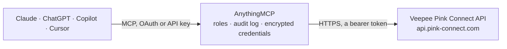

<!-- Generated by scripts/export-github-catalog.mjs in the anythingmcp-website repository. Do not edit by hand. -->

# Veepee Pink Connect MCP connector

Sell on Veepee and Privalia through Pink Connect from an AI agent: orders with lines, addresses, tracking and refunds, offers per sales channel, customer messages, return requests and carriers. The AnythingMCP connector gives Claude, ChatGPT, Microsoft Copilot, Cursor and Gemini 10 MCP tools for Veepee Pink Connect: 7 read and 3 can change data.

**Category:** [E-commerce](../e-commerce.md) · **Tools:** 10 · **Setup guide:** [anythingmcp.com](https://anythingmcp.com/guides/pink-connect-to-mcp) · [Deutsch](https://anythingmcp.com/de/guides/pink-connect-to-mcp) · [Italiano](https://anythingmcp.com/it/guides/pink-connect-to-mcp) · [Español](https://anythingmcp.com/es/guides/pink-connect-to-mcp) · [日本語](https://anythingmcp.com/ja/guides/pink-connect-to-mcp) · [Русский](https://anythingmcp.com/ru/guides/pink-connect-to-mcp) · [中文](https://anythingmcp.com/zh/guides/pink-connect-to-mcp)

## Start without code

No installation and no terminal: AnythingMCP Cloud runs the Veepee Pink Connect connector for you, operated by helpcode.ai in Frankfurt, Germany.

1. **Click the button above** and create an account or sign in. The Veepee Pink Connect connector opens, ready to install.
2. **Paste the API key or token from your Veepee Pink Connect account.** Every click is in the [step-by-step guide](https://anythingmcp.com/guides/pink-connect-to-mcp).
3. **Click Install.** AnythingMCP shows the address of your MCP server.
4. **Add that address to your assistant:** [Claude](https://anythingmcp.com/guides/connect-pink-connect-to-claude) · [ChatGPT](https://anythingmcp.com/guides/connect-pink-connect-to-chatgpt) · [Microsoft Copilot](https://anythingmcp.com/guides/connect-pink-connect-to-copilot) · [Cursor](https://anythingmcp.com/guides/connect-pink-connect-to-cursor) · [Gemini CLI](https://anythingmcp.com/guides/connect-pink-connect-to-gemini) · [Meta Muse](https://anythingmcp.com/guides/connect-pink-connect-to-muse).
5. **Ask your first question**, for example: *Find the Privalia order with marketplace code PR and marketplace order code 2026-4098.*

Prefer help with the setup? [Talk to us](https://anythingmcp.com/contact).

## How it works

- **The AI client** speaks MCP (Streamable HTTP) to AnythingMCP and only sees tool names, descriptions and results. It never gets the Veepee Pink Connect credentials.
- **AnythingMCP** checks the client's role, builds the call from the tool definition, adds the credentials (a bearer token), calls Veepee Pink Connect, logs the call and returns the result.
- **Veepee Pink Connect** sees an ordinary API client with the rights of the account the credentials belong to.

## Tools

| Tool | What it does | Access |
|---|---|---|
| [`pink_connect_list_orders`](#pink_connect_list_orders) | List Veepee and Privalia orders, oldest first: order id, marketplace and its order number, shop channel, status, order, update and shipping dates, totals… | read |
| [`pink_connect_get_order`](#pink_connect_get_order) | Get one Veepee or Privalia order by its Pink Connect order id (orderId, not the marketplace order number): status, dates, totals, shipping and billing… | read |
| [`pink_connect_list_offers`](#pink_connect_list_offers) | List your offers on one Veepee or Privalia shop channel: GTIN, SKU, name, brand, selling price, recommended price, discount with start and end, stock, price… | read |
| [`pink_connect_list_carriers`](#pink_connect_list_carriers) | List the carriers Pink Connect knows, with id and name (about 200). | read |
| [`pink_connect_list_notifications`](#pink_connect_list_notifications) | List customer messages (notifications) on your Veepee and Privalia orders: id, order id, subject, text, from (CUSTOMER or SELLER), to, status READ or… | read |
| [`pink_connect_get_notification`](#pink_connect_get_notification) | Get one customer message (notification) by id: order id, subject, text, sender and recipient, status, dates and attachments. | read |
| [`pink_connect_list_return_requests`](#pink_connect_list_return_requests) | List return requests: return request id, order and order line, marketplace return id and order number, GTIN, SKU, quantity, reason and details, request… | read |
| [`pink_connect_reply_notification`](#pink_connect_reply_notification) | Answer an existing customer message (notification) on Veepee or Privalia, with subject and text in the customer's language. | write |
| [`pink_connect_create_order_message`](#pink_connect_create_order_message) | Start a new conversation with the customer of an order on Veepee or Privalia (subject and text in the customer's language). | write |
| [`pink_connect_update_return_request`](#pink_connect_update_return_request) | Move a return request to a new status: PENDING to PROCESSING (accept) or REJECTED (refuse), PROCESSING to COMPLETE (goods received). | write |

## Tool reference

Every parameter as the AI client sees it in `tools/list`. Source: [`packages/backend/src/adapters/intl/pink-connect.json`](../../../packages/backend/src/adapters/intl/pink-connect.json).

### `pink_connect_list_orders`

List Veepee and Privalia orders, oldest first: order id, marketplace and its order number, shop channel, status, order, update and shipping dates, totals and currency, shipping and billing address, order lines with GTIN, SKU, price and line status, delivery details with carrier and tracking, refunds. Set updated_from for recent orders. Up to 100 per call, page with offset.

**Access:** read · **Call:** `GET /orders`

| Parameter | Type | Required | Description |
|---|---|---|---|
| `updated_from` | string | no | Only orders updated at or after this time, e.g. 2026-10-01T00:00:00. |
| `updated_to` | string | no | Only orders updated at or before this time, e.g. 2026-10-15T23:59:59. |
| `shop_channel_id` | integer | no | Only orders of this shop channel (shopChannelId of an order). |
| `marketplace_code` | string | no | Marketplace code, e.g. veepee_it; only together with marketplace_order_code. |
| `marketplace_order_code` | string | no | The marketplace's own order number; only together with marketplace_code. |
| `limit` | integer | no | Orders per call, 1 to 100. |
| `offset` | integer | no | Orders to skip, for paging. |

### `pink_connect_get_order`

Get one Veepee or Privalia order by its Pink Connect order id (orderId, not the marketplace order number): status, dates, totals, shipping and billing address, lines, delivery details with carrier and tracking, refunds and requested shipping method.

**Access:** read · **Call:** `GET /orders/{order_id}`

| Parameter | Type | Required | Description |
|---|---|---|---|
| `order_id` | string | yes | Pink Connect orderId from pink_connect_list_orders. |

### `pink_connect_list_offers`

List your offers on one Veepee or Privalia shop channel: GTIN, SKU, name, brand, selling price, recommended price, discount with start and end, stock, price list and marketplace status. 50 per call by default, page with offset.

**Access:** read · **Call:** `GET /offers`

| Parameter | Type | Required | Description |
|---|---|---|---|
| `shop_channel_id` | integer | yes | Shop channel id (shopChannelId of an order). |
| `limit` | integer | no | Offers per call, 1 to 100. |
| `offset` | integer | no | Offers to skip, for paging. |

### `pink_connect_list_carriers`

List the carriers Pink Connect knows, with id and name (about 200). The carrier id identifies the carrier in an order's delivery details. Changes rarely: read it once per conversation.

**Access:** read · **Call:** `GET /carriers`

No parameters.

### `pink_connect_list_notifications`

List customer messages (notifications) on your Veepee and Privalia orders: id, order id, subject, text, from (CUSTOMER or SELLER), to, status READ or UNREAD, creation and update date and attachments. Filter by order or update date; without a filter the call can take half a minute.

**Access:** read · **Call:** `GET /notifications`

| Parameter | Type | Required | Description |
|---|---|---|---|
| `order_id` | string | no | Only messages of this Pink Connect orderId. |
| `updated_from` | string | no | Only messages updated at or after this time, e.g. 2026-10-09T00:00:00. |
| `updated_to` | string | no | Only messages updated at or before this time. |
| `limit` | integer | no | Messages per call, 1 to 100. |
| `offset` | integer | no | Messages to skip, for paging. |

### `pink_connect_get_notification`

Get one customer message (notification) by id: order id, subject, text, sender and recipient, status, dates and attachments.

**Access:** read · **Call:** `GET /notifications/{notification_id}`

| Parameter | Type | Required | Description |
|---|---|---|---|
| `notification_id` | string | yes | Notification id from pink_connect_list_notifications. |

### `pink_connect_list_return_requests`

List return requests: return request id, order and order line, marketplace return id and order number, GTIN, SKU, quantity, reason and details, request date, status (PENDING, PROCESSING, REJECTED, COMPLETE, CANCELLED) and type (e.g. HOMEPICKUP). Up to 100 per call, page with offset.

**Access:** read · **Call:** `GET /return-requests`

| Parameter | Type | Required | Description |
|---|---|---|---|
| `status` | `PENDING` \| `PROCESSING` \| `REJECTED` \| `COMPLETE` \| `CANCELLED` | no | Only return requests in this status. |
| `order_id` | string | no | Only return requests of this Pink Connect orderId. |
| `limit` | integer | no | Return requests per call, 1 to 100. |
| `offset` | integer | no | Return requests to skip, for paging. |

### `pink_connect_reply_notification`

Answer an existing customer message (notification) on Veepee or Privalia, with subject and text in the customer's language. Installed switched off; reaches a real customer: show the user the text and get a yes first.

**Access:** write · **Call:** `POST /notifications/{notification_id}`

| Parameter | Type | Required | Description |
|---|---|---|---|
| `notification_id` | string | yes | Id of the message to answer. |
| `subject` | string | yes | Subject of the reply. |
| `message` | string | yes | Text of the reply, in the customer's language. |

### `pink_connect_create_order_message`

Start a new conversation with the customer of an order on Veepee or Privalia (subject and text in the customer's language). Use only when the order has no conversation yet; otherwise reply with pink_connect_reply_notification. Installed switched off; get a yes from the user first.

**Access:** write · **Call:** `POST /orders/{order_id}/notifications`

| Parameter | Type | Required | Description |
|---|---|---|---|
| `order_id` | string | yes | Pink Connect orderId. |
| `subject` | string | yes | Subject. |
| `message` | string | yes | Text, in the customer's language. |

### `pink_connect_update_return_request`

Move a return request to a new status: PENDING to PROCESSING (accept) or REJECTED (refuse), PROCESSING to COMPLETE (goods received). Does not refund. Installed switched off; show the user the return and the new status and get a yes first.

**Access:** write · **Call:** `PUT /return-requests/{return_request_id}/{new_status}`

| Parameter | Type | Required | Description |
|---|---|---|---|
| `return_request_id` | string | yes | returnRequestId from pink_connect_list_return_requests. |
| `new_status` | `PROCESSING` \| `REJECTED` \| `COMPLETE` | yes | New status. |

## Run it yourself

AnythingMCP is open source (AGPL-3.0). [Run it with Docker](../../../README.md#run-it-yourself), open **Connectors → Store**, pick **Veepee Pink Connect** and enter `PINK_CONNECT_TOKEN`, then add your MCP server URL to the AI client.

[← E-commerce connectors](../e-commerce.md) · [All categories](../README.md)
