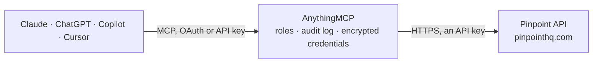

<!-- Generated by scripts/export-github-catalog.mjs in the anythingmcp-website repository. Do not edit by hand. -->

# Pinpoint MCP connector

Pinpoint applicant tracking (ATS): jobs, job postings, hiring workflows and stages, applications, candidates, interviews, comments, scorecards, requisitions, users and company structure. The AnythingMCP connector gives Claude, ChatGPT, Microsoft Copilot, Cursor and Gemini 19 MCP tools for Pinpoint: 17 read and 2 can change data.

**Category:** [HR](../hr.md) · **Tools:** 19 · **Setup guide:** [anythingmcp.com](https://anythingmcp.com/guides/pinpoint-to-mcp) · [Deutsch](https://anythingmcp.com/de/guides/pinpoint-to-mcp) · [Italiano](https://anythingmcp.com/it/guides/pinpoint-to-mcp) · [Español](https://anythingmcp.com/es/guides/pinpoint-to-mcp) · [日本語](https://anythingmcp.com/ja/guides/pinpoint-to-mcp) · [Русский](https://anythingmcp.com/ru/guides/pinpoint-to-mcp) · [中文](https://anythingmcp.com/zh/guides/pinpoint-to-mcp)

## Start without code

No installation and no terminal: AnythingMCP Cloud runs the Pinpoint connector for you, operated by helpcode.ai in Frankfurt, Germany.

1. **Click the button above** and create an account or sign in. The Pinpoint connector opens, ready to install.
2. **Paste the API key or token from your Pinpoint account.** Every click is in the [step-by-step guide](https://anythingmcp.com/guides/pinpoint-to-mcp).
3. **Click Install.** AnythingMCP shows the address of your MCP server.
4. **Add that address to your assistant:** [Claude](https://anythingmcp.com/guides/connect-pinpoint-to-claude) · [ChatGPT](https://anythingmcp.com/guides/connect-pinpoint-to-chatgpt) · [Microsoft Copilot](https://anythingmcp.com/guides/connect-pinpoint-to-copilot) · [Cursor](https://anythingmcp.com/guides/connect-pinpoint-to-cursor) · [Gemini CLI](https://anythingmcp.com/guides/connect-pinpoint-to-gemini) · [Meta Muse](https://anythingmcp.com/guides/connect-pinpoint-to-muse).
5. **Ask your first question**, for example: *Show application 4721 for 'Customer Success Manager' — who is the candidate and which stage is it in?*

Prefer help with the setup? [Talk to us](https://anythingmcp.com/contact).

## How it works

- **The AI client** speaks MCP (Streamable HTTP) to AnythingMCP and only sees tool names, descriptions and results. It never gets the Pinpoint credentials.
- **AnythingMCP** checks the client's role, builds the call from the tool definition, adds the credentials (an API key), calls Pinpoint, logs the call and returns the result.
- **Pinpoint** sees an ordinary API client with the rights of the account the credentials belong to.

## Tools

| Tool | What it does | Access |
|---|---|---|
| [`pinpoint_list_jobs`](#pinpoint_list_jobs) | List jobs (vacancies) with title, status, visibility, employment type, workplace type and dates. | read |
| [`pinpoint_get_job`](#pinpoint_get_job) | Return one job by id with its attributes; use include to embed the hiring stages, job postings, questions, managers, department and location. | read |
| [`pinpoint_list_applications`](#pinpoint_list_applications) | List applications (a candidate applying to a job) with stage, status dates, source and contact details. | read |
| [`pinpoint_get_application`](#pinpoint_get_application) | Return one application by id; include=stage,candidate,job,answers,offers,comments embeds the current stage, the candidate, the job, screening answers,… | read |
| [`pinpoint_list_candidates`](#pinpoint_list_candidates) | List candidates (people, across all their applications) with name, e-mail, phone and timestamps. | read |
| [`pinpoint_get_candidate`](#pinpoint_get_candidate) | Return one candidate by id with contact details; include=applications lists every application of this person. | read |
| [`pinpoint_list_comments`](#pinpoint_list_comments) | List comments (internal notes) with text, author and date. | read |
| [`pinpoint_list_interviews`](#pinpoint_list_interviews) | List scheduled interviews with start and end time, attendance (attended, no_show) and the stage. | read |
| [`pinpoint_get_interview`](#pinpoint_get_interview) | Return one interview by id with its times, attendance and, with include, the stage, the interview parts and the application interviewed. | read |
| [`pinpoint_list_hiring_workflows`](#pinpoint_list_hiring_workflows) | List hiring workflows (the stage pipelines jobs use). | read |
| [`pinpoint_list_job_postings`](#pinpoint_list_job_postings) | List job postings (the adverts of a job on the careers site and job boards) with title, status, employment and workplace type. | read |
| [`pinpoint_list_departments`](#pinpoint_list_departments) | List the company's departments with id and name. | read |
| [`pinpoint_list_divisions`](#pinpoint_list_divisions) | List the company's divisions with id and name, the level above departments in Pinpoint's company structure. | read |
| [`pinpoint_list_locations`](#pinpoint_list_locations) | List the company's locations with id, name and address. | read |
| [`pinpoint_list_users`](#pinpoint_list_users) | List Pinpoint users (recruiters, hiring managers, interviewers) with name, e-mail and role. | read |
| [`pinpoint_list_scorecards`](#pinpoint_list_scorecards) | List the interview scorecard templates with their sections and the stages they apply to (use include). | read |
| [`pinpoint_list_requisitions`](#pinpoint_list_requisitions) | List job requisitions (approved requests to hire) with identifier, status and dates. | read |
| [`pinpoint_add_comment`](#pinpoint_add_comment) | Add an internal comment (note) to an application, a candidate or a job seeker. | write |
| [`pinpoint_move_application_stage`](#pinpoint_move_application_stage) | Move an application to another stage of its hiring workflow, e.g. from review to interview. | write |

## Tool reference

Every parameter as the AI client sees it in `tools/list`. Source: [`packages/backend/src/adapters/gb/pinpoint.json`](../../../packages/backend/src/adapters/gb/pinpoint.json).

### `pinpoint_list_jobs`

List jobs (vacancies) with title, status, visibility, employment type, workplace type and dates. Filter by status, department, location or a search term; add include=stages for the hiring stages.

**Access:** read · **Call:** `GET /jobs`

| Parameter | Type | Required | Description |
|---|---|---|---|
| `status` | string | no | Job status, comma-separated: open, closed, archived, pending_approval, draft, hold, cancelled, filled, preview. |
| `visibility` | string | no | Comma-separated: internal, external, confidential, private_job. Confidential jobs are left out unless named here. |
| `department_id` | string | no | Only jobs of this department id (pinpoint_list_departments). |
| `location_id` | string | no | Only jobs of this location id (pinpoint_list_locations). |
| `hiring_manager_user_id` | string | no | Only jobs whose hiring manager is this user id (pinpoint_list_users). |
| `search` | string | no | Free-text search on the job. |
| `include` | string | no | Comma-separated related resources to embed (JSON:API include): department, division, location, company, hiring_manager_user, recruitment_manager_user, creator_user, job_postings, questions, custom_attributes, stages, applications. |
| `updated_after` | string | no | Only records updated after this time, ISO 8601, e.g. 2026-09-01T00:00:00Z. |
| `created_after` | string | no | Only records created after this time, ISO 8601. |
| `sort` | string | no | Sort key; prefix with - for descending. One of: id, created_at, updated_at, opened_at. |
| `page` | integer | no | Page number, starting at 1. |
| `page_size` | integer | no | Records per page, default 100, at most 1000. Use small pages (10 to 50) for a first look. |

### `pinpoint_get_job`

Return one job by id with its attributes; use include to embed the hiring stages, job postings, questions, managers, department and location.

**Access:** read · **Call:** `GET /jobs/{id}`

| Parameter | Type | Required | Description |
|---|---|---|---|
| `id` | string | yes | Job id from pinpoint_list_jobs. |
| `include` | string | no | Comma-separated related resources to embed (JSON:API include): department, division, location, company, hiring_manager_user, recruitment_manager_user, creator_user, job_postings, questions, custom_attributes, stages, applications. |

### `pinpoint_list_applications`

List applications (a candidate applying to a job) with stage, status dates, source and contact details. Filter by job, stage, stage type (applied, review, interview, offer, hired, rejected), candidate or e-mail.

**Access:** read · **Call:** `GET /applications`

| Parameter | Type | Required | Description |
|---|---|---|---|
| `job_id` | string | no | Only applications to this job id. |
| `stage_id` | string | no | Only applications currently in this stage id (stages come from pinpoint_get_job or pinpoint_list_hiring_workflows with include=stages). |
| `stage_basic_type` | string | no | Comma-separated stage types: applied, review, interview, offer, hired, rejected. |
| `candidate_id` | string | no | Only applications of this candidate id. |
| `candidate_email` | string | no | Only applications whose candidate has this e-mail address. |
| `include` | string | no | Comma-separated related resources to embed (JSON:API include): job, job_posting, stage, furthest_stage, candidate, offers, answers, custom_attributes, scorecard_ratings, scorecard_notes, user_scorecards, comments, resume, onboarding_application, document_requests. |
| `updated_after` | string | no | Only records updated after this time, ISO 8601, e.g. 2026-09-01T00:00:00Z. |
| `created_after` | string | no | Only records created after this time, ISO 8601. |
| `sort` | string | no | Sort key; prefix with - for descending. One of: id, created_at, updated_at. |
| `page` | integer | no | Page number, starting at 1. |
| `page_size` | integer | no | Records per page, default 100, at most 1000. Use small pages (10 to 50) for a first look. |

### `pinpoint_get_application`

Return one application by id; include=stage,candidate,job,answers,offers,comments embeds the current stage, the candidate, the job, screening answers, offers and comments.

**Access:** read · **Call:** `GET /applications/{id}`

| Parameter | Type | Required | Description |
|---|---|---|---|
| `id` | string | yes | Application id from pinpoint_list_applications. |
| `include` | string | no | Comma-separated related resources to embed (JSON:API include): job, job_posting, stage, furthest_stage, candidate, offers, answers, custom_attributes, scorecard_ratings, scorecard_notes, user_scorecards, comments, resume, onboarding_application, document_requests. |

### `pinpoint_list_candidates`

List candidates (people, across all their applications) with name, e-mail, phone and timestamps. Use updated_after for recent changes, or include=applications to see where each applied.

**Access:** read · **Call:** `GET /candidates`

| Parameter | Type | Required | Description |
|---|---|---|---|
| `phone` | string | no | Only candidates with this phone number. |
| `blocked` | boolean | no | true for blocked candidates only, false to exclude them. |
| `include` | string | no | Comma-separated related resources to embed (JSON:API include): applications, job_seekers, skills, custom_attributes, hris_references. |
| `updated_after` | string | no | Only records updated after this time, ISO 8601, e.g. 2026-09-01T00:00:00Z. |
| `created_after` | string | no | Only records created after this time, ISO 8601. |
| `sort` | string | no | Sort key; prefix with - for descending. One of: id, created_at, updated_at. |
| `page` | integer | no | Page number, starting at 1. |
| `page_size` | integer | no | Records per page, default 100, at most 1000. Use small pages (10 to 50) for a first look. |

### `pinpoint_get_candidate`

Return one candidate by id with contact details; include=applications lists every application of this person.

**Access:** read · **Call:** `GET /candidates/{id}`

| Parameter | Type | Required | Description |
|---|---|---|---|
| `id` | string | yes | Candidate id from pinpoint_list_candidates or an application's candidate relationship. |
| `include` | string | no | Comma-separated related resources to embed (JSON:API include): applications, job_seekers, skills, custom_attributes, hris_references. |

### `pinpoint_list_comments`

List comments (internal notes) with text, author and date. Filter by what they are attached to, e.g. commentable_type Application with the application id.

**Access:** read · **Call:** `GET /comments`

| Parameter | Type | Required | Description |
|---|---|---|---|
| `commentable_type` | `Application` \| `Candidate` \| `JobSeeker` \| `Job` \| `Task` \| `ReferenceCheckSubmission` \| `PinpointCheckOrder` | no | Type the comments belong to: Application, Candidate, JobSeeker, Job, Task, ReferenceCheckSubmission or PinpointCheckOrder. |
| `commentable_id` | string | no | Id of the record the comments belong to; use together with commentable_type. |
| `include` | string | no | Comma-separated related resources to embed (JSON:API include): user, commentable. |
| `updated_after` | string | no | Only records updated after this time, ISO 8601, e.g. 2026-09-01T00:00:00Z. |
| `created_after` | string | no | Only records created after this time, ISO 8601. |
| `sort` | string | no | Sort key; prefix with - for descending. One of: id, created_at, updated_at. |
| `page` | integer | no | Page number, starting at 1. |
| `page_size` | integer | no | Records per page, default 100, at most 1000. Use small pages (10 to 50) for a first look. |

### `pinpoint_list_interviews`

List scheduled interviews with start and end time, attendance (attended, no_show) and the stage. Filter by start time window or by the application interviewed.

**Access:** read · **Call:** `GET /interviews`

| Parameter | Type | Required | Description |
|---|---|---|---|
| `start_after` | string | no | Only interviews starting after this time, ISO 8601. |
| `start_before` | string | no | Only interviews starting before this time, ISO 8601. |
| `interviewable_type` | string | no | Type of record interviewed, usually Application. |
| `interviewable_id` | string | no | Id of that record, e.g. an application id. |
| `presence` | `attended` \| `no_show` | no | attended or no_show. |
| `include` | string | no | Comma-separated related resources to embed (JSON:API include): stage, interview_parts, interviewable. |
| `sort` | string | no | Sort key; prefix with - for descending. One of: id, created_at, updated_at, start_at. |
| `page` | integer | no | Page number, starting at 1. |
| `page_size` | integer | no | Records per page, default 100, at most 1000. Use small pages (10 to 50) for a first look. |

### `pinpoint_get_interview`

Return one interview by id with its times, attendance and, with include, the stage, the interview parts and the application interviewed.

**Access:** read · **Call:** `GET /interviews/{id}`

| Parameter | Type | Required | Description |
|---|---|---|---|
| `id` | string | yes | Interview id from pinpoint_list_interviews. |
| `include` | string | no | Comma-separated related resources to embed (JSON:API include): stage, interview_parts, interviewable. |

### `pinpoint_list_hiring_workflows`

List hiring workflows (the stage pipelines jobs use). include defaults to stages, so each workflow comes with its ordered stages and their ids for filtering applications.

**Access:** read · **Call:** `GET /hiring_workflows`

| Parameter | Type | Required | Description |
|---|---|---|---|
| `include` | string | no | Related resources to embed; "stages" (default) adds the workflow's stages. |
| `sort` | string | no | Sort key; prefix with - for descending. One of: id, created_at, updated_at. |
| `page` | integer | no | Page number, starting at 1. |
| `page_size` | integer | no | Records per page, default 100, at most 1000. Use small pages (10 to 50) for a first look. |

### `pinpoint_list_job_postings`

List job postings (the adverts of a job on the careers site and job boards) with title, status, employment and workplace type. Filter by job, status or location.

**Access:** read · **Call:** `GET /job_postings`

| Parameter | Type | Required | Description |
|---|---|---|---|
| `job_id` | string | no | Only postings of this job id. |
| `status` | string | no | Posting status, e.g. published. |
| `location_id` | string | no | Only postings for this location id. |
| `include` | string | no | Comma-separated related resources to embed, e.g. job. |
| `sort` | string | no | Sort key; prefix with - for descending. One of: id, created_at, updated_at. |
| `page` | integer | no | Page number, starting at 1. |
| `page_size` | integer | no | Records per page, default 100, at most 1000. Use small pages (10 to 50) for a first look. |

### `pinpoint_list_departments`

List the company's departments with id and name. Use the id to filter jobs and job postings by department.

**Access:** read · **Call:** `GET /departments`

| Parameter | Type | Required | Description |
|---|---|---|---|
| `updated_after` | string | no | Only records updated after this time, ISO 8601, e.g. 2026-09-01T00:00:00Z. |
| `created_after` | string | no | Only records created after this time, ISO 8601. |
| `sort` | string | no | Sort key; prefix with - for descending. One of: id, created_at, updated_at. |
| `page` | integer | no | Page number, starting at 1. |
| `page_size` | integer | no | Records per page, default 100, at most 1000. Use small pages (10 to 50) for a first look. |

### `pinpoint_list_divisions`

List the company's divisions with id and name, the level above departments in Pinpoint's company structure.

**Access:** read · **Call:** `GET /divisions`

| Parameter | Type | Required | Description |
|---|---|---|---|
| `updated_after` | string | no | Only records updated after this time, ISO 8601, e.g. 2026-09-01T00:00:00Z. |
| `created_after` | string | no | Only records created after this time, ISO 8601. |
| `sort` | string | no | Sort key; prefix with - for descending. One of: id, created_at, updated_at. |
| `page` | integer | no | Page number, starting at 1. |
| `page_size` | integer | no | Records per page, default 100, at most 1000. Use small pages (10 to 50) for a first look. |

### `pinpoint_list_locations`

List the company's locations with id, name and address. Use the id to filter jobs and job postings by location.

**Access:** read · **Call:** `GET /locations`

| Parameter | Type | Required | Description |
|---|---|---|---|
| `include` | string | no | Comma-separated related resources to embed. |
| `sort` | string | no | Sort key; prefix with - for descending. One of: id, created_at, updated_at. |
| `page` | integer | no | Page number, starting at 1. |
| `page_size` | integer | no | Records per page, default 100, at most 1000. Use small pages (10 to 50) for a first look. |

### `pinpoint_list_users`

List Pinpoint users (recruiters, hiring managers, interviewers) with name, e-mail and role. Filter by e-mail or by the job they manage; the id is used for comment authors.

**Access:** read · **Call:** `GET /users`

| Parameter | Type | Required | Description |
|---|---|---|---|
| `email` | string | no | Only the user with this e-mail address. |
| `hiring_manager_job_id` | string | no | Only the hiring managers of this job id. |
| `interviewing_user_id` | string | no | Filter by interviewing user id. |
| `sort` | string | no | Sort key; prefix with - for descending. One of: id, created_at, updated_at. |
| `page` | integer | no | Page number, starting at 1. |
| `page_size` | integer | no | Records per page, default 100, at most 1000. Use small pages (10 to 50) for a first look. |

### `pinpoint_list_scorecards`

List the interview scorecard templates with their sections and the stages they apply to (use include). Filled-in ratings are on the application, via include=user_scorecards.

**Access:** read · **Call:** `GET /scorecards`

| Parameter | Type | Required | Description |
|---|---|---|---|
| `include` | string | no | Comma-separated related resources to embed (JSON:API include): scorecard_sections, scorecard_notes, user_scorecards, stages. |
| `sort` | string | no | Sort key; prefix with - for descending. One of: id, created_at, updated_at. |
| `page` | integer | no | Page number, starting at 1. |
| `page_size` | integer | no | Records per page, default 100, at most 1000. Use small pages (10 to 50) for a first look. |

### `pinpoint_list_requisitions`

List job requisitions (approved requests to hire) with identifier, status and dates. Jobs can be filtered by requisition id in pinpoint_list_jobs.

**Access:** read · **Call:** `GET /requisitions`

| Parameter | Type | Required | Description |
|---|---|---|---|
| `identifier` | string | no | Only the requisition with this identifier. |
| `include` | string | no | Comma-separated related resources to embed. |
| `sort` | string | no | Sort key; prefix with - for descending. One of: id, created_at, updated_at. |
| `page` | integer | no | Page number, starting at 1. |
| `page_size` | integer | no | Records per page, default 100, at most 1000. Use small pages (10 to 50) for a first look. |

### `pinpoint_add_comment`

Add an internal comment (note) to an application, a candidate or a job seeker. The note is visible to the hiring team in Pinpoint, not to the candidate.

**Access:** write · **Call:** `POST /comments`

| Parameter | Type | Required | Description |
|---|---|---|---|
| `commentable_type` | `applications` \| `candidates` \| `job_seekers` | yes | What the comment is attached to. |
| `commentable_id` | string | yes | Id of that application, candidate or job seeker. |
| `body_text` | string | yes | Text of the comment. |

### `pinpoint_move_application_stage`

Move an application to another stage of its hiring workflow, e.g. from review to interview. Stage moves can trigger the automatic e-mails configured on that stage.

**Access:** write · **Call:** `PUT /applications/{id}`

| Parameter | Type | Required | Description |
|---|---|---|---|
| `id` | string | yes | Application id. |
| `stage_id` | string | yes | Target stage id from the job's stages (pinpoint_get_job with include=stages). |

## Run it yourself

AnythingMCP is open source (AGPL-3.0). [Run it with Docker](../../../README.md#run-it-yourself), open **Connectors → Store**, pick **Pinpoint** and enter `PINPOINT_SUBDOMAIN`, `PINPOINT_API_KEY`, then add your MCP server URL to the AI client.

[← HR connectors](../hr.md) · [All categories](../README.md)
