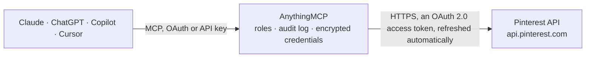

<!-- Generated by scripts/export-github-catalog.mjs in the anythingmcp-website repository. Do not edit by hand. -->

# Pinterest MCP connector

Manage Pinterest (boards, pins, search, ads, audiences) from any AI agent via Business API. 9 tools, OAuth2 token. The AnythingMCP connector gives Claude, ChatGPT, Microsoft Copilot, Cursor and Gemini 9 MCP tools for Pinterest: 6 read and 3 can change data.

**Category:** [Social Media](../social.md) · **Tools:** 9 · **Setup guide:** [anythingmcp.com](https://anythingmcp.com/guides/pinterest-to-mcp) · [Deutsch](https://anythingmcp.com/de/guides/pinterest-to-mcp) · [Italiano](https://anythingmcp.com/it/guides/pinterest-to-mcp) · [Español](https://anythingmcp.com/es/guides/pinterest-to-mcp) · [日本語](https://anythingmcp.com/ja/guides/pinterest-to-mcp) · [Русский](https://anythingmcp.com/ru/guides/pinterest-to-mcp) · [中文](https://anythingmcp.com/zh/guides/pinterest-to-mcp)

## Start without code

No installation and no terminal: AnythingMCP Cloud runs the Pinterest connector for you, operated by helpcode.ai in Frankfurt, Germany.

1. **Click the button above** and create an account or sign in. The Pinterest connector opens, ready to install.
2. **Sign in with your Pinterest account** when AnythingMCP asks. The first time, an admin creates a small app in the Pinterest developer console. Every click is in the [step-by-step guide](https://anythingmcp.com/guides/pinterest-to-mcp).
3. **Click Install.** AnythingMCP shows the address of your MCP server.
4. **Add that address to your assistant:** [Claude](https://anythingmcp.com/guides/connect-pinterest-to-claude) · [ChatGPT](https://anythingmcp.com/guides/connect-pinterest-to-chatgpt) · [Microsoft Copilot](https://anythingmcp.com/guides/connect-pinterest-to-copilot) · [Cursor](https://anythingmcp.com/guides/connect-pinterest-to-cursor) · [Gemini CLI](https://anythingmcp.com/guides/connect-pinterest-to-gemini) · [Meta Muse](https://anythingmcp.com/guides/connect-pinterest-to-muse).
5. **Ask your first question**, for example: *Show me the 'Spring 2026 Product Launch' board details and how many pins it currently has*

Prefer help with the setup? [Talk to us](https://anythingmcp.com/contact).

## How it works

- **The AI client** speaks MCP (Streamable HTTP) to AnythingMCP and only sees tool names, descriptions and results. It never gets the Pinterest credentials.
- **AnythingMCP** checks the client's role, builds the call from the tool definition, adds the credentials (an OAuth 2.0 access token, refreshed automatically), calls Pinterest, logs the call and returns the result.
- **Pinterest** sees an ordinary API client with the rights of the account the credentials belong to.

## Tools

| Tool | What it does | Access |
|---|---|---|
| [`pinterest_user_account`](#pinterest_user_account) | Get the authenticated user's account (username, account_type, profile_image, board_count, follower_count). | read |
| [`pinterest_list_boards`](#pinterest_list_boards) | List the authenticated user's boards. | read |
| [`pinterest_get_board`](#pinterest_get_board) | Get a single board with section + pin counts. | read |
| [`pinterest_create_board`](#pinterest_create_board) | Create a board. | write |
| [`pinterest_list_board_pins`](#pinterest_list_board_pins) | List pins in a board. | read |
| [`pinterest_get_pin`](#pinterest_get_pin) | Get a single pin with full media info. | read |
| [`pinterest_create_pin`](#pinterest_create_pin) | Create a pin on a board from an external image URL. | write |
| [`pinterest_delete_pin`](#pinterest_delete_pin) | Delete a pin. | write |
| [`pinterest_search_pins`](#pinterest_search_pins) | Search the authenticated user's pins (across all their boards) by free-text query. | read |

## Tool reference

Every parameter as the AI client sees it in `tools/list`. Source: [`packages/backend/src/adapters/intl/pinterest.json`](../../../packages/backend/src/adapters/intl/pinterest.json).

### `pinterest_user_account`

Get the authenticated user's account (username, account_type, profile_image, board_count, follower_count).

**Access:** read · **Call:** `GET /user_account`

No parameters.

### `pinterest_list_boards`

List the authenticated user's boards.

**Access:** read · **Call:** `GET /boards`

| Parameter | Type | Required | Description |
|---|---|---|---|
| `page_size` | integer | no | Max 100. |
| `bookmark` | string | no | Cursor. |
| `privacy` | string | no | PUBLIC, SECRET, PROTECTED. |

### `pinterest_get_board`

Get a single board with section + pin counts.

**Access:** read · **Call:** `GET /boards/{board_id}`

| Parameter | Type | Required | Description |
|---|---|---|---|
| `board_id` | string | yes | Board ID. |

### `pinterest_create_board`

Create a board.

**Access:** write · **Call:** `POST /boards`

| Parameter | Type | Required | Description |
|---|---|---|---|
| `name` | string | yes | Board name. |
| `description` | string | no | Description. |
| `privacy` | string | no | PUBLIC, SECRET, PROTECTED. |

### `pinterest_list_board_pins`

List pins in a board.

**Access:** read · **Call:** `GET /boards/{board_id}/pins`

| Parameter | Type | Required | Description |
|---|---|---|---|
| `board_id` | string | yes | Board ID. |
| `page_size` | integer | no | Max 100. |
| `bookmark` | string | no | Cursor. |

### `pinterest_get_pin`

Get a single pin with full media info.

**Access:** read · **Call:** `GET /pins/{pin_id}`

| Parameter | Type | Required | Description |
|---|---|---|---|
| `pin_id` | string | yes | Pin ID. |

### `pinterest_create_pin`

Create a pin on a board from an external image URL. For uploading from a file, use the dedicated media upload endpoint (out of scope here).

**Access:** write · **Call:** `POST /pins`

| Parameter | Type | Required | Description |
|---|---|---|---|
| `board_id` | string | yes | Board ID. |
| `title` | string | no | Pin title. |
| `description` | string | no | Description. |
| `link` | string | no | Destination URL when the pin is clicked. |
| `alt_text` | string | no | Alt text for accessibility. |
| `image_url` | string | yes | Public URL of the image to pin. |
| `board_section_id` | string | no | Section ID inside the board. |

### `pinterest_delete_pin`

Delete a pin.

**Access:** write · **Call:** `DELETE /pins/{pin_id}`

| Parameter | Type | Required | Description |
|---|---|---|---|
| `pin_id` | string | yes | Pin ID. |

### `pinterest_search_pins`

Search the authenticated user's pins (across all their boards) by free-text query.

**Access:** read · **Call:** `GET /search/pins`

| Parameter | Type | Required | Description |
|---|---|---|---|
| `query` | string | yes | Search query. |
| `page_size` | integer | no | Max 100. |
| `bookmark` | string | no | Cursor. |

## Run it yourself

AnythingMCP is open source (AGPL-3.0). [Run it with Docker](../../../README.md#run-it-yourself), open **Connectors → Store**, pick **Pinterest** and enter `PINTEREST_CLIENT_ID`, `PINTEREST_CLIENT_SECRET`, then add your MCP server URL to the AI client.

[← Social Media connectors](../social.md) · [All categories](../README.md)
