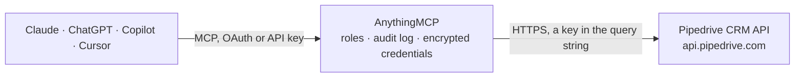

<!-- Generated by scripts/export-github-catalog.mjs in the anythingmcp-website repository. Do not edit by hand. -->

# Pipedrive CRM MCP connector

Drive Pipedrive (CRM) from any AI agent: search and manage deals, persons, organizations, activities, pipelines, and stages, with ready-to-use tools for the most common sales workflows. The AnythingMCP connector gives Claude, ChatGPT, Microsoft Copilot, Cursor and Gemini 22 MCP tools for Pipedrive CRM: 15 read and 7 can change data.

**Category:** [CRM](../crm.md) · **Tools:** 22 · **Setup guide:** [anythingmcp.com](https://anythingmcp.com/guides/pipedrive-to-mcp) · [Deutsch](https://anythingmcp.com/de/guides/pipedrive-to-mcp) · [Italiano](https://anythingmcp.com/it/guides/pipedrive-to-mcp) · [Español](https://anythingmcp.com/es/guides/pipedrive-to-mcp) · [日本語](https://anythingmcp.com/ja/guides/pipedrive-to-mcp) · [Русский](https://anythingmcp.com/ru/guides/pipedrive-to-mcp) · [中文](https://anythingmcp.com/zh/guides/pipedrive-to-mcp)

## Start without code

No installation and no terminal: AnythingMCP Cloud runs the Pipedrive CRM connector for you, operated by helpcode.ai in Frankfurt, Germany.

1. **Click the button above** and create an account or sign in. The Pipedrive CRM connector opens, ready to install.
2. **Paste the API key or token from your Pipedrive CRM account.** Every click is in the [step-by-step guide](https://anythingmcp.com/guides/pipedrive-to-mcp).
3. **Click Install.** AnythingMCP shows the address of your MCP server.
4. **Add that address to your assistant:** [Claude](https://anythingmcp.com/guides/connect-pipedrive-to-claude) · [ChatGPT](https://anythingmcp.com/guides/connect-pipedrive-to-chatgpt) · [Microsoft Copilot](https://anythingmcp.com/guides/connect-pipedrive-to-copilot) · [Cursor](https://anythingmcp.com/guides/connect-pipedrive-to-cursor) · [Gemini CLI](https://anythingmcp.com/guides/connect-pipedrive-to-gemini) · [Meta Muse](https://anythingmcp.com/guides/connect-pipedrive-to-muse).
5. **Ask your first question**, for example: *Open deal 4219 (Q3 Supply MX-900 for Novatech GmbH): what's status, value, owner and expected close date?*

Prefer help with the setup? [Talk to us](https://anythingmcp.com/contact).

## How it works

- **The AI client** speaks MCP (Streamable HTTP) to AnythingMCP and only sees tool names, descriptions and results. It never gets the Pipedrive CRM credentials.
- **AnythingMCP** checks the client's role, builds the call from the tool definition, adds the credentials (a key in the query string), calls Pipedrive CRM, logs the call and returns the result.
- **Pipedrive CRM** sees an ordinary API client with the rights of the account the credentials belong to.

## Tools

| Tool | What it does | Access |
|---|---|---|
| [`pipedrive_search`](#pipedrive_search) | Universal fuzzy search across deals, persons, organizations, products, files, mailbox messages and projects in one call. | read |
| [`pipedrive_list_deals`](#pipedrive_list_deals) | List deals with optional filtering by owner, person, organization, pipeline, stage, status. | read |
| [`pipedrive_get_deal`](#pipedrive_get_deal) | Fetch a single deal by its numeric ID. | read |
| [`pipedrive_create_deal`](#pipedrive_create_deal) | Create a new deal. | write |
| [`pipedrive_update_deal`](#pipedrive_update_deal) | Partial-update a deal — only pass the fields you want to change. | write |
| [`pipedrive_delete_deal`](#pipedrive_delete_deal) | Soft-delete a deal. | write |
| [`pipedrive_search_deals`](#pipedrive_search_deals) | Narrower search than pipedrive_search — only looks inside deals (title and custom fields). | read |
| [`pipedrive_list_persons`](#pipedrive_list_persons) | List persons (contacts) with optional filtering by owner, organization, or label. | read |
| [`pipedrive_get_person`](#pipedrive_get_person) | Fetch a single person by ID. | read |
| [`pipedrive_create_person`](#pipedrive_create_person) | Create a new person (contact). | write |
| [`pipedrive_update_person`](#pipedrive_update_person) | Partial-update a person. | write |
| [`pipedrive_list_organizations`](#pipedrive_list_organizations) | List organizations (companies) with optional filtering by owner or saved filter. | read |
| [`pipedrive_create_organization`](#pipedrive_create_organization) | Create a new organization. | write |
| [`pipedrive_list_activities`](#pipedrive_list_activities) | List activities (calls, meetings, tasks, emails, etc.) with optional filtering by user, deal, person, type or date range. | read |
| [`pipedrive_create_activity`](#pipedrive_create_activity) | Log an activity (call, meeting, task, email, etc.). | write |
| [`pipedrive_list_pipelines`](#pipedrive_list_pipelines) | List all pipelines on this Pipedrive account. | read |
| [`pipedrive_list_stages`](#pipedrive_list_stages) | List stages, optionally filtered by pipeline. | read |
| [`pipedrive_list_users`](#pipedrive_list_users) | List users on this Pipedrive account (sales reps, admins). | read |
| [`pipedrive_get_current_user`](#pipedrive_get_current_user) | Return the user account that the API token belongs to (whoami). | read |
| [`pipedrive_list_deal_fields`](#pipedrive_list_deal_fields) | List all deal fields including custom fields with their API keys, types, and pick-list options. | read |
| [`pipedrive_list_person_fields`](#pipedrive_list_person_fields) | List all person fields including custom fields with their API keys. | read |
| [`pipedrive_list_organization_fields`](#pipedrive_list_organization_fields) | List all organization fields including custom fields with their API keys. | read |

## Tool reference

Every parameter as the AI client sees it in `tools/list`. Source: [`packages/backend/src/adapters/intl/pipedrive.json`](../../../packages/backend/src/adapters/intl/pipedrive.json).

### `pipedrive_search`

Universal fuzzy search across deals, persons, organizations, products, files, mailbox messages and projects in one call. Use this when the agent only has a free-text query (a person name, deal title, company name) and doesn't know which entity type to look in. For narrower searches, prefer the per-resource search tools.

**Access:** read · **Call:** `GET /v1/itemSearch`

| Parameter | Type | Required | Description |
|---|---|---|---|
| `term` | string | yes | Search query. Min 2 chars normally, min 1 char if exact_match is true. |
| `item_types` | string | no | Comma-separated list of item types to search. Allowed: deal, person, organization, product, file, mail_attachment, project. Omit for all types. |
| `fields` | string | no | Comma-separated fields to search within (e.g. 'title,notes' for deals). Omit to search default fields per type. |
| `exact_match` | boolean | no | If true, return only items whose searched field contains the term as a whole word (case-insensitive). Default false (substring match). |
| `limit` | integer | no | Max results per page (default 100, max 500). |

### `pipedrive_list_deals`

List deals with optional filtering by owner, person, organization, pipeline, stage, status. Supports cursor pagination. Returns the deal id, title, value, currency, stage_id, status, owner_id, person_id, org_id, add_time, update_time, expected_close_date and custom_fields for each match.

**Access:** read · **Call:** `GET /api/v2/deals`

| Parameter | Type | Required | Description |
|---|---|---|---|
| `filter_id` | integer | no | Apply a saved filter by its numeric ID. |
| `owner_id` | integer | no | Only deals owned by this user ID. |
| `person_id` | integer | no | Only deals linked to this person ID. |
| `org_id` | integer | no | Only deals linked to this organization ID. |
| `pipeline_id` | integer | no | Only deals in this pipeline ID. |
| `stage_id` | integer | no | Only deals in this stage ID. |
| `status` | string | no | One of: open, won, lost, deleted. Default returns all but deleted. |
| `sort_by` | string | no | Field to sort by, e.g. add_time, update_time, value, expected_close_date. |
| `sort_direction` | string | no | asc or desc. Default desc. |
| `limit` | integer | no | Max deals per page (default 100, max 500). |
| `cursor` | string | no | Pagination cursor from a prior response's additional_data.next_cursor. |

### `pipedrive_get_deal`

Fetch a single deal by its numeric ID. Returns the full deal object including custom fields and the linked person, organization and owner details.

**Access:** read · **Call:** `GET /api/v2/deals/{dealId}`

| Parameter | Type | Required | Description |
|---|---|---|---|
| `dealId` | integer | yes | Numeric deal ID. |

### `pipedrive_create_deal`

Create a new deal. Only `title` is required; everything else (value, currency, owner, linked person/org, stage, expected_close_date, custom fields) is optional but recommended for forecasting accuracy.

**Access:** write · **Call:** `POST /api/v2/deals`

| Parameter | Type | Required | Description |
|---|---|---|---|
| `title` | string | yes | Deal title (e.g. 'ACME Inc — Q3 renewal'). |
| `value` | number | no | Monetary value (in the currency specified). |
| `currency` | string | no | ISO 4217 code, e.g. 'USD', 'EUR'. Defaults to the company's default currency. |
| `owner_id` | integer | no | User ID of the deal owner. Defaults to the API token's user. |
| `person_id` | integer | no | ID of the primary contact person on this deal. |
| `org_id` | integer | no | ID of the organization this deal belongs to. |
| `pipeline_id` | integer | no | Pipeline ID. Defaults to the default pipeline. |
| `stage_id` | integer | no | Stage ID (must belong to the pipeline). |
| `status` | string | no | open, won, or lost. Default open. |
| `expected_close_date` | string | no | Expected close date in YYYY-MM-DD format. |
| `probability` | number | no | Win probability 0-100. Used in forecasts. |
| `label_ids` | any[] | no | Array of label IDs to attach. |
| `visible_to` | integer | no | Visibility level: 1 (Owner & followers), 3 (Entire company). Some plans add 5/7 for group sharing. |
| `custom_fields` | object | no | Object of custom field API keys to values. Discover keys via pipedrive_list_deal_fields. |

### `pipedrive_update_deal`

Partial-update a deal — only pass the fields you want to change. Common uses: change stage_id (move deal in pipeline), set status=won|lost (close deal), update value or expected_close_date.

**Access:** write · **Call:** `PATCH /api/v2/deals/{dealId}`

| Parameter | Type | Required | Description |
|---|---|---|---|
| `dealId` | integer | yes | Numeric deal ID to update. |
| `title` | string | no | New title. |
| `value` | number | no | New value. |
| `currency` | string | no | New currency (ISO 4217). |
| `owner_id` | integer | no | Reassign owner. |
| `person_id` | integer | no | Change primary person. |
| `org_id` | integer | no | Change linked org. |
| `stage_id` | integer | no | Move to a different stage (within the same or a different pipeline). |
| `pipeline_id` | integer | no | Move to a different pipeline. |
| `status` | string | no | open, won, lost or deleted. |
| `expected_close_date` | string | no | New expected close date (YYYY-MM-DD). |
| `probability` | number | no | New probability 0-100. |
| `label_ids` | any[] | no | Replace label IDs. |
| `custom_fields` | object | no | Custom fields to update. |

### `pipedrive_delete_deal`

Soft-delete a deal. The deal moves to the trash and can be restored within 30 days from the Pipedrive UI. To hard-delete, the operator must purge from the UI separately.

**Access:** write · **Call:** `DELETE /api/v2/deals/{dealId}`

| Parameter | Type | Required | Description |
|---|---|---|---|
| `dealId` | integer | yes | Numeric deal ID to delete. |

### `pipedrive_search_deals`

Narrower search than pipedrive_search — only looks inside deals (title and custom fields). Use when the agent knows it's looking for a deal specifically.

**Access:** read · **Call:** `GET /api/v2/deals/search`

| Parameter | Type | Required | Description |
|---|---|---|---|
| `term` | string | yes | Search query (min 2 chars, min 1 if exact_match is true). |
| `fields` | string | no | Comma-separated fields to search (title, notes, custom_fields). Default: title, custom_fields. |
| `exact_match` | boolean | no | If true, require whole-word match. |
| `person_id` | integer | no | Limit to deals linked to this person. |
| `organization_id` | integer | no | Limit to deals linked to this organization. |
| `status` | string | no | open, won, lost. |
| `limit` | integer | no | Max results per page. |

### `pipedrive_list_persons`

List persons (contacts) with optional filtering by owner, organization, or label. Cursor-paginated. Each person has emails[], phones[], owner_id, org_id, label_ids, marketing_status and custom_fields.

**Access:** read · **Call:** `GET /api/v2/persons`

| Parameter | Type | Required | Description |
|---|---|---|---|
| `filter_id` | integer | no | Apply a saved filter by ID. |
| `owner_id` | integer | no | Only persons owned by this user ID. |
| `org_id` | integer | no | Only persons linked to this organization. |
| `sort_by` | string | no | add_time, update_time, name, etc. |
| `sort_direction` | string | no | asc or desc. |
| `limit` | integer | no | Max per page (default 100, max 500). |
| `cursor` | string | no | Pagination cursor. |

### `pipedrive_get_person`

Fetch a single person by ID. Returns full contact details including emails, phones, linked organization, owner, label IDs, marketing_status and custom fields.

**Access:** read · **Call:** `GET /api/v2/persons/{personId}`

| Parameter | Type | Required | Description |
|---|---|---|---|
| `personId` | integer | yes | Numeric person ID. |

### `pipedrive_create_person`

Create a new person (contact). Only `name` is required. Emails and phones are arrays of objects: `[{value:'a@b.com', primary:true, label:'work'}]`.

**Access:** write · **Call:** `POST /api/v2/persons`

| Parameter | Type | Required | Description |
|---|---|---|---|
| `name` | string | yes | Full name. |
| `owner_id` | integer | no | User ID of the person's owner. |
| `org_id` | integer | no | Linked organization ID. |
| `emails` | any[] | no | Array of email objects: [{value:'a@b.com', primary:true, label:'work'}] |
| `phones` | any[] | no | Array of phone objects: [{value:'+15551234', primary:true, label:'work'}] |
| `label_ids` | any[] | no | Array of label IDs to attach. |
| `marketing_status` | string | no | Marketing opt-in status. One of: no_consent, unsubscribed, subscribed, archived. |
| `visible_to` | integer | no | Visibility level: 1 (Owner & followers), 3 (Entire company). |
| `custom_fields` | object | no | Custom fields object (use pipedrive_list_person_fields to discover keys). |

### `pipedrive_update_person`

Partial-update a person. Pass only the fields to change. Emails and phones are REPLACED (not merged) if provided — to add an email, fetch current emails first, append, then send the full array.

**Access:** write · **Call:** `PATCH /api/v2/persons/{personId}`

| Parameter | Type | Required | Description |
|---|---|---|---|
| `personId` | integer | yes | Person ID. |
| `name` | string | no | New name. |
| `owner_id` | integer | no | Reassign owner. |
| `org_id` | integer | no | Link to a different organization (or null to unlink). |
| `emails` | any[] | no | Full replacement of emails array. |
| `phones` | any[] | no | Full replacement of phones array. |
| `label_ids` | any[] | no | Replace label IDs. |
| `marketing_status` | string | no | Update marketing status. |
| `custom_fields` | object | no | Custom fields to update. |

### `pipedrive_list_organizations`

List organizations (companies) with optional filtering by owner or saved filter. Cursor-paginated. Each org has name, address, owner_id, label_ids, custom_fields.

**Access:** read · **Call:** `GET /api/v2/organizations`

| Parameter | Type | Required | Description |
|---|---|---|---|
| `filter_id` | integer | no | Saved filter ID. |
| `owner_id` | integer | no | Owner user ID. |
| `sort_by` | string | no | add_time, update_time, name. |
| `sort_direction` | string | no | asc or desc. |
| `limit` | integer | no | Max per page. |
| `cursor` | string | no | Pagination cursor. |

### `pipedrive_create_organization`

Create a new organization. Only `name` is required.

**Access:** write · **Call:** `POST /api/v2/organizations`

| Parameter | Type | Required | Description |
|---|---|---|---|
| `name` | string | yes | Organization name. |
| `owner_id` | integer | no | Owner user ID. |
| `address` | string | no | Full street address as a single string. |
| `label_ids` | any[] | no | Label IDs. |
| `visible_to` | integer | no | Visibility level. |
| `custom_fields` | object | no | Custom fields. |

### `pipedrive_list_activities`

List activities (calls, meetings, tasks, emails, etc.) with optional filtering by user, deal, person, type or date range. Activities are the touchpoint log of a CRM and key signal for forecast.

**Access:** read · **Call:** `GET /api/v2/activities`

| Parameter | Type | Required | Description |
|---|---|---|---|
| `user_id` | integer | no | Filter by assigned user. |
| `deal_id` | integer | no | Filter by linked deal. |
| `person_id` | integer | no | Filter by linked person. |
| `org_id` | integer | no | Filter by linked organization. |
| `type` | string | no | Activity type key (call, meeting, task, email, deadline, lunch, ...). Use pipedrive_list_activity_types to discover. |
| `done` | boolean | no | true = only completed activities; false = only open ones; omit for all. |
| `start_date` | string | no | From date (YYYY-MM-DD). |
| `end_date` | string | no | To date (YYYY-MM-DD). |
| `limit` | integer | no | Max per page. |
| `cursor` | string | no | Pagination cursor. |

### `pipedrive_create_activity`

Log an activity (call, meeting, task, email, etc.). Link to a deal, an organization or people (`participants`) for context. Setting `due_date` + `due_time` schedules it; omitting both creates an untimed task.

**Access:** write · **Call:** `POST /api/v2/activities`

| Parameter | Type | Required | Description |
|---|---|---|---|
| `subject` | string | yes | Activity title (e.g. 'Discovery call with John'). |
| `type` | string | yes | Activity type key (call, meeting, task, email, deadline, lunch). Required. |
| `due_date` | string | no | Due date (YYYY-MM-DD). |
| `due_time` | string | no | Due time (HH:MM, 24h). |
| `duration` | string | no | Planned duration (HH:MM). Used for calendar blocking. |
| `deal_id` | integer | no | Link to a deal. |
| `participants` | object[] | no | People linked to the activity. The one with primary: true becomes the activity's person, e.g. [{"person_id": 42, "primary": true}]. |
| `org_id` | integer | no | Link to an organization. |
| `owner_id` | integer | no | User who owns the activity. Defaults to the API token's user. |
| `note` | string | no | Free-form note (HTML supported). |
| `done` | boolean | no | If true, mark as already completed. |

### `pipedrive_list_pipelines`

List all pipelines on this Pipedrive account. Each pipeline returns its id, name, order_nr (display order) and active flag. Pipelines are the funnels deals move through.

**Access:** read · **Call:** `GET /api/v2/pipelines`

No parameters.

### `pipedrive_list_stages`

List stages, optionally filtered by pipeline. Each stage has id, name, pipeline_id, order_nr, deal_probability (default win-rate %) and rotten_flag (whether stale deals turn rotten). Use the stage IDs when creating or moving deals.

**Access:** read · **Call:** `GET /api/v2/stages`

| Parameter | Type | Required | Description |
|---|---|---|---|
| `pipeline_id` | integer | no | If set, only stages in this pipeline. |

### `pipedrive_list_users`

List users on this Pipedrive account (sales reps, admins). Use to map user IDs to names when displaying deal owners.

**Access:** read · **Call:** `GET /v1/users`

No parameters.

### `pipedrive_get_current_user`

Return the user account that the API token belongs to (whoami). Useful at agent startup to know whose perspective the agent operates from.

**Access:** read · **Call:** `GET /v1/users/me`

No parameters.

### `pipedrive_list_deal_fields`

List all deal fields including custom fields with their API keys, types, and pick-list options. Required to compose the custom_fields object for pipedrive_create_deal / pipedrive_update_deal.

**Access:** read · **Call:** `GET /v1/dealFields`

No parameters.

### `pipedrive_list_person_fields`

List all person fields including custom fields with their API keys. Required to compose the custom_fields object for pipedrive_create_person / pipedrive_update_person.

**Access:** read · **Call:** `GET /v1/personFields`

No parameters.

### `pipedrive_list_organization_fields`

List all organization fields including custom fields with their API keys. Required to compose the custom_fields object for pipedrive_create_organization.

**Access:** read · **Call:** `GET /v1/organizationFields`

No parameters.

## Run it yourself

AnythingMCP is open source (AGPL-3.0). [Run it with Docker](../../../README.md#run-it-yourself), open **Connectors → Store**, pick **Pipedrive CRM** and enter `PIPEDRIVE_API_TOKEN`, then add your MCP server URL to the AI client.

[← CRM connectors](../crm.md) · [All categories](../README.md)
