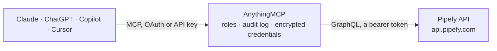

<!-- Generated by scripts/export-github-catalog.mjs in the anythingmcp-website repository. Do not edit by hand. -->

# Pipefy MCP connector

Pipefy work management platform: organizations, pipes (workflows), cards and phases through the GraphQL API. The AnythingMCP connector gives Claude, ChatGPT, Microsoft Copilot, Cursor and Gemini 6 MCP tools for Pipefy, all read-only.

**Category:** [Project Management](../project-management.md) · **Tools:** 6 · **Setup guide:** [anythingmcp.com](https://anythingmcp.com/guides/pipefy-to-mcp) · [Deutsch](https://anythingmcp.com/de/guides/pipefy-to-mcp) · [Italiano](https://anythingmcp.com/it/guides/pipefy-to-mcp) · [Español](https://anythingmcp.com/es/guides/pipefy-to-mcp) · [日本語](https://anythingmcp.com/ja/guides/pipefy-to-mcp) · [Русский](https://anythingmcp.com/ru/guides/pipefy-to-mcp) · [中文](https://anythingmcp.com/zh/guides/pipefy-to-mcp)

## Start without code

No installation and no terminal: AnythingMCP Cloud runs the Pipefy connector for you, operated by helpcode.ai in Frankfurt, Germany.

1. **Click the button above** and create an account or sign in. The Pipefy connector opens, ready to install.
2. **Paste the API key or token from your Pipefy account.** Every click is in the [step-by-step guide](https://anythingmcp.com/guides/pipefy-to-mcp).
3. **Click Install.** AnythingMCP shows the address of your MCP server.
4. **Add that address to your assistant:** [Claude](https://anythingmcp.com/guides/connect-pipefy-to-claude) · [ChatGPT](https://anythingmcp.com/guides/connect-pipefy-to-chatgpt) · [Microsoft Copilot](https://anythingmcp.com/guides/connect-pipefy-to-copilot) · [Cursor](https://anythingmcp.com/guides/connect-pipefy-to-cursor) · [Gemini CLI](https://anythingmcp.com/guides/connect-pipefy-to-gemini) · [Meta Muse](https://anythingmcp.com/guides/connect-pipefy-to-muse).
5. **Ask your first question**, for example: *Which phase is the 'Hydraulic pump restock' card in our Purchase Approvals pipe, and who is it assigned to?*

Prefer help with the setup? [Talk to us](https://anythingmcp.com/contact).

## How it works

- **The AI client** speaks MCP (Streamable HTTP) to AnythingMCP and only sees tool names, descriptions and results. It never gets the Pipefy credentials.
- **AnythingMCP** checks the client's role, builds the call from the tool definition, adds the credentials (a bearer token), calls Pipefy, logs the call and returns the result.
- **Pipefy** sees an ordinary API client with the rights of the account the credentials belong to.

## Tools

| Tool | What it does | Access |
|---|---|---|
| [`pipefy_list_organizations`](#pipefy_list_organizations) | List the organizations the token can see, with their id and name. | read |
| [`pipefy_list_pipes`](#pipefy_list_pipes) | List the pipes (workflows) of one organization, with their id and name. | read |
| [`pipefy_get_pipe`](#pipefy_get_pipe) | Show one pipe in full: id, name, card counts, its phases (id and name), the start-form fields and the labels. | read |
| [`pipefy_list_cards`](#pipefy_list_cards) | List cards of one pipe, a page at a time: id, title, done flag, update time, current phase and assignees. | read |
| [`pipefy_get_card`](#pipefy_get_card) | Show one card in full: id, title, done flag, its pipe and current phase, every field with its name and value, and the assignees. | read |
| [`pipefy_get_phase`](#pipefy_get_phase) | Show one phase: id, name, how many cards it holds, and the fields defined on it. | read |

## Tool reference

Every parameter as the AI client sees it in `tools/list`. Source: [`packages/backend/src/adapters/intl/pipefy.json`](../../../packages/backend/src/adapters/intl/pipefy.json).

### `pipefy_list_organizations`

List the organizations the token can see, with their id and name. The lightest call — it doubles as the auth check. Organization ids narrow pipefy_list_pipes.

**Access:** read · **Call:** `query query Organizations { organizations { id name } }`

No parameters.

### `pipefy_list_pipes`

List the pipes (workflows) of one organization, with their id and name. Pipe ids narrow pipefy_get_pipe and pipefy_list_cards.

**Access:** read · **Call:** `query query Pipes($orgId: ID!) { organization(id: $orgId) { id name pipes { id name } } }`

| Parameter | Type | Required | Description |
|---|---|---|---|
| `org_id` | string | yes | Organization id, e.g. "123456" (the number in the organization URL). pipefy_list_organizations lists them. |

### `pipefy_get_pipe`

Show one pipe in full: id, name, card counts, its phases (id and name), the start-form fields and the labels. Use it to learn the phase ids before listing cards.

**Access:** read · **Call:** `query query Pipe($pipeId: ID!) { pipe(id: $pipeId) { id name cards_count opened_cards_count phases { id name } start_form_fields { id label } labels { id name color } } }`

| Parameter | Type | Required | Description |
|---|---|---|---|
| `pipe_id` | string | yes | Pipe id, e.g. "301234567" (the number in the pipe URL). |

### `pipefy_list_cards`

List cards of one pipe, a page at a time: id, title, done flag, update time, current phase and assignees. Page with first/after — when pageInfo.hasNextPage is true, pass pageInfo.endCursor as after.

**Access:** read · **Call:** `query query Cards($pipeId: ID!, $first: Int = 25, $after: String) { allCards(pipeId: $pipeId, first: $first, after: $after) { pageInfo { hasNextPage endCursor } edges { node { id title done updated_at current_phase { id name } assignees { name email } } } } }`

| Parameter | Type | Required | Description |
|---|---|---|---|
| `after` | string | no | Cursor for the next page: the pageInfo.endCursor of the previous call. Omit for the first page. |
| `first` | integer | no | Cards per page (default 25, max 50 — the most Pipefy returns per request). |
| `pipe_id` | string | yes | Pipe id, e.g. "301234567". pipefy_list_pipes lists them. |

### `pipefy_get_card`

Show one card in full: id, title, done flag, its pipe and current phase, every field with its name and value, and the assignees.

**Access:** read · **Call:** `query query Card($cardId: ID!) { card(id: $cardId) { id title done updated_at pipe { id name } current_phase { id name } fields { name value filled_at } assignees { name email } } }`

| Parameter | Type | Required | Description |
|---|---|---|---|
| `card_id` | string | yes | Card id, e.g. "123456789" (the number in the card URL). |

### `pipefy_get_phase`

Show one phase: id, name, how many cards it holds, and the fields defined on it.

**Access:** read · **Call:** `query query Phase($phaseId: ID!) { phase(id: $phaseId) { id name cards_count fields { id label } } }`

| Parameter | Type | Required | Description |
|---|---|---|---|
| `phase_id` | string | yes | Phase id, e.g. "12345678". pipefy_get_pipe lists a pipe's phases. |

## Run it yourself

AnythingMCP is open source (AGPL-3.0). [Run it with Docker](../../../README.md#run-it-yourself), open **Connectors → Store**, pick **Pipefy** and enter `PIPEFY_API_TOKEN`, then add your MCP server URL to the AI client.

[← Project Management connectors](../project-management.md) · [All categories](../README.md)
