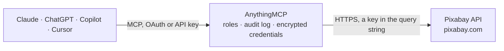

<!-- Generated by scripts/export-github-catalog.mjs in the anythingmcp-website repository. Do not edit by hand. -->

# Pixabay MCP connector

Search over 4 million royalty-free stock photos, illustrations, vector graphics, and videos via the Pixabay API. The AnythingMCP connector gives Claude, ChatGPT, Microsoft Copilot, Cursor and Gemini 2 MCP tools for Pixabay, all read-only.

**Category:** [Publishing](../publishing.md) · **Tools:** 2 · **Setup guide:** [anythingmcp.com](https://anythingmcp.com/guides/pixabay-to-mcp) · [Deutsch](https://anythingmcp.com/de/guides/pixabay-to-mcp) · [Italiano](https://anythingmcp.com/it/guides/pixabay-to-mcp) · [Español](https://anythingmcp.com/es/guides/pixabay-to-mcp) · [日本語](https://anythingmcp.com/ja/guides/pixabay-to-mcp) · [Русский](https://anythingmcp.com/ru/guides/pixabay-to-mcp) · [中文](https://anythingmcp.com/zh/guides/pixabay-to-mcp)

## Start without code

No installation and no terminal: AnythingMCP Cloud runs the Pixabay connector for you, operated by helpcode.ai in Frankfurt, Germany.

1. **Click the button above** and create an account or sign in. The Pixabay connector opens, ready to install.
2. **Paste the API key or token from your Pixabay account.** Every click is in the [step-by-step guide](https://anythingmcp.com/guides/pixabay-to-mcp).
3. **Click Install.** AnythingMCP shows the address of your MCP server.
4. **Add that address to your assistant:** [Claude](https://anythingmcp.com/guides/connect-pixabay-to-claude) · [ChatGPT](https://anythingmcp.com/guides/connect-pixabay-to-chatgpt) · [Microsoft Copilot](https://anythingmcp.com/guides/connect-pixabay-to-copilot) · [Cursor](https://anythingmcp.com/guides/connect-pixabay-to-cursor) · [Gemini CLI](https://anythingmcp.com/guides/connect-pixabay-to-gemini) · [Meta Muse](https://anythingmcp.com/guides/connect-pixabay-to-muse).
5. **Ask your first question**, for example: *What size is Pixabay image 4521873, who shot it, and how often has it been downloaded? Considering it for our sourdough newsletter header.*

Prefer help with the setup? [Talk to us](https://anythingmcp.com/contact).

## How it works

- **The AI client** speaks MCP (Streamable HTTP) to AnythingMCP and only sees tool names, descriptions and results. It never gets the Pixabay credentials.
- **AnythingMCP** checks the client's role, builds the call from the tool definition, adds the credentials (a key in the query string), calls Pixabay, logs the call and returns the result.
- **Pixabay** sees an ordinary API client with the rights of the account the credentials belong to.

## Tools

| Tool | What it does | Access |
|---|---|---|
| [`pixabay_search_images`](#pixabay_search_images) | Search free stock photos, vectors, and illustrations on Pixabay by keywords, category, colors, orientation, and dimensions with SafeSearch. | read |
| [`pixabay_search_videos`](#pixabay_search_videos) | Search free stock video footage, films, and animations on Pixabay with filters for duration, category, dimensions, and SafeSearch. | read |

## Tool reference

Every parameter as the AI client sees it in `tools/list`. Source: [`packages/backend/src/adapters/intl/pixabay.json`](../../../packages/backend/src/adapters/intl/pixabay.json).

### `pixabay_search_images`

Search free stock photos, vectors, and illustrations on Pixabay by keywords, category, colors, orientation, and dimensions with SafeSearch.

**Access:** read · **Call:** `GET /`

| Parameter | Type | Required | Description |
|---|---|---|---|
| `q` | string | no | A search term (up to 100 characters). For example 'yellow flowers' or 'mountain sunset'. |
| `lang` | string | no | Language code of the search term: cs, da, de, en, es, fr, id, it, hu, nl, no, pl, pt, ro, sk, fi, sv, tr, vi, th, bg, ru, el, ja, ko, zh. Default is 'en'. |
| `id` | string | no | Retrieve individual images by ID or a comma-separated list of IDs. |
| `image_type` | `all` \| `photo` \| `illustration` \| `vector` | no | Filter results by image type: 'all', 'photo', 'illustration', or 'vector'. Default is 'all'. |
| `orientation` | `all` \| `horizontal` \| `vertical` | no | Whether an image is wider than it is tall or vice versa: 'all', 'horizontal', or 'vertical'. Default is 'all'. |
| `category` | `backgrounds` \| `fashion` \| `nature` \| `science` \| `education` \| `feelings` \| `health` \| `people` \| `religion` \| `places` \| `animals` \| `industry` \| `computer` \| `food` \| `sports` \| `transportation` \| `travel` \| `buildings` \| `business` \| `music` | no | Filter results by category. |
| `min_width` | integer | no | Minimum image width in pixels. Default is 0. |
| `min_height` | integer | no | Minimum image height in pixels. Default is 0. |
| `colors` | string | no | Filter images by color: 'grayscale', 'transparent', 'red', 'orange', 'yellow', 'green', 'turquoise', 'blue', 'lilac', 'pink', 'white', 'gray', 'black', 'brown'. |
| `editors_choice` | boolean | no | Select images that have received an Editor's Choice award. Default is false. |
| `safesearch` | boolean | no | A flag indicating that only images suitable for all ages should be returned. Default is false. |
| `order` | `popular` \| `latest` | no | How the results should be ordered: 'popular' or 'latest'. Default is 'popular'. |
| `page` | integer | no | Page number to retrieve, starting at 1. Default is 1. |
| `per_page` | integer | no | Number of results per page. Acceptable values: 3 to 200. Default is 20. |

### `pixabay_search_videos`

Search free stock video footage, films, and animations on Pixabay with filters for duration, category, dimensions, and SafeSearch.

**Access:** read · **Call:** `GET /videos/`

| Parameter | Type | Required | Description |
|---|---|---|---|
| `q` | string | no | A search term (up to 100 characters). For example 'ocean waves' or 'city traffic'. |
| `lang` | string | no | Language code of the search term: cs, da, de, en, es, fr, id, it, hu, nl, no, pl, pt, ro, sk, fi, sv, tr, vi, th, bg, ru, el, ja, ko, zh. Default is 'en'. |
| `id` | string | no | Retrieve individual videos by ID or a comma-separated list of IDs. |
| `video_type` | `all` \| `film` \| `animation` | no | Filter results by video type: 'all', 'film', or 'animation'. Default is 'all'. |
| `category` | `backgrounds` \| `fashion` \| `nature` \| `science` \| `education` \| `feelings` \| `health` \| `people` \| `religion` \| `places` \| `animals` \| `industry` \| `computer` \| `food` \| `sports` \| `transportation` \| `travel` \| `buildings` \| `business` \| `music` | no | Filter results by category. |
| `min_width` | integer | no | Minimum video width in pixels. Default is 0. |
| `min_height` | integer | no | Minimum video height in pixels. Default is 0. |
| `editors_choice` | boolean | no | Select videos that have received an Editor's Choice award. Default is false. |
| `safesearch` | boolean | no | A flag indicating that only videos suitable for all ages should be returned. Default is false. |
| `order` | `popular` \| `latest` | no | How the results should be ordered: 'popular' or 'latest'. Default is 'popular'. |
| `page` | integer | no | Page number to retrieve, starting at 1. Default is 1. |
| `per_page` | integer | no | Number of results per page. Acceptable values: 3 to 200. Default is 20. |

## Run it yourself

AnythingMCP is open source (AGPL-3.0). [Run it with Docker](../../../README.md#run-it-yourself), open **Connectors → Store**, pick **Pixabay** and enter `PIXABAY_API_KEY`, then add your MCP server URL to the AI client.

[← Publishing connectors](../publishing.md) · [All categories](../README.md)
