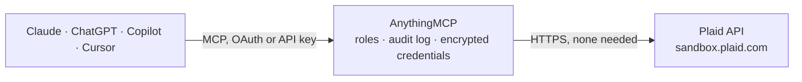

<!-- Generated by scripts/export-github-catalog.mjs in the anythingmcp-website repository. Do not edit by hand. -->

# Plaid MCP connector

Read Plaid (bank-linking, transactions, balances, identity, liabilities, investments) from any AI agent. 10 tools, body-credential auth. The AnythingMCP connector gives Claude, ChatGPT, Microsoft Copilot, Cursor and Gemini 10 MCP tools for Plaid: 7 read and 3 can change data.

**Category:** [Payments](../payments.md) · **Tools:** 10 · **Setup guide:** [anythingmcp.com](https://anythingmcp.com/guides/plaid-to-mcp) · [Deutsch](https://anythingmcp.com/de/guides/plaid-to-mcp) · [Italiano](https://anythingmcp.com/it/guides/plaid-to-mcp) · [Español](https://anythingmcp.com/es/guides/plaid-to-mcp) · [日本語](https://anythingmcp.com/ja/guides/plaid-to-mcp) · [Русский](https://anythingmcp.com/ru/guides/plaid-to-mcp) · [中文](https://anythingmcp.com/zh/guides/plaid-to-mcp)

## Start without code

No installation and no terminal: AnythingMCP Cloud runs the Plaid connector for you, operated by helpcode.ai in Frankfurt, Germany.

1. **Click the button above** and create an account or sign in. The Plaid connector opens, ready to install.
2. **Nothing to enter:** this connector needs no credentials. Every click is in the [step-by-step guide](https://anythingmcp.com/guides/plaid-to-mcp).
3. **Click Install.** AnythingMCP shows the address of your MCP server.
4. **Add that address to your assistant:** [Claude](https://anythingmcp.com/guides/connect-plaid-to-claude) · [ChatGPT](https://anythingmcp.com/guides/connect-plaid-to-chatgpt) · [Microsoft Copilot](https://anythingmcp.com/guides/connect-plaid-to-copilot) · [Cursor](https://anythingmcp.com/guides/connect-plaid-to-cursor) · [Gemini CLI](https://anythingmcp.com/guides/connect-plaid-to-gemini) · [Meta Muse](https://anythingmcp.com/guides/connect-plaid-to-muse).
5. **Ask your first question**, for example: *Get real-time balances for the payroll Item: access token access-sandbox-payroll-842 for March 31 2026.*

Prefer help with the setup? [Talk to us](https://anythingmcp.com/contact).

## How it works

- **The AI client** speaks MCP (Streamable HTTP) to AnythingMCP and only sees tool names, descriptions and results. It never gets the Plaid credentials.
- **AnythingMCP** checks the client's role, builds the call from the tool definition, adds the credentials (none needed), calls Plaid, logs the call and returns the result.
- **Plaid** sees an ordinary API client with the rights of the account the credentials belong to.

## Tools

| Tool | What it does | Access |
|---|---|---|
| [`plaid_link_token_create`](#plaid_link_token_create) | Create a short-lived link_token to pass to the Plaid Link client. | write |
| [`plaid_item_public_token_exchange`](#plaid_item_public_token_exchange) | Exchange a public_token (from Plaid Link) for a long-lived access_token + item_id. | write |
| [`plaid_item_get`](#plaid_item_get) | Get metadata about an Item (institution, products, billed products, status, error). | read |
| [`plaid_accounts_get`](#plaid_accounts_get) | List accounts for an Item with name, mask, type (depository, credit, loan, investment), subtype. | read |
| [`plaid_accounts_balance_get`](#plaid_accounts_balance_get) | Get real-time balances for an Item's accounts (may trigger a refresh — slower than accounts_get). | read |
| [`plaid_transactions_get`](#plaid_transactions_get) | Get transactions in a date range (up to 730 days back). | read |
| [`plaid_transactions_sync`](#plaid_transactions_sync) | Incremental transactions sync. | write |
| [`plaid_identity_get`](#plaid_identity_get) | Get identity info attached to the Item's accounts (names, emails, addresses, phone numbers). | read |
| [`plaid_auth_get`](#plaid_auth_get) | Get bank routing + account numbers for ACH/EFT setup. | read |
| [`plaid_institutions_search`](#plaid_institutions_search) | Search Plaid's catalog of supported financial institutions by name + country. | read |

## Tool reference

Every parameter as the AI client sees it in `tools/list`. Source: [`packages/backend/src/adapters/intl/plaid.json`](../../../packages/backend/src/adapters/intl/plaid.json).

### `plaid_link_token_create`

Create a short-lived link_token to pass to the Plaid Link client. The client returns a public_token after the user authenticates with their bank; exchange that for an access_token via plaid_item_public_token_exchange.

**Access:** write · **Call:** `POST /link/token/create`

| Parameter | Type | Required | Description |
|---|---|---|---|
| `user_client_user_id` | string | yes | Your unique ID for this end-user (will be associated with the Item). |
| `client_name` | string | yes | Display name shown in Link UI. |
| `products` | any[] | yes | Array: transactions, auth, identity, assets, investments, liabilities, ... |
| `country_codes` | any[] | yes | ISO 3166-1 alpha-2 list, e.g. ['US']. |
| `language` | string | yes | en, es, fr, ... |
| `webhook` | string | no | Webhook URL for Item updates. |

### `plaid_item_public_token_exchange`

Exchange a public_token (from Plaid Link) for a long-lived access_token + item_id.

**Access:** write · **Call:** `POST /item/public_token/exchange`

| Parameter | Type | Required | Description |
|---|---|---|---|
| `public_token` | string | yes | public_token from Link. |

### `plaid_item_get`

Get metadata about an Item (institution, products, billed products, status, error).

**Access:** read · **Call:** `POST /item/get`

| Parameter | Type | Required | Description |
|---|---|---|---|
| `access_token` | string | yes | Item access token. |

### `plaid_accounts_get`

List accounts for an Item with name, mask, type (depository, credit, loan, investment), subtype.

**Access:** read · **Call:** `POST /accounts/get`

| Parameter | Type | Required | Description |
|---|---|---|---|
| `access_token` | string | yes | Item access token. |

### `plaid_accounts_balance_get`

Get real-time balances for an Item's accounts (may trigger a refresh — slower than accounts_get).

**Access:** read · **Call:** `POST /accounts/balance/get`

| Parameter | Type | Required | Description |
|---|---|---|---|
| `access_token` | string | yes | Item access token. |
| `options` | object | no | {account_ids: [...]} to subset. |

### `plaid_transactions_get`

Get transactions in a date range (up to 730 days back). Paginated via `count` + `offset`. Note: for ongoing sync prefer `/transactions/sync`.

**Access:** read · **Call:** `POST /transactions/get`

| Parameter | Type | Required | Description |
|---|---|---|---|
| `access_token` | string | yes | Item access token. |
| `start_date` | string | yes | YYYY-MM-DD. |
| `end_date` | string | yes | YYYY-MM-DD. |
| `options` | object | no | {count: 500, offset: 0, account_ids: [...]}. |

### `plaid_transactions_sync`

Incremental transactions sync. Pass `cursor` from previous response (empty string for first call). Returns `added`, `modified`, `removed`, `next_cursor`, `has_more`.

**Access:** write · **Call:** `POST /transactions/sync`

| Parameter | Type | Required | Description |
|---|---|---|---|
| `access_token` | string | yes | Item access token. |
| `cursor` | string | no | Cursor (empty string on first sync). |
| `count` | integer | no | Max per page (500). |

### `plaid_identity_get`

Get identity info attached to the Item's accounts (names, emails, addresses, phone numbers).

**Access:** read · **Call:** `POST /identity/get`

| Parameter | Type | Required | Description |
|---|---|---|---|
| `access_token` | string | yes | Item access token. |

### `plaid_auth_get`

Get bank routing + account numbers for ACH/EFT setup. Requires `auth` product on the Item.

**Access:** read · **Call:** `POST /auth/get`

| Parameter | Type | Required | Description |
|---|---|---|---|
| `access_token` | string | yes | Item access token. |

### `plaid_institutions_search`

Search Plaid's catalog of supported financial institutions by name + country.

**Access:** read · **Call:** `POST /institutions/search`

| Parameter | Type | Required | Description |
|---|---|---|---|
| `query` | string | yes | Institution name fragment. |
| `products` | any[] | no | Array of products the institution must support. |
| `country_codes` | any[] | yes | ISO 3166-1 alpha-2 list. |

## Run it yourself

AnythingMCP is open source (AGPL-3.0). [Run it with Docker](../../../README.md#run-it-yourself), open **Connectors → Store**, pick **Plaid** and enter `PLAID_CLIENT_ID`, `PLAID_SECRET`, then add your MCP server URL to the AI client.

[← Payments connectors](../payments.md) · [All categories](../README.md)
