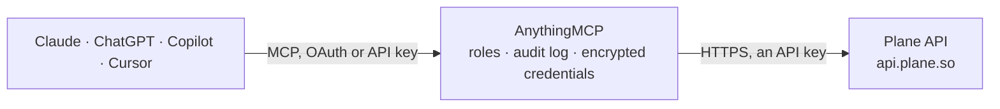

<!-- Generated by scripts/export-github-catalog.mjs in the anythingmcp-website repository. Do not edit by hand. -->

# Plane MCP connector

Manage Plane (open-source project management) workspaces, projects, issues, cycles, modules from any AI agent. 10 tools, API key auth. The AnythingMCP connector gives Claude, ChatGPT, Microsoft Copilot, Cursor and Gemini 10 MCP tools for Plane: 8 read and 2 can change data.

**Category:** [Project Management](../project-management.md) · **Tools:** 10 · **Setup guide:** [anythingmcp.com](https://anythingmcp.com/guides/plane-so-to-mcp) · [Deutsch](https://anythingmcp.com/de/guides/plane-so-to-mcp) · [Italiano](https://anythingmcp.com/it/guides/plane-so-to-mcp) · [Español](https://anythingmcp.com/es/guides/plane-so-to-mcp) · [日本語](https://anythingmcp.com/ja/guides/plane-so-to-mcp) · [Русский](https://anythingmcp.com/ru/guides/plane-so-to-mcp) · [中文](https://anythingmcp.com/zh/guides/plane-so-to-mcp)

## Start without code

No installation and no terminal: AnythingMCP Cloud runs the Plane connector for you, operated by helpcode.ai in Frankfurt, Germany.

1. **Click the button above** and create an account or sign in. The Plane connector opens, ready to install.
2. **Paste the API key or token from your Plane account.** Every click is in the [step-by-step guide](https://anythingmcp.com/guides/plane-so-to-mcp).
3. **Click Install.** AnythingMCP shows the address of your MCP server.
4. **Add that address to your assistant:** [Claude](https://anythingmcp.com/guides/connect-plane-so-to-claude) · [ChatGPT](https://anythingmcp.com/guides/connect-plane-so-to-chatgpt) · [Microsoft Copilot](https://anythingmcp.com/guides/connect-plane-so-to-copilot) · [Cursor](https://anythingmcp.com/guides/connect-plane-so-to-cursor) · [Gemini CLI](https://anythingmcp.com/guides/connect-plane-so-to-gemini) · [Meta Muse](https://anythingmcp.com/guides/connect-plane-so-to-muse).
5. **Ask your first question**, for example: *What's the status and current assignee of issue PL-1023 in project Apollo in workspace skyline-inc?*

Prefer help with the setup? [Talk to us](https://anythingmcp.com/contact).

## How it works

- **The AI client** speaks MCP (Streamable HTTP) to AnythingMCP and only sees tool names, descriptions and results. It never gets the Plane credentials.
- **AnythingMCP** checks the client's role, builds the call from the tool definition, adds the credentials (an API key), calls Plane, logs the call and returns the result.
- **Plane** sees an ordinary API client with the rights of the account the credentials belong to.

## Tools

| Tool | What it does | Access |
|---|---|---|
| [`plane_list_workspaces`](#plane_list_workspaces) | List all workspaces the API key can access. | read |
| [`plane_list_projects`](#plane_list_projects) | List projects in a workspace. | read |
| [`plane_get_project`](#plane_get_project) | Get one project. | read |
| [`plane_list_issues`](#plane_list_issues) | List issues in a project. | read |
| [`plane_get_issue`](#plane_get_issue) | Get one issue with full description + custom properties. | read |
| [`plane_create_issue`](#plane_create_issue) | Create an issue. | write |
| [`plane_update_issue`](#plane_update_issue) | Update an issue (PATCH semantics). | write |
| [`plane_list_states`](#plane_list_states) | List states (issue statuses) defined in a project. | read |
| [`plane_list_cycles`](#plane_list_cycles) | List cycles (sprints) in a project. | read |
| [`plane_list_modules`](#plane_list_modules) | List modules (feature groups) in a project. | read |

## Tool reference

Every parameter as the AI client sees it in `tools/list`. Source: [`packages/backend/src/adapters/intl/plane-so.json`](../../../packages/backend/src/adapters/intl/plane-so.json).

### `plane_list_workspaces`

List all workspaces the API key can access.

**Access:** read · **Call:** `GET /workspaces/`

No parameters.

### `plane_list_projects`

List projects in a workspace.

**Access:** read · **Call:** `GET /workspaces/{workspace_slug}/projects/`

| Parameter | Type | Required | Description |
|---|---|---|---|
| `workspace_slug` | string | yes | Workspace slug. |

### `plane_get_project`

Get one project.

**Access:** read · **Call:** `GET /workspaces/{workspace_slug}/projects/{project_id}/`

| Parameter | Type | Required | Description |
|---|---|---|---|
| `workspace_slug` | string | yes | Workspace slug. |
| `project_id` | string | yes | Project UUID. |

### `plane_list_issues`

List issues in a project. Filter by state, priority, assignee.

**Access:** read · **Call:** `GET /workspaces/{workspace_slug}/projects/{project_id}/issues/`

| Parameter | Type | Required | Description |
|---|---|---|---|
| `workspace_slug` | string | yes | Workspace slug. |
| `project_id` | string | yes | Project UUID. |
| `state` | string | no | Filter by state UUID. |
| `priority` | string | no | urgent, high, medium, low, none. |
| `assignees` | string | no | Comma-separated user UUIDs. |
| `per_page` | integer | no | Max 100. |
| `cursor` | string | no | Pagination cursor. |

### `plane_get_issue`

Get one issue with full description + custom properties.

**Access:** read · **Call:** `GET /workspaces/{workspace_slug}/projects/{project_id}/issues/{issue_id}/`

| Parameter | Type | Required | Description |
|---|---|---|---|
| `workspace_slug` | string | yes | Workspace slug. |
| `project_id` | string | yes | Project UUID. |
| `issue_id` | string | yes | Issue UUID. |

### `plane_create_issue`

Create an issue.

**Access:** write · **Call:** `POST /workspaces/{workspace_slug}/projects/{project_id}/issues/`

| Parameter | Type | Required | Description |
|---|---|---|---|
| `workspace_slug` | string | yes | Workspace slug. |
| `project_id` | string | yes | Project UUID. |
| `name` | string | yes | Issue title. |
| `description_html` | string | no | HTML description. |
| `state` | string | no | State UUID. |
| `priority` | string | no | urgent, high, medium, low, none. |
| `assignees` | any[] | no | Array of user UUIDs. |
| `labels` | any[] | no | Array of label UUIDs. |
| `parent` | string | no | Parent issue UUID (for sub-issues). |
| `estimate_point` | integer | no | Estimate point. |
| `start_date` | string | no | YYYY-MM-DD. |
| `target_date` | string | no | YYYY-MM-DD. |

### `plane_update_issue`

Update an issue (PATCH semantics).

**Access:** write · **Call:** `PATCH /workspaces/{workspace_slug}/projects/{project_id}/issues/{issue_id}/`

| Parameter | Type | Required | Description |
|---|---|---|---|
| `workspace_slug` | string | yes | Workspace slug. |
| `project_id` | string | yes | Project UUID. |
| `issue_id` | string | yes | Issue UUID. |
| `name` | string | no | New title. |
| `state` | string | no | Move to state UUID. |
| `priority` | string | no | New priority. |
| `assignees` | any[] | no | Replace assignees. |
| `description_html` | string | no | New HTML description. |

### `plane_list_states`

List states (issue statuses) defined in a project. Use to discover state UUIDs.

**Access:** read · **Call:** `GET /workspaces/{workspace_slug}/projects/{project_id}/states/`

| Parameter | Type | Required | Description |
|---|---|---|---|
| `workspace_slug` | string | yes | Workspace slug. |
| `project_id` | string | yes | Project UUID. |

### `plane_list_cycles`

List cycles (sprints) in a project.

**Access:** read · **Call:** `GET /workspaces/{workspace_slug}/projects/{project_id}/cycles/`

| Parameter | Type | Required | Description |
|---|---|---|---|
| `workspace_slug` | string | yes | Workspace slug. |
| `project_id` | string | yes | Project UUID. |

### `plane_list_modules`

List modules (feature groups) in a project.

**Access:** read · **Call:** `GET /workspaces/{workspace_slug}/projects/{project_id}/modules/`

| Parameter | Type | Required | Description |
|---|---|---|---|
| `workspace_slug` | string | yes | Workspace slug. |
| `project_id` | string | yes | Project UUID. |

## Run it yourself

AnythingMCP is open source (AGPL-3.0). [Run it with Docker](../../../README.md#run-it-yourself), open **Connectors → Store**, pick **Plane** and enter `PLANE_API_KEY`, then add your MCP server URL to the AI client.

[← Project Management connectors](../project-management.md) · [All categories](../README.md)
