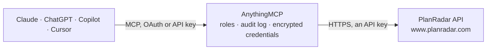

<!-- Generated by scripts/export-github-catalog.mjs in the anythingmcp-website repository. Do not edit by hand. -->

# PlanRadar MCP connector

Manage construction and real estate projects with PlanRadar. The AnythingMCP connector gives Claude, ChatGPT, Microsoft Copilot, Cursor and Gemini 10 MCP tools for PlanRadar: 8 read and 2 can change data.

**Category:** [Construction](../construction.md) · **Tools:** 10 · **Setup guide:** [anythingmcp.com](https://anythingmcp.com/guides/planradar-to-mcp) · [Deutsch](https://anythingmcp.com/de/guides/planradar-to-mcp) · [Italiano](https://anythingmcp.com/it/guides/planradar-to-mcp) · [Español](https://anythingmcp.com/es/guides/planradar-to-mcp) · [日本語](https://anythingmcp.com/ja/guides/planradar-to-mcp) · [Русский](https://anythingmcp.com/ru/guides/planradar-to-mcp) · [中文](https://anythingmcp.com/zh/guides/planradar-to-mcp)

## Start without code

No installation and no terminal: AnythingMCP Cloud runs the PlanRadar connector for you, operated by helpcode.ai in Frankfurt, Germany.

1. **Click the button above** and create an account or sign in. The PlanRadar connector opens, ready to install.
2. **Paste the API key or token from your PlanRadar account.** Every click is in the [step-by-step guide](https://anythingmcp.com/guides/planradar-to-mcp).
3. **Click Install.** AnythingMCP shows the address of your MCP server.
4. **Add that address to your assistant:** [Claude](https://anythingmcp.com/guides/connect-planradar-to-claude) · [ChatGPT](https://anythingmcp.com/guides/connect-planradar-to-chatgpt) · [Microsoft Copilot](https://anythingmcp.com/guides/connect-planradar-to-copilot) · [Cursor](https://anythingmcp.com/guides/connect-planradar-to-cursor) · [Gemini CLI](https://anythingmcp.com/guides/connect-planradar-to-gemini) · [Meta Muse](https://anythingmcp.com/guides/connect-planradar-to-muse).
5. **Ask your first question**, for example: *Status and assignee of ticket TCK-837 in project 241 (project number PRJ-241)?*

Prefer help with the setup? [Talk to us](https://anythingmcp.com/contact).

## How it works

- **The AI client** speaks MCP (Streamable HTTP) to AnythingMCP and only sees tool names, descriptions and results. It never gets the PlanRadar credentials.
- **AnythingMCP** checks the client's role, builds the call from the tool definition, adds the credentials (an API key), calls PlanRadar, logs the call and returns the result.
- **PlanRadar** sees an ordinary API client with the rights of the account the credentials belong to.

## Tools

| Tool | What it does | Access |
|---|---|---|
| [`planradar_list_projects`](#planradar_list_projects) | List all projects accessible to the authenticated user. | read |
| [`planradar_get_project`](#planradar_get_project) | Get a single project by its ID. | read |
| [`planradar_list_tickets`](#planradar_list_tickets) | List tickets (defects, tasks, issues) within a specific project. | read |
| [`planradar_get_ticket`](#planradar_get_ticket) | Get a single ticket by its ID within a project. | read |
| [`planradar_create_ticket`](#planradar_create_ticket) | Create a new ticket (defect, task, issue) in a project. | write |
| [`planradar_update_ticket`](#planradar_update_ticket) | Update an existing ticket in a project. | write |
| [`planradar_list_users`](#planradar_list_users) | List all users in the account. | read |
| [`planradar_get_user`](#planradar_get_user) | Get a single user by their ID. | read |
| [`planradar_list_documents`](#planradar_list_documents) | List documents (plans, photos, attachments) within a specific project. | read |
| [`planradar_get_document`](#planradar_get_document) | Get a single document by its ID within a project. | read |

## Tool reference

Every parameter as the AI client sees it in `tools/list`. Source: [`packages/backend/src/adapters/de/planradar.json`](../../../packages/backend/src/adapters/de/planradar.json).

### `planradar_list_projects`

List all projects accessible to the authenticated user. Returns project data in JSON:API format with attributes: id, name, homepage, country, projectnumber, description, city, zipcode, street, author-id. Supports pagination.

**Access:** read · **Call:** `GET /projects`

| Parameter | Type | Required | Description |
|---|---|---|---|
| `page` | number | no | Page number for pagination (starts at 1) |
| `per_page` | number | no | Number of results per page |

### `planradar_get_project`

Get a single project by its ID. Returns full project details including id, name, homepage, country, projectnumber, description, city, zipcode, street, and author-id.

**Access:** read · **Call:** `GET /projects/{project_id}`

| Parameter | Type | Required | Description |
|---|---|---|---|
| `project_id` | string | yes | The project ID |

### `planradar_list_tickets`

List tickets (defects, tasks, issues) within a specific project. Returns ticket data with predefined fields (Title, Assignee, Status, Priority, Progress, Due date, Layer, Parent Ticket) and custom fields. Statuses: Open, In Progress, Resolved, Feedback, Closed, Rejected. Supports pagination.

**Access:** read · **Call:** `GET /projects/{project_id}/tickets`

| Parameter | Type | Required | Description |
|---|---|---|---|
| `project_id` | string | yes | The project ID to list tickets from |
| `page` | number | no | Page number for pagination (starts at 1) |
| `per_page` | number | no | Number of results per page |

### `planradar_get_ticket`

Get a single ticket by its ID within a project. Returns full ticket details including all predefined fields (Title, Assignee, Status, Priority, Progress, Due date, Layer, Parent Ticket) and custom fields.

**Access:** read · **Call:** `GET /projects/{project_id}/tickets/{ticket_id}`

| Parameter | Type | Required | Description |
|---|---|---|---|
| `project_id` | string | yes | The project ID |
| `ticket_id` | string | yes | The ticket ID |

### `planradar_create_ticket`

Create a new ticket (defect, task, issue) in a project. Title is the only mandatory field. Tickets must be associated with a layer (floor plan). Available statuses: Open, In Progress, Resolved, Feedback, Closed, Rejected.

**Access:** write · **Call:** `POST /projects/{project_id}/tickets`

| Parameter | Type | Required | Description |
|---|---|---|---|
| `project_id` | string | yes | The project ID to create the ticket in |
| `title` | string | yes | Title of the ticket (mandatory) |
| `description` | string | no | Detailed description of the ticket |
| `status` | `Open` \| `In Progress` \| `Resolved` \| `Feedback` \| `Closed` \| `Rejected` | no | Ticket status. Values: Open, In Progress, Resolved, Feedback, Closed, Rejected |
| `priority` | string | no | Ticket priority level |
| `assignee_id` | string | no | User ID to assign the ticket to |
| `due_date` | string | no | Due date in ISO 8601 format (e.g. '2025-12-31') |
| `layer_id` | string | no | Layer ID (floor plan/drawing) to associate the ticket with |
| `progress` | number | no | Progress percentage (0-100) |

### `planradar_update_ticket`

Update an existing ticket in a project. Only include fields you want to change. Available statuses: Open, In Progress, Resolved, Feedback, Closed, Rejected.

**Access:** write · **Call:** `PUT /projects/{project_id}/tickets/{ticket_id}`

| Parameter | Type | Required | Description |
|---|---|---|---|
| `project_id` | string | yes | The project ID |
| `ticket_id` | string | yes | The ticket ID to update |
| `title` | string | no | Updated title |
| `description` | string | no | Updated description |
| `status` | `Open` \| `In Progress` \| `Resolved` \| `Feedback` \| `Closed` \| `Rejected` | no | Updated status. Values: Open, In Progress, Resolved, Feedback, Closed, Rejected |
| `priority` | string | no | Updated priority |
| `assignee_id` | string | no | Updated assignee user ID |
| `due_date` | string | no | Updated due date in ISO 8601 format (e.g. '2025-12-31') |
| `progress` | number | no | Progress percentage (0-100) |

### `planradar_list_users`

List all users in the account. Returns user data including names, email addresses, roles, and permissions. Users can be in-house users or subcontractors.

**Access:** read · **Call:** `GET /users`

| Parameter | Type | Required | Description |
|---|---|---|---|
| `page` | number | no | Page number for pagination (starts at 1) |
| `per_page` | number | no | Number of results per page |

### `planradar_get_user`

Get a single user by their ID. Returns full user details including name, email, role, and permissions.

**Access:** read · **Call:** `GET /users/{user_id}`

| Parameter | Type | Required | Description |
|---|---|---|---|
| `user_id` | string | yes | The user ID |

### `planradar_list_documents`

List documents (plans, photos, attachments) within a specific project. Supports pagination.

**Access:** read · **Call:** `GET /projects/{project_id}/documents`

| Parameter | Type | Required | Description |
|---|---|---|---|
| `project_id` | string | yes | The project ID to list documents from |
| `page` | number | no | Page number for pagination (starts at 1) |
| `per_page` | number | no | Number of results per page |

### `planradar_get_document`

Get a single document by its ID within a project. Returns document metadata and download information.

**Access:** read · **Call:** `GET /projects/{project_id}/documents/{document_id}`

| Parameter | Type | Required | Description |
|---|---|---|---|
| `project_id` | string | yes | The project ID |
| `document_id` | string | yes | The document ID |

## Run it yourself

AnythingMCP is open source (AGPL-3.0). [Run it with Docker](../../../README.md#run-it-yourself), open **Connectors → Store**, pick **PlanRadar** and enter `PLANRADAR_API_KEY`, `PLANRADAR_CUSTOMER_ID`, then add your MCP server URL to the AI client.

[← Construction connectors](../construction.md) · [All categories](../README.md)
