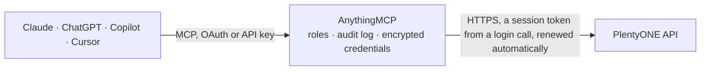

<!-- Generated by scripts/export-github-catalog.mjs in the anythingmcp-website repository. Do not edit by hand. -->

# PlentyONE MCP connector

PlentyONE (plentymarkets) e-commerce ERP: orders with items and addresses, order statuses and sales channels, items and variations with prices, barcodes, texts, properties and market SKUs, … The AnythingMCP connector gives Claude, ChatGPT, Microsoft Copilot, Cursor and Gemini 34 MCP tools for PlentyONE: 24 read and 10 can change data.

**Category:** [E-commerce](../e-commerce.md) · **Tools:** 34 · **Setup guide:** [anythingmcp.com](https://anythingmcp.com/guides/plentyone-to-mcp) · [Deutsch](https://anythingmcp.com/de/guides/plentyone-to-mcp) · [Italiano](https://anythingmcp.com/it/guides/plentyone-to-mcp) · [Español](https://anythingmcp.com/es/guides/plentyone-to-mcp) · [日本語](https://anythingmcp.com/ja/guides/plentyone-to-mcp) · [Русский](https://anythingmcp.com/ru/guides/plentyone-to-mcp) · [中文](https://anythingmcp.com/zh/guides/plentyone-to-mcp)

## Start without code

No installation and no terminal: AnythingMCP Cloud runs the PlentyONE connector for you, operated by helpcode.ai in Frankfurt, Germany.

1. **Click the button above** and create an account or sign in. The PlentyONE connector opens, ready to install.
2. **Paste the API key or token from your PlentyONE account.** Every click is in the [step-by-step guide](https://anythingmcp.com/guides/plentyone-to-mcp).
3. **Click Install.** AnythingMCP shows the address of your MCP server.
4. **Add that address to your assistant:** [Claude](https://anythingmcp.com/guides/connect-plentyone-to-claude) · [ChatGPT](https://anythingmcp.com/guides/connect-plentyone-to-chatgpt) · [Microsoft Copilot](https://anythingmcp.com/guides/connect-plentyone-to-copilot) · [Cursor](https://anythingmcp.com/guides/connect-plentyone-to-cursor) · [Gemini CLI](https://anythingmcp.com/guides/connect-plentyone-to-gemini) · [Meta Muse](https://anythingmcp.com/guides/connect-plentyone-to-muse).
5. **Ask your first question**, for example: *Show order 2026-ORD-4927 from webstore 7, include addresses and items*

Prefer help with the setup? [Talk to us](https://anythingmcp.com/contact).

## How it works

- **The AI client** speaks MCP (Streamable HTTP) to AnythingMCP and only sees tool names, descriptions and results. It never gets the PlentyONE credentials.
- **AnythingMCP** checks the client's role, builds the call from the tool definition, adds the credentials (a session token from a login call, renewed automatically), calls PlentyONE, logs the call and returns the result.
- **PlentyONE** sees an ordinary API client with the rights of the account the credentials belong to.

## Tools

| Tool | What it does | Access |
|---|---|---|
| [`plentyone_list_webstores`](#plentyone_list_webstores) | List the clients (webstores) of the plentyONE system: id, plentyId (storeIdentifier, used as plentyId in other filters), name, type and default language. | read |
| [`plentyone_search_orders`](#plentyone_search_orders) | Search orders: id, type, status id, referrer (sales channel), plentyId, dates, amounts and, with with, addresses and order items. | read |
| [`plentyone_get_order`](#plentyone_get_order) | Get one order by id with its relations: addresses, order items (variation, quantity, prices, VAT), amounts, dates, properties, payments, documents and… | read |
| [`plentyone_list_order_statuses`](#plentyone_list_order_statuses) | List the order statuses of the system (e.g. 3 waiting for payment, 5 cleared for shipping, 7 outgoing items booked) with their names per language. | read |
| [`plentyone_list_referrers`](#plentyone_list_referrers) | List the order referrers (sales channels: webshop, Amazon, eBay, Otto, manual entry...) with id, name and backend name. | read |
| [`plentyone_search_items`](#plentyone_search_items) | Search items (the article; sellable versions are its variations): id, manufacturer, condition, customs tariff number, producing country, stock type, free… | read |
| [`plentyone_get_item`](#plentyone_get_item) | Get one item by id: manufacturer, condition, customs tariff number, producing country, age restriction, stock type, flags and free fields. | read |
| [`plentyone_search_variations`](#plentyone_search_variations) | Search variations (the sellable SKUs): id, item id, variation number, model, external id, active flag, availability, purchase price, weight and size. | read |
| [`plentyone_get_variation`](#plentyone_get_variation) | Get one variation with optional relations: sales prices, barcodes, stock, categories, attribute values, images, unit, suppliers, warehouses. | read |
| [`plentyone_get_item_texts`](#plentyone_get_item_texts) | Get the texts of an item per language: name (name, name2, name3), preview and full description, technical data, meta title, description and keywords, URL path. | read |
| [`plentyone_list_warehouses`](#plentyone_list_warehouses) | List the warehouses with id, name, type (0 sales, 1 repair, 2 corrections, 3 transit, 4 distribution, 5 other), logistics type and notes. | read |
| [`plentyone_get_stock`](#plentyone_get_stock) | Get stock per variation and warehouse: physical stock, reserved stock, net (sellable) stock, reorder delta, average purchase price and update time. | read |
| [`plentyone_get_warehouse_stock`](#plentyone_get_warehouse_stock) | Get the stock of one warehouse per variation: physical, reserved and net stock, reorder delta and average purchase price. | read |
| [`plentyone_list_categories`](#plentyone_list_categories) | List categories with id, parent, level, type and, with with=details, their names and paths per language. | read |
| [`plentyone_list_manufacturers`](#plentyone_list_manufacturers) | List manufacturers (brands) with id, name, legal name, URL and address. | read |
| [`plentyone_list_units`](#plentyone_list_units) | List the units of measurement (piece, kg, litre...) with id and ISO unit code. | read |
| [`plentyone_list_sales_prices`](#plentyone_list_sales_prices) | List the sales price definitions (default price, RRP, special prices per channel or customer class) with id, type, position, names, minimum order quantity… | read |
| [`plentyone_search_contacts`](#plentyone_search_contacts) | Search contacts (customers, suppliers, partners): id, number, name, e-mail, type, class and, with with, addresses and order summary. | read |
| [`plentyone_list_property_relations`](#plentyone_list_property_relations) | List the property links (property relations) of an item, variation or other target: relation id, property id, relation type, target id, group, markup and… | read |
| [`plentyone_get_variation_market_skus`](#plentyone_get_variation_market_skus) | List the marketplace SKUs of a variation: per market (marketId, the referrer id) and market account its SKU, parent SKU, initial SKU, export status (ACTIVE,… | read |
| [`plentyone_get_variation_property_values`](#plentyone_get_variation_property_values) | List the property values linked to a variation (item properties of the classic property system): link id, property id, selection id, integer, decimal or… | read |
| [`plentyone_search_listing_markets`](#plentyone_search_listing_markets) | Search marketplace listings (listing markets, e.g. eBay offers): id, listing, item and variation, referrer (market), account, status, verification result,… | read |
| [`plentyone_search_listing_market_messages`](#plentyone_search_listing_market_messages) | Search the messages plentyONE stored for marketplace listings (listing market infos): errors, warnings and info returned by the market on start, update or… | read |
| [`plentyone_search_listing_market_history`](#plentyone_search_listing_market_history) | Search the history of marketplace listings (each time a listing went online, with its external id, dates, quantity sold and status: 1 active, 2 ended, 3… | read |
| [`plentyone_edit_item`](#plentyone_edit_item) | Change fields of one item (the article, shared by its variations): manufacturer, condition, stock type, store special, flags, age restriction, coupon… | write |
| [`plentyone_edit_item_texts`](#plentyone_edit_item_texts) | Change the texts of an item in one language: name (name, name2, name3), preview and full description, technical data, meta description and keywords, URL path. | write |
| [`plentyone_link_property`](#plentyone_link_property) | Link a property (Eigenschaft) to a target such as a variation or item (create a property relation): give the property id, the relation type (e.g. item) and… | write |
| [`plentyone_add_property_relation_value`](#plentyone_add_property_relation_value) | Add the value of a linked text or HTML property in one language (create a property relation value): relation id from plentyone_link_property or… | write |
| [`plentyone_set_property_relation_values`](#plentyone_set_property_relation_values) | Change several property relation values at once (texts of linked properties per language). | write |
| [`plentyone_edit_variation_market_sku`](#plentyone_edit_variation_market_sku) | Change a marketplace SKU row of a variation: the SKU and parent SKU for one market and account, or its status. | write |
| [`plentyone_check_listing_market`](#plentyone_check_listing_market) | Ask the market to verify a marketplace listing (listing market) without publishing it: the result shows in the listing's verified field and in… | write |
| [`plentyone_edit_order`](#plentyone_edit_order) | Change an order: status, owner, client (plentyId), order items (e.g. a changed price or quantity, each entry with its order item id), order properties,… | write |
| [`plentyone_create_item`](#plentyone_create_item) | Create a new item with its first variation. | write |
| [`plentyone_update_variation`](#plentyone_update_variation) | Change fields of one variation: name, model, variation number, active flag, weight and dimensions. | write |

## Tool reference

Every parameter as the AI client sees it in `tools/list`. Source: [`packages/backend/src/adapters/de/plentyone.json`](../../../packages/backend/src/adapters/de/plentyone.json).

### `plentyone_list_webstores`

List the clients (webstores) of the plentyONE system: id, plentyId (storeIdentifier, used as plentyId in other filters), name, type and default language. Use it to check the connection.

**Access:** read · **Call:** `GET /webstores`

No parameters.

### `plentyone_search_orders`

Search orders: id, type, status id, referrer (sales channel), plentyId, dates, amounts and, with with, addresses and order items. Filters take plentyONE's operator syntax: statusId "5" or "in:3,4" or "between:3,5", createdAt "between:2026-10-01T00:00:00+02:00,2026-10-21T23:59:59+02:00". Needs the Orders > Show right for the API user.

**Access:** read · **Call:** `GET /orders/search`

| Parameter | Type | Required | Description |
|---|---|---|---|
| `orderId` | string | no | One order id, or "in:1001,1002". |
| `statusId` | string | no | Status id or range, e.g. 5, in:3,4, between:3,5.9. |
| `createdAt` | string | no | Creation date range, e.g. between:2026-10-01T00:00:00+02:00,2026-10-21T23:59:59+02:00. |
| `updatedAt` | string | no | Last update range, same syntax as createdAt. |
| `referrerId` | string | no | Order referrer (sales channel) id from plentyone_list_referrers, e.g. 1 for the webshop or "in:4,4.01". |
| `orderTypeId` | string | no | Order type: 1 sales order, 2 delivery, 3 return, 4 credit note, 5 warranty, 6 repair, 7 offer, 8 advance order. |
| `variationNumber` | string | no | Only orders containing this variation number. |
| `externalOrderId` | string | no | Order id of the marketplace or shop that sent the order. |
| `with` | string | no | Comma-separated relations, e.g. addresses,orderItems,amounts,dates,comments,shippingPackages. |
| `sortBy` | `orderId` \| `createdAt` \| `updatedAt` \| `statusId` | no | Sort field, default orderId. |
| `sortOrder` | `asc` \| `desc` | no | Sort direction. |
| `page` | integer | no | Page, starting at 1. |
| `itemsPerPage` | integer | no | Rows per page, at most 100. |

### `plentyone_get_order`

Get one order by id with its relations: addresses, order items (variation, quantity, prices, VAT), amounts, dates, properties, payments, documents and shipping packages. Needs the Orders > Show right.

**Access:** read · **Call:** `GET /orders/{orderId}`

| Parameter | Type | Required | Description |
|---|---|---|---|
| `orderId` | integer | yes | Order id. |
| `with` | string[] | no | Relations to load, e.g. ["addresses","orderItems.variation","payments","documents","shippingPackages","comments"]. |

### `plentyone_list_order_statuses`

List the order statuses of the system (e.g. 3 waiting for payment, 5 cleared for shipping, 7 outgoing items booked) with their names per language. Needs the Orders > Order statuses > Show right.

**Access:** read · **Call:** `GET /orders/statuses`

| Parameter | Type | Required | Description |
|---|---|---|---|
| `language` | string | no | Language of the names, e.g. de, en. |
| `page` | integer | no | Page, starting at 1. |
| `itemsPerPage` | integer | no | Rows per page, at most 100. |

### `plentyone_list_referrers`

List the order referrers (sales channels: webshop, Amazon, eBay, Otto, manual entry...) with id, name and backend name. The id is what referrerId takes.

**Access:** read · **Call:** `GET /orders/referrers`

No parameters.

### `plentyone_search_items`

Search items (the article; sellable versions are its variations): id, manufacturer, condition, customs tariff number, producing country, stock type, free fields and update time. Filter by name, ids, manufacturer or update time; with=variations loads the variations.

**Access:** read · **Call:** `GET /items`

| Parameter | Type | Required | Description |
|---|---|---|---|
| `name` | string | no | Item name (contains). |
| `lang` | string | no | Language of the name, e.g. de. |
| `id` | string | no | Comma-separated item ids. |
| `manufacturerId` | integer | no | Manufacturer id (plentyone_list_manufacturers). |
| `updatedBetween` | string | no | Changed between: unix timestamps or ISO dates, "from" or "from,to". |
| `with` | string | no | Comma-separated relations: variations, itemImages, itemProperties, itemCrossSelling, itemShippingProfiles. |
| `page` | integer | no | Page, starting at 1. |
| `itemsPerPage` | integer | no | Rows per page, at most 50. |

### `plentyone_get_item`

Get one item by id: manufacturer, condition, customs tariff number, producing country, age restriction, stock type, flags and free fields.

**Access:** read · **Call:** `GET /items/{itemId}`

| Parameter | Type | Required | Description |
|---|---|---|---|
| `itemId` | integer | yes | Item id. |
| `lang` | string | no | Language, e.g. de. |

### `plentyone_search_variations`

Search variations (the sellable SKUs): id, item id, variation number, model, external id, active flag, availability, purchase price, weight and size. Find one by exact number (numberExact), part of the number, barcode (EAN), item name, category or supplier number; with loads sales prices, barcodes, stock and more.

**Access:** read · **Call:** `GET /items/variations`

| Parameter | Type | Required | Description |
|---|---|---|---|
| `numberExact` | string | no | Exact variation number, e.g. LEGO-60352-1244. |
| `numberFuzzy` | string | no | Part of a variation number. |
| `barcode` | string | no | Barcode, e.g. an EAN. |
| `itemId` | integer | no | Only variations of this item. |
| `itemName` | string | no | Item name (contains). |
| `isActive` | boolean | no | Only active (true) or inactive (false) variations. |
| `categoryId` | integer | no | Only variations in this category. |
| `supplierNumber` | string | no | Supplier's article number. |
| `manufacturerId` | integer | no | Manufacturer id. |
| `updatedBetween` | string | no | Changed between: unix timestamps or ISO dates, "from" or "from,to". |
| `with` | string | no | Comma-separated relations to load, e.g. variationSalesPrices,variationBarcodes,stock,variationCategories,variationAttributeValues,images,unit,variationSuppliers,variationWarehouses. |
| `page` | integer | no | Page, starting at 1. |
| `itemsPerPage` | integer | no | Rows per page, at most 100. |

### `plentyone_get_variation`

Get one variation with optional relations: sales prices, barcodes, stock, categories, attribute values, images, unit, suppliers, warehouses.

**Access:** read · **Call:** `GET /items/{itemId}/variations/{variationId}`

| Parameter | Type | Required | Description |
|---|---|---|---|
| `itemId` | integer | yes | Item id. |
| `variationId` | integer | yes | Variation id. |
| `with` | string | no | Comma-separated relations to load, e.g. variationSalesPrices,variationBarcodes,stock,variationCategories,variationAttributeValues,images,unit,variationSuppliers,variationWarehouses. |

### `plentyone_get_item_texts`

Get the texts of an item per language: name (name, name2, name3), preview and full description, technical data, meta title, description and keywords, URL path. The texts belong to the item and are the same for all its variations.

**Access:** read · **Call:** `GET /items/{itemId}/variations/{variationId}/descriptions`

| Parameter | Type | Required | Description |
|---|---|---|---|
| `itemId` | integer | yes | Item id. |
| `variationId` | integer | yes | Any variation id of the item (the main variation works). |

### `plentyone_list_warehouses`

List the warehouses with id, name, type (0 sales, 1 repair, 2 corrections, 3 transit, 4 distribution, 5 other), logistics type and notes. The id is what warehouseId takes.

**Access:** read · **Call:** `GET /stockmanagement/warehouses`

No parameters.

### `plentyone_get_stock`

Get stock per variation and warehouse: physical stock, reserved stock, net (sellable) stock, reorder delta, average purchase price and update time. Filter by variation or by update time.

**Access:** read · **Call:** `GET /stockmanagement/stock`

| Parameter | Type | Required | Description |
|---|---|---|---|
| `variationId` | integer | no | Only this variation. |
| `updatedAtFrom` | string | no | Changed at or after, ISO 8601, e.g. 2026-10-01T00:00:00+02:00. |
| `updatedAtTo` | string | no | Changed at or before, ISO 8601. |
| `page` | integer | no | Page, starting at 1. |
| `itemsPerPage` | integer | no | Rows per page, at most 100. |

### `plentyone_get_warehouse_stock`

Get the stock of one warehouse per variation: physical, reserved and net stock, reorder delta and average purchase price.

**Access:** read · **Call:** `GET /stockmanagement/warehouses/{warehouseId}/stock`

| Parameter | Type | Required | Description |
|---|---|---|---|
| `warehouseId` | integer | yes | Warehouse id from plentyone_list_warehouses. |
| `variationId` | integer | no | Only this variation. |
| `page` | integer | no | Page, starting at 1. |
| `itemsPerPage` | integer | no | Rows per page, at most 100. |

### `plentyone_list_categories`

List categories with id, parent, level, type and, with with=details, their names and paths per language. Filter by type, name, parent or level. The id is what categoryId takes.

**Access:** read · **Call:** `GET /categories`

| Parameter | Type | Required | Description |
|---|---|---|---|
| `type` | `item` \| `container` \| `content` \| `blog` | no | Category type. |
| `name` | string | no | Category name (contains). |
| `parentId` | integer | no | Only children of this category. |
| `level` | integer | no | Only this level, 1 = top level. |
| `lang` | string | no | Only categories with details in this language, e.g. de. |
| `with` | string | no | details for names and paths per language; also clients, tags. |
| `page` | integer | no | Page, starting at 1. |
| `itemsPerPage` | integer | no | Rows per page, at most 100. |

### `plentyone_list_manufacturers`

List manufacturers (brands) with id, name, legal name, URL and address. The id is what manufacturerId takes.

**Access:** read · **Call:** `GET /items/manufacturers`

| Parameter | Type | Required | Description |
|---|---|---|---|
| `name` | string | no | Manufacturer name. |
| `page` | integer | no | Page, starting at 1. |
| `itemsPerPage` | integer | no | Rows per page, at most 100. |

### `plentyone_list_units`

List the units of measurement (piece, kg, litre...) with id and ISO unit code. unitId in an item's variation refers to them.

**Access:** read · **Call:** `GET /items/units`

| Parameter | Type | Required | Description |
|---|---|---|---|
| `page` | integer | no | Page, starting at 1. |
| `itemsPerPage` | integer | no | Rows per page, at most 100. |

### `plentyone_list_sales_prices`

List the sales price definitions (default price, RRP, special prices per channel or customer class) with id, type, position, names, minimum order quantity and interval. A variation's variationSalesPrices refer to them by salesPriceId.

**Access:** read · **Call:** `GET /items/sales_prices`

| Parameter | Type | Required | Description |
|---|---|---|---|
| `page` | integer | no | Page, starting at 1. |
| `itemsPerPage` | integer | no | Rows per page, at most 50. |

### `plentyone_search_contacts`

Search contacts (customers, suppliers, partners): id, number, name, e-mail, type, class and, with with, addresses and order summary. Needs the contact read rights for the API user; a 403 names the missing right in missing_permissions.

**Access:** read · **Call:** `GET /accounts/contacts`

| Parameter | Type | Required | Description |
|---|---|---|---|
| `fullText` | string | no | Free text over name, e-mail, number and address. |
| `email` | string | no | Exact e-mail address. |
| `number` | string | no | Customer number. |
| `typeId` | integer | no | Contact type: 1 customer, 2 sales lead, 3 sales representative, 4 supplier, 5 manufacturer, 6 partner. |
| `with` | string | no | Comma-separated relations: addresses, accounts, options, orderSummary, primaryBillingAddress. |
| `page` | integer | no | Page, starting at 1. |
| `itemsPerPage` | integer | no | Rows per page, at most 100. |

### `plentyone_list_property_relations`

List the property links (property relations) of an item, variation or other target: relation id, property id, relation type, target id, group, markup and the value of number, date and file properties. Filter by relationTypeIdentifier (e.g. item) and relationTargetId (the item or variation id). Use the relation ids with plentyone_set_property_relation_values and plentyone_add_property_relation_value.

**Access:** read · **Call:** `GET /properties/relations`

| Parameter | Type | Required | Description |
|---|---|---|---|
| `relationTypeIdentifier` | string | no | Relation type, e.g. item, contact, category, warehouse, order. |
| `relationTargetId` | integer | no | Id of the target the property is linked to, e.g. the variation or item id. |
| `sortBy` | string | no | Sort field with _asc or _desc, e.g. id_desc. |
| `paginate` | `0` \| `1` | no | 1 to page the result (default), 0 for one unpaged list. |
| `page` | integer | no | Page, starting at 1. |
| `itemsPerPage` | integer | no | Rows per page, at most 100. |

### `plentyone_get_variation_market_skus`

List the marketplace SKUs of a variation: per market (marketId, the referrer id) and market account its SKU, parent SKU, initial SKU, export status (ACTIVE, INACTIVE, ERROR, SENT), last export and stock update times and extra information. Use the row id with plentyone_edit_variation_market_sku.

**Access:** read · **Call:** `GET /items/{itemId}/variations/{variationId}/variation_skus`

| Parameter | Type | Required | Description |
|---|---|---|---|
| `itemId` | integer | yes | Item id. |
| `variationId` | integer | yes | Variation id. |

### `plentyone_get_variation_property_values`

List the property values linked to a variation (item properties of the classic property system): link id, property id, selection id, integer, decimal or file value and surcharge.

**Access:** read · **Call:** `GET /items/{itemId}/variations/{variationId}/variation_properties`

| Parameter | Type | Required | Description |
|---|---|---|---|
| `itemId` | integer | yes | Item id. |
| `variationId` | integer | yes | Variation id. |

### `plentyone_search_listing_markets`

Search marketplace listings (listing markets, e.g. eBay offers): id, listing, item and variation, referrer (market), account, status, verification result, duration and prices. Filters: itemId, variationId, listingId, referrerId, credentialsId, status (enabled, disabled, online, offline), verified (succeeded, unknown, failed), stockCondition, updatedAtFrom/To (W3C date). with adds listing, texts, properties, prices, dates or infos.

**Access:** read · **Call:** `GET /listings/markets`

| Parameter | Type | Required | Description |
|---|---|---|---|
| `id` | integer | no | Listing market id. |
| `itemId` | integer | no | Item id. |
| `variationId` | integer | no | Variation id. |
| `listingId` | integer | no | Listing id. |
| `referrerId` | number | no | Referrer (market) id, e.g. 1.0 for eBay. |
| `credentialsId` | integer | no | Market account (credentials) id. |
| `directoryId` | integer | no | Listing directory id. |
| `status` | `enabled` \| `disabled` \| `online` \| `offline` | no | Status filter. |
| `verified` | `succeeded` \| `unknown` \| `failed` | no | Verification result filter. |
| `listingTypeId` | `1` \| `2` \| `3` | no | 1 auction, 2 fixed price, 3 shop (Hood only). |
| `stockCondition` | string | no | stockNetLessEqualZero, stockNetLessZero, stockNetGreaterZero and the gross variants. |
| `updatedAtFrom` | string | no | Updated from, W3C date, e.g. 2026-10-01T00:00:00+02:00. |
| `updatedAtTo` | string | no | Updated until, W3C date. |
| `with` | `listing` \| `texts` \| `properties` \| `prices` \| `dates` \| `infos`[] | no | Relations to load. |
| `page` | integer | no | Page, starting at 1. |
| `itemsPerPage` | integer | no | Rows per page, at most 100. |

### `plentyone_search_listing_market_messages`

Search the messages plentyONE stored for marketplace listings (listing market infos): errors, warnings and info returned by the market on start, update or verification, with code, type and date. Filter by listingMarketId, type (error, warning, info), code or creation date. Use it to see why a listing failed.

**Access:** read · **Call:** `GET /listings/markets/infos`

| Parameter | Type | Required | Description |
|---|---|---|---|
| `listingMarketId` | integer | no | Listing market id. |
| `type` | `error` \| `warning` \| `info` | no | Message type. |
| `code` | integer | no | Message code. |
| `createdAtFrom` | string | no | Created from, W3C date. |
| `createdAtTo` | string | no | Created until, W3C date. |
| `page` | integer | no | Page, starting at 1. |
| `itemsPerPage` | integer | no | Rows per page, at most 100. |

### `plentyone_search_listing_market_history`

Search the history of marketplace listings (each time a listing went online, with its external id, dates, quantity sold and status: 1 active, 2 ended, 3 relisted). Filter by listingMarketId, itemId, variationId, referrerId, externalId, statusId, textData (title or description text) or update date.

**Access:** read · **Call:** `GET /listings/markets/histories`

| Parameter | Type | Required | Description |
|---|---|---|---|
| `listingMarketId` | integer | no | Listing market id. |
| `itemId` | integer | no | Item id. |
| `variationId` | integer | no | Variation id. |
| `listingId` | integer | no | Listing id. |
| `referrerId` | number | no | Referrer (market) id. |
| `credentialsId` | integer | no | Market account id. |
| `externalId` | string | no | Id of the offer on the market. |
| `statusId` | integer | no | 1 active, 2 ended, 3 relisted. |
| `textData` | string | no | Text in the listing title or description. |
| `updatedAtFrom` | string | no | Updated from, W3C date. |
| `updatedAtTo` | string | no | Updated until, W3C date. |
| `page` | integer | no | Page, starting at 1. |
| `itemsPerPage` | integer | no | Rows per page, at most 100. |

### `plentyone_edit_item`

Change fields of one item (the article, shared by its variations): manufacturer, condition, stock type, store special, flags, age restriction, coupon restriction, owner, position and market categories. Only the fields sent are changed; other documented item fields go in fields. Show the user the item and the new values and wait for a yes before calling.

**Access:** write · **Call:** `PUT /items/{itemId}`

| Parameter | Type | Required | Description |
|---|---|---|---|
| `itemId` | integer | yes | Item id. |
| `manufacturerId` | integer | no | Manufacturer id from plentyone_list_manufacturers. |
| `condition` | integer | no | Condition: 0 new, 1 used, 2 boxed as new, 3 new with label, 4 factory seconds. |
| `conditionApi` | integer | no | Condition sent to markets: 0 new, 1 used but as new, 2 used but very good, 3 used but good, 4 used but acceptable, 5 factory seconds. |
| `stockType` | integer | no | 0 stocked item, 1 production item, 2 colli, 3 special order item. |
| `storeSpecial` | `0` \| `1` \| `2` \| `3` | no | 0 none, 1 special offer, 2 new item, 3 top item. |
| `flagOne` | integer | no | Flag 1, 0 to 31 (0 = no flag). |
| `flagTwo` | integer | no | Flag 2, 0 to 31. |
| `ageRestriction` | integer | no | Minimum age: 0, 3, 6, 9, 12, 14, 16, 18, 50 (not marked) and the documented special values. |
| `couponRestriction` | `0` \| `1` \| `2` | no | 0 coupons allowed, 1 not allowed, 2 purchase only with coupon. |
| `isSubscribable` | boolean | no | Can be ordered as a subscription. |
| `isShippingPackage` | boolean | no | Use a shipping package for this item. |
| `ownerId` | integer | no | plentyONE user who owns the item. |
| `position` | integer | no | Sort position. |
| `ebayCategory` | integer | no | eBay category 1 for new listings. |
| `ebayCategory2` | integer | no | eBay category 2 for new listings. |
| `fields` | object | no | Other fields of the documented item body, e.g. {"amazonFedas": "..."}. Keys named above win. |

### `plentyone_edit_item_texts`

Change the texts of an item in one language: name (name, name2, name3), preview and full description, technical data, meta description and keywords, URL path. Only the fields sent are changed; the texts are shared by all variations. Read them first with plentyone_get_item_texts, show the user old and new text and wait for a yes before calling.

**Access:** write · **Call:** `PUT /items/{itemId}/variations/{variationId}/descriptions/{lang}`

| Parameter | Type | Required | Description |
|---|---|---|---|
| `itemId` | integer | yes | Item id. |
| `variationId` | integer | yes | Variation id. |
| `lang` | string | yes | Language code, e.g. de or en. |
| `name` | string | no | Name 1, at most 240 characters. |
| `name2` | string | no | Name 2, at most 240 characters. |
| `name3` | string | no | Name 3, at most 240 characters. |
| `previewDescription` | string | no | Preview text. |
| `description` | string | no | Full description (HTML allowed). |
| `technicalData` | string | no | Technical data. |
| `metaDescription` | string | no | Meta description. |
| `metaKeywords` | string | no | Meta keywords, comma separated. |
| `urlPath` | string | no | URL path in the online store. |

### `plentyone_link_property`

Link a property (Eigenschaft) to a target such as a variation or item (create a property relation): give the property id, the relation type (e.g. item) and the target id; for a selection property also the selection relation id. Returns the relation with its id; add a text value with plentyone_add_property_relation_value. Show the user the link and wait for a yes before calling.

**Access:** write · **Call:** `POST /properties/relations`

| Parameter | Type | Required | Description |
|---|---|---|---|
| `propertyId` | integer | yes | Property id. |
| `relationTypeIdentifier` | string | yes | Relation type, e.g. item. |
| `relationTargetId` | integer | yes | Target id, e.g. the variation id. |
| `selectionRelationId` | integer | no | Selection id, for selection properties. |
| `groupId` | integer | no | Property group id. |
| `markup` | number | no | Markup (surcharge). |

### `plentyone_add_property_relation_value`

Add the value of a linked text or HTML property in one language (create a property relation value): relation id from plentyone_link_property or plentyone_list_property_relations, language and text. Show the user the value and wait for a yes before calling.

**Access:** write · **Call:** `POST /properties/relations/values`

| Parameter | Type | Required | Description |
|---|---|---|---|
| `propertyRelationId` | integer | yes | Property relation id. |
| `lang` | string | yes | Language code, e.g. de. |
| `value` | string | yes | The value text. |

### `plentyone_set_property_relation_values`

Change several property relation values at once (texts of linked properties per language). Each entry names the value id or the relation id with the language, and the new value. Show the user old and new values and wait for a yes before calling.

**Access:** write · **Call:** `PUT /properties/relations/values`

| Parameter | Type | Required | Description |
|---|---|---|---|
| `values` | object[] | yes | For example [{"id": 55, "relationId": 120, "lang": "de", "value": "Baumwolle"}]. |

### `plentyone_edit_variation_market_sku`

Change a marketplace SKU row of a variation: the SKU and parent SKU for one market and account, or its status. A SKU may exist only once per market and account. Read the row with plentyone_get_variation_market_skus, show the user the change and wait for a yes before calling.

**Access:** write · **Call:** `PUT /items/{itemId}/variations/{variationId}/variation_skus/{skuId}`

| Parameter | Type | Required | Description |
|---|---|---|---|
| `itemId` | integer | yes | Item id. |
| `variationId` | integer | yes | Variation id. |
| `skuId` | integer | yes | Row id from plentyone_get_variation_market_skus. |
| `marketId` | number | no | Market (referrer) id of the row. |
| `accountId` | integer | no | Market account id of the row. |
| `sku` | string | no | New SKU. |
| `parentSku` | string | no | New parent SKU (the same for all variations of the item). |
| `status` | `ACTIVE` \| `INACTIVE` \| `ERROR` \| `SENT` | no | Export status. |

### `plentyone_check_listing_market`

Ask the market to verify a marketplace listing (listing market) without publishing it: the result shows in the listing's verified field and in plentyone_search_listing_market_messages. Use it after changing a listing to see whether the market would accept it.

**Access:** write · **Call:** `POST /listings/markets/verify/{listingMarketId}`

| Parameter | Type | Required | Description |
|---|---|---|---|
| `listingMarketId` | integer | yes | Listing market id. |

### `plentyone_edit_order`

Change an order: status, owner, client (plentyId), order items (e.g. a changed price or quantity, each entry with its order item id), order properties, address links or relations. Only the fields sent are changed; locked orders refuse changes. Read the order with plentyone_get_order (with orderItems), show the user the change and wait for a yes before calling.

**Access:** write · **Call:** `PUT /orders/{orderId}`

| Parameter | Type | Required | Description |
|---|---|---|---|
| `orderId` | integer | yes | Order id. |
| `statusId` | number | no | New status id from plentyone_list_order_statuses, e.g. 5 or 5.1. |
| `ownerId` | integer | no | User id of the new owner. |
| `plentyId` | integer | no | Client (plentyId) the order belongs to. |
| `orderItems` | object[] | no | Order items to change, each with id and the fields to set, e.g. [{"id": 345, "quantity": 2, "amounts": [{"id": 678, "priceOriginalGross": 19.9}]}]. |
| `properties` | object[] | no | Order properties, e.g. [{"typeId": 3, "value": "1"}]. |
| `addressRelations` | object[] | no | Address links, e.g. [{"typeId": 2, "addressId": 12}]. |
| `relations` | object[] | no | Order relations, e.g. [{"referenceType": "contact", "referenceId": 5, "relation": "receiver"}]. |

### `plentyone_create_item`

Create a new item with its first variation. plentyONE creates the variation inactive; set texts, prices and stock afterwards in plentyONE or with plentyone_update_variation. Installed switched off: an admin turns it on. Show the user the variation number, name, category and unit and wait for a yes.

**Access:** write · **Call:** `POST /items`

| Parameter | Type | Required | Description |
|---|---|---|---|
| `variations` | object[] | yes | The first variation, as a one-element list, e.g. [{"number":"SKU-001","name":"Red, size M","unit":{"unitId":1,"content":1},"variationCategories":[{"categoryId":17}],"isActive":false}]. unit and variationCategories are required. |
| `manufacturerId` | integer | no | Manufacturer id (plentyone_list_manufacturers). |

### `plentyone_update_variation`

Change fields of one variation: name, model, variation number, active flag, weight and dimensions. Only the fields sent are changed. Installed switched off: an admin turns it on. Show the user the variation and the new values and wait for a yes.

**Access:** write · **Call:** `PUT /items/{itemId}/variations/{variationId}`

| Parameter | Type | Required | Description |
|---|---|---|---|
| `itemId` | integer | yes | Item id. |
| `variationId` | integer | yes | Variation id. |
| `name` | string | no | Variation name. |
| `model` | string | no | Model. |
| `number` | string | no | Variation number (SKU). |
| `isActive` | boolean | no | Active (sellable) or not. |
| `weightG` | integer | no | Gross weight in grams. |
| `widthMM` | integer | no | Width in mm. |
| `heightMM` | integer | no | Height in mm. |
| `lengthMM` | integer | no | Length in mm. |

## Run it yourself

AnythingMCP is open source (AGPL-3.0). [Run it with Docker](../../../README.md#run-it-yourself), open **Connectors → Store**, pick **PlentyONE** and enter `PLENTYONE_URL`, `PLENTYONE_USERNAME`, `PLENTYONE_PASSWORD`, then add your MCP server URL to the AI client.

[← E-commerce connectors](../e-commerce.md) · [All categories](../README.md)
