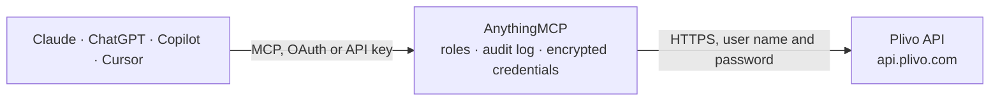

<!-- Generated by scripts/export-github-catalog.mjs in the anythingmcp-website repository. Do not edit by hand. -->

# Plivo MCP connector

Let your AI work with Plivo: check balance and prices, send SMS and MMS, place calls and read call records, end live calls, list recordings and transcriptions, find and look up phone numbers, and … The AnythingMCP connector gives Claude, ChatGPT, Microsoft Copilot, Cursor and Gemini 22 MCP tools for Plivo: 16 read and 6 can change data.

**Category:** [Messaging](../messaging.md) · **Tools:** 22 · **Setup guide:** [anythingmcp.com](https://anythingmcp.com/guides/plivo-to-mcp) · [Deutsch](https://anythingmcp.com/de/guides/plivo-to-mcp) · [Italiano](https://anythingmcp.com/it/guides/plivo-to-mcp) · [Español](https://anythingmcp.com/es/guides/plivo-to-mcp) · [日本語](https://anythingmcp.com/ja/guides/plivo-to-mcp) · [Русский](https://anythingmcp.com/ru/guides/plivo-to-mcp) · [中文](https://anythingmcp.com/zh/guides/plivo-to-mcp)

## Start without code

No installation and no terminal: AnythingMCP Cloud runs the Plivo connector for you, operated by helpcode.ai in Frankfurt, Germany.

1. **Click the button above** and create an account or sign in. The Plivo connector opens, ready to install.
2. **Paste the API key or token from your Plivo account.** Every click is in the [step-by-step guide](https://anythingmcp.com/guides/plivo-to-mcp).
3. **Click Install.** AnythingMCP shows the address of your MCP server.
4. **Add that address to your assistant:** [Claude](https://anythingmcp.com/guides/connect-plivo-to-claude) · [ChatGPT](https://anythingmcp.com/guides/connect-plivo-to-chatgpt) · [Microsoft Copilot](https://anythingmcp.com/guides/connect-plivo-to-copilot) · [Cursor](https://anythingmcp.com/guides/connect-plivo-to-cursor) · [Gemini CLI](https://anythingmcp.com/guides/connect-plivo-to-gemini) · [Meta Muse](https://anythingmcp.com/guides/connect-plivo-to-muse).
5. **Ask your first question**, for example: *What's our Plivo account balance and Auth ID on file right now?*

Prefer help with the setup? [Talk to us](https://anythingmcp.com/contact).

## How it works

- **The AI client** speaks MCP (Streamable HTTP) to AnythingMCP and only sees tool names, descriptions and results. It never gets the Plivo credentials.
- **AnythingMCP** checks the client's role, builds the call from the tool definition, adds the credentials (user name and password), calls Plivo, logs the call and returns the result.
- **Plivo** sees an ordinary API client with the rights of the account the credentials belong to.

## Tools

| Tool | What it does | Access |
|---|---|---|
| [`plivo_get_account`](#plivo_get_account) | Read the Plivo account: name, account type, billing mode (prepaid or postpaid), remaining cash credits, auto recharge, time zone and the Auth ID. | read |
| [`plivo_get_pricing`](#plivo_get_pricing) | Read Plivo's prices for one country: outbound and inbound SMS per message, voice per minute (local, toll-free, SIP and per prefix) and monthly rent for… | read |
| [`plivo_send_message`](#plivo_send_message) | Send an SMS or MMS from a Plivo number or sender id. | write |
| [`plivo_get_message`](#plivo_get_message) | Read one message by message_uuid: state (queued, sent, delivered, undelivered, failed, received, read), direction, numbers, time sent, number of billed… | read |
| [`plivo_list_messages`](#plivo_list_messages) | List SMS, MMS and WhatsApp messages of the account, newest first, with state, direction, numbers, times, billed parts, price and errors (no message text). | read |
| [`plivo_make_call`](#plivo_make_call) | Place an outbound phone call. | write |
| [`plivo_list_calls`](#plivo_list_calls) | List ended calls (call detail records) of the last 7 days unless ended_after or ended_before is set (at most 30 days per search, 90 days back): direction,… | read |
| [`plivo_get_call`](#plivo_get_call) | Read one ended call by call_uuid: direction, numbers, times, duration, billed duration, rate and total price, hangup cause and source. | read |
| [`plivo_list_live_calls`](#plivo_list_live_calls) | List the calls running right now on the account, as a list of call_uuid values. | read |
| [`plivo_get_live_call`](#plivo_get_live_call) | Read a call that is running right now: call_status (ringing, in-progress), direction, from, to, caller name and session start. | read |
| [`plivo_hangup_call`](#plivo_hangup_call) | End one running call at once (it cuts off the people on the line). | write |
| [`plivo_list_recordings`](#plivo_list_recordings) | List call and conference recordings of the last 7 days unless a time range is set (at most 30 days per search): recording_id, call_uuid, numbers, format,… | read |
| [`plivo_get_recording`](#plivo_get_recording) | Read one recording by recording_id: call_uuid, format, duration, start and end, storage cost and recording_url (playable by anyone with the link). | read |
| [`plivo_get_transcription`](#plivo_get_transcription) | Read the transcription of a recording, if one was created (transcription is a paid Plivo option set on the recording): status, the text, cost and duration. | read |
| [`plivo_list_numbers`](#plivo_list_numbers) | List the phone numbers rented on this account: number, alias, type, country, region, voice, SMS and MMS capability, linked application, monthly rent,… | read |
| [`plivo_get_number`](#plivo_get_number) | Read one rented number: alias, type, capabilities, linked application, monthly rent, renewal date and compliance status. | read |
| [`plivo_search_available_numbers`](#plivo_search_available_numbers) | Search numbers that can be rented in a country (free, nothing is bought): number, type, region or city, capabilities, monthly rent, setup fee, per-minute… | read |
| [`plivo_buy_number`](#plivo_buy_number) | Rent a number found with plivo_search_available_numbers. | write |
| [`plivo_lookup_number`](#plivo_lookup_number) | Look up a phone number: whether it is valid, its country, formats, carrier name, line type (mobile, fixed, voip, toll-free) and whether it was ported. | read |
| [`plivo_send_verification`](#plivo_send_verification) | Send a one-time code to a phone number by SMS or voice call with Plivo Verify and start a verification session. | write |
| [`plivo_validate_verification`](#plivo_validate_verification) | Check the one-time code a person entered against a Verify session. | write |
| [`plivo_get_verification`](#plivo_get_verification) | Read a Verify session: recipient, channel, status (in-progress, verified, expired), the delivery attempts and the charges. | read |

## Tool reference

Every parameter as the AI client sees it in `tools/list`. Source: [`packages/backend/src/adapters/intl/plivo.json`](../../../packages/backend/src/adapters/intl/plivo.json).

### `plivo_get_account`

Read the Plivo account: name, account type, billing mode (prepaid or postpaid), remaining cash credits, auto recharge, time zone and the Auth ID. Use it first to check the credentials and the balance.

**Access:** read · **Call:** `GET /`

No parameters.

### `plivo_get_pricing`

Read Plivo's prices for one country: outbound and inbound SMS per message, voice per minute (local, toll-free, SIP and per prefix) and monthly rent for local and toll-free numbers, in USD. Use it to tell the user what a message, call or number will cost before sending, calling or buying.

**Access:** read · **Call:** `GET /Pricing/`

| Parameter | Type | Required | Description |
|---|---|---|---|
| `country_iso` | string | yes | Two-letter country code, e.g. US, DE, GB. |

### `plivo_send_message`

Send an SMS or MMS from a Plivo number or sender id. This reaches real people and costs money per message part (check plivo_get_pricing), so show the user the sender, every recipient and the exact text and call only after the user confirms. Set src (or powerpack_uuid) and dst; several recipients are joined with < (e.g. 14155550123<14155550124), each billed. Returns message_uuid (a list); read the delivery state later with plivo_get_message.

**Access:** write · **Call:** `POST /Message/`

| Parameter | Type | Required | Description |
|---|---|---|---|
| `dst` | string | yes | Recipient in E.164 format without spaces, e.g. +14155550123. Several recipients: join with <. |
| `text` | string | yes | Message text. Long texts are split into several parts, each billed (up to 1600 GSM or 737 Unicode characters). |
| `src` | string | no | Sender: a Plivo number of this account in E.164, a short code or an alphanumeric sender id where the country allows it. Leave out when powerpack_uuid is set. |
| `powerpack_uuid` | string | no | Send through this Powerpack (number pool) instead of src. |
| `type` | `sms` \| `mms` | no | sms (default) or mms. MMS works in the US and Canada and costs more. |
| `media_urls` | string[] | no | For MMS: public URLs of images or files (up to 10, 5 MB in total). |
| `url` | string | no | Your URL that receives delivery status callbacks for this message. |
| `log` | `true` \| `false` \| `content_only` \| `number_only` | no | Whether Plivo keeps the content and numbers in its logs: true (default), false, content_only or number_only. |

### `plivo_get_message`

Read one message by message_uuid: state (queued, sent, delivered, undelivered, failed, received, read), direction, numbers, time sent, number of billed parts (units), price (total_amount) and error code with message when it failed. Message details are personal data.

**Access:** read · **Call:** `GET /Message/{message_uuid}/`

| Parameter | Type | Required | Description |
|---|---|---|---|
| `message_uuid` | string | yes | The message_uuid returned by plivo_send_message or plivo_list_messages. |

### `plivo_list_messages`

List SMS, MMS and WhatsApp messages of the account, newest first, with state, direction, numbers, times, billed parts, price and errors (no message text). Filter by direction, state, type, numbers, error code and time. Message logs are personal data. 20 per page; page with offset.

**Access:** read · **Call:** `GET /Message/`

| Parameter | Type | Required | Description |
|---|---|---|---|
| `message_direction` | `inbound` \| `outbound` | no | Only inbound or only outbound messages. |
| `message_state` | `queued` \| `sent` \| `delivered` \| `undelivered` \| `failed` \| `received` \| `read` | no | Only messages in this state. |
| `message_type` | `sms` \| `mms` \| `whatsapp` | no | Only this type. |
| `from_number` | string | no | Only messages from this number (E.164 without +, as Plivo stores it, e.g. 14155550123). |
| `to_number` | string | no | Only messages to this number (E.164 without +). |
| `error_code` | integer | no | Only messages that failed with this Plivo error code. |
| `sent_after` | string | no | Only messages after this time. UTC time as YYYY-MM-DD HH:MM:SS (e.g. 2026-10-01 00:00:00). |
| `sent_before` | string | no | Only messages before this time. UTC time as YYYY-MM-DD HH:MM:SS (e.g. 2026-10-01 00:00:00). |
| `limit` | integer | no | Results per page, 1 to 20 (default 20). |
| `offset` | integer | no | Number of results to skip, for the next page (e.g. 20, 40). meta.next is null on the last page. |

### `plivo_make_call`

Place an outbound phone call. Plivo rings the number and, when it is answered, fetches your answer_url, which must return Plivo XML saying what to do (speak, play, connect). This calls a real person and costs money per minute (check plivo_get_pricing), so show the user the number, the caller id and what will happen and call only after the user confirms. Set time_limit to cap the cost. Returns request_uuid; the call appears in plivo_list_live_calls while it runs.

**Access:** write · **Call:** `POST /Call/`

| Parameter | Type | Required | Description |
|---|---|---|---|
| `to` | string | yes | Number to call in E.164 without + (e.g. 14155550123) or a SIP URI. Several numbers joined with < are called at once, each billed. |
| `from` | string | yes | Caller id: a Plivo number of this account or a verified caller id, E.164 without + (e.g. 14155550100). |
| `answer_url` | string | yes | Public URL that returns Plivo XML when the call is answered, e.g. https://example.com/answer.xml. |
| `answer_method` | `GET` \| `POST` | no | HTTP method for answer_url (default POST). |
| `time_limit` | integer | no | Maximum call length in seconds (default 14400, i.e. 4 hours). Set a short limit, e.g. 120, to cap the cost. |
| `ring_timeout` | integer | no | Seconds to let it ring before giving up (default 120). |
| `caller_name` | string | no | Caller name shown on SIP calls (up to 50 characters). |
| `hangup_url` | string | no | URL notified when the call ends, with duration and cost. |
| `machine_detection` | `true` \| `hangup` | no | Detect answering machines: true to report it, hangup to end the call (billed extra). |

### `plivo_list_calls`

List ended calls (call detail records) of the last 7 days unless ended_after or ended_before is set (at most 30 days per search, 90 days back): direction, numbers, start, answer and end time, duration, billed duration, price, hangup cause and source. Call records are personal data. 20 per page; page with offset.

**Access:** read · **Call:** `GET /Call/`

| Parameter | Type | Required | Description |
|---|---|---|---|
| `call_direction` | `inbound` \| `outbound` | no | Only inbound or only outbound calls. |
| `from_number` | string | no | Only calls from this number. |
| `to_number` | string | no | Only calls to this number. |
| `ended_after` | string | no | Only calls that ended at or after this time. UTC time as YYYY-MM-DD HH:MM:SS (e.g. 2026-10-01 00:00:00). |
| `ended_before` | string | no | Only calls that ended at or before this time. UTC time as YYYY-MM-DD HH:MM:SS (e.g. 2026-10-01 00:00:00). |
| `min_bill_duration` | integer | no | Only calls billed longer than this many seconds. |
| `hangup_cause_code` | integer | no | Only calls with this hangup cause code. |
| `hangup_source` | `customer` \| `carrier` \| `zentrunk` | no | Only calls hung up by this side. |
| `limit` | integer | no | Results per page, 1 to 20 (default 20). |
| `offset` | integer | no | Number of results to skip, for the next page (e.g. 20, 40). meta.next is null on the last page. |

### `plivo_get_call`

Read one ended call by call_uuid: direction, numbers, times, duration, billed duration, rate and total price, hangup cause and source. For a call still running use plivo_get_live_call.

**Access:** read · **Call:** `GET /Call/{call_uuid}/`

| Parameter | Type | Required | Description |
|---|---|---|---|
| `call_uuid` | string | yes | The call_uuid from plivo_list_calls. |

### `plivo_list_live_calls`

List the calls running right now on the account, as a list of call_uuid values. Read one with plivo_get_live_call and end it with plivo_hangup_call.

**Access:** read · **Call:** `GET /Call/`

| Parameter | Type | Required | Description |
|---|---|---|---|
| `call_direction` | `inbound` \| `outbound` | no | Only inbound or only outbound calls. |
| `from_number` | string | no | Only calls from this number. |
| `to_number` | string | no | Only calls to this number. |
| `limit` | integer | no | Results per page, 1 to 20 (default 20). |
| `offset` | integer | no | Number of results to skip, for the next page (e.g. 20, 40). meta.next is null on the last page. |

### `plivo_get_live_call`

Read a call that is running right now: call_status (ringing, in-progress), direction, from, to, caller name and session start.

**Access:** read · **Call:** `GET /Call/{call_uuid}/`

| Parameter | Type | Required | Description |
|---|---|---|---|
| `call_uuid` | string | yes | The call_uuid from plivo_list_live_calls. |

### `plivo_hangup_call`

End one running call at once (it cuts off the people on the line). Always pass the full call_uuid of that one call: Plivo ends every running call of the account when no call is named. Show the user which call (numbers, start) will be ended and call only after the user confirms. Answers 204 with no body.

**Access:** write · **Call:** `DELETE /Call/{call_uuid}/`

| Parameter | Type | Required | Description |
|---|---|---|---|
| `call_uuid` | string | yes | The full call_uuid of the running call (36 characters) from plivo_list_live_calls. Never empty. |

### `plivo_list_recordings`

List call and conference recordings of the last 7 days unless a time range is set (at most 30 days per search): recording_id, call_uuid, numbers, format, duration in ms, start time, storage cost and recording_url, a link anyone can play. Recordings are personal data: share the links only with people allowed to hear them. 20 per page; page with offset.

**Access:** read · **Call:** `GET /Recording/`

| Parameter | Type | Required | Description |
|---|---|---|---|
| `call_uuid` | string | no | Only recordings of this call. |
| `from_number` | string | no | Only recordings of calls from this number. |
| `to_number` | string | no | Only recordings of calls to this number. |
| `added_after` | string | no | Only recordings created at or after this time. UTC time as YYYY-MM-DD HH:MM:SS (e.g. 2026-10-01 00:00:00). |
| `added_before` | string | no | Only recordings created at or before this time. UTC time as YYYY-MM-DD HH:MM:SS (e.g. 2026-10-01 00:00:00). |
| `limit` | integer | no | Results per page, 1 to 20 (default 20). |
| `offset` | integer | no | Number of results to skip, for the next page (e.g. 20, 40). meta.next is null on the last page. |

### `plivo_get_recording`

Read one recording by recording_id: call_uuid, format, duration, start and end, storage cost and recording_url (playable by anyone with the link). Recordings are personal data.

**Access:** read · **Call:** `GET /Recording/{recording_id}/`

| Parameter | Type | Required | Description |
|---|---|---|---|
| `recording_id` | string | yes | The recording_id from plivo_list_recordings. |

### `plivo_get_transcription`

Read the transcription of a recording, if one was created (transcription is a paid Plivo option set on the recording): status, the text, cost and duration. type diarized splits the text by speaker. Transcripts are personal data.

**Access:** read · **Call:** `GET /Transcription/{recording_id}/`

| Parameter | Type | Required | Description |
|---|---|---|---|
| `recording_id` | string | yes | The recording_id from plivo_list_recordings. |
| `type` | `transcription` \| `raw` \| `diarized` | no | transcription (default text), raw, or diarized (by speaker). |

### `plivo_list_numbers`

List the phone numbers rented on this account: number, alias, type, country, region, voice, SMS and MMS capability, linked application, monthly rent, renewal date and compliance or 10DLC status. 20 per page; page with offset.

**Access:** read · **Call:** `GET /Number/`

| Parameter | Type | Required | Description |
|---|---|---|---|
| `type` | `local` \| `mobile` \| `fixed` \| `national` \| `tollfree` | no | Only this number type. |
| `number_startswith` | string | no | Only numbers starting with these digits, e.g. 1415. |
| `alias` | string | no | Only the number with exactly this alias. |
| `services` | string | no | Only numbers with these capabilities: voice, sms, mms or a comma-separated combination such as voice,sms. |
| `limit` | integer | no | Results per page, 1 to 20 (default 20). |
| `offset` | integer | no | Number of results to skip, for the next page (e.g. 20, 40). meta.next is null on the last page. |

### `plivo_get_number`

Read one rented number: alias, type, capabilities, linked application, monthly rent, renewal date and compliance status.

**Access:** read · **Call:** `GET /Number/{number}/`

| Parameter | Type | Required | Description |
|---|---|---|---|
| `number` | string | yes | The number in E.164 without +, e.g. 14155550100. |

### `plivo_search_available_numbers`

Search numbers that can be rented in a country (free, nothing is bought): number, type, region or city, capabilities, monthly rent, setup fee, per-minute and per-message rates and the documents some countries require. 20 per page; page with offset.

**Access:** read · **Call:** `GET /PhoneNumber/`

| Parameter | Type | Required | Description |
|---|---|---|---|
| `country_iso` | string | yes | Two-letter country code, e.g. US, DE, GB. |
| `type` | `local` \| `mobile` \| `fixed` \| `national` \| `tollfree` | no | Number type. |
| `pattern` | string | no | Digits the number should start with after the country code, e.g. 415. |
| `region` | string | no | Region name, e.g. Frankfurt (fixed numbers). |
| `city` | string | no | City name (local numbers). |
| `services` | string | no | Required capabilities: voice, sms, mms, voice,sms or voice,sms,mms. |
| `limit` | integer | no | Results per page, 1 to 20 (default 20). |
| `offset` | integer | no | Number of results to skip, for the next page (e.g. 20, 40). meta.next is null on the last page. |

### `plivo_buy_number`

Rent a number found with plivo_search_available_numbers. This costs money: the setup fee and a monthly rent are charged until the number is released. Installed switched off; an administrator turns it on deliberately. Before calling, show the user the number with its monthly rent and setup fee and call only after the user confirms. Some countries need compliance documents first.

**Access:** write · **Call:** `POST /PhoneNumber/{number}/`

| Parameter | Type | Required | Description |
|---|---|---|---|
| `number` | string | yes | The number to rent, exactly as returned by the search (E.164 without +). |
| `app_id` | string | no | Plivo application id to link the number to, so its calls and messages are handled. |

### `plivo_lookup_number`

Look up a phone number: whether it is valid, its country, formats, carrier name, line type (mobile, fixed, voip, toll-free) and whether it was ported. Each lookup is billed (a fraction of a cent), so for more than a few numbers tell the user the count and the cost and continue only after the user confirms.

**Access:** read · **Call:** `GET https://lookup.plivo.com/v1/Number/{phone_number}`

| Parameter | Type | Required | Description |
|---|---|---|---|
| `phone_number` | string | yes | The number in E.164 format, e.g. +14155550123. |

### `plivo_send_verification`

Send a one-time code to a phone number by SMS or voice call with Plivo Verify and start a verification session. This reaches a real person and costs money (per verification plus the SMS or call), so confirm the number and channel with the user first. Returns session_uuid; check the code the person received with plivo_validate_verification.

**Access:** write · **Call:** `POST /Verify/Session/`

| Parameter | Type | Required | Description |
|---|---|---|---|
| `recipient` | string | yes | Phone number that receives the code, E.164, e.g. +14155550123. |
| `channel` | `sms` \| `voice` | no | sms (default) or voice. |
| `app_uuid` | string | no | Verify application to use (its template, code length and expiry); the default application when left out. |
| `locale` | string | no | Language of the message, e.g. en, de, fr_FR (default en). |
| `brand_name` | string | no | Brand name filled into the message template. |
| `code_length` | integer | no | Length of the code, 4 to 8 (overrides the application). |
| `url` | string | no | Your URL that receives status callbacks for this session. |

### `plivo_validate_verification`

Check the one-time code a person entered against a Verify session. Answers "session validated successfully." when it is right, an error when it is wrong or expired. Each try counts towards the session's attempt limit.

**Access:** write · **Call:** `POST /Verify/Session/{session_uuid}/`

| Parameter | Type | Required | Description |
|---|---|---|---|
| `session_uuid` | string | yes | The session_uuid from plivo_send_verification. |
| `otp` | string | yes | The code the person entered. |

### `plivo_get_verification`

Read a Verify session: recipient, channel, status (in-progress, verified, expired), the delivery attempts and the charges.

**Access:** read · **Call:** `GET /Verify/Session/{session_uuid}/`

| Parameter | Type | Required | Description |
|---|---|---|---|
| `session_uuid` | string | yes | The session_uuid from plivo_send_verification. |

## Run it yourself

AnythingMCP is open source (AGPL-3.0). [Run it with Docker](../../../README.md#run-it-yourself), open **Connectors → Store**, pick **Plivo** and enter `PLIVO_AUTH_ID`, `PLIVO_AUTH_TOKEN`, then add your MCP server URL to the AI client.

[← Messaging connectors](../messaging.md) · [All categories](../README.md)
