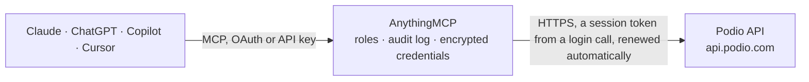

<!-- Generated by scripts/export-github-catalog.mjs in the anythingmcp-website repository. Do not edit by hand. -->

# Podio MCP connector

Read one Podio app: its field definitions, a filtered page of items, and a single item. The AnythingMCP connector gives Claude, ChatGPT, Microsoft Copilot, Cursor and Gemini 3 MCP tools for Podio, all read-only.

**Category:** [Project Management](../project-management.md) · **Tools:** 3 · **Setup guide:** [anythingmcp.com](https://anythingmcp.com/guides/podio-to-mcp) · [Deutsch](https://anythingmcp.com/de/guides/podio-to-mcp) · [Italiano](https://anythingmcp.com/it/guides/podio-to-mcp) · [Español](https://anythingmcp.com/es/guides/podio-to-mcp) · [日本語](https://anythingmcp.com/ja/guides/podio-to-mcp) · [Русский](https://anythingmcp.com/ru/guides/podio-to-mcp) · [中文](https://anythingmcp.com/zh/guides/podio-to-mcp)

## Start without code

No installation and no terminal: AnythingMCP Cloud runs the Podio connector for you, operated by helpcode.ai in Frankfurt, Germany.

1. **Click the button above** and create an account or sign in. The Podio connector opens, ready to install.
2. **Paste the API key or token from your Podio account.** Every click is in the [step-by-step guide](https://anythingmcp.com/guides/podio-to-mcp).
3. **Click Install.** AnythingMCP shows the address of your MCP server.
4. **Add that address to your assistant:** [Claude](https://anythingmcp.com/guides/connect-podio-to-claude) · [ChatGPT](https://anythingmcp.com/guides/connect-podio-to-chatgpt) · [Microsoft Copilot](https://anythingmcp.com/guides/connect-podio-to-copilot) · [Cursor](https://anythingmcp.com/guides/connect-podio-to-cursor) · [Gemini CLI](https://anythingmcp.com/guides/connect-podio-to-gemini) · [Meta Muse](https://anythingmcp.com/guides/connect-podio-to-muse).
5. **Ask your first question**, for example: *What's the status of service request SR-2026-0418 for Kellermann Hotel GmbH, and which technician is assigned to it?*

Prefer help with the setup? [Talk to us](https://anythingmcp.com/contact).

## How it works

- **The AI client** speaks MCP (Streamable HTTP) to AnythingMCP and only sees tool names, descriptions and results. It never gets the Podio credentials.
- **AnythingMCP** checks the client's role, builds the call from the tool definition, adds the credentials (a session token from a login call, renewed automatically), calls Podio, logs the call and returns the result.
- **Podio** sees an ordinary API client with the rights of the account the credentials belong to.

## Tools

| Tool | What it does | Access |
|---|---|---|
| [`podio_get_app`](#podio_get_app) | Get the Podio app this connector is signed in as, including every field (field_id, external_id, type, label, required and settings such as category options). | read |
| [`podio_filter_items`](#podio_filter_items) | Filter and list items in this Podio app. | read |
| [`podio_get_item`](#podio_get_item) | Get one Podio item by its numeric item_id (from podio_filter_items), with each field's external_id, type, label and values. | read |

## Tool reference

Every parameter as the AI client sees it in `tools/list`. Source: [`packages/backend/src/adapters/intl/podio.json`](../../../packages/backend/src/adapters/intl/podio.json).

### `podio_get_app`

Get the Podio app this connector is signed in as, including every field (field_id, external_id, type, label, required and settings such as category options). No parameters. Use it to check the sign-in and to learn filter keys.

**Access:** read · **Call:** `GET /app/{{PODIO_APP_ID}}`

No parameters.

### `podio_filter_items`

Filter and list items in this Podio app. Returns total, filtered and one page of items with field values. Pass filters keyed by a field external_id or by title, created_on, tags, item_id. Read-only; this call counts against Podio's tighter 250-per-hour limit.

**Access:** read · **Call:** `POST /item/app/{{PODIO_APP_ID}}/filter/`

| Parameter | Type | Required | Description |
|---|---|---|---|
| `filters` | object | no | Filter object. Keys are a field external_id (or field_id as a string) or title, created_on, created_by, last_edit_on, tags, item_id, app_item_id. Category values are lists of option ids. Number and date values are {from, to}. Example: {"status": [1], "created_on": {"from": "-7d"}}. |
| `sort_by` | string | no | Sort key: created_on, last_edit_on, created_by, title, item_id, app_item_id, activity, or a numeric field_id. |
| `sort_desc` | boolean | no | true to sort descending. Use true with created_on to see the newest items first. |
| `limit` | integer | no | Items per page, 1 to 100. Default 20. Podio's own ceiling is 500; stay at or below 100 so the answer stays small. |
| `offset` | integer | no | How many matching items to skip. Default 0. Add limit to move to the next page. |

### `podio_get_item`

Get one Podio item by its numeric item_id (from podio_filter_items), with each field's external_id, type, label and values. Does not mark the item as viewed.

**Access:** read · **Call:** `GET /item/{item_id}`

| Parameter | Type | Required | Description |
|---|---|---|---|
| `item_id` | integer | yes | Numeric item_id from podio_filter_items. Not the per-app app_item_id. |

## Run it yourself

AnythingMCP is open source (AGPL-3.0). [Run it with Docker](../../../README.md#run-it-yourself), open **Connectors → Store**, pick **Podio** and enter `PODIO_APP_ID`, `PODIO_APP_TOKEN`, `PODIO_CLIENT_ID`, `PODIO_CLIENT_SECRET`, then add your MCP server URL to the AI client.

[← Project Management connectors](../project-management.md) · [All categories](../README.md)
