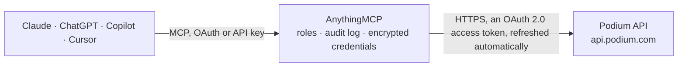

<!-- Generated by scripts/export-github-catalog.mjs in the anythingmcp-website repository. Do not edit by hand. -->

# Podium MCP connector

Podium customer messaging, reviews and payments for local businesses: read and answer inbox conversations by text and email, manage contacts, read reviews and feedback, create and refund payment … The AnythingMCP connector gives Claude, ChatGPT, Microsoft Copilot, Cursor and Gemini 38 MCP tools for Podium: 28 read and 10 can change data.

**Category:** [Messaging](../messaging.md) · **Tools:** 38 · **Setup guide:** [anythingmcp.com](https://anythingmcp.com/guides/podium-to-mcp) · [Deutsch](https://anythingmcp.com/de/guides/podium-to-mcp) · [Italiano](https://anythingmcp.com/it/guides/podium-to-mcp) · [Español](https://anythingmcp.com/es/guides/podium-to-mcp) · [日本語](https://anythingmcp.com/ja/guides/podium-to-mcp) · [Русский](https://anythingmcp.com/ru/guides/podium-to-mcp) · [中文](https://anythingmcp.com/zh/guides/podium-to-mcp)

## Start without code

No installation and no terminal: AnythingMCP Cloud runs the Podium connector for you, operated by helpcode.ai in Frankfurt, Germany.

1. **Click the button above** and create an account or sign in. The Podium connector opens, ready to install.
2. **Sign in with your Podium account** when AnythingMCP asks. The first time, an admin creates a small app in the Podium developer console. Every click is in the [step-by-step guide](https://anythingmcp.com/guides/podium-to-mcp).
3. **Click Install.** AnythingMCP shows the address of your MCP server.
4. **Add that address to your assistant:** [Claude](https://anythingmcp.com/guides/connect-podium-to-claude) · [ChatGPT](https://anythingmcp.com/guides/connect-podium-to-chatgpt) · [Microsoft Copilot](https://anythingmcp.com/guides/connect-podium-to-copilot) · [Cursor](https://anythingmcp.com/guides/connect-podium-to-cursor) · [Gemini CLI](https://anythingmcp.com/guides/connect-podium-to-gemini) · [Meta Muse](https://anythingmcp.com/guides/connect-podium-to-muse).
5. **Ask your first question**, for example: *What's the status and amount for invoice number INV-2026-114 for Greenfield Dental Ltd.?*

Prefer help with the setup? [Talk to us](https://anythingmcp.com/contact).

## How it works

- **The AI client** speaks MCP (Streamable HTTP) to AnythingMCP and only sees tool names, descriptions and results. It never gets the Podium credentials.
- **AnythingMCP** checks the client's role, builds the call from the tool definition, adds the credentials (an OAuth 2.0 access token, refreshed automatically), calls Podium, logs the call and returns the result.
- **Podium** sees an ordinary API client with the rights of the account the credentials belong to.

## Tools

| Tool | What it does | Access |
|---|---|---|
| [`podium_list_locations`](#podium_list_locations) | Locations (business sites) the signed-in account can access: location uid, name, address, phone, organization uid. | read |
| [`podium_get_location`](#podium_get_location) | One location by uid: name, display name, address, phone, time zone and organization uid. | read |
| [`podium_get_organization`](#podium_get_organization) | The organization (business account) a location belongs to, by its uid (organizationUid of a location). | read |
| [`podium_list_users`](#podium_list_users) | Podium users (staff) of the accessible locations: uid, name, email, role. | read |
| [`podium_get_user`](#podium_get_user) | One Podium user by uid: name, email, phone, role and locations. | read |
| [`podium_list_contacts`](#podium_list_contacts) | Contacts (customers) with name, phone, email, address, tags, attributes, locations and conversation uids. | read |
| [`podium_get_contact`](#podium_get_contact) | One contact, found by conversation uid, email or phone number: name, channels, address, tags, attributes and status. | read |
| [`podium_create_contact`](#podium_create_contact) | Create a contact at one or more locations. | write |
| [`podium_update_contact`](#podium_update_contact) | Change a contact found by conversation uid, email or phone: name, email, phone, address or locations. | write |
| [`podium_delete_contact`](#podium_delete_contact) | Delete a contact for good. | write |
| [`podium_list_conversations`](#podium_list_conversations) | Inbox conversations with uid, contact, channel (sms, email, ...), location, assigned user, open or closed, and lastItemAt. | read |
| [`podium_get_conversation`](#podium_get_conversation) | One conversation by uid: contact, channel, location, assignees, open or closed, last activity. | read |
| [`podium_update_conversation`](#podium_update_conversation) | Close or reopen a conversation, or assign it to a user (or several). | write |
| [`podium_list_messages`](#podium_list_messages) | Messages of a conversation, newest first by default: uid, body, direction (inbound from the customer or outbound), sender, channel, attachments, created time. | read |
| [`podium_get_message`](#podium_get_message) | One message of a conversation by uid: body, direction, sender, channel, delivery status and attachments. | read |
| [`podium_send_message`](#podium_send_message) | Send a text (phone) or email message from a location to a customer; it starts or continues the conversation on that channel. | write |
| [`podium_list_templates`](#podium_list_templates) | Message templates (saved replies), including review invite templates when asked for: uid, name, body, type, locations. | read |
| [`podium_list_reviews`](#podium_list_reviews) | Online reviews collected by Podium (Google, Facebook and other sites), newest first: uid, site, rating, author, body, response, location, published date. | read |
| [`podium_get_review`](#podium_get_review) | One review by uid with rating, text, author, site and the business response. | read |
| [`podium_list_feedback`](#podium_list_feedback) | Feedback survey answers (NPS-style), newest first: score, comment, contact, location. | read |
| [`podium_list_invoices`](#podium_list_invoices) | Podium payment invoices (text-to-pay and card reader): uid, invoice number, customer, amount in cents, status (created, paid, canceled, refunded ...),… | read |
| [`podium_get_invoice`](#podium_get_invoice) | One invoice by uid with line items, amount, status, payments (with payment uids) and refunds. | read |
| [`podium_create_invoice`](#podium_create_invoice) | Create an invoice and text or email the customer a payment link (no reader_uid), or send it to a Podium card reader (reader_uid). | write |
| [`podium_cancel_invoice`](#podium_cancel_invoice) | Cancel an unpaid invoice so it can no longer be paid, with an internal note. | write |
| [`podium_refund_invoice`](#podium_refund_invoice) | Refund a paid invoice, fully or partly (amount in cents, at most what was paid). | write |
| [`podium_get_payment`](#podium_get_payment) | One payment by uid: amount in cents, method, card brand and last digits, status, invoice. | read |
| [`podium_get_refund`](#podium_get_refund) | One refund by uid: amount in cents, reason, note, status and the invoice or payment it belongs to. | read |
| [`podium_list_products`](#podium_list_products) | Products of the payments catalogue: uid, name, price in cents, external id. | read |
| [`podium_get_product`](#podium_get_product) | One product of the payments catalogue by uid, with name, description, price in cents and images. | read |
| [`podium_list_campaigns`](#podium_list_campaigns) | Text marketing campaigns, last updated first: uid, name, message, status (DRAFT, SCHEDULED, IN_PROGRESS, COMPLETED, ...), locations and stats. | read |
| [`podium_get_campaign`](#podium_get_campaign) | One campaign by uid with message, status, audience and results. | read |
| [`podium_create_campaign_draft`](#podium_create_campaign_draft) | Create a text campaign as a DRAFT; nothing is sent until someone schedules or sends it in Podium. | write |
| [`podium_list_appointments`](#podium_list_appointments) | Appointments of the accessible locations, oldest change first by default: uid, contact, date and time, duration, status, type, assigned user. | read |
| [`podium_get_appointment`](#podium_get_appointment) | One appointment by uid: contact, date and time, duration, status, type, assigned user and note. | read |
| [`podium_create_appointment`](#podium_create_appointment) | Create an appointment for a contact at a location, optionally assigned to a user, with status and type. | write |
| [`podium_list_calls`](#podium_list_calls) | Podium Phones calls of the accessible locations, oldest change first by default: uid, direction, status, duration, phone numbers, location. | read |
| [`podium_get_call`](#podium_get_call) | One call by uid: direction, status, start and end, duration, numbers, whether it is private, conversation uid. | read |
| [`podium_get_call_voicemail`](#podium_get_call_voicemail) | Voicemail left on a call: transcript and a signed URL to the audio (404 when there is none). | read |

## Tool reference

Every parameter as the AI client sees it in `tools/list`. Source: [`packages/backend/src/adapters/intl/podium.json`](../../../packages/backend/src/adapters/intl/podium.json).

### `podium_list_locations`

Locations (business sites) the signed-in account can access: location uid, name, address, phone, organization uid. Most other tools need a location uid. Filter by name search or creation and update dates.

**Access:** read · **Call:** `GET /v4/locations`

| Parameter | Type | Required | Description |
|---|---|---|---|
| `search` | string | no | Text to search for in the search_fields. |
| `search_fields` | `name` \| `displayName` \| `address` \| `podiumPhoneNumber`[] | no | Fields to search in (default name). |
| `created_after` | string | no | Only locations created after this time, ISO 8601, e.g. 2026-10-01T00:00:00Z. |
| `created_before` | string | no | Only locations created at or before this time, ISO 8601, e.g. 2026-10-01T00:00:00Z. |
| `updated_after` | string | no | Only locations updated after this time, ISO 8601, e.g. 2026-10-01T00:00:00Z. |
| `limit` | integer | no | Items per page (at most 100). |
| `cursor` | string | no | metadata.nextCursor from the previous answer, for the next page. Other filters are ignored when a cursor is sent. |

### `podium_get_location`

One location by uid: name, display name, address, phone, time zone and organization uid.

**Access:** read · **Call:** `GET /v4/locations/{location_uid}`

| Parameter | Type | Required | Description |
|---|---|---|---|
| `location_uid` | string | yes | Location uid, from podium_list_locations. |

### `podium_get_organization`

The organization (business account) a location belongs to, by its uid (organizationUid of a location).

**Access:** read · **Call:** `GET /v4/organizations/{organization_uid}`

| Parameter | Type | Required | Description |
|---|---|---|---|
| `organization_uid` | string | yes | Organization uid, from a location (organizationUid). |

### `podium_list_users`

Podium users (staff) of the accessible locations: uid, name, email, role. Use a uid to assign conversations or appointments.

**Access:** read · **Call:** `GET /v4/users`

| Parameter | Type | Required | Description |
|---|---|---|---|
| `search` | string | no | Text to search for in the search_fields. |
| `search_fields` | `fullName` \| `address` \| `phone`[] | no | Fields to search in (default fullName). |
| `include_agents` | boolean | no | Include AI agent users (default true). |
| `limit` | integer | no | Items per page (at most 100). |
| `cursor` | string | no | metadata.nextCursor from the previous answer, for the next page. Other filters are ignored when a cursor is sent. |

### `podium_get_user`

One Podium user by uid: name, email, phone, role and locations.

**Access:** read · **Call:** `GET /v4/users/{user_uid}`

| Parameter | Type | Required | Description |
|---|---|---|---|
| `user_uid` | string | yes | User uid, from podium_list_users. |

### `podium_list_contacts`

Contacts (customers) with name, phone, email, address, tags, attributes, locations and conversation uids. Page with cursor; filter by last update.

**Access:** read · **Call:** `GET /v4/contacts`

| Parameter | Type | Required | Description |
|---|---|---|---|
| `updated_after` | string | no | Only contacts updated after this time, YYYY-MM-DDTHH:MM:SSZ. |
| `limit` | integer | no | Items per page (at most 100). |
| `cursor` | string | no | metadata.nextCursor from the previous answer, for the next page. Other filters are ignored when a cursor is sent. |

### `podium_get_contact`

One contact, found by conversation uid, email or phone number: name, channels, address, tags, attributes and status.

**Access:** read · **Call:** `GET /v4/contacts/{identifier}`

| Parameter | Type | Required | Description |
|---|---|---|---|
| `identifier` | string | yes | The contact: its conversation uid, email address, or phone number in E.164 form (+15555555555). |

### `podium_create_contact`

Create a contact at one or more locations. If a contact with the same phone or email exists, Podium updates it instead.

**Access:** write · **Call:** `POST /v4/contacts`

| Parameter | Type | Required | Description |
|---|---|---|---|
| `name` | string | yes | Full name. |
| `location_uids` | string[] | yes | Location uids the contact belongs to. |
| `phone_number` | string | no | Phone number, E.164 (+15555555555). |
| `email` | string | no | Email address. |
| `address` | object | no | Address: {"addressLine1", "addressLine2", "city", "state", "postalCode", "country"}. |
| `tag_uids` | string[] | no | Contact tag uids. |

### `podium_update_contact`

Change a contact found by conversation uid, email or phone: name, email, phone, address or locations. Send only what changes.

**Access:** write · **Call:** `PATCH /v4/contacts/{identifier}`

| Parameter | Type | Required | Description |
|---|---|---|---|
| `identifier` | string | yes | The contact: its conversation uid, email address, or phone number in E.164 form (+15555555555). |
| `name` | string | no | New name. |
| `email` | string | no | New email. |
| `phone_number` | string | no | New phone, E.164. |
| `address` | object | no | New address: {"addressLine1", "addressLine2", "city", "state", "postalCode", "country"}. |
| `location_uids` | string[] | no | Location uids. |

### `podium_delete_contact`

Delete a contact for good. It cannot be undone: show the user which contact it is and wait for a yes. Installed switched off.

**Access:** write · **Call:** `DELETE /v4/contacts/{identifier}`

| Parameter | Type | Required | Description |
|---|---|---|---|
| `identifier` | string | yes | The contact: its conversation uid, email address, or phone number in E.164 form (+15555555555). |

### `podium_list_conversations`

Inbox conversations with uid, contact, channel (sms, email, ...), location, assigned user, open or closed, and lastItemAt. Filter by location or last activity (since); order desc for the most recent.

**Access:** read · **Call:** `GET /v4/conversations`

| Parameter | Type | Required | Description |
|---|---|---|---|
| `location_uid` | string | no | Location uid, from podium_list_locations. |
| `since` | string | no | Only conversations with activity at or after this time, ISO 8601, e.g. 2026-10-01T00:00:00Z. |
| `order` | `asc` \| `desc` | no | asc: oldest first (for polling), desc: newest first. |
| `limit` | integer | no | Items per page (at most 100). |
| `cursor` | string | no | metadata.nextCursor from the previous answer, for the next page. Other filters are ignored when a cursor is sent. |

### `podium_get_conversation`

One conversation by uid: contact, channel, location, assignees, open or closed, last activity.

**Access:** read · **Call:** `GET /v4/conversations/{conversation_uid}`

| Parameter | Type | Required | Description |
|---|---|---|---|
| `conversation_uid` | string | yes | Conversation uid. |

### `podium_update_conversation`

Close or reopen a conversation, or assign it to a user (or several).

**Access:** write · **Call:** `PUT /v4/conversations/{conversation_uid}`

| Parameter | Type | Required | Description |
|---|---|---|---|
| `conversation_uid` | string | yes | Conversation uid. |
| `closed` | boolean | no | true to close, false to reopen. |
| `assigned_user_uid` | string | no | User uid to assign the conversation to. |
| `assignee_uids` | string[] | no | User uids to assign, for several assignees. |
| `assigned_by_name` | string | no | Name shown as the one who assigned it. |

### `podium_list_messages`

Messages of a conversation, newest first by default: uid, body, direction (inbound from the customer or outbound), sender, channel, attachments, created time.

**Access:** read · **Call:** `GET /v4/conversations/{conversation_uid}/messages`

| Parameter | Type | Required | Description |
|---|---|---|---|
| `conversation_uid` | string | yes | Conversation uid. |
| `since` | string | no | Only messages published at or after this time, ISO 8601, e.g. 2026-10-01T00:00:00Z. |
| `order` | `asc` \| `desc` | no | asc: oldest first (for polling), desc: newest first. |
| `cursor` | string | no | metadata.nextCursor from the previous answer, for the next page. Other filters are ignored when a cursor is sent. |

### `podium_get_message`

One message of a conversation by uid: body, direction, sender, channel, delivery status and attachments.

**Access:** read · **Call:** `GET /v4/conversations/{conversation_uid}/messages/{message_uid}`

| Parameter | Type | Required | Description |
|---|---|---|---|
| `conversation_uid` | string | yes | Conversation uid. |
| `message_uid` | string | yes | Message uid. |

### `podium_send_message`

Send a text (phone) or email message from a location to a customer; it starts or continues the conversation on that channel. It reaches the customer at once: show the user the recipient and the exact text and wait for a yes.

**Access:** write · **Call:** `POST /v4/messages`

| Parameter | Type | Required | Description |
|---|---|---|---|
| `location_uid` | string | yes | Location uid, from podium_list_locations. |
| `channel_type` | `phone` \| `email` | yes | phone for SMS/text, email for email. |
| `channel_identifier` | string | yes | Phone number (US/Canada, or with country code such as +61) or email address. |
| `body` | string | yes | Message text. |
| `contact_name` | string | no | Name of the contact (updates the name of an existing contact). |
| `sender_name` | string | no | Name credited as the sender in the Podium app. |
| `subject` | string | no | Subject, for email. |
| `set_open_inbox` | boolean | no | Open the conversation in the inbox (new conversations start closed). |

### `podium_list_templates`

Message templates (saved replies), including review invite templates when asked for: uid, name, body, type, locations.

**Access:** read · **Call:** `GET /v4/templates`

| Parameter | Type | Required | Description |
|---|---|---|---|
| `types` | `custom` \| `review_invite` \| `review_invite_backup`[] | no | Template types (default custom). |
| `location_uid` | string | no | Location uid, from podium_list_locations. |

### `podium_list_reviews`

Online reviews collected by Podium (Google, Facebook and other sites), newest first: uid, site, rating, author, body, response, location, published date.

**Access:** read · **Call:** `GET /v4/reviews`

| Parameter | Type | Required | Description |
|---|---|---|---|
| `created_from` | string | no | Created at or after, ISO 8601, e.g. 2026-10-01T00:00:00Z. |
| `created_to` | string | no | Created at or before, ISO 8601, e.g. 2026-10-01T00:00:00Z. |
| `updated_from` | string | no | Updated at or after, ISO 8601, e.g. 2026-10-01T00:00:00Z. |
| `limit` | integer | no | Items per page (at most 100). |
| `cursor` | string | no | metadata.nextCursor from the previous answer, for the next page. Other filters are ignored when a cursor is sent. |

### `podium_get_review`

One review by uid with rating, text, author, site and the business response.

**Access:** read · **Call:** `GET /v4/reviews/{review_uid}`

| Parameter | Type | Required | Description |
|---|---|---|---|
| `review_uid` | string | yes | Review uid. |

### `podium_list_feedback`

Feedback survey answers (NPS-style), newest first: score, comment, contact, location.

**Access:** read · **Call:** `GET /v4/feedback`

| Parameter | Type | Required | Description |
|---|---|---|---|
| `created_from` | string | no | Created at or after, ISO 8601, e.g. 2026-10-01T00:00:00Z. |
| `created_to` | string | no | Created at or before, ISO 8601, e.g. 2026-10-01T00:00:00Z. |
| `limit` | integer | no | Items per page (at most 100). |
| `cursor` | string | no | metadata.nextCursor from the previous answer, for the next page. Other filters are ignored when a cursor is sent. |

### `podium_list_invoices`

Podium payment invoices (text-to-pay and card reader): uid, invoice number, customer, amount in cents, status (created, paid, canceled, refunded ...), payments and refunds. Filter by location and by created, paid or refunded date.

**Access:** read · **Call:** `GET /v4/invoices`

| Parameter | Type | Required | Description |
|---|---|---|---|
| `location_uid` | string | no | Location uid, from podium_list_locations. |
| `date_created` | string | no | Created on or after, ISO 8601, e.g. 2026-10-01T00:00:00Z. |
| `date_paid` | string | no | Paid on or after, ISO 8601, e.g. 2026-10-01T00:00:00Z. |
| `date_refunded` | string | no | Refunded on or after, ISO 8601, e.g. 2026-10-01T00:00:00Z. |
| `limit` | integer | no | Items per page (at most 100). |
| `cursor` | string | no | metadata.nextCursor from the previous answer, for the next page. Other filters are ignored when a cursor is sent. |

### `podium_get_invoice`

One invoice by uid with line items, amount, status, payments (with payment uids) and refunds.

**Access:** read · **Call:** `GET /v4/invoices/{invoice_uid}`

| Parameter | Type | Required | Description |
|---|---|---|---|
| `invoice_uid` | string | yes | Invoice uid. |
| `location_uid` | string | yes | Location uid, from podium_list_locations. |

### `podium_create_invoice`

Create an invoice and text or email the customer a payment link (no reader_uid), or send it to a Podium card reader (reader_uid). Amounts are in cents. It reaches the customer at once: show the user the customer, items and amounts and wait for a yes.

**Access:** write · **Call:** `POST /v4/invoices`

| Parameter | Type | Required | Description |
|---|---|---|---|
| `location_uid` | string | yes | Location uid, from podium_list_locations. |
| `customer_name` | string | yes | Customer name. |
| `channel_identifier` | string | yes | Customer phone number or email address for the payment link. |
| `invoice_number` | string | yes | Your reference number for the invoice. |
| `line_items` | object[] | yes | Items: [{"description": "Oil change", "amount": 4999}] with amount in cents. |
| `account_uid` | string | no | Bank account uid to pay into (default: the most recent account). |
| `reader_uid` | string | no | Card reader uid for an in-person (card present) invoice. |

### `podium_cancel_invoice`

Cancel an unpaid invoice so it can no longer be paid, with an internal note. It cannot be undone: show the user the invoice and wait for a yes. Installed switched off.

**Access:** write · **Call:** `POST /v4/invoices/{invoice_uid}/cancel`

| Parameter | Type | Required | Description |
|---|---|---|---|
| `invoice_uid` | string | yes | Invoice uid. |
| `location_uid` | string | yes | Location uid, from podium_list_locations. |
| `note` | string | yes | Internal reason for the cancellation. |

### `podium_refund_invoice`

Refund a paid invoice, fully or partly (amount in cents, at most what was paid). It sends money back: show the user the invoice and amount and wait for a yes. Installed switched off.

**Access:** write · **Call:** `POST /v4/invoices/{invoice_uid}/refund`

| Parameter | Type | Required | Description |
|---|---|---|---|
| `invoice_uid` | string | yes | Invoice uid (status paid). |
| `location_uid` | string | yes | Location uid, from podium_list_locations. |
| `payment_uid` | string | yes | Payment uid from podium_get_invoice. |
| `amount` | integer | yes | Amount to refund, in cents. |
| `reason` | `accidental_charge` \| `canceled` \| `duplicate` \| `fraudulent` \| `requested_by_customer` | yes | Reason. |
| `note` | string | no | Detailed note. |

### `podium_get_payment`

One payment by uid: amount in cents, method, card brand and last digits, status, invoice.

**Access:** read · **Call:** `GET /v4/payments/{payment_uid}`

| Parameter | Type | Required | Description |
|---|---|---|---|
| `payment_uid` | string | yes | Payment uid. |

### `podium_get_refund`

One refund by uid: amount in cents, reason, note, status and the invoice or payment it belongs to.

**Access:** read · **Call:** `GET /v4/refunds/{refund_uid}`

| Parameter | Type | Required | Description |
|---|---|---|---|
| `refund_uid` | string | yes | Refund uid. |
| `location_uid` | string | yes | Location uid, from podium_list_locations. |

### `podium_list_products`

Products of the payments catalogue: uid, name, price in cents, external id.

**Access:** read · **Call:** `GET /v4/products`

| Parameter | Type | Required | Description |
|---|---|---|---|
| `location_uid` | string | no | Location uid, from podium_list_locations. |
| `xid` | string | no | External id of the product. |
| `limit` | integer | no | Items per page (at most 100). |
| `cursor` | string | no | metadata.nextCursor from the previous answer, for the next page. Other filters are ignored when a cursor is sent. |

### `podium_get_product`

One product of the payments catalogue by uid, with name, description, price in cents and images.

**Access:** read · **Call:** `GET /v4/products/{product_uid}`

| Parameter | Type | Required | Description |
|---|---|---|---|
| `product_uid` | string | yes | Product uid. |

### `podium_list_campaigns`

Text marketing campaigns, last updated first: uid, name, message, status (DRAFT, SCHEDULED, IN_PROGRESS, COMPLETED, ...), locations and stats.

**Access:** read · **Call:** `GET /v4/campaigns`

| Parameter | Type | Required | Description |
|---|---|---|---|
| `status` | string | no | Only campaigns with this status, e.g. DRAFT, SCHEDULED, ACTIVE, COMPLETED. |

### `podium_get_campaign`

One campaign by uid with message, status, audience and results.

**Access:** read · **Call:** `GET /v4/campaigns/{campaign_uid}`

| Parameter | Type | Required | Description |
|---|---|---|---|
| `campaign_uid` | string | yes | Campaign uid. |

### `podium_create_campaign_draft`

Create a text campaign as a DRAFT; nothing is sent until someone schedules or sends it in Podium.

**Access:** write · **Call:** `POST /v4/campaigns`

| Parameter | Type | Required | Description |
|---|---|---|---|
| `name` | string | yes | Campaign name. |
| `location_uids` | string[] | yes | Location uids. |
| `message` | string | yes | Message sent to subscribers. |
| `include_active_conversations` | boolean | no | Also send to subscribers with an active inbox conversation. |
| `recently_sent_override` | boolean | no | Also send to subscribers who got a campaign in the past 5 days. |

### `podium_list_appointments`

Appointments of the accessible locations, oldest change first by default: uid, contact, date and time, duration, status, type, assigned user.

**Access:** read · **Call:** `GET /v4/appointments`

| Parameter | Type | Required | Description |
|---|---|---|---|
| `location_uid` | string | no | Location uid, from podium_list_locations. |
| `since` | string | no | Only appointments changed at or after this time, ISO 8601, e.g. 2026-10-01T00:00:00Z. |
| `order` | `asc` \| `desc` | no | asc: oldest first (for polling), desc: newest first. |
| `limit` | integer | no | Items per page (at most 100). |
| `cursor` | string | no | metadata.nextCursor from the previous answer, for the next page. Other filters are ignored when a cursor is sent. |

### `podium_get_appointment`

One appointment by uid: contact, date and time, duration, status, type, assigned user and note.

**Access:** read · **Call:** `GET /v4/appointments/{appointment_uid}`

| Parameter | Type | Required | Description |
|---|---|---|---|
| `appointment_uid` | string | yes | Appointment uid. |

### `podium_create_appointment`

Create an appointment for a contact at a location, optionally assigned to a user, with status and type.

**Access:** write · **Call:** `POST /v4/appointments`

| Parameter | Type | Required | Description |
|---|---|---|---|
| `location_uid` | string | yes | Location uid, from podium_list_locations. |
| `contact_name` | string | yes | Contact name. |
| `contact_phone_number` | string | yes | Contact phone, E.164 (+15555555555). |
| `datetime` | string | yes | Date and time, ISO 8601, e.g. 2026-10-01T00:00:00Z. |
| `duration_min` | integer | no | Length in minutes. |
| `status` | `unconfirmed` \| `confirmed` \| `completed` \| `cancelled` \| `no_show` | no | Status. |
| `type` | `in_person` \| `virtual` | no | in_person or virtual. |
| `assigned_user_uid` | string | no | User uid to assign. |
| `note` | string | no | Note on the appointment. |

### `podium_list_calls`

Podium Phones calls of the accessible locations, oldest change first by default: uid, direction, status, duration, phone numbers, location. Use podium_get_call for start and end time and privacy.

**Access:** read · **Call:** `GET /v4/calls`

| Parameter | Type | Required | Description |
|---|---|---|---|
| `location_uid` | string | no | Location uid, from podium_list_locations. |
| `since` | string | no | Only calls changed at or after this time, ISO 8601, e.g. 2026-10-01T00:00:00Z. |
| `order` | `asc` \| `desc` | no | asc: oldest first (for polling), desc: newest first. |
| `limit` | integer | no | Items per page (at most 100). |
| `cursor` | string | no | metadata.nextCursor from the previous answer, for the next page. Other filters are ignored when a cursor is sent. |

### `podium_get_call`

One call by uid: direction, status, start and end, duration, numbers, whether it is private, conversation uid.

**Access:** read · **Call:** `GET /v4/calls/{call_uid}`

| Parameter | Type | Required | Description |
|---|---|---|---|
| `call_uid` | string | yes | Call uid. |

### `podium_get_call_voicemail`

Voicemail left on a call: transcript and a signed URL to the audio (404 when there is none).

**Access:** read · **Call:** `GET /v4/calls/{call_uid}/voicemail`

| Parameter | Type | Required | Description |
|---|---|---|---|
| `call_uid` | string | yes | Call uid. |

## Run it yourself

AnythingMCP is open source (AGPL-3.0). [Run it with Docker](../../../README.md#run-it-yourself), open **Connectors → Store**, pick **Podium** and enter `PODIUM_CLIENT_ID`, `PODIUM_CLIENT_SECRET`, then add your MCP server URL to the AI client.

[← Messaging connectors](../messaging.md) · [All categories](../README.md)
