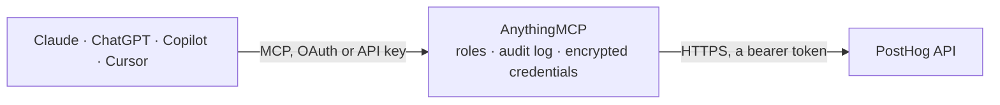

<!-- Generated by scripts/export-github-catalog.mjs in the anythingmcp-website repository. Do not edit by hand. -->

# PostHog MCP connector

Let your AI answer product analytics questions from PostHog: run read-only SQL (HogQL) over events and persons, compute trends, funnels and retention, read saved insights and dashboards, look up … The AnythingMCP connector gives Claude, ChatGPT, Microsoft Copilot, Cursor and Gemini 28 MCP tools for PostHog: 20 read and 8 can change data.

**Category:** [Analytics](../analytics.md) · **Tools:** 28 · **Setup guide:** [anythingmcp.com](https://anythingmcp.com/guides/posthog-to-mcp) · [Deutsch](https://anythingmcp.com/de/guides/posthog-to-mcp) · [Italiano](https://anythingmcp.com/it/guides/posthog-to-mcp) · [Español](https://anythingmcp.com/es/guides/posthog-to-mcp) · [日本語](https://anythingmcp.com/ja/guides/posthog-to-mcp) · [Русский](https://anythingmcp.com/ru/guides/posthog-to-mcp) · [中文](https://anythingmcp.com/zh/guides/posthog-to-mcp)

## Start without code

No installation and no terminal: AnythingMCP Cloud runs the PostHog connector for you, operated by helpcode.ai in Frankfurt, Germany.

1. **Click the button above** and create an account or sign in. The PostHog connector opens, ready to install.
2. **Paste the API key or token from your PostHog account.** Every click is in the [step-by-step guide](https://anythingmcp.com/guides/posthog-to-mcp).
3. **Click Install.** AnythingMCP shows the address of your MCP server.
4. **Add that address to your assistant:** [Claude](https://anythingmcp.com/guides/connect-posthog-to-claude) · [ChatGPT](https://anythingmcp.com/guides/connect-posthog-to-chatgpt) · [Microsoft Copilot](https://anythingmcp.com/guides/connect-posthog-to-copilot) · [Cursor](https://anythingmcp.com/guides/connect-posthog-to-cursor) · [Gemini CLI](https://anythingmcp.com/guides/connect-posthog-to-gemini) · [Meta Muse](https://anythingmcp.com/guides/connect-posthog-to-muse).
5. **Ask your first question**, for example: *Find the person with email billing@solarkomplett.no and show their distinct_ids and last_seen*

Prefer help with the setup? [Talk to us](https://anythingmcp.com/contact).

## How it works

- **The AI client** speaks MCP (Streamable HTTP) to AnythingMCP and only sees tool names, descriptions and results. It never gets the PostHog credentials.
- **AnythingMCP** checks the client's role, builds the call from the tool definition, adds the credentials (a bearer token), calls PostHog, logs the call and returns the result.
- **PostHog** sees an ordinary API client with the rights of the account the credentials belong to.

## Tools

| Tool | What it does | Access |
|---|---|---|
| [`posthog_get_current_user`](#posthog_get_current_user) | Get the user the personal API key belongs to: uuid, email and name, the current project (id, name, project_id, timezone), the current organization with the… | read |
| [`posthog_list_organizations`](#posthog_list_organizations) | List the organizations the user belongs to: id (a UUID), name, slug, membership_level, and each organization's projects. | read |
| [`posthog_list_projects`](#posthog_list_projects) | List the projects of an organization: id (the project_id every other tool takes), name, project_id, timezone, tags, is_demo and ingested_event (false until… | read |
| [`posthog_get_project`](#posthog_get_project) | Get one project's settings: name, timezone, week_start_day, base_currency, app_urls, test account filters, group types, whether events arrived, session… | read |
| [`posthog_run_hogql_query`](#posthog_run_hogql_query) | Run one read-only HogQL (PostHog SQL) SELECT over events, persons, sessions, groups or warehouse tables and return columns, results (rows as arrays), types… | read |
| [`posthog_run_insight_query`](#posthog_run_insight_query) | Run one of PostHog's insight calculations without saving it: TrendsQuery, FunnelsQuery, RetentionQuery, StickinessQuery, LifecycleQuery or PathsQuery. | read |
| [`posthog_list_persons`](#posthog_list_persons) | List or search persons (identified users and anonymous visitors): id, uuid, name, distinct_ids, properties, created_at and last_seen_at. | read |
| [`posthog_get_person`](#posthog_get_person) | Get one person by numeric id or UUID: name, distinct_ids, all person properties (email, initial UTM and referrer, geo), created_at and last_seen_at. | read |
| [`posthog_list_insights`](#posthog_list_insights) | List saved insights (charts): id, short_id, name, description, query, tags, favorited, dashboard_tiles, created_by and last_modified_at. | read |
| [`posthog_get_insight`](#posthog_get_insight) | Get one insight by numeric id or 8-character short_id: name, description, query, result, columns, last_refresh, is_cached, the hogql it ran and the… | read |
| [`posthog_create_insight`](#posthog_create_insight) | Save a new insight (chart) in the project from a query: a product analytics chart or a SQL insight. | write |
| [`posthog_update_insight`](#posthog_update_insight) | Change a saved insight: name, description, query, tags or favorited. | write |
| [`posthog_delete_insight`](#posthog_delete_insight) | Delete a saved insight (PostHog marks it deleted; it disappears from every dashboard and can be restored in the app). | write |
| [`posthog_list_dashboards`](#posthog_list_dashboards) | List dashboards: id, name, description, pinned, tags, created_by, created_at and last_viewed_at. | read |
| [`posthog_get_dashboard`](#posthog_get_dashboard) | Get one dashboard with its filters and tiles: each tile carries its insight (id, short_id, name, query and the last cached result) or a text card. | read |
| [`posthog_list_feature_flags`](#posthog_list_feature_flags) | List feature flags: id, key, name (the description), active, filters (release conditions with rollout_percentage, variants, payloads), status (ACTIVE,… | read |
| [`posthog_get_feature_flag`](#posthog_get_feature_flag) | Get one feature flag by id: key, name, active, filters (release condition groups with properties and rollout_percentage, multivariate variants, payloads),… | read |
| [`posthog_create_feature_flag`](#posthog_create_feature_flag) | Create a feature flag. | write |
| [`posthog_update_feature_flag`](#posthog_update_feature_flag) | Change a feature flag: switch it on or off, change its rollout or targeting, rename its description, archive it or retag it. | write |
| [`posthog_delete_feature_flag`](#posthog_delete_feature_flag) | Delete a feature flag (PostHog marks it deleted and switches it off; code that checks the key then gets false). | write |
| [`posthog_list_cohorts`](#posthog_list_cohorts) | List cohorts (saved groups of persons): id, name, description, count (persons in it), is_static, is_calculating, filters and created_at. | read |
| [`posthog_get_cohort`](#posthog_get_cohort) | Get one cohort by id: name, description, its definition (filters or query), count of persons, whether it is static or behavioral, last_calculation and any… | read |
| [`posthog_list_annotations`](#posthog_list_annotations) | List annotations (notes on charts such as releases or incidents): id, content, date_marker, scope, the insight or dashboard they belong to, created_by and… | read |
| [`posthog_get_annotation`](#posthog_get_annotation) | Get one annotation by id: content, date_marker, scope (project, organization, dashboard or insight), emoji, the insight or dashboard it is attached to,… | read |
| [`posthog_create_annotation`](#posthog_create_annotation) | Add an annotation, a note shown on charts at a point in time, e.g. a release, a campaign start or an incident. | write |
| [`posthog_delete_annotation`](#posthog_delete_annotation) | Delete an annotation (PostHog marks it deleted; it disappears from every chart and can be restored). | write |
| [`posthog_list_experiments`](#posthog_list_experiments) | List A/B test experiments: id, name, description, status, start_date, end_date, feature_flag_key, type, conclusion, archived and created_by. | read |
| [`posthog_get_experiment`](#posthog_get_experiment) | Get one experiment by id: status, start and end dates, its feature flag and variants, metrics, parameters, exposure cohort, conclusion and conclusion_comment. | read |

## Tool reference

Every parameter as the AI client sees it in `tools/list`. Source: [`packages/backend/src/adapters/intl/posthog.json`](../../../packages/backend/src/adapters/intl/posthog.json).

### `posthog_get_current_user`

Get the user the personal API key belongs to: uuid, email and name, the current project (id, name, project_id, timezone), the current organization with the id and name of each of its projects, and every organization the user belongs to. Start here to find project ids; works with every key, also one limited to specific projects.

**Access:** read · **Call:** `GET /api/users/@me/`

No parameters.

### `posthog_list_organizations`

List the organizations the user belongs to: id (a UUID), name, slug, membership_level, and each organization's projects. Pages with limit and offset; the answer has count, next (null on the last page) and results. A key limited to specific projects gets 403 here.

**Access:** read · **Call:** `GET /api/organizations/`

| Parameter | Type | Required | Description |
|---|---|---|---|
| `limit` | integer | no | Organizations per page (PostHog's default is 100). |
| `offset` | integer | no | How many organizations to skip, for the next page. |

### `posthog_list_projects`

List the projects of an organization: id (the project_id every other tool takes), name, project_id, timezone, tags, is_demo and ingested_event (false until the project received its first event). Pages with limit and offset; the answer has count, next (null on the last page) and results. A key limited to specific projects gets 403 here; use posthog_get_current_user instead.

**Access:** read · **Call:** `GET /api/organizations/{organization_id}/projects/`

| Parameter | Type | Required | Description |
|---|---|---|---|
| `organization_id` | string | yes | Organization id (UUID) from posthog_list_organizations or posthog_get_current_user. Default @current, the organization the user last opened in PostHog. |
| `search` | string | no | Text matched against project names. |
| `limit` | integer | no | Projects per page (PostHog's default is 100). |
| `offset` | integer | no | How many projects to skip, for the next page. |

### `posthog_get_project`

Get one project's settings: name, timezone, week_start_day, base_currency, app_urls, test account filters, group types, whether events arrived, session recording and autocapture settings and the primary dashboard. Project secrets are left out of the answer on purpose.

**Access:** read · **Call:** `GET /api/organizations/{organization_id}/projects/{project_id}/`

| Parameter | Type | Required | Description |
|---|---|---|---|
| `organization_id` | string | yes | Organization id (UUID) the project belongs to. Default @current, the organization the user last opened in PostHog. |
| `project_id` | string | yes | Project id, the number from posthog_get_current_user or posthog_list_projects (also in the PostHog URL /project/<id>/). |

### `posthog_run_hogql_query`

Run one read-only HogQL (PostHog SQL) SELECT over events, persons, sessions, groups or warehouse tables and return columns, results (rows as arrays), types and the hogql that ran. Read-only although it is a POST: HogQL only accepts SELECT. Filter on timestamp, add a LIMIT (100 rows without one, at most 50,000); OFFSET is refused, page by timestamp instead. Answers over 200 KB are cut.

**Access:** read · **Call:** `POST /api/projects/{project_id}/query/`

| Parameter | Type | Required | Description |
|---|---|---|---|
| `project_id` | string | yes | Project id, the number from posthog_get_current_user or posthog_list_projects. |
| `query` | string | yes | One HogQL SELECT, e.g. SELECT properties.$browser AS browser, count() AS events FROM events WHERE event = '$pageview' AND timestamp >= now() - INTERVAL 7 DAY GROUP BY browser ORDER BY events DESC LIMIT 20. |
| `values` | object | no | Values for {name} placeholders in the query, e.g. {"event_name": "signed_up"} with WHERE event = {event_name}. Keeps user text out of the SQL. |
| `name` | string | no | Short label for the query, shown in PostHog's query log (up to 128 characters). |

### `posthog_run_insight_query`

Run one of PostHog's insight calculations without saving it: TrendsQuery, FunnelsQuery, RetentionQuery, StickinessQuery, LifecycleQuery or PathsQuery. Read-only although it is a POST. Returns results (per series, step or cohort, with count values), plus resolved_date_range and whether the answer is_cached. Compute conversion and retention rates from the counts. Answers over 200 KB are cut.

**Access:** read · **Call:** `POST /api/projects/{project_id}/query/`

| Parameter | Type | Required | Description |
|---|---|---|---|
| `project_id` | string | yes | Project id, the number from posthog_get_current_user or posthog_list_projects. |
| `query` | object | yes | The query with its kind, e.g. {"kind": "TrendsQuery", "series": [{"kind": "EventsNode", "event": "$pageview", "math": "dau"}], "interval": "day", "dateRange": {"date_from": "-30d"}} or {"kind": "FunnelsQuery", "series": [{"kind": "EventsNode", "event": "signed_up"}, {"kind": "EventsNode", "event": "subscription_started"}], "dateRange": {"date_from": "-30d"}, "funnelsFilter": {"funnelWindowInterval": 14, "funnelWindowIntervalUnit": "day"}}. |
| `name` | string | no | Short label for the query, shown in PostHog's query log (up to 128 characters). |

### `posthog_list_persons`

List or search persons (identified users and anonymous visitors): id, uuid, name, distinct_ids, properties, created_at and last_seen_at. search matches email, name, person id or distinct id. Pages with limit and offset; the answer has next (null on the last page) and results, which is empty when nothing matches. Counts as an analytics call for rate limits.

**Access:** read · **Call:** `GET /api/projects/{project_id}/persons/`

| Parameter | Type | Required | Description |
|---|---|---|---|
| `project_id` | string | yes | Project id, the number from posthog_get_current_user or posthog_list_projects. |
| `search` | string | no | Text matched against email, name, person id and distinct id; partial values match. |
| `distinct_id` | string | no | Only the person with this distinct id (exact). |
| `email` | string | no | Only persons with this email property (exact). |
| `limit` | integer | no | Persons per page (default 20). |
| `offset` | integer | no | How many persons to skip, for the next page. |

### `posthog_get_person`

Get one person by numeric id or UUID: name, distinct_ids, all person properties (email, initial UTM and referrer, geo), created_at and last_seen_at. For the person's events, query the events table with posthog_run_hogql_query.

**Access:** read · **Call:** `GET /api/projects/{project_id}/persons/{person_id}/`

| Parameter | Type | Required | Description |
|---|---|---|---|
| `project_id` | string | yes | Project id, the number from posthog_get_current_user or posthog_list_projects. |
| `person_id` | string | yes | The person's numeric id or UUID, from posthog_list_persons. |

### `posthog_list_insights`

List saved insights (charts): id, short_id, name, description, query, tags, favorited, dashboard_tiles, created_by and last_modified_at. Metadata only by default (basic=true), without results. Pages with limit and offset; the answer has count, next (null on the last page) and results, empty in a new project.

**Access:** read · **Call:** `GET /api/projects/{project_id}/insights/`

| Parameter | Type | Required | Description |
|---|---|---|---|
| `project_id` | string | yes | Project id, the number from posthog_get_current_user or posthog_list_projects. |
| `search` | string | no | Text matched against name, description and tags. |
| `insight` | `TRENDS` \| `FUNNELS` \| `RETENTION` \| `PATHS` \| `STICKINESS` \| `LIFECYCLE` \| `SQL` \| `JSON` \| `JOURNEYS` \| `BI` | no | Only insights of this type, e.g. TRENDS, FUNNELS, RETENTION or SQL. |
| `saved` | boolean | no | true for insights that are saved or on a dashboard only, false for unsaved ones only. |
| `basic` | boolean | no | Return metadata only, without results (default true, much smaller and faster). |
| `order` | `-last_modified_at` \| `last_modified_at` \| `-last_viewed_at` \| `last_viewed_at` | no | Sort order, e.g. -last_modified_at for the most recently changed first. |
| `limit` | integer | no | Insights per page (default 25). |
| `offset` | integer | no | How many insights to skip, for the next page. |

### `posthog_get_insight`

Get one insight by numeric id or 8-character short_id: name, description, query, result, columns, last_refresh, is_cached, the hogql it ran and the dashboards it is on. By default only the cached result comes back (refresh force_cache, which may be null); refresh blocking recalculates when the cache is stale. Answers over 200 KB are cut.

**Access:** read · **Call:** `GET /api/projects/{project_id}/insights/{insight_id}/`

| Parameter | Type | Required | Description |
|---|---|---|---|
| `project_id` | string | yes | Project id, the number from posthog_get_current_user or posthog_list_projects. |
| `insight_id` | string | yes | Numeric id or 8-character short_id (from the insight's URL /insights/<short_id>). |
| `refresh` | `force_cache` \| `blocking` \| `force_blocking` | no | force_cache (PostHog's default) returns cached results only; blocking recalculates if the cache is stale; force_blocking always recalculates. |

### `posthog_create_insight`

Save a new insight (chart) in the project from a query: a product analytics chart or a SQL insight. Returns the insight with its id and short_id; open it at <POSTHOG_HOST>/project/<project_id>/insights/<short_id>. Run the query with posthog_run_insight_query or posthog_run_hogql_query first to check it.

**Access:** write · **Call:** `POST /api/projects/{project_id}/insights/`

| Parameter | Type | Required | Description |
|---|---|---|---|
| `project_id` | string | yes | Project id, the number from posthog_get_current_user or posthog_list_projects. |
| `name` | string | yes | Insight name, e.g. Weekly signups. |
| `description` | string | no | Optional description. |
| `query` | object | yes | What the chart shows. Product analytics: {"kind": "InsightVizNode", "source": {"kind": "TrendsQuery", "series": [{"kind": "EventsNode", "event": "signed_up"}], "interval": "week", "dateRange": {"date_from": "-90d"}}}. SQL: {"kind": "DataVisualizationNode", "source": {"kind": "HogQLQuery", "query": "SELECT ..."}}. |
| `tags` | string[] | no | Optional tags. |

### `posthog_update_insight`

Change a saved insight: name, description, query, tags or favorited. Only the fields you pass change, but a new query replaces the old one for everyone who views the chart and the dashboards it is on: confirm with the user first. Returns the updated insight.

**Access:** write · **Call:** `PATCH /api/projects/{project_id}/insights/{insight_id}/`

| Parameter | Type | Required | Description |
|---|---|---|---|
| `project_id` | string | yes | Project id, the number from posthog_get_current_user or posthog_list_projects. |
| `insight_id` | string | yes | Numeric id or 8-character short_id of the insight. |
| `name` | string | no | New name. |
| `description` | string | no | New description. |
| `query` | object | no | New query, the same shape as in posthog_create_insight; replaces the whole query. |
| `tags` | string[] | no | New tags; replaces the existing list. |
| `favorited` | boolean | no | true to star the insight, false to unstar it. |

### `posthog_delete_insight`

Delete a saved insight (PostHog marks it deleted; it disappears from every dashboard and can be restored in the app). Confirm the insight's name with the user first. Switched off at install.

**Access:** write · **Call:** `PATCH /api/projects/{project_id}/insights/{insight_id}/`

| Parameter | Type | Required | Description |
|---|---|---|---|
| `project_id` | string | yes | Project id, the number from posthog_get_current_user or posthog_list_projects. |
| `insight_id` | string | yes | Numeric id or 8-character short_id of the insight. |

### `posthog_list_dashboards`

List dashboards: id, name, description, pinned, tags, created_by, created_at and last_viewed_at. Pages with limit and offset; the answer has count, next (null on the last page) and results, empty in a new project. Use posthog_get_dashboard for the tiles.

**Access:** read · **Call:** `GET /api/projects/{project_id}/dashboards/`

| Parameter | Type | Required | Description |
|---|---|---|---|
| `project_id` | string | yes | Project id, the number from posthog_get_current_user or posthog_list_projects. |
| `search` | string | no | Text matched against name, description and tags. |
| `pinned` | boolean | no | true for pinned dashboards only. |
| `limit` | integer | no | Dashboards per page (PostHog's default is 100). |
| `offset` | integer | no | How many dashboards to skip, for the next page. |

### `posthog_get_dashboard`

Get one dashboard with its filters and tiles: each tile carries its insight (id, short_id, name, query and the last cached result) or a text card. Large dashboards are cut at 200 KB; then read single insights with posthog_get_insight.

**Access:** read · **Call:** `GET /api/projects/{project_id}/dashboards/{dashboard_id}/`

| Parameter | Type | Required | Description |
|---|---|---|---|
| `project_id` | string | yes | Project id, the number from posthog_get_current_user or posthog_list_projects. |
| `dashboard_id` | integer | yes | Dashboard id, from posthog_list_dashboards or the dashboard's URL. |

### `posthog_list_feature_flags`

List feature flags: id, key, name (the description), active, filters (release conditions with rollout_percentage, variants, payloads), status (ACTIVE, STALE...), version, tags, last_called_at and created_by. Archived flags are left out. Pages with limit and offset; the answer has count, next (null on the last page) and results, empty in a new project.

**Access:** read · **Call:** `GET /api/projects/{project_id}/feature_flags/`

| Parameter | Type | Required | Description |
|---|---|---|---|
| `project_id` | string | yes | Project id, the number from posthog_get_current_user or posthog_list_projects. |
| `search` | string | no | Text matched against flag key and name. |
| `key` | string | no | Only the flag with exactly this key (case-insensitive). |
| `active` | `true` \| `false` \| `STALE` | no | true for enabled flags, false for disabled ones, STALE for enabled flags not evaluated in 30 days. |
| `type` | `boolean` \| `multivariant` \| `experiment` \| `remote_config` | no | Only flags of this type. |
| `limit` | integer | no | Flags per page (PostHog's default is 100). |
| `offset` | integer | no | How many flags to skip, for the next page. |

### `posthog_get_feature_flag`

Get one feature flag by id: key, name, active, filters (release condition groups with properties and rollout_percentage, multivariate variants, payloads), version (needed to change it), status, experiments that use it, tags and last_called_at.

**Access:** read · **Call:** `GET /api/projects/{project_id}/feature_flags/{flag_id}/`

| Parameter | Type | Required | Description |
|---|---|---|---|
| `project_id` | string | yes | Project id, the number from posthog_get_current_user or posthog_list_projects. |
| `flag_id` | integer | yes | Numeric flag id, from posthog_list_feature_flags (search by key there). |

### `posthog_create_feature_flag`

Create a feature flag. An active flag with a rollout above 0 changes what live users see as soon as their SDK refreshes: show the user the key, active and the rollout and confirm with them first. Safest is active false or rollout_percentage 0. Returns the flag with its id and version.

**Access:** write · **Call:** `POST /api/projects/{project_id}/feature_flags/`

| Parameter | Type | Required | Description |
|---|---|---|---|
| `project_id` | string | yes | Project id, the number from posthog_get_current_user or posthog_list_projects. |
| `key` | string | yes | Flag key the code checks, e.g. new-checkout; unique in the project. |
| `name` | string | no | Description of the flag (PostHog stores it in the field name). |
| `filters` | object | yes | Targeting, e.g. {"groups": [{"properties": [], "rollout_percentage": 0}]}. A property condition: {"key": "email", "type": "person", "operator": "icontains", "value": "@acme.com"}. Variants: "multivariate": {"variants": [{"key": "control", "rollout_percentage": 50}, {"key": "test", "rollout_percentage": 50}]}. |
| `active` | boolean | yes | Whether the flag is served at all. Pass false to create it switched off. |
| `tags` | string[] | no | Optional tags. |

### `posthog_update_feature_flag`

Change a feature flag: switch it on or off, change its rollout or targeting, rename its description, archive it or retag it. This changes what live users see right away: show the user the change and confirm with them first. Send the version from your last read; a stale version is refused with 409. Returns the updated flag.

**Access:** write · **Call:** `PATCH /api/projects/{project_id}/feature_flags/{flag_id}/`

| Parameter | Type | Required | Description |
|---|---|---|---|
| `project_id` | string | yes | Project id, the number from posthog_get_current_user or posthog_list_projects. |
| `flag_id` | integer | yes | Numeric flag id, from posthog_list_feature_flags. |
| `version` | integer | no | The flag's version from posthog_get_feature_flag. Required for flags on PostHog's newer configuration; a mismatch means someone changed the flag since and is refused with 409. |
| `active` | boolean | no | true to serve the flag, false to switch it off for everyone. |
| `filters` | object | no | Complete new targeting (replaces the old one), e.g. {"groups": [{"properties": [], "rollout_percentage": 25}]}. Start from the filters of posthog_get_feature_flag and change only what the user asked. |
| `name` | string | no | New description of the flag. |
| `archived` | boolean | no | true to archive the flag (it must be inactive), false to unarchive it. |
| `tags` | string[] | no | New tags; replaces the existing list. |

### `posthog_delete_feature_flag`

Delete a feature flag (PostHog marks it deleted and switches it off; code that checks the key then gets false). Confirm the flag key with the user first. Send the version from your last read. Switched off at install.

**Access:** write · **Call:** `PATCH /api/projects/{project_id}/feature_flags/{flag_id}/`

| Parameter | Type | Required | Description |
|---|---|---|---|
| `project_id` | string | yes | Project id, the number from posthog_get_current_user or posthog_list_projects. |
| `flag_id` | integer | yes | Numeric flag id, from posthog_list_feature_flags. |
| `version` | integer | no | The flag's version from posthog_get_feature_flag; required for flags on PostHog's newer configuration. |

### `posthog_list_cohorts`

List cohorts (saved groups of persons): id, name, description, count (persons in it), is_static, is_calculating, filters and created_at. Pages with limit and offset; the answer has count, next (null on the last page) and results, empty in a new project.

**Access:** read · **Call:** `GET /api/projects/{project_id}/cohorts/`

| Parameter | Type | Required | Description |
|---|---|---|---|
| `project_id` | string | yes | Project id, the number from posthog_get_current_user or posthog_list_projects. |
| `search` | string | no | Text matched against cohort names. |
| `basic` | boolean | no | Leave out query, groups and error details (default true, smaller). |
| `limit` | integer | no | Cohorts per page (PostHog's default is 100). |
| `offset` | integer | no | How many cohorts to skip, for the next page. |

### `posthog_get_cohort`

Get one cohort by id: name, description, its definition (filters or query), count of persons, whether it is static or behavioral, last_calculation and any calculation error.

**Access:** read · **Call:** `GET /api/projects/{project_id}/cohorts/{cohort_id}/`

| Parameter | Type | Required | Description |
|---|---|---|---|
| `project_id` | string | yes | Project id, the number from posthog_get_current_user or posthog_list_projects. |
| `cohort_id` | integer | yes | Cohort id, from posthog_list_cohorts. |

### `posthog_list_annotations`

List annotations (notes on charts such as releases or incidents): id, content, date_marker, scope, the insight or dashboard they belong to, created_by and created_at. Pages with limit and offset; the answer has count, next (null on the last page) and results, empty when there are none.

**Access:** read · **Call:** `GET /api/projects/{project_id}/annotations/`

| Parameter | Type | Required | Description |
|---|---|---|---|
| `project_id` | string | yes | Project id, the number from posthog_get_current_user or posthog_list_projects. |
| `search` | string | no | Text matched against the annotation content. |
| `limit` | integer | no | Annotations per page (PostHog's default is 100). |
| `offset` | integer | no | How many annotations to skip, for the next page. |

### `posthog_get_annotation`

Get one annotation by id: content, date_marker, scope (project, organization, dashboard or insight), emoji, the insight or dashboard it is attached to, created_by and created_at.

**Access:** read · **Call:** `GET /api/projects/{project_id}/annotations/{annotation_id}/`

| Parameter | Type | Required | Description |
|---|---|---|---|
| `project_id` | string | yes | Project id, the number from posthog_get_current_user or posthog_list_projects. |
| `annotation_id` | integer | yes | Annotation id, from posthog_list_annotations. |

### `posthog_create_annotation`

Add an annotation, a note shown on charts at a point in time, e.g. a release, a campaign start or an incident. Visible to the whole project (or organization) by default. Returns the annotation with its id.

**Access:** write · **Call:** `POST /api/projects/{project_id}/annotations/`

| Parameter | Type | Required | Description |
|---|---|---|---|
| `project_id` | string | yes | Project id, the number from posthog_get_current_user or posthog_list_projects. |
| `content` | string | yes | The note, e.g. Released checkout v2. |
| `date_marker` | string | yes | When it happened, ISO 8601 with a timezone, e.g. 2026-10-11T09:30:00Z. |
| `scope` | `project` \| `organization` \| `dashboard` \| `dashboard_item` | no | Where it shows: project (default), organization, dashboard (set dashboard_id) or dashboard_item for one insight (set dashboard_item). |
| `dashboard_id` | integer | no | Dashboard id, for scope dashboard. |
| `dashboard_item` | integer | no | Numeric insight id, for scope dashboard_item. |

### `posthog_delete_annotation`

Delete an annotation (PostHog marks it deleted; it disappears from every chart and can be restored). Confirm the annotation with the user first. Switched off at install.

**Access:** write · **Call:** `PATCH /api/projects/{project_id}/annotations/{annotation_id}/`

| Parameter | Type | Required | Description |
|---|---|---|---|
| `project_id` | string | yes | Project id, the number from posthog_get_current_user or posthog_list_projects. |
| `annotation_id` | integer | yes | Annotation id, from posthog_list_annotations. |

### `posthog_list_experiments`

List A/B test experiments: id, name, description, status, start_date, end_date, feature_flag_key, type, conclusion, archived and created_by. Archived experiments are left out unless archived is true. Pages with limit and offset; the answer has count, next (null on the last page) and results, empty in a new project.

**Access:** read · **Call:** `GET /api/projects/{project_id}/experiments/`

| Parameter | Type | Required | Description |
|---|---|---|---|
| `project_id` | string | yes | Project id, the number from posthog_get_current_user or posthog_list_projects. |
| `search` | string | no | Text matched against the experiment name and its feature flag key. |
| `status` | `all` \| `draft` \| `running` \| `paused` \| `stopped` \| `complete` | no | Only experiments in this state, e.g. running. |
| `archived` | boolean | no | true for archived experiments only. |
| `limit` | integer | no | Experiments per page (PostHog's default is 100). |
| `offset` | integer | no | How many experiments to skip, for the next page. |

### `posthog_get_experiment`

Get one experiment by id: status, start and end dates, its feature flag and variants, metrics, parameters, exposure cohort, conclusion and conclusion_comment. Metric results are not included; compare variants with posthog_run_hogql_query on the $feature/<flag key> event property.

**Access:** read · **Call:** `GET /api/projects/{project_id}/experiments/{experiment_id}/`

| Parameter | Type | Required | Description |
|---|---|---|---|
| `project_id` | string | yes | Project id, the number from posthog_get_current_user or posthog_list_projects. |
| `experiment_id` | integer | yes | Experiment id, from posthog_list_experiments. |

## Run it yourself

AnythingMCP is open source (AGPL-3.0). [Run it with Docker](../../../README.md#run-it-yourself), open **Connectors → Store**, pick **PostHog** and enter `POSTHOG_HOST`, `POSTHOG_PERSONAL_API_KEY`, then add your MCP server URL to the AI client.

[← Analytics connectors](../analytics.md) · [All categories](../README.md)
