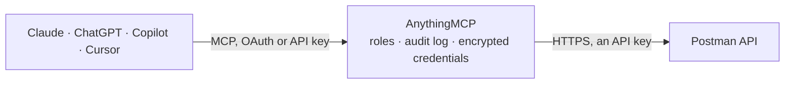

<!-- Generated by scripts/export-github-catalog.mjs in the anythingmcp-website repository. Do not edit by hand. -->

# Postman MCP connector

Let your AI work with Postman: workspaces, collections and requests, environments, Spec Hub specs, APIs, mock servers and their call logs, monitors and team users, and create or change collections, … The AnythingMCP connector gives Claude, ChatGPT, Microsoft Copilot, Cursor and Gemini 35 MCP tools for Postman: 23 read and 12 can change data.

**Category:** [Infrastructure](../infrastructure.md) · **Tools:** 35 · **Setup guide:** [anythingmcp.com](https://anythingmcp.com/guides/postman-to-mcp)

## Start without code

No installation and no terminal: AnythingMCP Cloud runs the Postman connector for you, operated by helpcode.ai in Frankfurt, Germany.

1. **Click the button above** and create an account or sign in. The Postman connector opens, ready to install.
2. **Paste the API key or token from your Postman account.** Every click is in the [step-by-step guide](https://anythingmcp.com/guides/postman-to-mcp).
3. **Click Install.** AnythingMCP shows the address of your MCP server.
4. **Add that address to your assistant:** [Claude](https://anythingmcp.com/guides/connect-postman-to-claude) · [ChatGPT](https://anythingmcp.com/guides/connect-postman-to-chatgpt) · [Microsoft Copilot](https://anythingmcp.com/guides/connect-postman-to-copilot) · [Cursor](https://anythingmcp.com/guides/connect-postman-to-cursor) · [Gemini CLI](https://anythingmcp.com/guides/connect-postman-to-gemini) · [Meta Muse](https://anythingmcp.com/guides/connect-postman-to-muse).
5. **Ask your first question**, for example: *Which collection UID is used for the Invoicing API collection in workspace Finance Team (we need it for a webhook)?*

Prefer help with the setup? [Talk to us](https://anythingmcp.com/contact).

## How it works

- **The AI client** speaks MCP (Streamable HTTP) to AnythingMCP and only sees tool names, descriptions and results. It never gets the Postman credentials.
- **AnythingMCP** checks the client's role, builds the call from the tool definition, adds the credentials (an API key), calls Postman, logs the call and returns the result.
- **Postman** sees an ordinary API client with the rights of the account the credentials belong to.

## Tools

| Tool | What it does | Access |
|---|---|---|
| [`postman_get_me`](#postman_get_me) | Read the Postman user the API key belongs to: user id, username, email, team id and name, and the monthly usage of API calls and other plan limits (operations). | read |
| [`postman_list_workspaces`](#postman_list_workspaces) | List the workspaces the key can see: id, name, type and visibility (personal, team, private, public, partner). | read |
| [`postman_get_workspace`](#postman_get_workspace) | Read one workspace with the collections, environments, mocks, monitors and APIs it contains (ids, uids and names), its visibility and who created it. | read |
| [`postman_list_collections`](#postman_list_collections) | List collections, optionally of one workspace: id, uid, name, owner and dates. | read |
| [`postman_get_collection`](#postman_get_collection) | Read a whole collection in Postman Collection Format v2.1: info, folders and requests (item), variables, auth and scripts. | read |
| [`postman_get_collection_request`](#postman_get_collection_request) | Read one request of a collection: method, url, headers, query parameters, body, auth and scripts. | read |
| [`postman_get_collection_folder`](#postman_get_collection_folder) | Read one folder of a collection with the ids of its requests and subfolders (or their full contents with populate). | read |
| [`postman_list_environments`](#postman_list_environments) | List environments, optionally of one workspace: id, uid, name, owner and dates. | read |
| [`postman_get_environment`](#postman_get_environment) | Read an environment with its variables (key, value, type, enabled). | read |
| [`postman_list_apis`](#postman_list_apis) | List the APIs (API Builder) of a workspace: id, name, summary and dates. | read |
| [`postman_get_api`](#postman_get_api) | Read one API with, on request, its linked collections, versions, schemas or Git repository details. | read |
| [`postman_list_mocks`](#postman_list_mocks) | List the active mock servers: id, uid, name, mockUrl, the collection and environment they serve, and whether they are private. | read |
| [`postman_get_mock`](#postman_get_mock) | Read a mock server: mockUrl, collection, environment, private flag, delay and server responses. | read |
| [`postman_get_mock_call_logs`](#postman_get_mock_call_logs) | Read the requests a mock server received and what it answered, newest first with sort=servedAt and direction=desc. | read |
| [`postman_list_monitors`](#postman_list_monitors) | List monitors (scheduled collection runs): id, uid, name, owner and whether they are active. | read |
| [`postman_get_monitor`](#postman_get_monitor) | Read a monitor: collection, environment, schedule (cron and time zone), regions, notifications, and lastRun with status, start and finish time and the… | read |
| [`postman_list_specs`](#postman_list_specs) | List the API specifications in Spec Hub for a workspace: id, name, type (OPENAPI:3.0, ASYNCAPI:2.0 ...) and dates. | read |
| [`postman_get_spec`](#postman_get_spec) | Read a spec's metadata: name, type, dates and who created and changed it. | read |
| [`postman_list_spec_files`](#postman_list_spec_files) | List the files of a spec with their path and type (ROOT is the entry file, DEFAULT a referenced file). | read |
| [`postman_get_spec_file`](#postman_get_spec_file) | Read one file of a spec, including its content as text. | read |
| [`postman_get_spec_definition`](#postman_get_spec_definition) | Read the complete, resolved definition of an OpenAPI or AsyncAPI spec, with all files combined. | read |
| [`postman_list_team_users`](#postman_list_team_users) | List the users of the Postman team: id, name, username, email, roles and join date. | read |
| [`postman_search`](#postman_search) | Search Postman for requests, collections, workspaces, environments, documents, flows or specs by text. | read |
| [`postman_create_collection`](#postman_create_collection) | Create a collection in a workspace, empty or with folders and requests in Postman Collection Format v2.1. | write |
| [`postman_update_collection`](#postman_update_collection) | Change a collection's name or description, its variables or its auth, leaving folders and requests as they are. | write |
| [`postman_create_collection_folder`](#postman_create_collection_folder) | Create a folder in a collection, at the top level or inside another folder. | write |
| [`postman_create_collection_request`](#postman_create_collection_request) | Add a request to a collection, at the top level or in a folder: method, URL, headers, query parameters, body and scripts. | write |
| [`postman_update_collection_request`](#postman_update_collection_request) | Change a request in a collection: name, method, URL, headers, query parameters, body, auth or scripts. | write |
| [`postman_create_environment`](#postman_create_environment) | Create an environment in a workspace with its variables. | write |
| [`postman_update_environment`](#postman_update_environment) | Change an environment with JSON Patch operations of one kind per call: add variables, replace the name or a variable property, or remove variables. | write |
| [`postman_create_mock`](#postman_create_mock) | Create a mock server that answers with the saved example responses of a collection. | write |
| [`postman_create_monitor`](#postman_create_monitor) | Create a monitor that runs a collection on a schedule from Postman's cloud. | write |
| [`postman_run_monitor`](#postman_run_monitor) | Run a monitor now, which sends the collection's real requests to their APIs and uses a monitoring run of the plan. | write |
| [`postman_create_spec`](#postman_create_spec) | Create an API specification in Spec Hub from one or more files (OpenAPI, AsyncAPI, protobuf, GraphQL, Smithy). | write |
| [`postman_update_spec_file`](#postman_update_spec_file) | Change one file of an OpenAPI or protobuf spec: its content, its name, or its type (ROOT or DEFAULT). | write |

## Tool reference

Every parameter as the AI client sees it in `tools/list`. Source: [`packages/backend/src/adapters/intl/postman.json`](../../../packages/backend/src/adapters/intl/postman.json).

### `postman_get_me`

Read the Postman user the API key belongs to: user id, username, email, team id and name, and the monthly usage of API calls and other plan limits (operations). Start here: the user id filters other lists. Read-only.

**Access:** read · **Call:** `GET /me`

No parameters.

### `postman_list_workspaces`

List the workspaces the key can see: id, name, type and visibility (personal, team, private, public, partner). Most other tools need a workspace id. Read-only.

**Access:** read · **Call:** `GET /workspaces`

| Parameter | Type | Required | Description |
|---|---|---|---|
| `type` | `personal` \| `team` \| `private` \| `public` \| `partner` | no | Only workspaces of this type. |
| `createdBy` | string | no | Only workspaces created by these user ids, comma-separated, e.g. the id from postman_get_me for "my workspaces". |
| `elementType` | `collection` \| `specification` | no | With elementId: return the workspace that holds this element. |
| `elementId` | string | no | With elementType: a collection uid (<owner id>-<collection id>) or a spec id. |
| `cursor` | string | no | Cursor for the next page: meta.nextCursor of the previous response. Leave empty for the first page. |
| `limit` | integer | no | Workspaces per page, up to 100. |

### `postman_get_workspace`

Read one workspace with the collections, environments, mocks, monitors and APIs it contains (ids, uids and names), its visibility and who created it. Read-only.

**Access:** read · **Call:** `GET /workspaces/{workspaceId}`

| Parameter | Type | Required | Description |
|---|---|---|---|
| `workspaceId` | string | yes | Workspace id from postman_list_workspaces, e.g. 1f0df51a-8658-4ee8-a2a1-d2567dfa09a9. |
| `include` | string | no | Optional extras, comma-separated: team (the team id), scim (SCIM ids of creator and last editor), mocks:deactivated (also deactivated mock servers). |

### `postman_list_collections`

List collections, optionally of one workspace: id, uid, name, owner and dates. Page with limit and offset; name filters by exact name and cannot be combined with limit or offset. Read-only.

**Access:** read · **Call:** `GET /collections`

| Parameter | Type | Required | Description |
|---|---|---|---|
| `workspace` | string | no | Optional workspace id from postman_list_workspaces. An unknown id returns an empty list, not an error. |
| `name` | string | no | Optional exact collection name; partial matches are not supported. Do not combine with limit or offset. |
| `limit` | integer | no | Collections per page. |
| `offset` | integer | no | Zero-based position of the first collection to return. |

### `postman_get_collection`

Read a whole collection in Postman Collection Format v2.1: info, folders and requests (item), variables, auth and scripts. Large collections are big; pass model=minimal to get only the ids of the root-level folders and requests first. Read-only.

**Access:** read · **Call:** `GET /collections/{collectionId}`

| Parameter | Type | Required | Description |
|---|---|---|---|
| `collectionId` | string | yes | Collection id or uid from postman_list_collections. The uid is <owner id>-<collection id>, e.g. 12345678-12ece9e1-2abf-4edc-8e34-de66e74114d2; both forms work here. |
| `model` | `minimal` | no | minimal returns only the root-level folder and request ids instead of the full collection. |

### `postman_get_collection_request`

Read one request of a collection: method, url, headers, query parameters, body, auth and scripts. Request ids come from postman_get_collection (item[].id) or postman_get_collection_folder. Read-only.

**Access:** read · **Call:** `GET /collections/{collectionId}/requests/{requestId}`

| Parameter | Type | Required | Description |
|---|---|---|---|
| `collectionId` | string | yes | Collection id or uid from postman_list_collections. The uid is <owner id>-<collection id>, e.g. 12345678-12ece9e1-2abf-4edc-8e34-de66e74114d2; both forms work here. |
| `requestId` | string | yes | Request id from the collection items. |
| `uid` | boolean | no | Return all ids in uid form (<owner id>-<id>). |
| `populate` | boolean | no | Return all of the request contents, including its saved responses. |

### `postman_get_collection_folder`

Read one folder of a collection with the ids of its requests and subfolders (or their full contents with populate). Read-only.

**Access:** read · **Call:** `GET /collections/{collectionId}/folders/{folderId}`

| Parameter | Type | Required | Description |
|---|---|---|---|
| `collectionId` | string | yes | Collection id or uid from postman_list_collections. The uid is <owner id>-<collection id>, e.g. 12345678-12ece9e1-2abf-4edc-8e34-de66e74114d2; both forms work here. |
| `folderId` | string | yes | Folder id from the collection items. |
| `uid` | boolean | no | Return all ids in uid form (<owner id>-<id>). |
| `populate` | boolean | no | Return the full contents of the requests and subfolders. |

### `postman_list_environments`

List environments, optionally of one workspace: id, uid, name, owner and dates. Read-only.

**Access:** read · **Call:** `GET /environments`

| Parameter | Type | Required | Description |
|---|---|---|---|
| `workspace` | string | no | Optional workspace id from postman_list_workspaces. |

### `postman_get_environment`

Read an environment with its variables (key, value, type, enabled). Values of shared variables are returned, including secret-type ones; do not repeat secret values to the user unless asked. Read-only.

**Access:** read · **Call:** `GET /environments/{environmentId}`

| Parameter | Type | Required | Description |
|---|---|---|---|
| `environmentId` | string | yes | Environment id or uid from postman_list_environments. |

### `postman_list_apis`

List the APIs (API Builder) of a workspace: id, name, summary and dates. New design work lives in Spec Hub instead; see postman_list_specs. Read-only.

**Access:** read · **Call:** `GET /apis`

| Parameter | Type | Required | Description |
|---|---|---|---|
| `workspaceId` | string | yes | Workspace id from postman_list_workspaces, e.g. 1f0df51a-8658-4ee8-a2a1-d2567dfa09a9. |
| `createdBy` | integer | no | Only APIs created by this user id. |
| `description` | string | no | Only APIs whose description contains this text (case-insensitive). |
| `cursor` | string | no | Cursor for the next page: meta.nextCursor of the previous response. Leave empty for the first page. |
| `limit` | integer | no | APIs per page. |

### `postman_get_api`

Read one API with, on request, its linked collections, versions, schemas or Git repository details. Git-connected APIs only return versions and gitInfo. Read-only.

**Access:** read · **Call:** `GET /apis/{apiId}`

| Parameter | Type | Required | Description |
|---|---|---|---|
| `apiId` | string | yes | API id from postman_list_apis. |
| `include` | string | no | Optional, comma-separated: collections, versions, schemas, gitInfo. |

### `postman_list_mocks`

List the active mock servers: id, uid, name, mockUrl, the collection and environment they serve, and whether they are private. Without filters only the mocks you created. Read-only.

**Access:** read · **Call:** `GET /mocks`

| Parameter | Type | Required | Description |
|---|---|---|---|
| `workspace` | string | no | Optional workspace id; wins over teamId. |
| `teamId` | string | no | Optional team id (from postman_get_me) for the whole team's mocks. |

### `postman_get_mock`

Read a mock server: mockUrl, collection, environment, private flag, delay and server responses. Read-only.

**Access:** read · **Call:** `GET /mocks/{mockId}`

| Parameter | Type | Required | Description |
|---|---|---|---|
| `mockId` | string | yes | Mock id from postman_list_mocks. |

### `postman_get_mock_call_logs`

Read the requests a mock server received and what it answered, newest first with sort=servedAt and direction=desc. At most 100 logs or 6.5 MB per call; headers and bodies only with include. Read-only.

**Access:** read · **Call:** `GET /mocks/{mockId}/call-logs`

| Parameter | Type | Required | Description |
|---|---|---|---|
| `mockId` | string | yes | Mock id from postman_list_mocks. |
| `since` | string | no | Only calls from this time on, ISO 8601, e.g. 2026-10-01T00:00:00Z. |
| `until` | string | no | Only calls up to this time, ISO 8601. |
| `responseStatusCode` | integer | no | Only calls answered with this HTTP status, e.g. 404. |
| `requestMethod` | string | no | Only calls with this HTTP method, e.g. POST. |
| `requestPath` | string | no | Only calls to this path, e.g. /users. |
| `sort` | `servedAt` | no | Sort field; requires direction. |
| `direction` | `asc` \| `desc` | no | Sort direction; requires sort. |
| `include` | string | no | Optional, comma-separated: request.headers, request.body, response.headers, response.body. |
| `cursor` | string | no | Cursor for the next page: meta.nextCursor of the previous response. Leave empty for the first page. |
| `limit` | integer | no | Logs per page, up to 100. |

### `postman_list_monitors`

List monitors (scheduled collection runs): id, uid, name, owner and whether they are active. Read-only.

**Access:** read · **Call:** `GET /monitors`

| Parameter | Type | Required | Description |
|---|---|---|---|
| `workspace` | string | no | Optional workspace id. |
| `active` | boolean | no | true for active monitors only. |
| `owner` | integer | no | Only monitors of this user id. |
| `collectionUid` | string | no | Only monitors of this collection uid. |
| `environmentUid` | string | no | Only monitors that use this environment uid. |
| `cursor` | string | no | Cursor for the next page: meta.nextCursor of the previous response. Leave empty for the first page. |
| `limit` | integer | no | Monitors per page, up to 25. |

### `postman_get_monitor`

Read a monitor: collection, environment, schedule (cron and time zone), regions, notifications, and lastRun with status, start and finish time and the counts of passed and failed assertions. Read-only.

**Access:** read · **Call:** `GET /monitors/{monitorId}`

| Parameter | Type | Required | Description |
|---|---|---|---|
| `monitorId` | string | yes | Monitor id from postman_list_monitors. |

### `postman_list_specs`

List the API specifications in Spec Hub for a workspace: id, name, type (OPENAPI:3.0, ASYNCAPI:2.0 ...) and dates. Read-only.

**Access:** read · **Call:** `GET /specs`

| Parameter | Type | Required | Description |
|---|---|---|---|
| `workspaceId` | string | yes | Workspace id from postman_list_workspaces, e.g. 1f0df51a-8658-4ee8-a2a1-d2567dfa09a9. |
| `cursor` | string | no | Cursor for the next page: meta.nextCursor of the previous response. Leave empty for the first page. |
| `limit` | integer | no | Specs per page. |

### `postman_get_spec`

Read a spec's metadata: name, type, dates and who created and changed it. Read-only.

**Access:** read · **Call:** `GET /specs/{specId}`

| Parameter | Type | Required | Description |
|---|---|---|---|
| `specId` | string | yes | Spec id from postman_list_specs. |

### `postman_list_spec_files`

List the files of a spec with their path and type (ROOT is the entry file, DEFAULT a referenced file). Read-only.

**Access:** read · **Call:** `GET /specs/{specId}/files`

| Parameter | Type | Required | Description |
|---|---|---|---|
| `specId` | string | yes | Spec id from postman_list_specs. |

### `postman_get_spec_file`

Read one file of a spec, including its content as text. Read-only.

**Access:** read · **Call:** `GET /specs/{specId}/files/{filePath}`

| Parameter | Type | Required | Description |
|---|---|---|---|
| `specId` | string | yes | Spec id from postman_list_specs. |
| `filePath` | string | yes | File path inside the spec as returned by postman_list_spec_files, e.g. index.yaml or components/schemas.json. Slashes stay as they are. |

### `postman_get_spec_definition`

Read the complete, resolved definition of an OpenAPI or AsyncAPI spec, with all files combined. Read-only.

**Access:** read · **Call:** `GET /specs/{specId}/definitions`

| Parameter | Type | Required | Description |
|---|---|---|---|
| `specId` | string | yes | Spec id from postman_list_specs. |

### `postman_list_team_users`

List the users of the Postman team: id, name, username, email, roles and join date. Read-only.

**Access:** read · **Call:** `GET /users`

| Parameter | Type | Required | Description |
|---|---|---|---|
| `groupId` | integer | no | Optional user group id to list only its members. |

### `postman_search`

Search Postman for requests, collections, workspaces, environments, documents, flows or specs by text. By default only resources of your own team; ownership=external or all also finds public ones. Sent as POST but changes nothing. Read-only.

**Access:** read · **Call:** `POST /search`

| Parameter | Type | Required | Description |
|---|---|---|---|
| `elementType` | `requests` \| `collections` \| `workspaces` \| `environments` \| `documents` \| `flows` \| `specs` | yes | What to search for. |
| `q` | string | no | Search text, case-insensitive. |
| `ownership` | `organization` \| `external` \| `all` | no | organization (your team, default), external (not your team) or all. |
| `filters` | object | no | Optional filters as {"$and": [ {...}, ... ]}, one condition per entry, as documented for the Postman search endpoint. |
| `cursor` | string | no | Cursor for the next page: meta.nextCursor of the previous response. |
| `limit` | integer | no | Results per page. |

### `postman_create_collection`

Create a collection in a workspace, empty or with folders and requests in Postman Collection Format v2.1. Tell the user the workspace and name and call after the user agrees. Returns the new id and uid.

**Access:** write · **Call:** `POST /collections`

| Parameter | Type | Required | Description |
|---|---|---|---|
| `workspace` | string | yes | Workspace id from postman_list_workspaces, e.g. 1f0df51a-8658-4ee8-a2a1-d2567dfa09a9. |
| `name` | string | yes | Collection name. |
| `description` | string | no | Optional description, Markdown allowed. |
| `item` | object[] | no | Optional folders and requests in Collection Format v2.1, e.g. [{"name": "List users", "request": {"method": "GET", "url": "https://api.example.com/users"}}]. Empty for an empty collection. |
| `variable` | object[] | no | Optional collection variables, e.g. [{"key": "baseUrl", "value": "https://api.example.com"}]. Do not put secrets here. |
| `auth` | object | no | Optional collection auth, e.g. {"type": "bearer", "bearer": [{"key": "token", "value": "{{token}}", "type": "string"}]}. |

### `postman_update_collection`

Change a collection's name or description, its variables or its auth, leaving folders and requests as they are. Variables listed are added or updated. Show the change and call after the user agrees.

**Access:** write · **Call:** `PATCH /collections/{collectionId}`

| Parameter | Type | Required | Description |
|---|---|---|---|
| `collectionId` | string | yes | Collection uid from postman_list_collections: <owner id>-<collection id>, e.g. 12345678-12ece9e1-2abf-4edc-8e34-de66e74114d2. |
| `info` | object | no | Name and description to set, e.g. {"name": "Payments API", "description": "..."}. |
| `variable` | object[] | no | Collection variables to add or update, e.g. [{"key": "baseUrl", "value": "https://staging.example.com"}]. Secret variables cannot be set here. |
| `auth` | object | no | New collection auth in Collection Format v2.1, e.g. {"type": "apikey", "apikey": [...]}. |

### `postman_create_collection_folder`

Create a folder in a collection, at the top level or inside another folder. Call after the user agrees. Returns the folder id.

**Access:** write · **Call:** `POST /collections/{collectionId}/folders`

| Parameter | Type | Required | Description |
|---|---|---|---|
| `collectionId` | string | yes | Collection id from postman_list_collections: the plain id (12ece9e1-2abf-4edc-8e34-de66e74114d2), not the uid with the owner prefix. |
| `name` | string | yes | Folder name. |
| `description` | string | no | Optional description. |
| `folder` | string | no | Optional id of the parent folder; empty for the top level. |

### `postman_create_collection_request`

Add a request to a collection, at the top level or in a folder: method, URL, headers, query parameters, body and scripts. Call after the user agrees. Returns the request id.

**Access:** write · **Call:** `POST /collections/{collectionId}/requests`

| Parameter | Type | Required | Description |
|---|---|---|---|
| `collectionId` | string | yes | Collection id from postman_list_collections: the plain id (12ece9e1-2abf-4edc-8e34-de66e74114d2), not the uid with the owner prefix. |
| `folder` | string | no | Optional folder id to create the request in. |
| `name` | string | yes | Request name. |
| `description` | string | no | Optional description. |
| `method` | `GET` \| `PUT` \| `POST` \| `PATCH` \| `DELETE` \| `COPY` \| `HEAD` \| `OPTIONS` \| `LINK` \| `UNLINK` \| `PURGE` \| `LOCK` \| `UNLOCK` \| `PROPFIND` \| `VIEW` | no | HTTP method. |
| `url` | string | no | Request URL; variables like {{baseUrl}}/users are allowed. |
| `headerData` | object[] | no | Optional headers, e.g. [{"key": "Accept", "value": "application/json"}]. |
| `queryParams` | object[] | no | Optional query parameters, e.g. [{"key": "page", "value": "1"}]. |
| `dataMode` | `raw` \| `urlencoded` \| `formdata` \| `binary` \| `graphql` | no | Body mode. |
| `rawModeData` | string | no | Body text for dataMode raw, e.g. a JSON document. |
| `data` | object[] | no | Form fields for dataMode urlencoded or formdata, e.g. [{"key": "name", "value": "Ada", "type": "text"}]. |
| `dataOptions` | object | no | Optional body options, e.g. {"raw": {"language": "json"}}. |
| `auth` | object | no | Optional request auth in Collection Format v2.1. |
| `events` | object[] | no | Optional pre-request and test scripts, e.g. [{"listen": "test", "script": {"exec": ["pm.response.to.have.status(200);"]}}]. |

### `postman_update_collection_request`

Change a request in a collection: name, method, URL, headers, query parameters, body, auth or scripts. The fields you pass replace the old ones; a request cannot be moved to another folder here. Show the change and call after the user agrees.

**Access:** write · **Call:** `PUT /collections/{collectionId}/requests/{requestId}`

| Parameter | Type | Required | Description |
|---|---|---|---|
| `collectionId` | string | yes | Collection id from postman_list_collections: the plain id (12ece9e1-2abf-4edc-8e34-de66e74114d2), not the uid with the owner prefix. |
| `requestId` | string | yes | Request id from postman_get_collection or postman_get_collection_folder. |
| `name` | string | no | New request name. |
| `description` | string | no | New description. |
| `method` | `GET` \| `PUT` \| `POST` \| `PATCH` \| `DELETE` \| `COPY` \| `HEAD` \| `OPTIONS` \| `LINK` \| `UNLINK` \| `PURGE` \| `LOCK` \| `UNLOCK` \| `PROPFIND` \| `VIEW` | no | HTTP method. |
| `url` | string | no | New request URL. |
| `headerData` | object[] | no | Headers, e.g. [{"key": "Accept", "value": "application/json"}]. |
| `queryParams` | object[] | no | Query parameters, e.g. [{"key": "page", "value": "1"}]. |
| `dataMode` | `raw` \| `urlencoded` \| `formdata` \| `binary` \| `graphql` | no | Body mode. |
| `rawModeData` | string | no | Body text for dataMode raw. |
| `data` | object[] | no | Form fields for dataMode urlencoded or formdata. |
| `dataOptions` | object | no | Body options, e.g. {"raw": {"language": "json"}}. |
| `auth` | object | no | Request auth in Collection Format v2.1. |
| `events` | object[] | no | Pre-request and test scripts. |

### `postman_create_environment`

Create an environment in a workspace with its variables. Values are shared with everyone in the workspace; mark secrets with type secret. Call after the user agrees. Returns the new id and uid.

**Access:** write · **Call:** `POST /environments`

| Parameter | Type | Required | Description |
|---|---|---|---|
| `workspace` | string | yes | Workspace id from postman_list_workspaces, e.g. 1f0df51a-8658-4ee8-a2a1-d2567dfa09a9. |
| `name` | string | yes | Environment name, e.g. Staging. |
| `values` | object[] | no | Variables, e.g. [{"key": "baseUrl", "value": "https://staging.example.com", "type": "default", "enabled": true}]. type is default or secret. |

### `postman_update_environment`

Change an environment with JSON Patch operations of one kind per call: add variables, replace the name or a variable property, or remove variables. Variable positions come from postman_get_environment (values[0] is /values/0). Show the change and call after the user agrees.

**Access:** write · **Call:** `PATCH /environments/{environmentId}`

| Parameter | Type | Required | Description |
|---|---|---|---|
| `environmentId` | string | yes | Environment id or uid from postman_list_environments. |
| `operations` | object[] | yes | One kind of operation per call. Rename: [{"op": "replace", "path": "/name", "value": "Production"}]. Change a value: [{"op": "replace", "path": "/values/0/value", "value": "https://api.example.com"}]. Add: [{"op": "add", "path": "/values/3", "value": {"key": "region", "value": "eu", "type": "default", "enabled": true}}]. Remove: [{"op": "remove", "path": "/values/2"}]. |

### `postman_create_mock`

Create a mock server that answers with the saved example responses of a collection. Mocks are public unless private is true. Call after the user agrees. Returns the mock id and mockUrl.

**Access:** write · **Call:** `POST /mocks`

| Parameter | Type | Required | Description |
|---|---|---|---|
| `workspace` | string | yes | Workspace id from postman_list_workspaces, e.g. 1f0df51a-8658-4ee8-a2a1-d2567dfa09a9. |
| `collection` | string | yes | Collection uid from postman_list_collections: <owner id>-<collection id>, e.g. 12345678-12ece9e1-2abf-4edc-8e34-de66e74114d2. |
| `name` | string | no | Mock server name. |
| `environment` | string | no | Optional environment uid (<owner id>-<environment id>) from postman_list_environments. |
| `private` | boolean | no | true to require a Postman API key on every call to the mock. Default false (public). |

### `postman_create_monitor`

Create a monitor that runs a collection on a schedule from Postman's cloud. Each run uses monitoring requests of the plan. Tell the user the collection, schedule and environment and call after the user agrees. Returns the monitor id and uid.

**Access:** write · **Call:** `POST /monitors`

| Parameter | Type | Required | Description |
|---|---|---|---|
| `workspace` | string | yes | Workspace id from postman_list_workspaces, e.g. 1f0df51a-8658-4ee8-a2a1-d2567dfa09a9. |
| `name` | string | yes | Monitor name. |
| `collection` | string | yes | Collection uid from postman_list_collections: <owner id>-<collection id>, e.g. 12345678-12ece9e1-2abf-4edc-8e34-de66e74114d2. |
| `environment` | string | no | Optional environment uid (<owner id>-<environment id>) from postman_list_environments. |
| `cron` | string | yes | Schedule as a cron pattern, e.g. 0 */6 * * * (every 6 hours) or 0 6 * * MON-FRI (weekdays 6 am). |
| `timezone` | string | no | IANA time zone for the schedule, e.g. Europe/Berlin. |
| `active` | boolean | no | false to create it paused. Default true. |

### `postman_run_monitor`

Run a monitor now, which sends the collection's real requests to their APIs and uses a monitoring run of the plan. Runs asynchronously by default; read the result later with postman_get_monitor (lastRun). Call after the user agrees.

**Access:** write · **Call:** `POST /monitors/{monitorId}/run`

| Parameter | Type | Required | Description |
|---|---|---|---|
| `monitorId` | string | yes | Monitor id from postman_list_monitors. |
| `async` | boolean | no | true (default) returns at once; false waits up to 300 seconds for the run and returns its stats, executions and failures. |

### `postman_create_spec`

Create an API specification in Spec Hub from one or more files (OpenAPI, AsyncAPI, protobuf, GraphQL, Smithy). A path with a slash creates a folder; multi-file specs have one root file. Call after the user agrees. Returns the spec id.

**Access:** write · **Call:** `POST /specs`

| Parameter | Type | Required | Description |
|---|---|---|---|
| `workspaceId` | string | yes | Workspace id from postman_list_workspaces, e.g. 1f0df51a-8658-4ee8-a2a1-d2567dfa09a9. |
| `name` | string | yes | Spec name. |
| `type` | `OPENAPI:2.0` \| `OPENAPI:3.0` \| `OPENAPI:3.1` \| `ASYNCAPI:2.0` \| `ASYNCAPI:3.0` \| `PROTOBUF:2` \| `PROTOBUF:3` \| `GRAPHQL` \| `SMITHY:2.0` | yes | Spec type. |
| `files` | object[] | yes | Files with path and content as text, e.g. [{"path": "index.yaml", "content": "openapi: 3.0.0 ..."}]. At most 12 MB per file. |

### `postman_update_spec_file`

Change one file of an OpenAPI or protobuf spec: its content, its name, or its type (ROOT or DEFAULT). Only one of the three per call. Read the file first with postman_get_spec_file, show the change and call after the user agrees.

**Access:** write · **Call:** `PATCH /specs/{specId}/files/{filePath}`

| Parameter | Type | Required | Description |
|---|---|---|---|
| `specId` | string | yes | Spec id from postman_list_specs. |
| `filePath` | string | yes | File path inside the spec as returned by postman_list_spec_files, e.g. index.yaml or components/schemas.json. Slashes stay as they are. |
| `content` | string | no | The new full content of the file as text. |
| `name` | string | no | New file name. |
| `type` | `ROOT` \| `DEFAULT` | no | ROOT makes it the entry file (the old root becomes DEFAULT). |

## Run it yourself

AnythingMCP is open source (AGPL-3.0). [Run it with Docker](../../../README.md#run-it-yourself), open **Connectors → Store**, pick **Postman** and enter `POSTMAN_API_URL`, `POSTMAN_API_KEY`, then add your MCP server URL to the AI client.

[← Infrastructure connectors](../infrastructure.md) · [All categories](../README.md)
