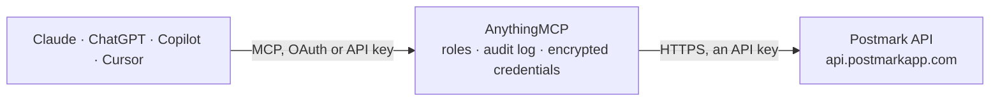

<!-- Generated by scripts/export-github-catalog.mjs in the anythingmcp-website repository. Do not edit by hand. -->

# Postmark MCP connector

Postmark transactional and broadcast email: send single, batch and templated emails, manage templates, search sent and inbound messages with opens, clicks and bounces, sending statistics, … The AnythingMCP connector gives Claude, ChatGPT, Microsoft Copilot, Cursor and Gemini 49 MCP tools for Postmark: 29 read and 20 can change data.

**Category:** [Email](../email.md) · **Tools:** 49 · **Setup guide:** [anythingmcp.com](https://anythingmcp.com/guides/postmark-to-mcp) · [Deutsch](https://anythingmcp.com/de/guides/postmark-to-mcp) · [Italiano](https://anythingmcp.com/it/guides/postmark-to-mcp) · [Español](https://anythingmcp.com/es/guides/postmark-to-mcp) · [日本語](https://anythingmcp.com/ja/guides/postmark-to-mcp) · [Русский](https://anythingmcp.com/ru/guides/postmark-to-mcp) · [中文](https://anythingmcp.com/zh/guides/postmark-to-mcp)

## Start without code

No installation and no terminal: AnythingMCP Cloud runs the Postmark connector for you, operated by helpcode.ai in Frankfurt, Germany.

1. **Click the button above** and create an account or sign in. The Postmark connector opens, ready to install.
2. **Paste the API key or token from your Postmark account.** Every click is in the [step-by-step guide](https://anythingmcp.com/guides/postmark-to-mcp).
3. **Click Install.** AnythingMCP shows the address of your MCP server.
4. **Add that address to your assistant:** [Claude](https://anythingmcp.com/guides/connect-postmark-to-claude) · [ChatGPT](https://anythingmcp.com/guides/connect-postmark-to-chatgpt) · [Microsoft Copilot](https://anythingmcp.com/guides/connect-postmark-to-copilot) · [Cursor](https://anythingmcp.com/guides/connect-postmark-to-cursor) · [Gemini CLI](https://anythingmcp.com/guides/connect-postmark-to-gemini) · [Meta Muse](https://anythingmcp.com/guides/connect-postmark-to-muse).
5. **Ask your first question**, for example: *Find the outbound message sent for invoice INV-2026-089 to billing@vegastore.fi on 2026-08-12 and show delivery events.*

Prefer help with the setup? [Talk to us](https://anythingmcp.com/contact).

## How it works

- **The AI client** speaks MCP (Streamable HTTP) to AnythingMCP and only sees tool names, descriptions and results. It never gets the Postmark credentials.
- **AnythingMCP** checks the client's role, builds the call from the tool definition, adds the credentials (an API key), calls Postmark, logs the call and returns the result.
- **Postmark** sees an ordinary API client with the rights of the account the credentials belong to.

## Tools

| Tool | What it does | Access |
|---|---|---|
| [`postmark_send_email`](#postmark_send_email) | Send one email through the server: from a confirmed sender, to up to 50 recipients, with subject, HTML and/or text body, tag, metadata, tracking and… | write |
| [`postmark_send_batch`](#postmark_send_batch) | Send up to 500 different emails in one call; each message takes the same fields as postmark_send_email. | write |
| [`postmark_send_email_with_template`](#postmark_send_email_with_template) | Send one email built from a stored template: pass TemplateId or TemplateAlias and the TemplateModel with the variables. | write |
| [`postmark_send_batch_with_templates`](#postmark_send_batch_with_templates) | Send up to 500 templated emails in one call, each with its own template, recipient and model. | write |
| [`postmark_list_templates`](#postmark_list_templates) | List the templates of the server with id, alias, name, type (Standard or Layout), active flag and layout. | read |
| [`postmark_get_template`](#postmark_get_template) | Get one template by id or alias: name, subject, HTML and text body with their Mustachio variables, type and layout. | read |
| [`postmark_create_template`](#postmark_create_template) | Create a template (Standard, or Layout to wrap other templates) with name, alias, subject and HTML/text bodies using Mustachio variables. | write |
| [`postmark_update_template`](#postmark_update_template) | Edit a template by id or alias: name, alias, subject, bodies or layout. | write |
| [`postmark_delete_template`](#postmark_delete_template) | Delete a template for good by id or alias. | write |
| [`postmark_validate_template`](#postmark_validate_template) | Check template content without saving: Mustachio syntax errors, the variables it uses and a rendered preview with a test model. | read |
| [`postmark_search_outbound_messages`](#postmark_search_outbound_messages) | Search sent messages (last 45 days by default retention) by recipient, sender, tag, subject, status, stream, date range or one metadata field. | read |
| [`postmark_get_outbound_message`](#postmark_get_outbound_message) | Details of one sent message by MessageID: recipients, subject, bodies, tag, metadata and the MessageEvents timeline (delivered, bounced, opened, clicked, ...). | read |
| [`postmark_search_inbound_messages`](#postmark_search_inbound_messages) | Search inbound messages received by the server by recipient, sender, subject, mailbox hash, tag, status or date range. | read |
| [`postmark_get_inbound_message`](#postmark_get_inbound_message) | Details of one inbound message: sender, recipients, subject, text and HTML body, headers, attachments list, status and the webhook processing result. | read |
| [`postmark_retry_inbound_message`](#postmark_retry_inbound_message) | Retry posting a failed inbound message to the server's inbound webhook, e.g. after fixing the endpoint. | write |
| [`postmark_list_message_opens`](#postmark_list_message_opens) | List open events across messages with recipient, time, email client, OS, platform and location. | read |
| [`postmark_get_message_opens`](#postmark_get_message_opens) | List the open events of one message: each open with time, client, OS, platform and location. | read |
| [`postmark_list_message_clicks`](#postmark_list_message_clicks) | List link click events across messages with recipient, clicked URL, time, browser, OS, platform and location. | read |
| [`postmark_get_message_clicks`](#postmark_get_message_clicks) | List the link click events of one message: each click with the original link, time, browser, OS and location. | read |
| [`postmark_get_delivery_stats`](#postmark_get_delivery_stats) | Bounce summary of the server: number of inactive (deactivated) addresses and the count of bounces per bounce type. | read |
| [`postmark_list_bounces`](#postmark_list_bounces) | List bounces with type, recipient, description, details, whether the address is now inactive and whether it can be activated. | read |
| [`postmark_get_bounce`](#postmark_get_bounce) | Get one bounce by id: type, recipient, description, SMTP details, the related MessageID, Inactive and CanActivate flags. | read |
| [`postmark_get_bounce_dump`](#postmark_get_bounce_dump) | Get the raw SMTP source of a bounce message (kept for 30 days), to read the receiving server's exact answer. | read |
| [`postmark_activate_bounce`](#postmark_activate_bounce) | Reactivate an address deactivated by a bounce so it can receive email again. | write |
| [`postmark_get_outbound_overview`](#postmark_get_outbound_overview) | Sending overview for a period: sent, bounced, spam complaints, bounce and spam rates, opens, unique opens, tracked emails and link clicks. | read |
| [`postmark_get_outbound_stats`](#postmark_get_outbound_stats) | Daily counts of one metric for a period: sends, bounces (by type), spam, tracked, opens, opens by platform or email client, clicks, clicks by browser,… | read |
| [`postmark_list_suppressions`](#postmark_list_suppressions) | List suppressed addresses of a message stream (no email is sent to them) with the reason (HardBounce, SpamComplaint, ManualSuppression), origin and date. | read |
| [`postmark_create_suppressions`](#postmark_create_suppressions) | Suppress up to 50 addresses in a message stream so nothing is sent to them any more (ManualSuppression). | write |
| [`postmark_delete_suppressions`](#postmark_delete_suppressions) | Remove up to 50 addresses from the suppression list of a stream so they can receive email again. | write |
| [`postmark_list_message_streams`](#postmark_list_message_streams) | List the message streams of the server (Transactional, Broadcasts, Inbound) with id, name, description, unsubscribe handling and archive state. | read |
| [`postmark_get_message_stream`](#postmark_get_message_stream) | Get one message stream by id: name, type, description, unsubscribe handling, created, updated and archived dates. | read |
| [`postmark_create_message_stream`](#postmark_create_message_stream) | Create a message stream: Transactional for app email or Broadcasts for bulk and marketing mail (at most 10 streams per server, one Inbound). | write |
| [`postmark_update_message_stream`](#postmark_update_message_stream) | Edit a message stream: name, description or unsubscribe handling. | write |
| [`postmark_archive_message_stream`](#postmark_archive_message_stream) | Archive a message stream: it stops sending and is deleted with its data after 45 days unless restored with postmark_unarchive_message_stream. | write |
| [`postmark_unarchive_message_stream`](#postmark_unarchive_message_stream) | Restore an archived message stream within 45 days of archiving so it can send again. | write |
| [`postmark_list_webhooks`](#postmark_list_webhooks) | List the webhooks of the server with URL, stream, HTTP auth and headers, and which events trigger them (Open, Click, Delivery, Bounce, SpamComplaint,… | read |
| [`postmark_get_webhook`](#postmark_get_webhook) | Get one webhook by id: URL, message stream, HTTP auth user, custom headers and enabled triggers. | read |
| [`postmark_create_webhook`](#postmark_create_webhook) | Create a webhook for a message stream: the URL and which events (opens, clicks, deliveries, bounces, spam complaints, subscription changes) to post to it. | write |
| [`postmark_update_webhook`](#postmark_update_webhook) | Edit a webhook: URL, HTTP auth, headers or triggers. | write |
| [`postmark_delete_webhook`](#postmark_delete_webhook) | Delete a webhook; Postmark stops posting those events to its URL. | write |
| [`postmark_get_server`](#postmark_get_server) | Settings of the server the token belongs to: id, name, color, inbound address and domain, tracking defaults, hook URLs and SMTP API state. | read |
| [`postmark_list_servers`](#postmark_list_servers) | List all servers of the account with id, name, color, API tokens and settings. | read |
| [`postmark_get_server_by_id`](#postmark_get_server_by_id) | Get one server of the account by id with its settings and API tokens. | read |
| [`postmark_list_domains`](#postmark_list_domains) | List the sending domains of the account with DKIM, Return-Path and SPF verification state. | read |
| [`postmark_get_domain`](#postmark_get_domain) | Get one domain with the DNS records to set (DKIM host and value, pending DKIM, Return-Path CNAME) and their verification state. | read |
| [`postmark_verify_domain_dkim`](#postmark_verify_domain_dkim) | Ask Postmark to check the DKIM DNS record of a domain now, after the user has added it. | write |
| [`postmark_verify_domain_return_path`](#postmark_verify_domain_return_path) | Ask Postmark to check the Return-Path CNAME of a domain now. | write |
| [`postmark_list_sender_signatures`](#postmark_list_sender_signatures) | List the sender signatures (single confirmed From addresses) of the account with confirmation and DKIM state. | read |
| [`postmark_get_sender_signature`](#postmark_get_sender_signature) | Get one sender signature: From address, name, reply-to, confirmed flag, domain and DNS verification details. | read |

## Tool reference

Every parameter as the AI client sees it in `tools/list`. Source: [`packages/backend/src/adapters/intl/postmark.json`](../../../packages/backend/src/adapters/intl/postmark.json).

### `postmark_send_email`

Send one email through the server: from a confirmed sender, to up to 50 recipients, with subject, HTML and/or text body, tag, metadata, tracking and attachments. Returns the MessageID.

**Access:** write · **Call:** `POST /email`

| Parameter | Type | Required | Description |
|---|---|---|---|
| `From` | string | yes | Sender address of a confirmed sender signature or verified domain; "Name <sender@example.com>" adds a display name. |
| `To` | string | yes | Recipient addresses, comma-separated (To, Cc and Bcc together at most 50). |
| `Cc` | string | no | Cc addresses, comma-separated. |
| `Bcc` | string | no | Bcc addresses, comma-separated. |
| `ReplyTo` | string | no | Reply-To address(es), comma-separated. |
| `Tag` | string | no | One tag to group the email in statistics and searches, e.g. password-reset. |
| `Headers` | object[] | no | Custom headers: [{"Name": "X-Ref", "Value": "123"}]. |
| `TrackOpens` | boolean | no | Track opens for this email (needs an HTML body). |
| `TrackLinks` | `None` \| `HtmlAndText` \| `HtmlOnly` \| `TextOnly` | no | Link tracking: None, HtmlAndText, HtmlOnly or TextOnly. |
| `Metadata` | object | no | Your own key-value pairs stored with the message and returned in webhooks, e.g. {"order_id": "123"}. |
| `Attachments` | object[] | no | Attachments: [{"Name": "invoice.pdf", "Content": "<base64>", "ContentType": "application/pdf"}]; ContentID "cid:logo.png" for inline images. 10 MB total. |
| `MessageStream` | string | no | Message stream to send through: outbound (default, transactional) or a broadcast stream id for bulk mail. |
| `Subject` | string | yes | Subject line. |
| `HtmlBody` | string | no | HTML body; HtmlBody or TextBody is required. |
| `TextBody` | string | no | Plain text body; HtmlBody or TextBody is required. |

### `postmark_send_batch`

Send up to 500 different emails in one call; each message takes the same fields as postmark_send_email. Returns one result per message with its own ErrorCode (0 = accepted).

**Access:** write · **Call:** `POST /email/batch`

| Parameter | Type | Required | Description |
|---|---|---|---|
| `messages` | object[] | yes | Messages: [{"From": "a@example.com", "To": "b@example.com", "Subject": "Hi", "TextBody": "Hello", "MessageStream": "outbound"}, ...], at most 500 and 50 MB. |

### `postmark_send_email_with_template`

Send one email built from a stored template: pass TemplateId or TemplateAlias and the TemplateModel with the variables. Subject and body come from the template.

**Access:** write · **Call:** `POST /email/withTemplate`

| Parameter | Type | Required | Description |
|---|---|---|---|
| `From` | string | yes | Sender address of a confirmed sender signature or verified domain; "Name <sender@example.com>" adds a display name. |
| `To` | string | yes | Recipient addresses, comma-separated (To, Cc and Bcc together at most 50). |
| `Cc` | string | no | Cc addresses, comma-separated. |
| `Bcc` | string | no | Bcc addresses, comma-separated. |
| `ReplyTo` | string | no | Reply-To address(es), comma-separated. |
| `Tag` | string | no | One tag to group the email in statistics and searches, e.g. password-reset. |
| `Headers` | object[] | no | Custom headers: [{"Name": "X-Ref", "Value": "123"}]. |
| `TrackOpens` | boolean | no | Track opens for this email (needs an HTML body). |
| `TrackLinks` | `None` \| `HtmlAndText` \| `HtmlOnly` \| `TextOnly` | no | Link tracking: None, HtmlAndText, HtmlOnly or TextOnly. |
| `Metadata` | object | no | Your own key-value pairs stored with the message and returned in webhooks, e.g. {"order_id": "123"}. |
| `Attachments` | object[] | no | Attachments: [{"Name": "invoice.pdf", "Content": "<base64>", "ContentType": "application/pdf"}]; ContentID "cid:logo.png" for inline images. 10 MB total. |
| `MessageStream` | string | no | Message stream to send through: outbound (default, transactional) or a broadcast stream id for bulk mail. |
| `TemplateId` | integer | no | Template id; give TemplateId or TemplateAlias. |
| `TemplateAlias` | string | no | Template alias, e.g. welcome; give TemplateId or TemplateAlias. |
| `TemplateModel` | object | yes | Values for the template variables, e.g. {"name": "Ana", "action_url": "https://..."}. |
| `InlineCss` | boolean | no | Inline the template CSS into the HTML (default true). |

### `postmark_send_batch_with_templates`

Send up to 500 templated emails in one call, each with its own template, recipient and model. Returns one result per message with its own ErrorCode.

**Access:** write · **Call:** `POST /email/batchWithTemplates`

| Parameter | Type | Required | Description |
|---|---|---|---|
| `messages` | object[] | yes | Messages: [{"From": "a@example.com", "To": "b@example.com", "TemplateAlias": "welcome", "TemplateModel": {"name": "Ana"}}, ...], at most 500. |

### `postmark_list_templates`

List the templates of the server with id, alias, name, type (Standard or Layout), active flag and layout. Templates are used with postmark_send_email_with_template.

**Access:** read · **Call:** `GET /templates`

| Parameter | Type | Required | Description |
|---|---|---|---|
| `count` | integer | no | Items per page, 1 to 500. |
| `offset` | integer | no | Items to skip; count + offset may not exceed 10,000. |
| `template_type` | `All` \| `Standard` \| `Layout` | no | All (default), Standard or Layout. |
| `layout_template` | string | no | Only standard templates that use this layout alias. |

### `postmark_get_template`

Get one template by id or alias: name, subject, HTML and text body with their Mustachio variables, type and layout.

**Access:** read · **Call:** `GET /templates/{template}`

| Parameter | Type | Required | Description |
|---|---|---|---|
| `template` | string | yes | Template id (number) or alias. |

### `postmark_create_template`

Create a template (Standard, or Layout to wrap other templates) with name, alias, subject and HTML/text bodies using Mustachio variables. Validate first with postmark_validate_template.

**Access:** write · **Call:** `POST /templates`

| Parameter | Type | Required | Description |
|---|---|---|---|
| `Name` | string | yes | Template name. |
| `Alias` | string | no | Alias to send by, letters, numbers, dots, dashes and underscores, starting with a letter. |
| `Subject` | string | no | Subject with optional {{variables}}; required for Standard templates, not allowed for Layouts. |
| `HtmlBody` | string | no | HTML body; a Layout must contain {{{@content}}}. |
| `TextBody` | string | no | Plain text body. |
| `LayoutTemplate` | string | no | Alias of the layout to wrap this standard template in. |
| `TemplateType` | `Standard` \| `Layout` | no | Standard (default) or Layout. |

### `postmark_update_template`

Edit a template by id or alias: name, alias, subject, bodies or layout. Only the fields passed change; the next send uses the new version.

**Access:** write · **Call:** `PUT /templates/{template}`

| Parameter | Type | Required | Description |
|---|---|---|---|
| `template` | string | yes | Template id (number) or alias. |
| `Name` | string | no | Template name. |
| `Alias` | string | no | Alias to send by, letters, numbers, dots, dashes and underscores, starting with a letter. |
| `Subject` | string | no | Subject with optional {{variables}}; required for Standard templates, not allowed for Layouts. |
| `HtmlBody` | string | no | HTML body; a Layout must contain {{{@content}}}. |
| `TextBody` | string | no | Plain text body. |
| `LayoutTemplate` | string | no | Alias of the layout to wrap this standard template in. |

### `postmark_delete_template`

Delete a template for good by id or alias. A layout cannot be deleted while standard templates still use it. Confirm with the user first.

**Access:** write · **Call:** `DELETE /templates/{template}`

| Parameter | Type | Required | Description |
|---|---|---|---|
| `template` | string | yes | Template id (number) or alias. |

### `postmark_validate_template`

Check template content without saving: Mustachio syntax errors, the variables it uses and a rendered preview with a test model.

**Access:** read · **Call:** `POST /templates/validate`

| Parameter | Type | Required | Description |
|---|---|---|---|
| `Subject` | string | no | Subject to check. |
| `HtmlBody` | string | no | HTML body to check. |
| `TextBody` | string | no | Text body to check. |
| `TestRenderModel` | object | no | Example values to render with, e.g. {"name": "Ana"}. |
| `InlineCssForHtmlTestRender` | boolean | no | Inline CSS in the rendered HTML (default true). |
| `TemplateType` | `Standard` \| `Layout` | no | Standard (default) or Layout. |
| `LayoutTemplate` | string | no | Layout alias to render the standard template in. |

### `postmark_search_outbound_messages`

Search sent messages (last 45 days by default retention) by recipient, sender, tag, subject, status, stream, date range or one metadata field. Returns TotalCount and Messages with MessageID, status and recipients.

**Access:** read · **Call:** `GET /messages/outbound`

| Parameter | Type | Required | Description |
|---|---|---|---|
| `count` | integer | no | Items per page, 1 to 500. |
| `offset` | integer | no | Items to skip; count + offset may not exceed 10,000. |
| `recipient` | string | no | Recipient address. |
| `fromemail` | string | no | Sender address. |
| `tag` | string | no | Tag. |
| `status` | `queued` \| `sent` \| `processed` | no | queued or sent (sent and processed are the same). |
| `subject` | string | no | Subject. |
| `messagestream` | string | no | Message stream id, e.g. outbound (default transactional stream), broadcast or your own stream id from postmark_list_message_streams. |
| `fromdate` | string | no | From this date or date-time, e.g. 2026-10-01 or 2026-10-01T12:00:00 (US Eastern Time). |
| `todate` | string | no | Up to this date or date-time, inclusive (US Eastern Time). |

### `postmark_get_outbound_message`

Details of one sent message by MessageID: recipients, subject, bodies, tag, metadata and the MessageEvents timeline (delivered, bounced, opened, clicked, ...).

**Access:** read · **Call:** `GET /messages/outbound/{message_id}/details`

| Parameter | Type | Required | Description |
|---|---|---|---|
| `message_id` | string | yes | MessageID from a send result or a search. |

### `postmark_search_inbound_messages`

Search inbound messages received by the server by recipient, sender, subject, mailbox hash, tag, status or date range.

**Access:** read · **Call:** `GET /messages/inbound`

| Parameter | Type | Required | Description |
|---|---|---|---|
| `count` | integer | no | Items per page, 1 to 500. |
| `offset` | integer | no | Items to skip; count + offset may not exceed 10,000. |
| `recipient` | string | no | Recipient address. |
| `fromemail` | string | no | Sender address. |
| `subject` | string | no | Subject. |
| `mailboxhash` | string | no | Mailbox hash (the part after + in the inbound address). |
| `tag` | string | no | Tag. |
| `status` | `blocked` \| `processed` \| `queued` \| `failed` \| `scheduled` | no | blocked, processed (default), queued, failed or scheduled. |
| `fromdate` | string | no | From this date or date-time, e.g. 2026-10-01 or 2026-10-01T12:00:00 (US Eastern Time). |
| `todate` | string | no | Up to this date or date-time, inclusive (US Eastern Time). |

### `postmark_get_inbound_message`

Details of one inbound message: sender, recipients, subject, text and HTML body, headers, attachments list, status and the webhook processing result.

**Access:** read · **Call:** `GET /messages/inbound/{message_id}/details`

| Parameter | Type | Required | Description |
|---|---|---|---|
| `message_id` | string | yes | MessageID of the inbound message. |

### `postmark_retry_inbound_message`

Retry posting a failed inbound message to the server's inbound webhook, e.g. after fixing the endpoint.

**Access:** write · **Call:** `PUT /messages/inbound/{message_id}/retry`

| Parameter | Type | Required | Description |
|---|---|---|---|
| `message_id` | string | yes | MessageID of a failed inbound message. |

### `postmark_list_message_opens`

List open events across messages with recipient, time, email client, OS, platform and location. Filter by recipient, tag, stream, client or location.

**Access:** read · **Call:** `GET /messages/outbound/opens`

| Parameter | Type | Required | Description |
|---|---|---|---|
| `count` | integer | no | Items per page, 1 to 500. |
| `offset` | integer | no | Items to skip; count + offset may not exceed 10,000. |
| `recipient` | string | no | Recipient address. |
| `tag` | string | no | Tag. |
| `messagestream` | string | no | Message stream id, e.g. outbound (default transactional stream), broadcast or your own stream id from postmark_list_message_streams. |
| `client_family` | string | no | Email client family, e.g. Gmail or Outlook. |
| `os_family` | string | no | Operating system family, e.g. iOS. |
| `platform` | string | no | Platform: Desktop, Mobile, WebMail or Unknown. |
| `country` | string | no | Country name. |
| `region` | string | no | Region name. |
| `city` | string | no | City name. |

### `postmark_get_message_opens`

List the open events of one message: each open with time, client, OS, platform and location.

**Access:** read · **Call:** `GET /messages/outbound/opens/{message_id}`

| Parameter | Type | Required | Description |
|---|---|---|---|
| `message_id` | string | yes | MessageID. |
| `count` | integer | no | Items per page, 1 to 500. |
| `offset` | integer | no | Items to skip; count + offset may not exceed 10,000. |

### `postmark_list_message_clicks`

List link click events across messages with recipient, clicked URL, time, browser, OS, platform and location. Filter by recipient, tag, stream, client or location.

**Access:** read · **Call:** `GET /messages/outbound/clicks`

| Parameter | Type | Required | Description |
|---|---|---|---|
| `count` | integer | no | Items per page, 1 to 500. |
| `offset` | integer | no | Items to skip; count + offset may not exceed 10,000. |
| `recipient` | string | no | Recipient address. |
| `tag` | string | no | Tag. |
| `messagestream` | string | no | Message stream id, e.g. outbound (default transactional stream), broadcast or your own stream id from postmark_list_message_streams. |
| `client_family` | string | no | Email client family, e.g. Gmail or Outlook. |
| `os_family` | string | no | Operating system family, e.g. iOS. |
| `platform` | string | no | Platform: Desktop, Mobile, WebMail or Unknown. |
| `country` | string | no | Country name. |
| `region` | string | no | Region name. |
| `city` | string | no | City name. |

### `postmark_get_message_clicks`

List the link click events of one message: each click with the original link, time, browser, OS and location.

**Access:** read · **Call:** `GET /messages/outbound/clicks/{message_id}`

| Parameter | Type | Required | Description |
|---|---|---|---|
| `message_id` | string | yes | MessageID. |
| `count` | integer | no | Items per page, 1 to 500. |
| `offset` | integer | no | Items to skip; count + offset may not exceed 10,000. |

### `postmark_get_delivery_stats`

Bounce summary of the server: number of inactive (deactivated) addresses and the count of bounces per bounce type.

**Access:** read · **Call:** `GET /deliverystats`

No parameters.

### `postmark_list_bounces`

List bounces with type, recipient, description, details, whether the address is now inactive and whether it can be activated. Filter by type, address, tag, message, stream or date.

**Access:** read · **Call:** `GET /bounces`

| Parameter | Type | Required | Description |
|---|---|---|---|
| `count` | integer | no | Items per page, 1 to 500. |
| `offset` | integer | no | Items to skip; count + offset may not exceed 10,000. |
| `type` | `HardBounce` \| `Transient` \| `Unsubscribe` \| `Subscribe` \| `AutoResponder` \| `AddressChange` \| `DnsError` \| `SpamNotification` \| `OpenRelayTest` \| `Unknown` \| `SoftBounce` \| `VirusNotification` \| `ChallengeVerification` \| `BadEmailAddress` \| `SpamComplaint` \| `ManuallyDeactivated` \| `Unconfirmed` \| `Blocked` \| `SMTPApiError` \| `InboundError` \| `DMARCPolicy` \| `TemplateRenderingFailed` | no | Bounce type. |
| `inactive` | boolean | no | true: only bounces that deactivated the address; false: only those that did not. |
| `email_filter` | string | no | Recipient address or part of it. |
| `tag` | string | no | Tag. |
| `message_id` | string | no | MessageID of the bounced message. |
| `messagestream` | string | no | Message stream id, e.g. outbound (default transactional stream), broadcast or your own stream id from postmark_list_message_streams. |
| `fromdate` | string | no | From this date or date-time, e.g. 2026-10-01 or 2026-10-01T12:00:00 (US Eastern Time). |
| `todate` | string | no | Up to this date or date-time, inclusive (US Eastern Time). |

### `postmark_get_bounce`

Get one bounce by id: type, recipient, description, SMTP details, the related MessageID, Inactive and CanActivate flags.

**Access:** read · **Call:** `GET /bounces/{bounce_id}`

| Parameter | Type | Required | Description |
|---|---|---|---|
| `bounce_id` | integer | yes | Bounce id from postmark_list_bounces. |

### `postmark_get_bounce_dump`

Get the raw SMTP source of a bounce message (kept for 30 days), to read the receiving server's exact answer.

**Access:** read · **Call:** `GET /bounces/{bounce_id}/dump`

| Parameter | Type | Required | Description |
|---|---|---|---|
| `bounce_id` | integer | yes | Bounce id. |

### `postmark_activate_bounce`

Reactivate an address deactivated by a bounce so it can receive email again. Only when CanActivate is true; spam complaints cannot be activated. Confirm the address with the user.

**Access:** write · **Call:** `PUT /bounces/{bounce_id}/activate`

| Parameter | Type | Required | Description |
|---|---|---|---|
| `bounce_id` | integer | yes | Bounce id. |

### `postmark_get_outbound_overview`

Sending overview for a period: sent, bounced, spam complaints, bounce and spam rates, opens, unique opens, tracked emails and link clicks.

**Access:** read · **Call:** `GET /stats/outbound`

| Parameter | Type | Required | Description |
|---|---|---|---|
| `tag` | string | no | Only this tag. |
| `fromdate` | string | no | From this date, YYYY-MM-DD. |
| `todate` | string | no | Up to this date, YYYY-MM-DD. |
| `messagestream` | string | no | Message stream id, e.g. outbound (default transactional stream), broadcast or your own stream id from postmark_list_message_streams. |

### `postmark_get_outbound_stats`

Daily counts of one metric for a period: sends, bounces (by type), spam, tracked, opens, opens by platform or email client, clicks, clicks by browser, platform or location.

**Access:** read · **Call:** `GET /stats/outbound/{metric}`

| Parameter | Type | Required | Description |
|---|---|---|---|
| `metric` | `sends` \| `bounces` \| `spam` \| `tracked` \| `opens` \| `opens/platforms` \| `opens/emailclients` \| `clicks` \| `clicks/browserfamilies` \| `clicks/platforms` \| `clicks/location` | yes | Which statistic. |
| `tag` | string | no | Only this tag. |
| `fromdate` | string | no | From this date, YYYY-MM-DD. |
| `todate` | string | no | Up to this date, YYYY-MM-DD. |
| `messagestream` | string | no | Message stream id, e.g. outbound (default transactional stream), broadcast or your own stream id from postmark_list_message_streams. |

### `postmark_list_suppressions`

List suppressed addresses of a message stream (no email is sent to them) with the reason (HardBounce, SpamComplaint, ManualSuppression), origin and date.

**Access:** read · **Call:** `GET /message-streams/{stream_id}/suppressions/dump`

| Parameter | Type | Required | Description |
|---|---|---|---|
| `stream_id` | string | yes | Message stream id, e.g. outbound (default transactional stream), broadcast or your own stream id from postmark_list_message_streams. |
| `suppression_reason` | `HardBounce` \| `SpamComplaint` \| `ManualSuppression` | no | Only this reason. |
| `origin` | `Recipient` \| `Customer` \| `Admin` | no | How it was added: Recipient, Customer or Admin. |
| `fromdate` | string | no | From this date, YYYY-MM-DD. |
| `todate` | string | no | Up to this date, YYYY-MM-DD. |
| `email_address` | string | no | Only this address. |

### `postmark_create_suppressions`

Suppress up to 50 addresses in a message stream so nothing is sent to them any more (ManualSuppression). Returns a status per address.

**Access:** write · **Call:** `POST /message-streams/{stream_id}/suppressions`

| Parameter | Type | Required | Description |
|---|---|---|---|
| `stream_id` | string | yes | Message stream id, e.g. outbound (default transactional stream), broadcast or your own stream id from postmark_list_message_streams. |
| `suppressions` | object[] | yes | Addresses, at most 50: [{"EmailAddress": "someone@example.com"}]. |

### `postmark_delete_suppressions`

Remove up to 50 addresses from the suppression list of a stream so they can receive email again. SpamComplaint suppressions cannot be removed. Confirm with the user first.

**Access:** write · **Call:** `POST /message-streams/{stream_id}/suppressions/delete`

| Parameter | Type | Required | Description |
|---|---|---|---|
| `stream_id` | string | yes | Message stream id, e.g. outbound (default transactional stream), broadcast or your own stream id from postmark_list_message_streams. |
| `suppressions` | object[] | yes | Addresses, at most 50: [{"EmailAddress": "someone@example.com"}]. |

### `postmark_list_message_streams`

List the message streams of the server (Transactional, Broadcasts, Inbound) with id, name, description, unsubscribe handling and archive state.

**Access:** read · **Call:** `GET /message-streams`

| Parameter | Type | Required | Description |
|---|---|---|---|
| `message_stream_type` | `All` \| `Inbound` \| `Transactional` \| `Broadcasts` | no | All (default), Inbound, Transactional or Broadcasts. |
| `include_archived` | boolean | no | Include archived streams (default false). |

### `postmark_get_message_stream`

Get one message stream by id: name, type, description, unsubscribe handling, created, updated and archived dates.

**Access:** read · **Call:** `GET /message-streams/{stream_id}`

| Parameter | Type | Required | Description |
|---|---|---|---|
| `stream_id` | string | yes | Message stream id, e.g. outbound (default transactional stream), broadcast or your own stream id from postmark_list_message_streams. |

### `postmark_create_message_stream`

Create a message stream: Transactional for app email or Broadcasts for bulk and marketing mail (at most 10 streams per server, one Inbound).

**Access:** write · **Call:** `POST /message-streams`

| Parameter | Type | Required | Description |
|---|---|---|---|
| `ID` | string | yes | Stream id, lower case letters, numbers and dashes, e.g. newsletter. |
| `Name` | string | yes | Display name. |
| `MessageStreamType` | `Transactional` \| `Broadcasts` \| `Inbound` | yes | Transactional or Broadcasts (Inbound exists once per server). |
| `Description` | string | no | Description. |
| `SubscriptionManagementConfiguration` | object | no | Unsubscribe handling: {"UnsubscribeHandlingType": "Postmark"}; Postmark (default for Broadcasts), Custom or None (Transactional and Inbound). |

### `postmark_update_message_stream`

Edit a message stream: name, description or unsubscribe handling. The id and type cannot change.

**Access:** write · **Call:** `PATCH /message-streams/{stream_id}`

| Parameter | Type | Required | Description |
|---|---|---|---|
| `stream_id` | string | yes | Message stream id, e.g. outbound (default transactional stream), broadcast or your own stream id from postmark_list_message_streams. |
| `Name` | string | no | New name. |
| `Description` | string | no | New description. |
| `SubscriptionManagementConfiguration` | object | no | Unsubscribe handling: {"UnsubscribeHandlingType": "Postmark"}; Postmark (default for Broadcasts), Custom or None (Transactional and Inbound). |

### `postmark_archive_message_stream`

Archive a message stream: it stops sending and is deleted with its data after 45 days unless restored with postmark_unarchive_message_stream. Default streams cannot be archived.

**Access:** write · **Call:** `POST /message-streams/{stream_id}/archive`

| Parameter | Type | Required | Description |
|---|---|---|---|
| `stream_id` | string | yes | Message stream id, e.g. outbound (default transactional stream), broadcast or your own stream id from postmark_list_message_streams. |

### `postmark_unarchive_message_stream`

Restore an archived message stream within 45 days of archiving so it can send again.

**Access:** write · **Call:** `POST /message-streams/{stream_id}/unarchive`

| Parameter | Type | Required | Description |
|---|---|---|---|
| `stream_id` | string | yes | Message stream id, e.g. outbound (default transactional stream), broadcast or your own stream id from postmark_list_message_streams. |

### `postmark_list_webhooks`

List the webhooks of the server with URL, stream, HTTP auth and headers, and which events trigger them (Open, Click, Delivery, Bounce, SpamComplaint, SubscriptionChange).

**Access:** read · **Call:** `GET /webhooks`

| Parameter | Type | Required | Description |
|---|---|---|---|
| `messagestream` | string | no | Message stream id, e.g. outbound (default transactional stream), broadcast or your own stream id from postmark_list_message_streams. |

### `postmark_get_webhook`

Get one webhook by id: URL, message stream, HTTP auth user, custom headers and enabled triggers.

**Access:** read · **Call:** `GET /webhooks/{webhook_id}`

| Parameter | Type | Required | Description |
|---|---|---|---|
| `webhook_id` | integer | yes | Webhook id. |

### `postmark_create_webhook`

Create a webhook for a message stream: the URL and which events (opens, clicks, deliveries, bounces, spam complaints, subscription changes) to post to it.

**Access:** write · **Call:** `POST /webhooks`

| Parameter | Type | Required | Description |
|---|---|---|---|
| `Url` | string | yes | HTTPS URL that receives the POSTs. |
| `HttpAuth` | object | no | Basic auth for your endpoint: {"Username": "u", "Password": "p"}. |
| `HttpHeaders` | object[] | no | Custom headers: [{"Name": "X-Key", "Value": "..."}]. |
| `Triggers` | object | no | Events: {"Open": {"Enabled": true, "PostFirstOpenOnly": false}, "Click": {"Enabled": true}, "Delivery": {"Enabled": true}, "Bounce": {"Enabled": true, "IncludeContent": false}, "SpamComplaint": {"Enabled": true, "IncludeContent": false}, "SubscriptionChange": {"Enabled": true}}. |
| `Verify` | boolean | no | Test the endpoint for each enabled event before saving (default true). |
| `MessageStream` | string | no | Message stream id, e.g. outbound (default transactional stream), broadcast or your own stream id from postmark_list_message_streams. |

### `postmark_update_webhook`

Edit a webhook: URL, HTTP auth, headers or triggers. Triggers left out keep their setting.

**Access:** write · **Call:** `PUT /webhooks/{webhook_id}`

| Parameter | Type | Required | Description |
|---|---|---|---|
| `webhook_id` | integer | yes | Webhook id. |
| `Url` | string | no | HTTPS URL that receives the POSTs. |
| `HttpAuth` | object | no | Basic auth for your endpoint: {"Username": "u", "Password": "p"}. |
| `HttpHeaders` | object[] | no | Custom headers: [{"Name": "X-Key", "Value": "..."}]. |
| `Triggers` | object | no | Events: {"Open": {"Enabled": true, "PostFirstOpenOnly": false}, "Click": {"Enabled": true}, "Delivery": {"Enabled": true}, "Bounce": {"Enabled": true, "IncludeContent": false}, "SpamComplaint": {"Enabled": true, "IncludeContent": false}, "SubscriptionChange": {"Enabled": true}}. |
| `Verify` | boolean | no | Test the endpoint for each enabled event before saving (default true). |

### `postmark_delete_webhook`

Delete a webhook; Postmark stops posting those events to its URL. Confirm with the user first.

**Access:** write · **Call:** `DELETE /webhooks/{webhook_id}`

| Parameter | Type | Required | Description |
|---|---|---|---|
| `webhook_id` | integer | yes | Webhook id. |

### `postmark_get_server`

Settings of the server the token belongs to: id, name, color, inbound address and domain, tracking defaults, hook URLs and SMTP API state. Needs no ids; checks the token.

**Access:** read · **Call:** `GET /server`

No parameters.

### `postmark_list_servers`

List all servers of the account with id, name, color, API tokens and settings. Needs POSTMARK_ACCOUNT_TOKEN.

**Access:** read · **Call:** `GET /servers`

| Parameter | Type | Required | Description |
|---|---|---|---|
| `count` | integer | no | Items per page, 1 to 500. |
| `offset` | integer | no | Items to skip; count + offset may not exceed 10,000. |
| `name` | string | no | Only servers whose name contains this text. |

### `postmark_get_server_by_id`

Get one server of the account by id with its settings and API tokens. Needs POSTMARK_ACCOUNT_TOKEN.

**Access:** read · **Call:** `GET /servers/{server_id}`

| Parameter | Type | Required | Description |
|---|---|---|---|
| `server_id` | integer | yes | Server id from postmark_list_servers. |

### `postmark_list_domains`

List the sending domains of the account with DKIM, Return-Path and SPF verification state. Needs POSTMARK_ACCOUNT_TOKEN.

**Access:** read · **Call:** `GET /domains`

| Parameter | Type | Required | Description |
|---|---|---|---|
| `count` | integer | no | Items per page, 1 to 500. |
| `offset` | integer | no | Items to skip; count + offset may not exceed 10,000. |

### `postmark_get_domain`

Get one domain with the DNS records to set (DKIM host and value, pending DKIM, Return-Path CNAME) and their verification state. Needs POSTMARK_ACCOUNT_TOKEN.

**Access:** read · **Call:** `GET /domains/{domain_id}`

| Parameter | Type | Required | Description |
|---|---|---|---|
| `domain_id` | integer | yes | Domain id from postmark_list_domains. |

### `postmark_verify_domain_dkim`

Ask Postmark to check the DKIM DNS record of a domain now, after the user has added it. Returns the domain with DKIMVerified. Needs POSTMARK_ACCOUNT_TOKEN.

**Access:** write · **Call:** `PUT /domains/{domain_id}/verifyDkim`

| Parameter | Type | Required | Description |
|---|---|---|---|
| `domain_id` | integer | yes | Domain id. |

### `postmark_verify_domain_return_path`

Ask Postmark to check the Return-Path CNAME of a domain now. Returns the domain with ReturnPathDomainVerified. Needs POSTMARK_ACCOUNT_TOKEN.

**Access:** write · **Call:** `PUT /domains/{domain_id}/verifyReturnPath`

| Parameter | Type | Required | Description |
|---|---|---|---|
| `domain_id` | integer | yes | Domain id. |

### `postmark_list_sender_signatures`

List the sender signatures (single confirmed From addresses) of the account with confirmation and DKIM state. Needs POSTMARK_ACCOUNT_TOKEN.

**Access:** read · **Call:** `GET /senders`

| Parameter | Type | Required | Description |
|---|---|---|---|
| `count` | integer | no | Items per page, 1 to 500. |
| `offset` | integer | no | Items to skip; count + offset may not exceed 10,000. |

### `postmark_get_sender_signature`

Get one sender signature: From address, name, reply-to, confirmed flag, domain and DNS verification details. Needs POSTMARK_ACCOUNT_TOKEN.

**Access:** read · **Call:** `GET /senders/{signature_id}`

| Parameter | Type | Required | Description |
|---|---|---|---|
| `signature_id` | integer | yes | Sender signature id. |

## Run it yourself

AnythingMCP is open source (AGPL-3.0). [Run it with Docker](../../../README.md#run-it-yourself), open **Connectors → Store**, pick **Postmark** and enter `POSTMARK_SERVER_TOKEN`, then add your MCP server URL to the AI client.

[← Email connectors](../email.md) · [All categories](../README.md)
