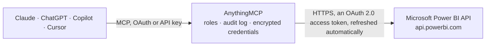

<!-- Generated by scripts/export-github-catalog.mjs in the anythingmcp-website repository. Do not edit by hand. -->

# Microsoft Power BI MCP connector

Let your AI work with Power BI: list workspaces, semantic models, reports, dashboards, dataflows, gateways and apps, run DAX queries against a model, check data sources, parameters, refresh history … The AnythingMCP connector gives Claude, ChatGPT, Microsoft Copilot, Cursor and Gemini 35 MCP tools for Microsoft Power BI: 31 read and 4 can change data.

**Category:** [Analytics](../analytics.md) · **Tools:** 35 · **Setup guide:** [anythingmcp.com](https://anythingmcp.com/guides/power-bi-to-mcp) · [Deutsch](https://anythingmcp.com/de/guides/power-bi-to-mcp) · [Italiano](https://anythingmcp.com/it/guides/power-bi-to-mcp) · [Español](https://anythingmcp.com/es/guides/power-bi-to-mcp) · [日本語](https://anythingmcp.com/ja/guides/power-bi-to-mcp) · [Русский](https://anythingmcp.com/ru/guides/power-bi-to-mcp) · [中文](https://anythingmcp.com/zh/guides/power-bi-to-mcp)

## Start without code

No installation and no terminal: AnythingMCP Cloud runs the Microsoft Power BI connector for you, operated by helpcode.ai in Frankfurt, Germany.

1. **Click the button above** and create an account or sign in. The Microsoft Power BI connector opens, ready to install.
2. **Sign in with your Microsoft Power BI account** when AnythingMCP asks. The first time, an admin creates a small app in the Microsoft Power BI developer console. Every click is in the [step-by-step guide](https://anythingmcp.com/guides/power-bi-to-mcp).
3. **Click Install.** AnythingMCP shows the address of your MCP server.
4. **Add that address to your assistant:** [Claude](https://anythingmcp.com/guides/connect-power-bi-to-claude) · [ChatGPT](https://anythingmcp.com/guides/connect-power-bi-to-chatgpt) · [Microsoft Copilot](https://anythingmcp.com/guides/connect-power-bi-to-copilot) · [Cursor](https://anythingmcp.com/guides/connect-power-bi-to-cursor) · [Gemini CLI](https://anythingmcp.com/guides/connect-power-bi-to-gemini) · [Meta Muse](https://anythingmcp.com/guides/connect-power-bi-to-muse).
5. **Ask your first question**, for example: *Which workspace contains the report 'AR Aging by Customer' and what's its datasetId and webUrl?*

Prefer help with the setup? [Talk to us](https://anythingmcp.com/contact).

## How it works

- **The AI client** speaks MCP (Streamable HTTP) to AnythingMCP and only sees tool names, descriptions and results. It never gets the Microsoft Power BI credentials.
- **AnythingMCP** checks the client's role, builds the call from the tool definition, adds the credentials (an OAuth 2.0 access token, refreshed automatically), calls Microsoft Power BI, logs the call and returns the result.
- **Microsoft Power BI** sees an ordinary API client with the rights of the account the credentials belong to.

## Tools

| Tool | What it does | Access |
|---|---|---|
| [`power_bi_list_workspaces`](#power_bi_list_workspaces) | List the workspaces (groups) the signed-in user can access: id, name, isReadOnly, isOnDedicatedCapacity (Premium or Fabric capacity) and capacityId. | read |
| [`power_bi_get_workspace`](#power_bi_get_workspace) | Read one workspace: name, read-only flag, capacity and default semantic model storage format. | read |
| [`power_bi_list_workspace_users`](#power_bi_list_workspace_users) | List who has access to a workspace: email or app id, display name, principalType (User, Group, App) and groupUserAccessRight (Admin, Member, Contributor,… | read |
| [`power_bi_list_datasets`](#power_bi_list_datasets) | List the semantic models (datasets) of a workspace: id, name, configuredBy (owner), isRefreshable, isOnPremGatewayRequired, targetStorageMode, createdDate… | read |
| [`power_bi_list_my_datasets`](#power_bi_list_my_datasets) | List the semantic models (datasets) in the signed-in user's My workspace. | read |
| [`power_bi_get_dataset`](#power_bi_get_dataset) | Read one semantic model (dataset) of a workspace: name, owner (configuredBy), isRefreshable, storage mode, whether it needs a gateway or an effective… | read |
| [`power_bi_execute_dax_query`](#power_bi_execute_dax_query) | Run a DAX query against a semantic model and get the rows back as JSON (results[0].tables[0].rows, keys like "Table[Column]" or "[Measure]"). | read |
| [`power_bi_list_dataset_datasources`](#power_bi_list_dataset_datasources) | List the data sources of a semantic model: datasourceType (Sql, AnalysisServices, SharePointList, Web, File, ...), connectionDetails (server, database, url,… | read |
| [`power_bi_list_dataset_parameters`](#power_bi_list_dataset_parameters) | List the Power Query parameters of a semantic model: name, type, currentValue, isRequired and suggestedValues. | read |
| [`power_bi_get_refresh_history`](#power_bi_get_refresh_history) | Refresh history of a semantic model, newest first: requestId, refreshType (Scheduled, OnDemand, ViaApi, ...), startTime, endTime, status (Unknown while… | read |
| [`power_bi_get_refresh_details`](#power_bi_get_refresh_details) | Execution details of one refresh of a semantic model (enhanced refreshes started through the API on Premium, PPU or Fabric capacity): status and… | read |
| [`power_bi_get_refresh_schedule`](#power_bi_get_refresh_schedule) | The scheduled refresh of a semantic model: enabled, days, times, localTimeZoneId and notifyOption. | read |
| [`power_bi_list_reports`](#power_bi_list_reports) | List the reports of a workspace: id, name, reportType (PowerBIReport or PaginatedReport), the datasetId it reads, description and webUrl. | read |
| [`power_bi_list_my_reports`](#power_bi_list_my_reports) | List the reports in the signed-in user's My workspace: id, name, type, datasetId and webUrl. | read |
| [`power_bi_get_report`](#power_bi_get_report) | Read one report of a workspace: name, type, the datasetId (semantic model) behind it, description and webUrl. | read |
| [`power_bi_list_report_pages`](#power_bi_list_report_pages) | List the pages of a Power BI report: name (the internal id used in URLs), displayName and order. | read |
| [`power_bi_list_dashboards`](#power_bi_list_dashboards) | List the dashboards of a workspace: id, displayName, isReadOnly and webUrl. | read |
| [`power_bi_list_my_dashboards`](#power_bi_list_my_dashboards) | List the dashboards in the signed-in user's My workspace: id, displayName, isReadOnly and webUrl. | read |
| [`power_bi_list_dashboard_tiles`](#power_bi_list_dashboard_tiles) | List the tiles of a dashboard: id, title, the reportId and datasetId each tile comes from, and its size (rowSpan, colSpan). | read |
| [`power_bi_list_dataflows`](#power_bi_list_dataflows) | List the dataflows (Gen1) of a workspace: objectId, name, description and configuredBy. | read |
| [`power_bi_list_dataflow_transactions`](#power_bi_list_dataflow_transactions) | Refresh transactions of a dataflow, newest first: id, refreshType, startTime, endTime and status. | read |
| [`power_bi_list_dataflow_datasources`](#power_bi_list_dataflow_datasources) | List the data sources a dataflow reads: type, connection details and gateway ids. | read |
| [`power_bi_list_gateways`](#power_bi_list_gateways) | List the on-premises data gateways the signed-in user administers: id, name, type and gatewayStatus. | read |
| [`power_bi_list_gateway_datasources`](#power_bi_list_gateway_datasources) | List the data sources configured on a gateway: id, datasourceName, datasourceType, connectionDetails and credentialType. | read |
| [`power_bi_get_gateway_datasource_status`](#power_bi_get_gateway_datasource_status) | Check whether a gateway can reach one of its data sources. | read |
| [`power_bi_list_apps`](#power_bi_list_apps) | List the Power BI apps installed for the signed-in user: id, name, description, publishedBy and lastUpdate. | read |
| [`power_bi_get_app`](#power_bi_get_app) | Read one installed app: name, description, publisher and last update. | read |
| [`power_bi_list_app_reports`](#power_bi_list_app_reports) | List the reports of an installed app (ids are the app copies; datasetId names the semantic model). | read |
| [`power_bi_list_app_dashboards`](#power_bi_list_app_dashboards) | List the dashboards of an installed app: id, displayName, isReadOnly and webUrl. | read |
| [`power_bi_list_imports`](#power_bi_list_imports) | List the imports (uploads of .pbix, .rdl, .xlsx or .json files) of a workspace: id, name, importState (Publishing, Succeeded, Failed), created and updated… | read |
| [`power_bi_get_import`](#power_bi_get_import) | Read one import of a workspace: its state and the reports and semantic models it created. | read |
| [`power_bi_refresh_dataset`](#power_bi_refresh_dataset) | Start a refresh of a semantic model. | write |
| [`power_bi_cancel_refresh`](#power_bi_cancel_refresh) | Cancel a running enhanced refresh of a semantic model (one started through the API with enhanced options). | write |
| [`power_bi_refresh_dataflow`](#power_bi_refresh_dataflow) | Start a refresh of a dataflow. | write |
| [`power_bi_update_dataset_parameters`](#power_bi_update_dataset_parameters) | Change Power Query parameter values of a semantic model (for example a server name or a date range). | write |

## Tool reference

Every parameter as the AI client sees it in `tools/list`. Source: [`packages/backend/src/adapters/intl/power-bi.json`](../../../packages/backend/src/adapters/intl/power-bi.json).

### `power_bi_list_workspaces`

List the workspaces (groups) the signed-in user can access: id, name, isReadOnly, isOnDedicatedCapacity (Premium or Fabric capacity) and capacityId. My workspace is not in this list. Filter with OData, e.g. contains(name,'Sales').

**Access:** read · **Call:** `GET /groups`

| Parameter | Type | Required | Description |
|---|---|---|---|
| `filter` | string | no | OData filter, e.g. contains(name,'Finance') or name eq 'Sales' or isOnDedicatedCapacity eq true. |
| `top` | integer | no | Return at most this many items. |
| `skip` | integer | no | Skip this many items first (paging together with top). |

### `power_bi_get_workspace`

Read one workspace: name, read-only flag, capacity and default semantic model storage format.

**Access:** read · **Call:** `GET /groups/{group_id}`

| Parameter | Type | Required | Description |
|---|---|---|---|
| `group_id` | string | yes | Workspace id (a GUID), from power_bi_list_workspaces. Content in My workspace has none: use the power_bi_list_my_* tools for it. |

### `power_bi_list_workspace_users`

List who has access to a workspace: email or app id, display name, principalType (User, Group, App) and groupUserAccessRight (Admin, Member, Contributor, Viewer).

**Access:** read · **Call:** `GET /groups/{group_id}/users`

| Parameter | Type | Required | Description |
|---|---|---|---|
| `group_id` | string | yes | Workspace id (a GUID), from power_bi_list_workspaces. Content in My workspace has none: use the power_bi_list_my_* tools for it. |
| `top` | integer | no | Return at most this many items. |
| `skip` | integer | no | Skip this many items first (paging together with top). |

### `power_bi_list_datasets`

List the semantic models (datasets) of a workspace: id, name, configuredBy (owner), isRefreshable, isOnPremGatewayRequired, targetStorageMode, createdDate and webUrl.

**Access:** read · **Call:** `GET /groups/{group_id}/datasets`

| Parameter | Type | Required | Description |
|---|---|---|---|
| `group_id` | string | yes | Workspace id (a GUID), from power_bi_list_workspaces. Content in My workspace has none: use the power_bi_list_my_* tools for it. |

### `power_bi_list_my_datasets`

List the semantic models (datasets) in the signed-in user's My workspace.

**Access:** read · **Call:** `GET /datasets`

No parameters.

### `power_bi_get_dataset`

Read one semantic model (dataset) of a workspace: name, owner (configuredBy), isRefreshable, storage mode, whether it needs a gateway or an effective identity (row-level security), created date and webUrl.

**Access:** read · **Call:** `GET /groups/{group_id}/datasets/{dataset_id}`

| Parameter | Type | Required | Description |
|---|---|---|---|
| `group_id` | string | yes | Workspace id (a GUID), from power_bi_list_workspaces. Content in My workspace has none: use the power_bi_list_my_* tools for it. |
| `dataset_id` | string | yes | Semantic model (dataset) id, from power_bi_list_datasets or power_bi_list_my_datasets. |

### `power_bi_execute_dax_query`

Run a DAX query against a semantic model and get the rows back as JSON (results[0].tables[0].rows, keys like "Table[Column]" or "[Measure]"). Works for models in any workspace the user can read and build on, including My workspace. One query per call, starting with EVALUATE, e.g. EVALUATE TOPN(10, SUMMARIZECOLUMNS('Date'[Year], "Sales", [Total Sales]), [Sales], DESC). Read-only, although it is a POST.

**Access:** read · **Call:** `POST /datasets/{dataset_id}/executeQueries`

| Parameter | Type | Required | Description |
|---|---|---|---|
| `dataset_id` | string | yes | Semantic model (dataset) id, from power_bi_list_datasets or power_bi_list_my_datasets. |
| `query` | string | yes | One DAX query beginning with EVALUATE (DEFINE ... EVALUATE ... also works). Keep results small with TOPN, filters or SUMMARIZECOLUMNS; at most 100,000 rows or 1,000,000 values come back. |
| `include_nulls` | boolean | no | true keeps null values in the rows (default false: keys with null values are left out). |
| `impersonated_user_name` | string | no | UPN of a user whose row-level security should apply, e.g. anna@contoso.com (needs dataset write permission). Leave empty to query as the signed-in user. |

### `power_bi_list_dataset_datasources`

List the data sources of a semantic model: datasourceType (Sql, AnalysisServices, SharePointList, Web, File, ...), connectionDetails (server, database, url, path) and the gatewayId and datasourceId when it goes through a gateway.

**Access:** read · **Call:** `GET /groups/{group_id}/datasets/{dataset_id}/datasources`

| Parameter | Type | Required | Description |
|---|---|---|---|
| `group_id` | string | yes | Workspace id (a GUID), from power_bi_list_workspaces. Content in My workspace has none: use the power_bi_list_my_* tools for it. |
| `dataset_id` | string | yes | Semantic model (dataset) id, from power_bi_list_datasets or power_bi_list_my_datasets. |

### `power_bi_list_dataset_parameters`

List the Power Query parameters of a semantic model: name, type, currentValue, isRequired and suggestedValues.

**Access:** read · **Call:** `GET /groups/{group_id}/datasets/{dataset_id}/parameters`

| Parameter | Type | Required | Description |
|---|---|---|---|
| `group_id` | string | yes | Workspace id (a GUID), from power_bi_list_workspaces. Content in My workspace has none: use the power_bi_list_my_* tools for it. |
| `dataset_id` | string | yes | Semantic model (dataset) id, from power_bi_list_datasets or power_bi_list_my_datasets. |

### `power_bi_get_refresh_history`

Refresh history of a semantic model, newest first: requestId, refreshType (Scheduled, OnDemand, ViaApi, ...), startTime, endTime, status (Unknown while running, Completed, Failed, Disabled, Cancelled) and serviceExceptionJson with the error of a failed refresh. Needs write permission on the model.

**Access:** read · **Call:** `GET /groups/{group_id}/datasets/{dataset_id}/refreshes`

| Parameter | Type | Required | Description |
|---|---|---|---|
| `group_id` | string | yes | Workspace id (a GUID), from power_bi_list_workspaces. Content in My workspace has none: use the power_bi_list_my_* tools for it. |
| `dataset_id` | string | yes | Semantic model (dataset) id, from power_bi_list_datasets or power_bi_list_my_datasets. |
| `top` | integer | no | Number of entries (default: the last 60). |

### `power_bi_get_refresh_details`

Execution details of one refresh of a semantic model (enhanced refreshes started through the API on Premium, PPU or Fabric capacity): status and extendedStatus, the tables and partitions refreshed, attempts and error messages.

**Access:** read · **Call:** `GET /groups/{group_id}/datasets/{dataset_id}/refreshes/{refresh_id}`

| Parameter | Type | Required | Description |
|---|---|---|---|
| `group_id` | string | yes | Workspace id (a GUID), from power_bi_list_workspaces. Content in My workspace has none: use the power_bi_list_my_* tools for it. |
| `dataset_id` | string | yes | Semantic model (dataset) id, from power_bi_list_datasets or power_bi_list_my_datasets. |
| `refresh_id` | string | yes | Refresh id: requestId from power_bi_get_refresh_history. |

### `power_bi_get_refresh_schedule`

The scheduled refresh of a semantic model: enabled, days, times, localTimeZoneId and notifyOption.

**Access:** read · **Call:** `GET /groups/{group_id}/datasets/{dataset_id}/refreshSchedule`

| Parameter | Type | Required | Description |
|---|---|---|---|
| `group_id` | string | yes | Workspace id (a GUID), from power_bi_list_workspaces. Content in My workspace has none: use the power_bi_list_my_* tools for it. |
| `dataset_id` | string | yes | Semantic model (dataset) id, from power_bi_list_datasets or power_bi_list_my_datasets. |

### `power_bi_list_reports`

List the reports of a workspace: id, name, reportType (PowerBIReport or PaginatedReport), the datasetId it reads, description and webUrl.

**Access:** read · **Call:** `GET /groups/{group_id}/reports`

| Parameter | Type | Required | Description |
|---|---|---|---|
| `group_id` | string | yes | Workspace id (a GUID), from power_bi_list_workspaces. Content in My workspace has none: use the power_bi_list_my_* tools for it. |

### `power_bi_list_my_reports`

List the reports in the signed-in user's My workspace: id, name, type, datasetId and webUrl.

**Access:** read · **Call:** `GET /reports`

No parameters.

### `power_bi_get_report`

Read one report of a workspace: name, type, the datasetId (semantic model) behind it, description and webUrl.

**Access:** read · **Call:** `GET /groups/{group_id}/reports/{report_id}`

| Parameter | Type | Required | Description |
|---|---|---|---|
| `group_id` | string | yes | Workspace id (a GUID), from power_bi_list_workspaces. Content in My workspace has none: use the power_bi_list_my_* tools for it. |
| `report_id` | string | yes | Report id (a GUID), from power_bi_list_reports. |

### `power_bi_list_report_pages`

List the pages of a Power BI report: name (the internal id used in URLs), displayName and order.

**Access:** read · **Call:** `GET /groups/{group_id}/reports/{report_id}/pages`

| Parameter | Type | Required | Description |
|---|---|---|---|
| `group_id` | string | yes | Workspace id (a GUID), from power_bi_list_workspaces. Content in My workspace has none: use the power_bi_list_my_* tools for it. |
| `report_id` | string | yes | Report id (a GUID), from power_bi_list_reports. |

### `power_bi_list_dashboards`

List the dashboards of a workspace: id, displayName, isReadOnly and webUrl.

**Access:** read · **Call:** `GET /groups/{group_id}/dashboards`

| Parameter | Type | Required | Description |
|---|---|---|---|
| `group_id` | string | yes | Workspace id (a GUID), from power_bi_list_workspaces. Content in My workspace has none: use the power_bi_list_my_* tools for it. |

### `power_bi_list_my_dashboards`

List the dashboards in the signed-in user's My workspace: id, displayName, isReadOnly and webUrl.

**Access:** read · **Call:** `GET /dashboards`

No parameters.

### `power_bi_list_dashboard_tiles`

List the tiles of a dashboard: id, title, the reportId and datasetId each tile comes from, and its size (rowSpan, colSpan).

**Access:** read · **Call:** `GET /groups/{group_id}/dashboards/{dashboard_id}/tiles`

| Parameter | Type | Required | Description |
|---|---|---|---|
| `group_id` | string | yes | Workspace id (a GUID), from power_bi_list_workspaces. Content in My workspace has none: use the power_bi_list_my_* tools for it. |
| `dashboard_id` | string | yes | Dashboard id (a GUID), from power_bi_list_dashboards. |

### `power_bi_list_dataflows`

List the dataflows (Gen1) of a workspace: objectId, name, description and configuredBy.

**Access:** read · **Call:** `GET /groups/{group_id}/dataflows`

| Parameter | Type | Required | Description |
|---|---|---|---|
| `group_id` | string | yes | Workspace id (a GUID), from power_bi_list_workspaces. Content in My workspace has none: use the power_bi_list_my_* tools for it. |

### `power_bi_list_dataflow_transactions`

Refresh transactions of a dataflow, newest first: id, refreshType, startTime, endTime and status.

**Access:** read · **Call:** `GET /groups/{group_id}/dataflows/{dataflow_id}/transactions`

| Parameter | Type | Required | Description |
|---|---|---|---|
| `group_id` | string | yes | Workspace id (a GUID), from power_bi_list_workspaces. Content in My workspace has none: use the power_bi_list_my_* tools for it. |
| `dataflow_id` | string | yes | Dataflow id (objectId, a GUID), from power_bi_list_dataflows. |

### `power_bi_list_dataflow_datasources`

List the data sources a dataflow reads: type, connection details and gateway ids.

**Access:** read · **Call:** `GET /groups/{group_id}/dataflows/{dataflow_id}/datasources`

| Parameter | Type | Required | Description |
|---|---|---|---|
| `group_id` | string | yes | Workspace id (a GUID), from power_bi_list_workspaces. Content in My workspace has none: use the power_bi_list_my_* tools for it. |
| `dataflow_id` | string | yes | Dataflow id (objectId, a GUID), from power_bi_list_dataflows. |

### `power_bi_list_gateways`

List the on-premises data gateways the signed-in user administers: id, name, type and gatewayStatus. Users who are not gateway admins get an empty list.

**Access:** read · **Call:** `GET /gateways`

No parameters.

### `power_bi_list_gateway_datasources`

List the data sources configured on a gateway: id, datasourceName, datasourceType, connectionDetails and credentialType.

**Access:** read · **Call:** `GET /gateways/{gateway_id}/datasources`

| Parameter | Type | Required | Description |
|---|---|---|---|
| `gateway_id` | string | yes | Gateway id (a GUID), from power_bi_list_gateways. |

### `power_bi_get_gateway_datasource_status`

Check whether a gateway can reach one of its data sources. An empty answer (HTTP 200) means it is reachable; otherwise the error says why (gateway offline, wrong credentials, ...).

**Access:** read · **Call:** `GET /gateways/{gateway_id}/datasources/{datasource_id}/status`

| Parameter | Type | Required | Description |
|---|---|---|---|
| `gateway_id` | string | yes | Gateway id (a GUID), from power_bi_list_gateways. |
| `datasource_id` | string | yes | Data source id, from power_bi_list_gateway_datasources. |

### `power_bi_list_apps`

List the Power BI apps installed for the signed-in user: id, name, description, publishedBy and lastUpdate.

**Access:** read · **Call:** `GET /apps`

No parameters.

### `power_bi_get_app`

Read one installed app: name, description, publisher and last update.

**Access:** read · **Call:** `GET /apps/{app_id}`

| Parameter | Type | Required | Description |
|---|---|---|---|
| `app_id` | string | yes | App id (a GUID), from power_bi_list_apps. |

### `power_bi_list_app_reports`

List the reports of an installed app (ids are the app copies; datasetId names the semantic model).

**Access:** read · **Call:** `GET /apps/{app_id}/reports`

| Parameter | Type | Required | Description |
|---|---|---|---|
| `app_id` | string | yes | App id (a GUID), from power_bi_list_apps. |

### `power_bi_list_app_dashboards`

List the dashboards of an installed app: id, displayName, isReadOnly and webUrl.

**Access:** read · **Call:** `GET /apps/{app_id}/dashboards`

| Parameter | Type | Required | Description |
|---|---|---|---|
| `app_id` | string | yes | App id (a GUID), from power_bi_list_apps. |

### `power_bi_list_imports`

List the imports (uploads of .pbix, .rdl, .xlsx or .json files) of a workspace: id, name, importState (Publishing, Succeeded, Failed), created and updated time, and the reports and semantic models each import produced.

**Access:** read · **Call:** `GET /groups/{group_id}/imports`

| Parameter | Type | Required | Description |
|---|---|---|---|
| `group_id` | string | yes | Workspace id (a GUID), from power_bi_list_workspaces. Content in My workspace has none: use the power_bi_list_my_* tools for it. |

### `power_bi_get_import`

Read one import of a workspace: its state and the reports and semantic models it created.

**Access:** read · **Call:** `GET /groups/{group_id}/imports/{import_id}`

| Parameter | Type | Required | Description |
|---|---|---|---|
| `group_id` | string | yes | Workspace id (a GUID), from power_bi_list_workspaces. Content in My workspace has none: use the power_bi_list_my_* tools for it. |
| `import_id` | string | yes | Import id, from power_bi_list_imports. |

### `power_bi_refresh_dataset`

Start a refresh of a semantic model. Asynchronous: the call answers 202 at once; follow it with power_bi_get_refresh_history (and power_bi_get_refresh_details for an enhanced refresh). A plain refresh takes only notify_option. Any other option (type, objects, commit_mode, ...) starts an enhanced refresh, which needs Premium, PPU or Fabric capacity and must leave notify_option out. On shared (Pro) capacity a model can refresh at most 8 times a day, scheduled ones included.

**Access:** write · **Call:** `POST /groups/{group_id}/datasets/{dataset_id}/refreshes`

| Parameter | Type | Required | Description |
|---|---|---|---|
| `group_id` | string | yes | Workspace id (a GUID), from power_bi_list_workspaces. Content in My workspace has none: use the power_bi_list_my_* tools for it. |
| `dataset_id` | string | yes | Semantic model (dataset) id, from power_bi_list_datasets or power_bi_list_my_datasets. |
| `notify_option` | `NoNotification` \| `MailOnFailure` \| `MailOnCompletion` | no | Email on completion or failure, for a plain refresh only. |
| `type` | `Full` \| `ClearValues` \| `Calculate` \| `DataOnly` \| `Automatic` \| `Defragment` | no | Enhanced refresh type (default Automatic). |
| `commit_mode` | `Transactional` \| `PartialBatch` | no | Enhanced refresh: Transactional (default, all or nothing) or PartialBatch. |
| `objects` | object[] | no | Enhanced refresh of only these tables or partitions, e.g. [{"table": "Sales"}, {"table": "Sales", "partition": "Sales-2026"}]. |
| `max_parallelism` | integer | no | Enhanced refresh: maximum parallel processing threads. |
| `retry_count` | integer | no | Enhanced refresh: retries before the refresh fails. |
| `apply_refresh_policy` | boolean | no | Enhanced refresh: apply the incremental refresh policy (default true). |
| `effective_date` | string | no | Enhanced refresh with incremental policy: the date to treat as today, ISO 8601. |
| `timeout` | string | no | Enhanced refresh: time limit per attempt, hh:mm:ss (default 05:00:00). |

### `power_bi_cancel_refresh`

Cancel a running enhanced refresh of a semantic model (one started through the API with enhanced options). Plain and scheduled refreshes cannot be cancelled this way.

**Access:** write · **Call:** `DELETE /groups/{group_id}/datasets/{dataset_id}/refreshes/{refresh_id}`

| Parameter | Type | Required | Description |
|---|---|---|---|
| `group_id` | string | yes | Workspace id (a GUID), from power_bi_list_workspaces. Content in My workspace has none: use the power_bi_list_my_* tools for it. |
| `dataset_id` | string | yes | Semantic model (dataset) id, from power_bi_list_datasets or power_bi_list_my_datasets. |
| `refresh_id` | string | yes | Refresh id: requestId of the running refresh, from power_bi_get_refresh_history. |

### `power_bi_refresh_dataflow`

Start a refresh of a dataflow. Asynchronous; follow it with power_bi_list_dataflow_transactions.

**Access:** write · **Call:** `POST /groups/{group_id}/dataflows/{dataflow_id}/refreshes`

| Parameter | Type | Required | Description |
|---|---|---|---|
| `group_id` | string | yes | Workspace id (a GUID), from power_bi_list_workspaces. Content in My workspace has none: use the power_bi_list_my_* tools for it. |
| `dataflow_id` | string | yes | Dataflow id (objectId, a GUID), from power_bi_list_dataflows. |
| `notify_option` | `NoNotification` \| `MailOnFailure` | no | Email on failure or none. MailOnCompletion is not supported for dataflows. |
| `process_type` | `default` \| `processFull` | no | default refreshes as configured (incremental where set up); processFull refreshes everything. |

### `power_bi_update_dataset_parameters`

Change Power Query parameter values of a semantic model (for example a server name or a date range). Takes effect at the next refresh. Installed switched off: turn it on only if the AI should change model parameters.

**Access:** write · **Call:** `POST /groups/{group_id}/datasets/{dataset_id}/Default.UpdateParameters`

| Parameter | Type | Required | Description |
|---|---|---|---|
| `group_id` | string | yes | Workspace id (a GUID), from power_bi_list_workspaces. Content in My workspace has none: use the power_bi_list_my_* tools for it. |
| `dataset_id` | string | yes | Semantic model (dataset) id, from power_bi_list_datasets or power_bi_list_my_datasets. |
| `update_details` | object[] | yes | Parameters to change, e.g. [{"name": "Region", "newValue": "EMEA"}]. Names from power_bi_list_dataset_parameters. |

## Run it yourself

AnythingMCP is open source (AGPL-3.0). [Run it with Docker](../../../README.md#run-it-yourself), open **Connectors → Store**, pick **Microsoft Power BI** and enter `MICROSOFT_CLIENT_ID`, `MICROSOFT_CLIENT_SECRET`, `MICROSOFT_TENANT_ID`, then add your MCP server URL to the AI client.

[← Analytics connectors](../analytics.md) · [All categories](../README.md)
