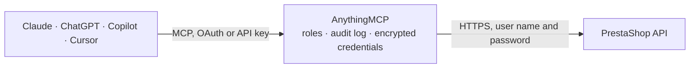

<!-- Generated by scripts/export-github-catalog.mjs in the anythingmcp-website repository. Do not edit by hand. -->

# PrestaShop MCP connector

Your own PrestaShop shop: products with features, combinations and attributes, brands, stock, orders with their status history and shipping rows, customers, addresses, carriers and categories, … The AnythingMCP connector gives Claude, ChatGPT, Microsoft Copilot, Cursor and Gemini 29 MCP tools for PrestaShop: 20 read and 9 can change data.

**Category:** [E-commerce](../e-commerce.md) · **Tools:** 29 · **Setup guide:** [anythingmcp.com](https://anythingmcp.com/guides/prestashop-to-mcp) · [Deutsch](https://anythingmcp.com/de/guides/prestashop-to-mcp) · [Italiano](https://anythingmcp.com/it/guides/prestashop-to-mcp) · [Español](https://anythingmcp.com/es/guides/prestashop-to-mcp) · [日本語](https://anythingmcp.com/ja/guides/prestashop-to-mcp) · [Русский](https://anythingmcp.com/ru/guides/prestashop-to-mcp) · [中文](https://anythingmcp.com/zh/guides/prestashop-to-mcp)

## Start without code

No installation and no terminal: AnythingMCP Cloud runs the PrestaShop connector for you, operated by helpcode.ai in Frankfurt, Germany.

1. **Click the button above** and create an account or sign in. The PrestaShop connector opens, ready to install.
2. **Paste the API key or token from your PrestaShop account.** Every click is in the [step-by-step guide](https://anythingmcp.com/guides/prestashop-to-mcp).
3. **Click Install.** AnythingMCP shows the address of your MCP server.
4. **Add that address to your assistant:** [Claude](https://anythingmcp.com/guides/connect-prestashop-to-claude) · [ChatGPT](https://anythingmcp.com/guides/connect-prestashop-to-chatgpt) · [Microsoft Copilot](https://anythingmcp.com/guides/connect-prestashop-to-copilot) · [Cursor](https://anythingmcp.com/guides/connect-prestashop-to-cursor) · [Gemini CLI](https://anythingmcp.com/guides/connect-prestashop-to-gemini) · [Meta Muse](https://anythingmcp.com/guides/connect-prestashop-to-muse).
5. **Ask your first question**, for example: *Show current stock for product reference TBL-102 and its M size combination*

Prefer help with the setup? [Talk to us](https://anythingmcp.com/contact).

## How it works

- **The AI client** speaks MCP (Streamable HTTP) to AnythingMCP and only sees tool names, descriptions and results. It never gets the PrestaShop credentials.
- **AnythingMCP** checks the client's role, builds the call from the tool definition, adds the credentials (user name and password), calls PrestaShop, logs the call and returns the result.
- **PrestaShop** sees an ordinary API client with the rights of the account the credentials belong to.

## Tools

| Tool | What it does | Access |
|---|---|---|
| [`prestashop_list_products`](#prestashop_list_products) | List products of the shop, with filters on id, reference, name, active flag and default category. | read |
| [`prestashop_get_product`](#prestashop_get_product) | Get one product with all its fields: prices (base price without tax, wholesale price), reference and EANs, descriptions, active flag, and associations to… | read |
| [`prestashop_list_combinations`](#prestashop_list_combinations) | List the combinations (variants such as size and colour) of products: reference, EAN, price impact on the product price, weight impact, default flag and the… | read |
| [`prestashop_list_stock_availables`](#prestashop_list_stock_availables) | List stock rows: quantity per product and combination (id_product_attribute 0 is the product row), out-of-stock behaviour and whether advanced stock… | read |
| [`prestashop_update_product_price`](#prestashop_update_product_price) | Set a product's base price without tax, in the shop's default currency. | write |
| [`prestashop_update_stock_quantity`](#prestashop_update_stock_quantity) | Set the quantity of one stock row (a product or one of its combinations) to an absolute number. | write |
| [`prestashop_list_orders`](#prestashop_list_orders) | List orders, filtered by id, reference, customer, current status or a date range on date_add. | read |
| [`prestashop_get_order`](#prestashop_get_order) | Get one order: customer, delivery and invoice address ids, carrier, payment method, current status, totals with and without tax, currency, and the order… | read |
| [`prestashop_list_order_states`](#prestashop_list_order_states) | List the shop's order statuses with id, name and flags: paid, shipped, delivery, invoice, whether the customer gets an e-mail (send_email) and the e-mail… | read |
| [`prestashop_list_order_histories`](#prestashop_list_order_histories) | List the status history of orders: each row is one status change with the order id, the status id, the employee who made it (0 for the system) and its date. | read |
| [`prestashop_change_order_state`](#prestashop_change_order_state) | Move an order to another status by adding a row to its history. | write |
| [`prestashop_list_customers`](#prestashop_list_customers) | List customer accounts with name, e-mail, company, group, language, newsletter and opt-in flags, guest flag, active flag, note and dates. | read |
| [`prestashop_get_customer`](#prestashop_get_customer) | Get one customer account by id: name, e-mail, company, group, language, newsletter and opt-in flags, guest flag, active flag, note and dates. | read |
| [`prestashop_list_addresses`](#prestashop_list_addresses) | List postal addresses with name, company, VAT number, street lines, postcode, city, country and state ids, phones and the customer they belong to. | read |
| [`prestashop_list_carriers`](#prestashop_list_carriers) | List carriers with id, name, active and deleted flags, delivery delay text, tracking URL and limits. | read |
| [`prestashop_list_categories`](#prestashop_list_categories) | List product categories with id, name, parent id, depth in the tree, active flag and, with display=full, descriptions and associated products. | read |
| [`prestashop_list_product_features`](#prestashop_list_product_features) | List the product features (Caractéristiques, Merkmale) the shop defines, such as Material or Composition: id, name and position. | read |
| [`prestashop_list_product_feature_values`](#prestashop_list_product_feature_values) | List the values of product features: id, id_feature, custom flag (1 = a value typed for one product, 0 = a predefined value) and the value text. | read |
| [`prestashop_get_product_feature_value`](#prestashop_get_product_feature_value) | Get one product feature value by id: id_feature, custom flag and the value per language (or in one language with language). | read |
| [`prestashop_list_attribute_groups`](#prestashop_list_attribute_groups) | List the attribute groups (product options such as Size or Color) used to build combinations: id, name, public name, group type (select, radio, color) and… | read |
| [`prestashop_list_attribute_values`](#prestashop_list_attribute_values) | List the attribute values (product option values such as S, M, L or Red) of the attribute groups: id, id_attribute_group, name, color and position. | read |
| [`prestashop_list_brands`](#prestashop_list_brands) | List the brands (manufacturers) of the shop: id, name, active flag, dates and descriptions. | read |
| [`prestashop_list_order_shipping`](#prestashop_list_order_shipping) | List the shipping rows of orders (order_carriers): id, id_order, id_carrier, invoice, weight, shipping cost with and without tax, tracking number and date. | read |
| [`prestashop_update_product`](#prestashop_update_product) | Change fields of one product with a partial XML update (PATCH): only the elements sent change. | write |
| [`prestashop_add_product`](#prestashop_add_product) | Create a product from XML elements. | write |
| [`prestashop_update_product_feature_value`](#prestashop_update_product_feature_value) | Change the text of one product feature value in one language (PATCH). | write |
| [`prestashop_add_combination`](#prestashop_add_combination) | Create a combination (variant) of a product. | write |
| [`prestashop_upload_product_image`](#prestashop_upload_product_image) | Add an image to a product from a public image URL (JPG, PNG, GIF or WebP): the connector downloads the file and uploads it to the shop, which builds every… | write |
| [`prestashop_set_order_tracking_number`](#prestashop_set_order_tracking_number) | Set the tracking number of an order's shipping row (order_carrier), found with prestashop_list_order_shipping (PATCH). | write |

## Tool reference

Every parameter as the AI client sees it in `tools/list`. Source: [`packages/backend/src/adapters/intl/prestashop.json`](../../../packages/backend/src/adapters/intl/prestashop.json).

### `prestashop_list_products`

List products of the shop, with filters on id, reference, name, active flag and default category. Without display only ids come back; display=full returns every field, [id,name,price,reference,active] only those. price is the base price without tax.

**Access:** read · **Call:** `GET /products`

| Parameter | Type | Required | Description |
|---|---|---|---|
| `display` | string | no | full, or a field list such as [id,name,reference,price,active,id_category_default,date_upd]. Omitted: ids only. |
| `id` | string | no | Product id, or several separated by \| (e.g. 3\|7\|12). |
| `reference` | string | no | Exact product reference (SKU), case-insensitive. |
| `name_contains` | string | no | Text the product name contains. |
| `active` | `0` \| `1` | no | 1 for enabled products, 0 for disabled ones. |
| `category_id` | integer | no | Default category id (id_category_default), from prestashop_list_categories. |
| `filters` | string | no | Further filters in PrestaShop syntax joined with &, e.g. filter[ean13]=[4006381333931] or filter[date_upd]=[2026-01-01,2026-12-31]. |
| `sort` | string | no | Sort order, e.g. [id_DESC] or [price_ASC,id_ASC]. |
| `limit` | string | no | 20 for the first 20 rows, or offset,count such as 40,20. |
| `language` | integer | no | Language id: multilingual fields such as name come back as plain text in that language instead of a list per language. |

### `prestashop_get_product`

Get one product with all its fields: prices (base price without tax, wholesale price), reference and EANs, descriptions, active flag, and associations to categories, images, combinations, features and stock_availables rows.

**Access:** read · **Call:** `GET /products/{product_id}`

| Parameter | Type | Required | Description |
|---|---|---|---|
| `product_id` | integer | yes | Product id. |
| `language` | integer | no | Language id for plain-text multilingual fields. |

### `prestashop_list_combinations`

List the combinations (variants such as size and colour) of products: reference, EAN, price impact on the product price, weight impact, default flag and the attribute values (product_option_values) that make the combination.

**Access:** read · **Call:** `GET /combinations`

| Parameter | Type | Required | Description |
|---|---|---|---|
| `product_id` | integer | no | Only the combinations of this product. |
| `id` | string | no | Combination id, or several separated by \|. |
| `reference` | string | no | Exact combination reference. |
| `limit` | string | no | 20, or offset,count such as 40,20. |

### `prestashop_list_stock_availables`

List stock rows: quantity per product and combination (id_product_attribute 0 is the product row), out-of-stock behaviour and whether advanced stock management drives the row (depends_on_stock). The row id is what prestashop_update_stock_quantity needs.

**Access:** read · **Call:** `GET /stock_availables`

| Parameter | Type | Required | Description |
|---|---|---|---|
| `product_id` | integer | no | Only the rows of this product. |
| `product_attribute_id` | integer | no | Only the row of this combination id (0 for the product row). |
| `quantity_range` | string | no | Quantity range min,max, e.g. -100,0 for products out of stock or oversold. |
| `limit` | string | no | 20, or offset,count such as 40,20. |

### `prestashop_update_product_price`

Set a product's base price without tax, in the shop's default currency. Only the price changes; the other fields of the product stay as they are. Needs PrestaShop 8 or later and the PATCH permission on products. Returns the updated product.

**Access:** write · **Call:** `PATCH /products/{product_id}`

| Parameter | Type | Required | Description |
|---|---|---|---|
| `product_id` | integer | yes | Product id. |
| `price` | number | yes | New base price without tax, e.g. 24.5. |

### `prestashop_update_stock_quantity`

Set the quantity of one stock row (a product or one of its combinations) to an absolute number. Take the row id from prestashop_list_stock_availables. Needs PrestaShop 8 or later and the PATCH permission on stock_availables. Returns the updated row.

**Access:** write · **Call:** `PATCH /stock_availables/{stock_available_id}`

| Parameter | Type | Required | Description |
|---|---|---|---|
| `stock_available_id` | integer | yes | Id of the stock_availables row. |
| `quantity` | integer | yes | New quantity on hand. |

### `prestashop_list_orders`

List orders, filtered by id, reference, customer, current status or a date range on date_add. Without display only ids come back; display=full returns totals, addresses, carrier, payment and order lines. current_state is an order status id from prestashop_list_order_states.

**Access:** read · **Call:** `GET /orders`

| Parameter | Type | Required | Description |
|---|---|---|---|
| `display` | string | no | full, or a field list such as [id,reference,id_customer,current_state,total_paid_tax_incl,payment,date_add]. |
| `id` | string | no | Order id, or several separated by \|. |
| `reference` | string | no | Order reference (9 letters, e.g. XKBKNABJK). |
| `customer_id` | integer | no | Only orders of this customer. |
| `current_state` | string | no | Order status id, or several separated by \| (e.g. 2\|3). |
| `date_from` | string | no | Orders placed on or after this date (YYYY-MM-DD or YYYY-MM-DD HH:MM:SS). Needs date_to as well. |
| `date_to` | string | no | Orders placed on or before this date. Needs date_from as well. |
| `filters` | string | no | Further filters in PrestaShop syntax joined with &, e.g. filter[id_carrier]=[2] or filter[valid]=[1]. |
| `sort` | string | no | Sort order, e.g. [id_DESC] or [date_add_DESC]. |
| `limit` | string | no | 20, or offset,count such as 40,20. |

### `prestashop_get_order`

Get one order: customer, delivery and invoice address ids, carrier, payment method, current status, totals with and without tax, currency, and the order lines (product, combination, quantity, unit prices).

**Access:** read · **Call:** `GET /orders/{order_id}`

| Parameter | Type | Required | Description |
|---|---|---|---|
| `order_id` | integer | yes | Order id. |

### `prestashop_list_order_states`

List the shop's order statuses with id, name and flags: paid, shipped, delivery, invoice, whether the customer gets an e-mail (send_email) and the e-mail template. Ids differ between shops.

**Access:** read · **Call:** `GET /order_states`

| Parameter | Type | Required | Description |
|---|---|---|---|
| `language` | integer | no | Language id for plain-text names. |

### `prestashop_list_order_histories`

List the status history of orders: each row is one status change with the order id, the status id, the employee who made it (0 for the system) and its date.

**Access:** read · **Call:** `GET /order_histories`

| Parameter | Type | Required | Description |
|---|---|---|---|
| `order_id` | integer | no | Only the history of this order. |
| `limit` | string | no | 20, or offset,count such as 40,20. |

### `prestashop_change_order_state`

Move an order to another status by adding a row to its history. PrestaShop then updates current_state and runs what the status triggers (invoice, stock movements). With send_email 1, the customer gets the status e-mail if the status has one. Returns the new history row.

**Access:** write · **Call:** `POST /order_histories`

| Parameter | Type | Required | Description |
|---|---|---|---|
| `order_id` | integer | yes | Order id. |
| `order_state_id` | integer | yes | Target status id from prestashop_list_order_states. |
| `send_email` | `0` \| `1` | no | 1 to send the customer the e-mail tied to the status. 0 or omitted: no e-mail. |

### `prestashop_list_customers`

List customer accounts with name, e-mail, company, group, language, newsletter and opt-in flags, guest flag, active flag, note and dates. The password hash and secure key are never returned.

**Access:** read · **Call:** `GET /customers`

| Parameter | Type | Required | Description |
|---|---|---|---|
| `id` | string | no | Customer id, or several separated by \|. |
| `email` | string | no | Exact e-mail address, case-insensitive. |
| `lastname_contains` | string | no | Text the last name contains. |
| `company_contains` | string | no | Text the company name contains. |
| `active` | `0` \| `1` | no | 1 for active accounts, 0 for disabled ones. |
| `sort` | string | no | Sort order, e.g. [id_DESC] or [lastname_ASC]. |
| `limit` | string | no | 20, or offset,count such as 40,20. |

### `prestashop_get_customer`

Get one customer account by id: name, e-mail, company, group, language, newsletter and opt-in flags, guest flag, active flag, note and dates. The password hash and secure key are never returned.

**Access:** read · **Call:** `GET /customers`

| Parameter | Type | Required | Description |
|---|---|---|---|
| `customer_id` | integer | yes | Customer id. |

### `prestashop_list_addresses`

List postal addresses with name, company, VAT number, street lines, postcode, city, country and state ids, phones and the customer they belong to. Orders point to them through id_address_delivery and id_address_invoice.

**Access:** read · **Call:** `GET /addresses`

| Parameter | Type | Required | Description |
|---|---|---|---|
| `id` | string | no | Address id, or several separated by \| (e.g. the delivery and invoice address of an order). |
| `customer_id` | integer | no | Only the addresses of this customer. |
| `postcode` | string | no | Exact postcode. |
| `limit` | string | no | 20, or offset,count such as 40,20. |

### `prestashop_list_carriers`

List carriers with id, name, active and deleted flags, delivery delay text, tracking URL and limits. PrestaShop keeps the old version of an edited carrier as a deleted row with its own id, so older orders can point to a deleted carrier.

**Access:** read · **Call:** `GET /carriers`

| Parameter | Type | Required | Description |
|---|---|---|---|
| `id` | string | no | Carrier id, or several separated by \|. |
| `active` | `0` \| `1` | no | 1 for carriers offered at checkout, 0 for disabled ones. |
| `deleted` | `0` \| `1` | no | 0 for current carriers, 1 for replaced or deleted ones. |
| `language` | integer | no | Language id for the plain-text delay. |

### `prestashop_list_categories`

List product categories with id, name, parent id, depth in the tree, active flag and, with display=full, descriptions and associated products. The tree starts at Root (id 1) and Home (id 2).

**Access:** read · **Call:** `GET /categories`

| Parameter | Type | Required | Description |
|---|---|---|---|
| `display` | string | no | full, or a field list such as [id,name,id_parent,level_depth,active]. Omitted: ids only. |
| `id` | string | no | Category id, or several separated by \|. |
| `parent_id` | integer | no | Only the direct children of this category. |
| `name_contains` | string | no | Text the category name contains. |
| `active` | `0` \| `1` | no | 1 for visible categories, 0 for hidden ones. |
| `limit` | string | no | 20, or offset,count such as 40,20. |
| `language` | integer | no | Language id for plain-text names. |

### `prestashop_list_product_features`

List the product features (Caractéristiques, Merkmale) the shop defines, such as Material or Composition: id, name and position. Feature values come from prestashop_list_product_feature_values; a product links them in associations.product_features.

**Access:** read · **Call:** `GET /product_features`

| Parameter | Type | Required | Description |
|---|---|---|---|
| `id` | string | no | Id, or several separated by \|. |
| `name_contains` | string | no | Text the feature name contains. |
| `display` | string | no | full (default), or a field list such as [id,name]. |
| `limit` | string | no | 20 for the first 20 rows, or offset,count such as 40,20. |
| `language` | integer | no | Language id: multilingual fields such as name come back as plain text in that language. |

### `prestashop_list_product_feature_values`

List the values of product features: id, id_feature, custom flag (1 = a value typed for one product, 0 = a predefined value) and the value text. Filter by feature_id to get the values a product can pick for that feature, or by value text.

**Access:** read · **Call:** `GET /product_feature_values`

| Parameter | Type | Required | Description |
|---|---|---|---|
| `feature_id` | integer | no | Only values of this feature (id_feature). |
| `id` | string | no | Id, or several separated by \|. |
| `custom` | `0` \| `1` | no | 0 predefined values, 1 custom values. |
| `value_contains` | string | no | Text the value contains (in the language given, or any). |
| `display` | string | no | full (default), or a field list such as [id,name]. |
| `limit` | string | no | 20 for the first 20 rows, or offset,count such as 40,20. |
| `language` | integer | no | Language id: multilingual fields such as name come back as plain text in that language. |

### `prestashop_get_product_feature_value`

Get one product feature value by id: id_feature, custom flag and the value per language (or in one language with language).

**Access:** read · **Call:** `GET /product_feature_values/{feature_value_id}`

| Parameter | Type | Required | Description |
|---|---|---|---|
| `feature_value_id` | integer | yes | Feature value id. |
| `language` | integer | no | Language id: multilingual fields such as name come back as plain text in that language. |

### `prestashop_list_attribute_groups`

List the attribute groups (product options such as Size or Color) used to build combinations: id, name, public name, group type (select, radio, color) and position.

**Access:** read · **Call:** `GET /product_options`

| Parameter | Type | Required | Description |
|---|---|---|---|
| `id` | string | no | Id, or several separated by \|. |
| `display` | string | no | full (default), or a field list such as [id,name]. |
| `limit` | string | no | 20 for the first 20 rows, or offset,count such as 40,20. |
| `language` | integer | no | Language id: multilingual fields such as name come back as plain text in that language. |

### `prestashop_list_attribute_values`

List the attribute values (product option values such as S, M, L or Red) of the attribute groups: id, id_attribute_group, name, color and position. Their ids go into associations.product_option_values of a combination.

**Access:** read · **Call:** `GET /product_option_values`

| Parameter | Type | Required | Description |
|---|---|---|---|
| `attribute_group_id` | integer | no | Only values of this attribute group. |
| `id` | string | no | Id, or several separated by \|. |
| `name_contains` | string | no | Text the value name contains. |
| `display` | string | no | full (default), or a field list such as [id,name]. |
| `limit` | string | no | 20 for the first 20 rows, or offset,count such as 40,20. |
| `language` | integer | no | Language id: multilingual fields such as name come back as plain text in that language. |

### `prestashop_list_brands`

List the brands (manufacturers) of the shop: id, name, active flag, dates and descriptions. A product points to its brand with id_manufacturer.

**Access:** read · **Call:** `GET /manufacturers`

| Parameter | Type | Required | Description |
|---|---|---|---|
| `id` | string | no | Id, or several separated by \|. |
| `name` | string | no | Exact brand name, case-insensitive. |
| `active` | `0` \| `1` | no | 1 for enabled brands. |
| `display` | string | no | full (default), or a field list such as [id,name]. |
| `limit` | string | no | 20 for the first 20 rows, or offset,count such as 40,20. |
| `language` | integer | no | Language id: multilingual fields such as name come back as plain text in that language. |

### `prestashop_list_order_shipping`

List the shipping rows of orders (order_carriers): id, id_order, id_carrier, invoice, weight, shipping cost with and without tax, tracking number and date. Filter by order_id; the row id is what prestashop_set_order_tracking_number changes.

**Access:** read · **Call:** `GET /order_carriers`

| Parameter | Type | Required | Description |
|---|---|---|---|
| `order_id` | integer | no | Only the rows of this order. |
| `id` | string | no | Id, or several separated by \|. |
| `limit` | string | no | 20 for the first 20 rows, or offset,count such as 40,20. |

### `prestashop_update_product`

Change fields of one product with a partial XML update (PATCH): only the elements sent change. fields_xml holds the product elements to set, for example <reference><![CDATA[MUG-1]]></reference><active>1</active>, multilingual fields as <name><language id="1"><![CDATA[Mug]]></language></name>, or associations such as <associations><product_features><product_feature><id>7</id><id_feature_value>23</id_feature_value></product_feature></product_features></associations> (an association sent replaces that whole list, so include the existing entries from prestashop_get_product). Wrap text in CDATA. Needs PrestaShop 8 and the PATCH permission on products. Show the user the change and ask for confirmation before calling. Returns the updated product.

**Access:** write · **Call:** `PATCH /products/{product_id}`

| Parameter | Type | Required | Description |
|---|---|---|---|
| `product_id` | integer | yes | Product id. |
| `fields_xml` | string | yes | XML elements of the product to change, without the <product> wrapper and without <id>. |

### `prestashop_add_product`

Create a product from XML elements. fields_xml needs at least <price> (without tax) and should carry <id_category_default>, <id_tax_rules_group>, <active>, <state>1</state>, <name> and <link_rewrite> per language (<name><language id="1"><![CDATA[Mug]]></language></name>), and <associations><categories><category><id>2</id></category></categories></associations>. Stock is set afterwards with prestashop_update_stock_quantity, images with prestashop_upload_product_image. Wrap text in CDATA. Needs the POST permission on products. Show the user the product and ask for confirmation before calling. Returns the new product with its id.

**Access:** write · **Call:** `POST /products`

| Parameter | Type | Required | Description |
|---|---|---|---|
| `fields_xml` | string | yes | XML elements of the new product, without the <product> wrapper. |

### `prestashop_update_product_feature_value`

Change the text of one product feature value in one language (PATCH). A predefined value (custom 0) is shared by every product that uses it; a custom value belongs to one product. Needs PrestaShop 8 and the PATCH permission on product_feature_values. Show the user the old and new text and ask for confirmation before calling.

**Access:** write · **Call:** `PATCH /product_feature_values/{feature_value_id}`

| Parameter | Type | Required | Description |
|---|---|---|---|
| `feature_value_id` | integer | yes | Feature value id. |
| `language_id` | integer | yes | Language id of the text, e.g. 1. |
| `value` | string | yes | New text, at most 255 characters. |

### `prestashop_add_combination`

Create a combination (variant) of a product. fields_xml carries <minimal_quantity>1</minimal_quantity> (required) and the attribute values that make it, e.g. <associations><product_option_values><product_option_value><id>4</id></product_option_value></product_option_values></associations>, plus optional <reference>, <ean13>, <price> (impact on the product price), <weight> and <default_on>. Take value ids from prestashop_list_attribute_values. The stock row of the combination appears in prestashop_list_stock_availables. Needs the POST permission on combinations. Show the user the combination and ask for confirmation before calling.

**Access:** write · **Call:** `POST /combinations`

| Parameter | Type | Required | Description |
|---|---|---|---|
| `product_id` | integer | yes | Product id. |
| `fields_xml` | string | yes | XML elements of the combination, without the <combination> wrapper and without <id_product>. |

### `prestashop_upload_product_image`

Add an image to a product from a public image URL (JPG, PNG, GIF or WebP): the connector downloads the file and uploads it to the shop, which builds every thumbnail size. The first image of a product becomes its cover. Needs the POST permission on images. Show the user the image and ask for confirmation before calling. Returns the new image id.

**Access:** write · **Call:** `POST /images/products/{product_id}`

| Parameter | Type | Required | Description |
|---|---|---|---|
| `product_id` | integer | yes | Product id. |
| `image_url` | string | yes | Public URL of the image file. |

### `prestashop_set_order_tracking_number`

Set the tracking number of an order's shipping row (order_carrier), found with prestashop_list_order_shipping (PATCH). The customer sees it in the order details; unlike the back office, the Webservice sends no shipping e-mail. Needs PrestaShop 8 and the PATCH permission on order_carriers. Show the user the order and number and ask for confirmation before calling.

**Access:** write · **Call:** `PATCH /order_carriers/{order_carrier_id}`

| Parameter | Type | Required | Description |
|---|---|---|---|
| `order_carrier_id` | integer | yes | Shipping row id (order_carriers). |
| `tracking_number` | string | yes | Tracking number. |

## Run it yourself

AnythingMCP is open source (AGPL-3.0). [Run it with Docker](../../../README.md#run-it-yourself), open **Connectors → Store**, pick **PrestaShop** and enter `PRESTASHOP_URL`, `PRESTASHOP_WEBSERVICE_KEY`, then add your MCP server URL to the AI client.

[← E-commerce connectors](../e-commerce.md) · [All categories](../README.md)
