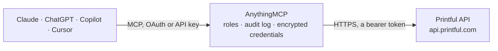

<!-- Generated by scripts/export-github-catalog.mjs in the anythingmcp-website repository. Do not edit by hand. -->

# Printful MCP connector

Printful print-on-demand: browse the product catalog, check production prices and shipping rates, estimate costs, draft and track orders, and see the products of your Printful stores, including … The AnythingMCP connector gives Claude, ChatGPT, Microsoft Copilot, Cursor and Gemini 20 MCP tools for Printful: 18 read and 2 can change data.

**Category:** [E-commerce](../e-commerce.md) · **Tools:** 20 · **Setup guide:** [anythingmcp.com](https://anythingmcp.com/guides/printful-to-mcp) · [Deutsch](https://anythingmcp.com/de/guides/printful-to-mcp) · [Italiano](https://anythingmcp.com/it/guides/printful-to-mcp) · [Español](https://anythingmcp.com/es/guides/printful-to-mcp) · [日本語](https://anythingmcp.com/ja/guides/printful-to-mcp) · [Русский](https://anythingmcp.com/ru/guides/printful-to-mcp) · [中文](https://anythingmcp.com/zh/guides/printful-to-mcp)

## Start without code

No installation and no terminal: AnythingMCP Cloud runs the Printful connector for you, operated by helpcode.ai in Frankfurt, Germany.

1. **Click the button above** and create an account or sign in. The Printful connector opens, ready to install.
2. **Paste the API key or token from your Printful account.** Every click is in the [step-by-step guide](https://anythingmcp.com/guides/printful-to-mcp).
3. **Click Install.** AnythingMCP shows the address of your MCP server.
4. **Add that address to your assistant:** [Claude](https://anythingmcp.com/guides/connect-printful-to-claude) · [ChatGPT](https://anythingmcp.com/guides/connect-printful-to-chatgpt) · [Microsoft Copilot](https://anythingmcp.com/guides/connect-printful-to-copilot) · [Cursor](https://anythingmcp.com/guides/connect-printful-to-cursor) · [Gemini CLI](https://anythingmcp.com/guides/connect-printful-to-gemini) · [Meta Muse](https://anythingmcp.com/guides/connect-printful-to-muse).
5. **Ask your first question**, for example: *What’s the status, total and tracking for Printful order PF-2026-1487?*

Prefer help with the setup? [Talk to us](https://anythingmcp.com/contact).

## How it works

- **The AI client** speaks MCP (Streamable HTTP) to AnythingMCP and only sees tool names, descriptions and results. It never gets the Printful credentials.
- **AnythingMCP** checks the client's role, builds the call from the tool definition, adds the credentials (a bearer token), calls Printful, logs the call and returns the result.
- **Printful** sees an ordinary API client with the rights of the account the credentials belong to.

## Tools

| Tool | What it does | Access |
|---|---|---|
| [`printful_get_token_scopes`](#printful_get_token_scopes) | List the scopes of the configured private token (orders, sync_products, file_library, webhooks…), to check what the connector is allowed to read and change. | read |
| [`printful_list_stores`](#printful_list_stores) | List the Printful stores the token can reach, with id, name and type (the platform the store is linked to). | read |
| [`printful_list_categories`](#printful_list_categories) | List the Printful catalog categories (men's clothing, wall art, mugs, hats…) with id, parent id, title and image. | read |
| [`printful_list_catalog_products`](#printful_list_catalog_products) | List the blank products in the Printful catalog (t-shirts, hoodies, posters, mugs…) with id, type, brand, model, title, image, variant count, average… | read |
| [`printful_get_catalog_product`](#printful_get_catalog_product) | Get one catalog product with its description, print file placements, techniques and options, and every variant (size, colour, price, in-stock flag and stock… | read |
| [`printful_get_catalog_variant`](#printful_get_catalog_variant) | Get one catalog variant (a size and colour of a product) with its price, stock status by region and its parent product. | read |
| [`printful_get_product_size_guide`](#printful_get_product_size_guide) | Get the size guide of a catalog product: measurements per size for the product and how to measure, in inches or centimetres. | read |
| [`printful_get_printfiles`](#printful_get_printfiles) | Get the print areas of a catalog product: per placement (front, back, sleeve...) the printfile size in pixels, DPI and fill mode, and which printfile each… | read |
| [`printful_get_product_prices`](#printful_get_product_prices) | Get the production prices of a catalog product, including store discounts: price per placement and technique (front, back, sleeve, embroidery…) and per variant. | read |
| [`printful_calculate_shipping_rates`](#printful_calculate_shipping_rates) | Get the shipping options for a set of catalog or store variants to an address, with rate id, name, price, currency and delivery-day range and dates. | read |
| [`printful_list_orders`](#printful_list_orders) | List the orders of a store, optionally by status: draft, pending, inreview, failed, canceled, inprocess, onhold, partial, fulfilled or archived. | read |
| [`printful_get_order`](#printful_get_order) | Get one order: status, shipping method, recipient, items with files, Printful costs (subtotal, shipping, tax, VAT, total), retail costs, and shipments with… | read |
| [`printful_estimate_order_costs`](#printful_estimate_order_costs) | Estimate what Printful would charge for an order without creating it: item and print costs (back prints, inside labels…), digitization, fees, shipping, tax,… | read |
| [`printful_create_draft_order`](#printful_create_draft_order) | Create an order as a draft. | write |
| [`printful_confirm_order`](#printful_confirm_order) | Submit a draft order for fulfillment. | write |
| [`printful_list_store_products`](#printful_list_store_products) | List the products of a Manual order / API store (one created in the Printful dashboard rather than linked to a platform) with id, external id, name, number… | read |
| [`printful_get_store_product`](#printful_get_store_product) | Get one product of a Manual order / API store with its sync variants: catalog variant, retail price, currency, SKU, print files and options. | read |
| [`printful_list_sync_products`](#printful_list_sync_products) | List the products of a store linked to an e-commerce platform (Shopify, WooCommerce, Etsy…), with their sync state toward Printful: how many variants exist… | read |
| [`printful_get_sync_product`](#printful_get_sync_product) | Get one product of a platform-linked store with its sync variants: the platform variant, the Printful catalog variant it is synced to, retail price, SKU,… | read |
| [`printful_get_webhooks`](#printful_get_webhooks) | Show the webhook set up for the store: the URL that receives Printful's notifications and the enabled event types (package_shipped, order_failed,… | read |

## Tool reference

Every parameter as the AI client sees it in `tools/list`. Source: [`packages/backend/src/adapters/intl/printful.json`](../../../packages/backend/src/adapters/intl/printful.json).

### `printful_get_token_scopes`

List the scopes of the configured private token (orders, sync_products, file_library, webhooks…), to check what the connector is allowed to read and change. Works with store- and account-level tokens.

**Access:** read · **Call:** `GET /oauth/scopes`

No parameters.

### `printful_list_stores`

List the Printful stores the token can reach, with id, name and type (the platform the store is linked to). An account-level token sees every store of the account and needs one of these ids as store_id on store tools; a store-level token sees its own store.

**Access:** read · **Call:** `GET /stores`

No parameters.

### `printful_list_categories`

List the Printful catalog categories (men's clothing, wall art, mugs, hats…) with id, parent id, title and image. Use a category id to filter printful_list_catalog_products.

**Access:** read · **Call:** `GET /categories`

No parameters.

### `printful_list_catalog_products`

List the blank products in the Printful catalog (t-shirts, hoodies, posters, mugs…) with id, type, brand, model, title, image, variant count, average fulfillment time and printing techniques, optionally only from some categories.

**Access:** read · **Call:** `GET /products`

| Parameter | Type | Required | Description |
|---|---|---|---|
| `category_id` | string | no | Comma-separated category ids from printful_list_categories, e.g. 24 or 24,27. |

### `printful_get_catalog_product`

Get one catalog product with its description, print file placements, techniques and options, and every variant (size, colour, price, in-stock flag and stock status by region). Variant ids are what orders, shipping rates and cost estimates use.

**Access:** read · **Call:** `GET /products/{product_id}`

| Parameter | Type | Required | Description |
|---|---|---|---|
| `product_id` | integer | yes | Catalog product id from printful_list_catalog_products. |

### `printful_get_catalog_variant`

Get one catalog variant (a size and colour of a product) with its price, stock status by region and its parent product.

**Access:** read · **Call:** `GET /products/variant/{variant_id}`

| Parameter | Type | Required | Description |
|---|---|---|---|
| `variant_id` | integer | yes | Catalog variant id from printful_get_catalog_product. |

### `printful_get_product_size_guide`

Get the size guide of a catalog product: measurements per size for the product and how to measure, in inches or centimetres.

**Access:** read · **Call:** `GET /products/{product_id}/sizes`

| Parameter | Type | Required | Description |
|---|---|---|---|
| `product_id` | integer | yes | Catalog product id. |
| `unit` | `inches` \| `cm` | no | Measurement unit. By default inches for the United States, Liberia and Myanmar and centimetres elsewhere. |

### `printful_get_printfiles`

Get the print areas of a catalog product: per placement (front, back, sleeve...) the printfile size in pixels, DPI and fill mode, and which printfile each variant uses. Use it to prepare design files in the right resolution before creating an order. Products with several techniques default to DTG; pass technique for embroidery and others.

**Access:** read · **Call:** `GET /mockup-generator/printfiles/{product_id}`

| Parameter | Type | Required | Description |
|---|---|---|---|
| `product_id` | integer | yes | Catalog product id from printful_list_catalog_products. |
| `technique` | string | no | Printing technique when the product has several, e.g. EMBROIDERY, DTG, SUBLIMATION, DTFILM. |
| `orientation` | `horizontal` \| `vertical` | no | Only for wall art: printfiles for this orientation. |
| `store_id` | string | no | Printful store id from printful_list_stores. Needed only with an account-level token; a store-level token already belongs to one store. |

### `printful_get_product_prices`

Get the production prices of a catalog product, including store discounts: price per placement and technique (front, back, sleeve, embroidery…) and per variant. Shipping is not included. Uses Printful API v2 (open beta).

**Access:** read · **Call:** `GET /v2/catalog-products/{product_id}/prices`

| Parameter | Type | Required | Description |
|---|---|---|---|
| `product_id` | integer | yes | Catalog product id. |
| `selling_region_name` | string | no | Selling region whose production currency the prices are calculated in, e.g. worldwide. |
| `currency` | string | no | 3-letter currency code to show prices in (default: the store currency). |
| `store_id` | string | no | Printful store id from printful_list_stores. Needed only with an account-level token; a store-level token already belongs to one store. |

### `printful_calculate_shipping_rates`

Get the shipping options for a set of catalog or store variants to an address, with rate id, name, price, currency and delivery-day range and dates. Creates nothing. Only the country (and state for the US, Canada, Australia) is required; a fuller address gives more precise rates.

**Access:** read · **Call:** `POST /shipping/rates`

| Parameter | Type | Required | Description |
|---|---|---|---|
| `store_id` | string | no | Printful store id from printful_list_stores. Needed only with an account-level token; a store-level token already belongs to one store. |
| `recipient` | object | yes | Destination address. |
| `items` | object[] | yes | Items to ship, each with one variant id. |
| `currency` | string | no | 3-letter currency code to convert the rates to (default: the store currency). |
| `locale` | `en_US` \| `es_ES` | no | Language of the rate names (default en_US). |

### `printful_list_orders`

List the orders of a store, optionally by status: draft, pending, inreview, failed, canceled, inprocess, onhold, partial, fulfilled or archived. Returns each order with recipient, items, costs and shipments; page with offset and limit.

**Access:** read · **Call:** `GET /orders`

| Parameter | Type | Required | Description |
|---|---|---|---|
| `store_id` | string | no | Printful store id from printful_list_stores. Needed only with an account-level token; a store-level token already belongs to one store. |
| `status` | `draft` \| `pending` \| `inreview` \| `failed` \| `canceled` \| `inprocess` \| `onhold` \| `partial` \| `fulfilled` \| `archived` | no | Only orders with this status. |
| `offset` | integer | no | Orders to skip, for paging (default 0). |
| `limit` | integer | no | Orders per page, at most 100. |

### `printful_get_order`

Get one order: status, shipping method, recipient, items with files, Printful costs (subtotal, shipping, tax, VAT, total), retail costs, and shipments with carrier, tracking number and tracking URL.

**Access:** read · **Call:** `GET /orders/{order_id}`

| Parameter | Type | Required | Description |
|---|---|---|---|
| `order_id` | string | yes | Printful order id (a number), or your external id prefixed with @, e.g. @SHOP-1001. |
| `store_id` | string | no | Printful store id from printful_list_stores. Needed only with an account-level token; a store-level token already belongs to one store. |

### `printful_estimate_order_costs`

Estimate what Printful would charge for an order without creating it: item and print costs (back prints, inside labels…), digitization, fees, shipping, tax, VAT and total, plus the retail costs. Applies the store's shipping settings. Takes the same recipient and items as an order.

**Access:** read · **Call:** `POST /orders/estimate-costs`

| Parameter | Type | Required | Description |
|---|---|---|---|
| `store_id` | string | no | Printful store id from printful_list_stores. Needed only with an account-level token; a store-level token already belongs to one store. |
| `external_id` | string | no | Your own order id (up to 32 letters, digits, - or _). The order can then be read as @<external_id>. |
| `shipping` | string | no | Shipping rate id from printful_calculate_shipping_rates, e.g. STANDARD (default). |
| `recipient` | object | yes | Recipient address. |
| `items` | object[] | yes | Line items. Give each one exactly one of variant_id (catalog variant, with files), sync_variant_id or external_variant_id (a product already set up in a Printful store, files included). |
| `retail_costs` | object | no | Amounts shown on the packing slip (not what Printful charges). |
| `gift` | object | no | Gift message printed on the packing slip. |
| `packing_slip` | object | no | Packing slip overrides. |

### `printful_create_draft_order`

Create an order as a draft. A draft is not submitted for fulfillment and not charged; it can be reviewed and edited in the Printful dashboard and is sent to production only when confirmed (printful_confirm_order or the dashboard). Returns the order with its id and estimated costs.

**Access:** write · **Call:** `POST /orders`

| Parameter | Type | Required | Description |
|---|---|---|---|
| `store_id` | string | no | Printful store id from printful_list_stores. Needed only with an account-level token; a store-level token already belongs to one store. |
| `external_id` | string | no | Your own order id (up to 32 letters, digits, - or _). The order can then be read as @<external_id>. |
| `shipping` | string | no | Shipping rate id from printful_calculate_shipping_rates, e.g. STANDARD (default). |
| `recipient` | object | yes | Recipient address. |
| `items` | object[] | yes | Line items. Give each one exactly one of variant_id (catalog variant, with files), sync_variant_id or external_variant_id (a product already set up in a Printful store, files included). |
| `retail_costs` | object | no | Amounts shown on the packing slip (not what Printful charges). |
| `gift` | object | no | Gift message printed on the packing slip. |
| `packing_slip` | object | no | Packing slip overrides. |

### `printful_confirm_order`

Submit a draft order for fulfillment. Printful charges the store's billing method and starts production; from then on the order can only be cancelled while it is pending. Returns the order with its new status.

**Access:** write · **Call:** `POST /orders/{order_id}/confirm`

| Parameter | Type | Required | Description |
|---|---|---|---|
| `order_id` | string | yes | Printful order id of a draft, or @<external_id>. |
| `store_id` | string | no | Printful store id from printful_list_stores. Needed only with an account-level token; a store-level token already belongs to one store. |

### `printful_list_store_products`

List the products of a Manual order / API store (one created in the Printful dashboard rather than linked to a platform) with id, external id, name, number of variants and thumbnail, optionally by status or category.

**Access:** read · **Call:** `GET /store/products`

| Parameter | Type | Required | Description |
|---|---|---|---|
| `store_id` | string | no | Printful store id from printful_list_stores. Needed only with an account-level token; a store-level token already belongs to one store. |
| `status` | `all` \| `synced` \| `unsynced` \| `ignored` \| `imported` \| `discontinued` \| `out_of_stock` | no | Only products in this state. |
| `category_id` | string | no | Comma-separated catalog category ids. |

### `printful_get_store_product`

Get one product of a Manual order / API store with its sync variants: catalog variant, retail price, currency, SKU, print files and options. A sync variant id can be ordered without sending files again.

**Access:** read · **Call:** `GET /store/products/{product_id}`

| Parameter | Type | Required | Description |
|---|---|---|---|
| `product_id` | string | yes | Sync product id (a number), or its external id prefixed with @. |
| `store_id` | string | no | Printful store id from printful_list_stores. Needed only with an account-level token; a store-level token already belongs to one store. |

### `printful_list_sync_products`

List the products of a store linked to an e-commerce platform (Shopify, WooCommerce, Etsy…), with their sync state toward Printful: how many variants exist and how many are synced to a Printful product. Search by name and page with offset and limit.

**Access:** read · **Call:** `GET /sync/products`

| Parameter | Type | Required | Description |
|---|---|---|---|
| `store_id` | string | no | Printful store id from printful_list_stores. Needed only with an account-level token; a store-level token already belongs to one store. |
| `search` | string | no | Text to look for in product names. |
| `status` | `all` \| `synced` \| `unsynced` \| `ignored` \| `imported` \| `discontinued` \| `out_of_stock` | no | Only products in this state, e.g. unsynced for products without a Printful product attached. |
| `offset` | integer | no | Products to skip, for paging. |
| `limit` | integer | no | Products per page, at most 100. |

### `printful_get_sync_product`

Get one product of a platform-linked store with its sync variants: the platform variant, the Printful catalog variant it is synced to, retail price, SKU, print files and whether it is synced.

**Access:** read · **Call:** `GET /sync/products/{product_id}`

| Parameter | Type | Required | Description |
|---|---|---|---|
| `product_id` | string | yes | Sync product id (a number), or the platform's product id prefixed with @. |
| `store_id` | string | no | Printful store id from printful_list_stores. Needed only with an account-level token; a store-level token already belongs to one store. |

### `printful_get_webhooks`

Show the webhook set up for the store: the URL that receives Printful's notifications and the enabled event types (package_shipped, order_failed, stock_updated...) with their parameters. Needs the webhooks/read scope.

**Access:** read · **Call:** `GET /webhooks`

| Parameter | Type | Required | Description |
|---|---|---|---|
| `store_id` | string | no | Printful store id from printful_list_stores. Needed only with an account-level token; a store-level token already belongs to one store. |

## Run it yourself

AnythingMCP is open source (AGPL-3.0). [Run it with Docker](../../../README.md#run-it-yourself), open **Connectors → Store**, pick **Printful** and enter `PRINTFUL_API_TOKEN`, then add your MCP server URL to the AI client.

[← E-commerce connectors](../e-commerce.md) · [All categories](../README.md)
