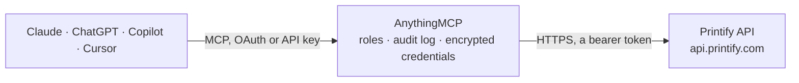

<!-- Generated by scripts/export-github-catalog.mjs in the anythingmcp-website repository. Do not edit by hand. -->

# Printify MCP connector

Printify print-on-demand: shops, products, the blueprint catalog with print providers, variants and shipping, the image library, orders and webhooks. The AnythingMCP connector gives Claude, ChatGPT, Microsoft Copilot, Cursor and Gemini 24 MCP tools for Printify: 16 read and 8 can change data.

**Category:** [E-commerce](../e-commerce.md) · **Tools:** 24 · **Setup guide:** [anythingmcp.com](https://anythingmcp.com/guides/printify-to-mcp) · [Deutsch](https://anythingmcp.com/de/guides/printify-to-mcp) · [Italiano](https://anythingmcp.com/it/guides/printify-to-mcp) · [Español](https://anythingmcp.com/es/guides/printify-to-mcp) · [日本語](https://anythingmcp.com/ja/guides/printify-to-mcp) · [Русский](https://anythingmcp.com/ru/guides/printify-to-mcp) · [中文](https://anythingmcp.com/zh/guides/printify-to-mcp)

## Start without code

No installation and no terminal: AnythingMCP Cloud runs the Printify connector for you, operated by helpcode.ai in Frankfurt, Germany.

1. **Click the button above** and create an account or sign in. The Printify connector opens, ready to install.
2. **Paste the API key or token from your Printify account.** Every click is in the [step-by-step guide](https://anythingmcp.com/guides/printify-to-mcp).
3. **Click Install.** AnythingMCP shows the address of your MCP server.
4. **Add that address to your assistant:** [Claude](https://anythingmcp.com/guides/connect-printify-to-claude) · [ChatGPT](https://anythingmcp.com/guides/connect-printify-to-chatgpt) · [Microsoft Copilot](https://anythingmcp.com/guides/connect-printify-to-copilot) · [Cursor](https://anythingmcp.com/guides/connect-printify-to-cursor) · [Gemini CLI](https://anythingmcp.com/guides/connect-printify-to-gemini) · [Meta Muse](https://anythingmcp.com/guides/connect-printify-to-muse).
5. **Ask your first question**, for example: *Show details for Printify order 5f3a2b1c4d6e7f8a9b0c1d2e in my shop CanvasCo Ltd (we need invoice info).*

Prefer help with the setup? [Talk to us](https://anythingmcp.com/contact).

## How it works

- **The AI client** speaks MCP (Streamable HTTP) to AnythingMCP and only sees tool names, descriptions and results. It never gets the Printify credentials.
- **AnythingMCP** checks the client's role, builds the call from the tool definition, adds the credentials (a bearer token), calls Printify, logs the call and returns the result.
- **Printify** sees an ordinary API client with the rights of the account the credentials belong to.

## Tools

| Tool | What it does | Access |
|---|---|---|
| [`printify_list_shops`](#printify_list_shops) | List the shops in the Printify account with their id, title and sales channel (etsy, shopify, custom_integration, disconnected). | read |
| [`printify_list_blueprints`](#printify_list_blueprints) | List every blueprint in the Printify catalog: the base products (t-shirts, mugs, posters...) with id, title, brand, model and images. | read |
| [`printify_get_blueprint`](#printify_get_blueprint) | Get one catalog blueprint by id: title, description, brand, model and product images. | read |
| [`printify_list_blueprint_print_providers`](#printify_list_blueprint_print_providers) | List the print providers that can produce a blueprint, with their id, name and decoration methods (dtg, embroidery...). | read |
| [`printify_list_variants`](#printify_list_variants) | List the variants (size, colour) of a blueprint at one print provider, with variant ids and the print area placeholders and their dimensions. | read |
| [`printify_get_shipping`](#printify_get_shipping) | Get the shipping profiles of a blueprint at one print provider: handling time and first-item and additional-item costs in cents per variant and country. | read |
| [`printify_list_print_providers`](#printify_list_print_providers) | List all Printify print providers with their id, title and location. | read |
| [`printify_get_print_provider`](#printify_get_print_provider) | Get one print provider by id: name, location and the blueprints it produces. | read |
| [`printify_list_products`](#printify_list_products) | List the products of a shop, newest first, with title, variants and prices, images, print areas, visibility and the sales channel listing in `external`. | read |
| [`printify_get_product`](#printify_get_product) | Get one product of a shop with all details: variants with price, cost and SKU, print areas and images, mockups, tags, publishing state and the linked sales… | read |
| [`printify_create_product`](#printify_create_product) | Create a product in a shop from a blueprint and print provider: title, description, variants with prices in cents and print areas placing uploaded images. | write |
| [`printify_update_product`](#printify_update_product) | Update a product: title, description, tags, variant prices and enabled flags, or print areas. | write |
| [`printify_delete_product`](#printify_delete_product) | Delete a product from a Printify shop. | write |
| [`printify_publish_product`](#printify_publish_product) | Publish a product to the shop's sales channel (for example the Etsy listing). | write |
| [`printify_list_uploads`](#printify_list_uploads) | List the images in the account's media library with id, file name, size, dimensions and preview URL. | read |
| [`printify_get_upload`](#printify_get_upload) | Get one uploaded image by id: file name, dimensions, size, MIME type, preview URL and upload time. | read |
| [`printify_upload_image`](#printify_upload_image) | Upload an image to the media library from a public URL (preferred) or base64 contents. | write |
| [`printify_list_orders`](#printify_list_orders) | List the orders of a shop, newest first, with status, line items and costs, shipping address, shipments and tracking. | read |
| [`printify_get_order`](#printify_get_order) | Get one order with status, line items with production cost and shipping cost in cents, the address, shipments with carrier and tracking number, and print… | read |
| [`printify_calculate_shipping`](#printify_calculate_shipping) | Calculate the shipping cost of a would-be order for an address without creating it. | read |
| [`printify_create_order`](#printify_create_order) | Create an order in a shop for existing products (product_id + variant_id), SKUs, or catalog items with print areas. | write |
| [`printify_send_order_to_production`](#printify_send_order_to_production) | Send an on-hold order to production. | write |
| [`printify_cancel_order`](#printify_cancel_order) | Cancel an order. | write |
| [`printify_list_webhooks`](#printify_list_webhooks) | List the webhooks installed on a shop with id, topic (order:created, product:publish:started...) and target URL. | read |

## Tool reference

Every parameter as the AI client sees it in `tools/list`. Source: [`packages/backend/src/adapters/intl/printify.json`](../../../packages/backend/src/adapters/intl/printify.json).

### `printify_list_shops`

List the shops in the Printify account with their id, title and sales channel (etsy, shopify, custom_integration, disconnected). Call this first: the shop id is needed by every product, order and webhook tool.

**Access:** read · **Call:** `GET /shops.json`

No parameters.

### `printify_list_blueprints`

List every blueprint in the Printify catalog: the base products (t-shirts, mugs, posters...) with id, title, brand, model and images. Use it to find the blueprint_id before choosing a print provider.

**Access:** read · **Call:** `GET /catalog/blueprints.json`

No parameters.

### `printify_get_blueprint`

Get one catalog blueprint by id: title, description, brand, model and product images. Use it to read the details of a base product found with printify_list_blueprints.

**Access:** read · **Call:** `GET /catalog/blueprints/{blueprint_id}.json`

| Parameter | Type | Required | Description |
|---|---|---|---|
| `blueprint_id` | integer | yes | Blueprint id from printify_list_blueprints. |

### `printify_list_blueprint_print_providers`

List the print providers that can produce a blueprint, with their id, name and decoration methods (dtg, embroidery...). Pick one to read its variants, shipping and costs.

**Access:** read · **Call:** `GET /catalog/blueprints/{blueprint_id}/print_providers.json`

| Parameter | Type | Required | Description |
|---|---|---|---|
| `blueprint_id` | integer | yes | Blueprint id from printify_list_blueprints. |

### `printify_list_variants`

List the variants (size, colour) of a blueprint at one print provider, with variant ids and the print area placeholders and their dimensions. Variant ids are needed to create products and orders.

**Access:** read · **Call:** `GET /catalog/blueprints/{blueprint_id}/print_providers/{print_provider_id}/variants.json`

| Parameter | Type | Required | Description |
|---|---|---|---|
| `blueprint_id` | integer | yes | Blueprint id from printify_list_blueprints. |
| `print_provider_id` | integer | yes | Print provider id from printify_list_blueprint_print_providers. |
| `show_out_of_stock` | `0` \| `1` | no | 1 to include variants that are out of stock, 0 or omitted for in-stock variants only. |

### `printify_get_shipping`

Get the shipping profiles of a blueprint at one print provider: handling time and first-item and additional-item costs in cents per variant and country. Use it to price products and estimate delivery.

**Access:** read · **Call:** `GET /catalog/blueprints/{blueprint_id}/print_providers/{print_provider_id}/shipping.json`

| Parameter | Type | Required | Description |
|---|---|---|---|
| `blueprint_id` | integer | yes | Blueprint id from printify_list_blueprints. |
| `print_provider_id` | integer | yes | Print provider id from printify_list_blueprint_print_providers. |

### `printify_list_print_providers`

List all Printify print providers with their id, title and location. Use it to compare providers or find one in a given country.

**Access:** read · **Call:** `GET /catalog/print_providers.json`

No parameters.

### `printify_get_print_provider`

Get one print provider by id: name, location and the blueprints it produces. Use it to see what else a provider can print.

**Access:** read · **Call:** `GET /catalog/print_providers/{print_provider_id}.json`

| Parameter | Type | Required | Description |
|---|---|---|---|
| `print_provider_id` | integer | yes | Print provider id from printify_list_print_providers. |

### `printify_list_products`

List the products of a shop, newest first, with title, variants and prices, images, print areas, visibility and the sales channel listing in `external`. Paged: up to 50 per page.

**Access:** read · **Call:** `GET /shops/{shop_id}/products.json`

| Parameter | Type | Required | Description |
|---|---|---|---|
| `shop_id` | integer | yes | Shop id from printify_list_shops. |
| `limit` | integer | no | Products per page, 1-50. Default 10. |
| `page` | integer | no | Page number, starting at 1. |

### `printify_get_product`

Get one product of a shop with all details: variants with price, cost and SKU, print areas and images, mockups, tags, publishing state and the linked sales channel listing.

**Access:** read · **Call:** `GET /shops/{shop_id}/products/{product_id}.json`

| Parameter | Type | Required | Description |
|---|---|---|---|
| `shop_id` | integer | yes | Shop id from printify_list_shops. |
| `product_id` | string | yes | Product id (24 hex characters) from printify_list_products. |

### `printify_create_product`

Create a product in a shop from a blueprint and print provider: title, description, variants with prices in cents and print areas placing uploaded images. Returns the new product. It is not published until printify_publish_product.

**Access:** write · **Call:** `POST /shops/{shop_id}/products.json`

| Parameter | Type | Required | Description |
|---|---|---|---|
| `shop_id` | integer | yes | Shop id from printify_list_shops. |
| `title` | string | yes | Product title. |
| `description` | string | yes | Product description (HTML allowed). |
| `blueprint_id` | integer | yes | Blueprint id from printify_list_blueprints. |
| `print_provider_id` | integer | yes | Print provider id from printify_list_blueprint_print_providers. |
| `variants` | object[] | yes | Variants to offer: [{"id": 17390, "price": 2499, "is_enabled": true}]. Ids from printify_list_variants, price in cents. |
| `print_areas` | object[] | yes | Print areas: [{"variant_ids": [17390], "placeholders": [{"position": "front", "images": [{"id": "<upload id>", "x": 0.5, "y": 0.5, "scale": 1, "angle": 0}]}]}]. |
| `tags` | string[] | no | Tags passed to the sales channel listing. |
| `safety_information` | string | no | GPSR safety information shown to EU buyers (manufacturer, product info, warnings, care). |

### `printify_update_product`

Update a product: title, description, tags, variant prices and enabled flags, or print areas. Only the fields passed are changed. Publish again afterwards to push the change to the sales channel.

**Access:** write · **Call:** `PUT /shops/{shop_id}/products/{product_id}.json`

| Parameter | Type | Required | Description |
|---|---|---|---|
| `shop_id` | integer | yes | Shop id from printify_list_shops. |
| `product_id` | string | yes | Product id from printify_list_products. |
| `title` | string | no | New title. |
| `description` | string | no | New description (HTML allowed). |
| `tags` | string[] | no | New tag list (replaces the old one). |
| `variants` | object[] | no | Variants with id, price in cents and is_enabled. |
| `print_areas` | object[] | no | Replacement print areas, same shape as in printify_create_product. |

### `printify_delete_product`

Delete a product from a Printify shop. This cannot be undone. A listing already published to the sales channel is not removed by Printify; check it there.

**Access:** write · **Call:** `DELETE /shops/{shop_id}/products/{product_id}.json`

| Parameter | Type | Required | Description |
|---|---|---|---|
| `shop_id` | integer | yes | Shop id from printify_list_shops. |
| `product_id` | string | yes | Product id from printify_list_products. |

### `printify_publish_product`

Publish a product to the shop's sales channel (for example the Etsy listing). Each flag says which parts to push; omitted flags count as true. Limited to 200 calls per 30 minutes.

**Access:** write · **Call:** `POST /shops/{shop_id}/products/{product_id}/publish.json`

| Parameter | Type | Required | Description |
|---|---|---|---|
| `shop_id` | integer | yes | Shop id from printify_list_shops. |
| `product_id` | string | yes | Product id from printify_list_products. |
| `title` | boolean | no | Push the title. |
| `description` | boolean | no | Push the description. |
| `images` | boolean | no | Push the mockup images. |
| `variants` | boolean | no | Push variants and prices. |
| `tags` | boolean | no | Push the tags. |
| `key_features` | boolean | no | Push the key features. |
| `shipping_template` | boolean | no | Push the shipping profile (Etsy and Amazon only). |

### `printify_list_uploads`

List the images in the account's media library with id, file name, size, dimensions and preview URL. Paged: up to 50 per page. Image ids are used in product print areas.

**Access:** read · **Call:** `GET /uploads.json`

| Parameter | Type | Required | Description |
|---|---|---|---|
| `limit` | integer | no | Images per page, 1-50 (Printify rejects more). Default 10. |
| `page` | integer | no | Page number, starting at 1. |

### `printify_get_upload`

Get one uploaded image by id: file name, dimensions, size, MIME type, preview URL and upload time. Use it to check an image before placing it on a product.

**Access:** read · **Call:** `GET /uploads/{image_id}.json`

| Parameter | Type | Required | Description |
|---|---|---|---|
| `image_id` | string | yes | Image id from printify_list_uploads or printify_upload_image. |

### `printify_upload_image`

Upload an image to the media library from a public URL (preferred) or base64 contents. Returns the image id to use in print areas. Printify downloads the URL itself, so it must be reachable from the internet.

**Access:** write · **Call:** `POST /uploads/images.json`

| Parameter | Type | Required | Description |
|---|---|---|---|
| `file_name` | string | yes | File name with extension, e.g. design.png. |
| `url` | string | no | Public URL of the image. Use this or contents. |
| `contents` | string | no | Base64-encoded image contents, for small files only (under 5 MB). Use this or url. |

### `printify_list_orders`

List the orders of a shop, newest first, with status, line items and costs, shipping address, shipments and tracking. Filter by status or SKU. Paged: at most 10 per page.

**Access:** read · **Call:** `GET /shops/{shop_id}/orders.json`

| Parameter | Type | Required | Description |
|---|---|---|---|
| `shop_id` | integer | yes | Shop id from printify_list_shops. |
| `status` | `pending` \| `on-hold` \| `sending-to-production` \| `in-production` \| `canceled` \| `fulfilled` \| `partially-fulfilled` \| `payment-not-received` \| `has-issues` \| `cost-calculation` \| `unfulfillable` | no | Only orders with this status. |
| `sku` | string | no | Only orders that contain a product with this SKU. |
| `limit` | integer | no | Orders per page, 1-10. Default 10. |
| `page` | integer | no | Page number, starting at 1. |

### `printify_get_order`

Get one order with status, line items with production cost and shipping cost in cents, the address, shipments with carrier and tracking number, and print provider details.

**Access:** read · **Call:** `GET /shops/{shop_id}/orders/{order_id}.json`

| Parameter | Type | Required | Description |
|---|---|---|---|
| `shop_id` | integer | yes | Shop id from printify_list_shops. |
| `order_id` | string | yes | Order id (24 hex characters) from printify_list_orders. |

### `printify_calculate_shipping`

Calculate the shipping cost of a would-be order for an address without creating it. Returns the cost in cents for standard, priority, express and economy shipping where available.

**Access:** read · **Call:** `POST /shops/{shop_id}/orders/shipping.json`

| Parameter | Type | Required | Description |
|---|---|---|---|
| `shop_id` | integer | yes | Shop id from printify_list_shops. |
| `line_items` | object[] | yes | Items: [{"product_id": "...", "variant_id": 17887, "quantity": 1}], or {"sku": "...", "quantity": 1}, or {"blueprint_id", "print_provider_id", "variant_id", "quantity"}. |
| `address_to` | object | yes | Destination: first_name, last_name, email, phone, country (ISO 2-letter), region, address1, address2, city, zip. |

### `printify_create_order`

Create an order in a shop for existing products (product_id + variant_id), SKUs, or catalog items with print areas. It is placed on hold until printify_send_order_to_production; orders from Etsy or Shopify arrive by themselves.

**Access:** write · **Call:** `POST /shops/{shop_id}/orders.json`

| Parameter | Type | Required | Description |
|---|---|---|---|
| `shop_id` | integer | yes | Shop id from printify_list_shops. |
| `external_id` | string | yes | Your own unique order reference. |
| `label` | string | no | Optional label shown in Printify. |
| `line_items` | object[] | yes | Items: [{"product_id": "...", "variant_id": 17887, "quantity": 1}] or [{"sku": "...", "quantity": 1}]. |
| `shipping_method` | `1` \| `2` \| `3` \| `4` | yes | 1 standard, 2 priority, 3 Printify Express, 4 economy. |
| `send_shipping_notification` | boolean | no | Let Printify e-mail the customer when the order ships. |
| `address_to` | object | yes | Recipient: first_name, last_name, email, phone, country (ISO 2-letter), region, address1, address2, city, zip. |

### `printify_send_order_to_production`

Send an on-hold order to production. Printify charges the order to the merchant's balance or card and passes it to the print provider; it can no longer be edited.

**Access:** write · **Call:** `POST /shops/{shop_id}/orders/{order_id}/send_to_production.json`

| Parameter | Type | Required | Description |
|---|---|---|---|
| `shop_id` | integer | yes | Shop id from printify_list_shops. |
| `order_id` | string | yes | Order id from printify_list_orders. |

### `printify_cancel_order`

Cancel an order. Only accepted while its status is on-hold or payment-not-received; orders already in production cannot be canceled through the API.

**Access:** write · **Call:** `POST /shops/{shop_id}/orders/{order_id}/cancel.json`

| Parameter | Type | Required | Description |
|---|---|---|---|
| `shop_id` | integer | yes | Shop id from printify_list_shops. |
| `order_id` | string | yes | Order id from printify_list_orders. |

### `printify_list_webhooks`

List the webhooks installed on a shop with id, topic (order:created, product:publish:started...) and target URL. Use it to see which systems are notified of shop events.

**Access:** read · **Call:** `GET /shops/{shop_id}/webhooks.json`

| Parameter | Type | Required | Description |
|---|---|---|---|
| `shop_id` | integer | yes | Shop id from printify_list_shops. |

## Run it yourself

AnythingMCP is open source (AGPL-3.0). [Run it with Docker](../../../README.md#run-it-yourself), open **Connectors → Store**, pick **Printify** and enter `PRINTIFY_API_TOKEN`, then add your MCP server URL to the AI client.

[← E-commerce connectors](../e-commerce.md) · [All categories](../README.md)
