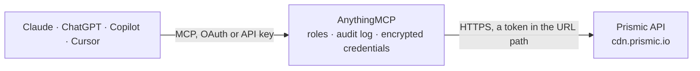

<!-- Generated by scripts/export-github-catalog.mjs in the anythingmcp-website repository. Do not edit by hand. -->

# Prismic MCP connector

Prismic headless page builder: query published and scheduled documents with Prismic filters, read custom type and slice models, browse and upload media, and create or update draft documents through the Migration API. The AnythingMCP connector gives Claude, ChatGPT, Microsoft Copilot, Cursor and Gemini 14 MCP tools for Prismic: 10 read and 4 can change data.

**Category:** [CMS](../cms.md) · **Tools:** 14 · **Setup guide:** [anythingmcp.com](https://anythingmcp.com/guides/prismic-to-mcp) · [Deutsch](https://anythingmcp.com/de/guides/prismic-to-mcp) · [Italiano](https://anythingmcp.com/it/guides/prismic-to-mcp) · [Español](https://anythingmcp.com/es/guides/prismic-to-mcp) · [日本語](https://anythingmcp.com/ja/guides/prismic-to-mcp) · [Русский](https://anythingmcp.com/ru/guides/prismic-to-mcp) · [中文](https://anythingmcp.com/zh/guides/prismic-to-mcp)

## Start without code

No installation and no terminal: AnythingMCP Cloud runs the Prismic connector for you, operated by helpcode.ai in Frankfurt, Germany.

1. **Click the button above** and create an account or sign in. The Prismic connector opens, ready to install.
2. **Paste the API key or token from your Prismic account.** Every click is in the [step-by-step guide](https://anythingmcp.com/guides/prismic-to-mcp).
3. **Click Install.** AnythingMCP shows the address of your MCP server.
4. **Add that address to your assistant:** [Claude](https://anythingmcp.com/guides/connect-prismic-to-claude) · [ChatGPT](https://anythingmcp.com/guides/connect-prismic-to-chatgpt) · [Microsoft Copilot](https://anythingmcp.com/guides/connect-prismic-to-copilot) · [Cursor](https://anythingmcp.com/guides/connect-prismic-to-cursor) · [Gemini CLI](https://anythingmcp.com/guides/connect-prismic-to-gemini) · [Meta Muse](https://anythingmcp.com/guides/connect-prismic-to-muse).
5. **Ask your first question**, for example: *Do we have a published 'product' page with UID sustain-350 in repository greenworks-corp?*

Prefer help with the setup? [Talk to us](https://anythingmcp.com/contact).

## How it works

- **The AI client** speaks MCP (Streamable HTTP) to AnythingMCP and only sees tool names, descriptions and results. It never gets the Prismic credentials.
- **AnythingMCP** checks the client's role, builds the call from the tool definition, adds the credentials (a token in the URL path), calls Prismic, logs the call and returns the result.
- **Prismic** sees an ordinary API client with the rights of the account the credentials belong to.

## Tools

| Tool | What it does | Access |
|---|---|---|
| [`prismic_get_repository`](#prismic_get_repository) | The repository's entry point for the Content API: refs (the master ref needed by every content query, plus release refs), custom types, tags, languages and… | read |
| [`prismic_search_documents`](#prismic_search_documents) | Query published content (or a release) with Prismic filters: by type, tag, id, uid, field values, full text or dates, sorted and paged. | read |
| [`prismic_get_document`](#prismic_get_document) | One document by its id with all its fields (data), slices, tags, alternate languages and publication dates. | read |
| [`prismic_get_document_by_uid`](#prismic_get_document_by_uid) | One document by its custom type and UID (the slug-like unique id), e.g. type page and uid about-us. | read |
| [`prismic_list_documents_by_type`](#prismic_list_documents_by_type) | All documents of one custom type, paged and optionally sorted, e.g. every blog_post newest first. | read |
| [`prismic_list_custom_types`](#prismic_list_custom_types) | The custom types (page types) of the repository with their JSON model: tabs, fields, slice zones, repeatable or single, and status (active or disabled). | read |
| [`prismic_get_custom_type`](#prismic_get_custom_type) | One custom type model by its API id, with every field and its configuration. | read |
| [`prismic_list_shared_slices`](#prismic_list_shared_slices) | The shared slices of the repository with their variations and fields (primary and items). | read |
| [`prismic_get_shared_slice`](#prismic_get_shared_slice) | One shared slice model by id, with its variations and fields. | read |
| [`prismic_list_assets`](#prismic_list_assets) | Assets of the media library: id, url, filename, kind, size, width and height, alt, credits, notes and tags. | read |
| [`prismic_upload_asset`](#prismic_upload_asset) | Upload a file from a public URL to the media library, with optional alt text, credits and notes. | write |
| [`prismic_update_asset`](#prismic_update_asset) | Change the alt text, credits or notes of a media library asset. | write |
| [`prismic_create_document`](#prismic_create_document) | Create a document as a draft through the Migration API. | write |
| [`prismic_update_document`](#prismic_update_document) | Replace the content of an existing document through the Migration API, saved as a draft in a migration release. | write |

## Tool reference

Every parameter as the AI client sees it in `tools/list`. Source: [`packages/backend/src/adapters/intl/prismic.json`](../../../packages/backend/src/adapters/intl/prismic.json).

### `prismic_get_repository`

The repository's entry point for the Content API: refs (the master ref needed by every content query, plus release refs), custom types, tags, languages and bookmarks. Call it first.

**Access:** read

No parameters.

### `prismic_search_documents`

Query published content (or a release) with Prismic filters: by type, tag, id, uid, field values, full text or dates, sorted and paged. Returns results with id, uid, type, lang, tags, first and last publication dates and data (the fields), plus total_results_size and total_pages.

**Access:** read · **Call:** `GET /documents/search`

| Parameter | Type | Required | Description |
|---|---|---|---|
| `ref` | string | yes | Content version to read: the ref of the master ref (isMasterRef true) from prismic_get_repository, or a release ref for scheduled content. Refs change on every publish: fetch a fresh one when the API answers that the ref is unknown or expired. |
| `q` | string | no | Filters, each in brackets, all inside brackets: [[at(document.type,"blog_post")][fulltext(document,"pricing")][any(document.tags,["news"])][date.after(document.first_publication_date,"2026-01-01")][at(my.blog_post.author,"<document id>")]]. |
| `orderings` | string | no | Sort, e.g. [my.blog_post.date desc] or [document.first_publication_date desc,document.id]. |
| `after` | string | no | Return documents after this document id (with orderings), for cursor paging. |
| `page` | integer | no | Page number, starting at 1. |
| `page_size` | integer | no | Documents per page (default 20, max 100). |
| `lang` | string | no | Locale code, e.g. en-us or fr-fr; * for all locales. Default: the master locale. |
| `fetch_links` | string | no | Fields of linked documents to include, e.g. author.name,author.avatar. |
| `graph_query` | string | no | GraphQuery string for selective or deep fetching, e.g. {blog_post{title author{...on author{name}}}}. |

### `prismic_get_document`

One document by its id with all its fields (data), slices, tags, alternate languages and publication dates.

**Access:** read · **Call:** `GET /documents/search`

| Parameter | Type | Required | Description |
|---|---|---|---|
| `ref` | string | yes | Content version to read: the ref of the master ref (isMasterRef true) from prismic_get_repository, or a release ref for scheduled content. Refs change on every publish: fetch a fresh one when the API answers that the ref is unknown or expired. |
| `id` | string | yes | Document id, e.g. ZMI65RQAADkECUFM. |
| `lang` | string | no | Locale code, e.g. en-us or fr-fr; * for all locales. Default: the master locale. |
| `fetch_links` | string | no | Fields of linked documents to include, e.g. author.name,author.avatar. |
| `graph_query` | string | no | GraphQuery string for selective or deep fetching, e.g. {blog_post{title author{...on author{name}}}}. |

### `prismic_get_document_by_uid`

One document by its custom type and UID (the slug-like unique id), e.g. type page and uid about-us.

**Access:** read · **Call:** `GET /documents/search`

| Parameter | Type | Required | Description |
|---|---|---|---|
| `ref` | string | yes | Content version to read: the ref of the master ref (isMasterRef true) from prismic_get_repository, or a release ref for scheduled content. Refs change on every publish: fetch a fresh one when the API answers that the ref is unknown or expired. |
| `type` | string | yes | API id of the custom type, e.g. page or blog_post. |
| `uid` | string | yes | The document UID, e.g. about-us. |
| `lang` | string | no | Locale code, e.g. en-us or fr-fr; * for all locales. Default: the master locale. |
| `fetch_links` | string | no | Fields of linked documents to include, e.g. author.name,author.avatar. |
| `graph_query` | string | no | GraphQuery string for selective or deep fetching, e.g. {blog_post{title author{...on author{name}}}}. |

### `prismic_list_documents_by_type`

All documents of one custom type, paged and optionally sorted, e.g. every blog_post newest first.

**Access:** read · **Call:** `GET /documents/search`

| Parameter | Type | Required | Description |
|---|---|---|---|
| `ref` | string | yes | Content version to read: the ref of the master ref (isMasterRef true) from prismic_get_repository, or a release ref for scheduled content. Refs change on every publish: fetch a fresh one when the API answers that the ref is unknown or expired. |
| `type` | string | yes | API id of the custom type, e.g. blog_post. |
| `orderings` | string | no | Sort, e.g. [document.first_publication_date desc]. |
| `page` | integer | no | Page number, starting at 1. |
| `page_size` | integer | no | Documents per page (default 20, max 100). |
| `lang` | string | no | Locale code, e.g. en-us or fr-fr; * for all locales. Default: the master locale. |
| `fetch_links` | string | no | Fields of linked documents to include, e.g. author.name,author.avatar. |
| `graph_query` | string | no | GraphQuery string for selective or deep fetching, e.g. {blog_post{title author{...on author{name}}}}. |

### `prismic_list_custom_types`

The custom types (page types) of the repository with their JSON model: tabs, fields, slice zones, repeatable or single, and status (active or disabled). Needs the write token.

**Access:** read · **Call:** `GET https://customtypes.prismic.io/customtypes`

No parameters.

### `prismic_get_custom_type`

One custom type model by its API id, with every field and its configuration. Use it before creating or updating documents of that type. Needs the write token.

**Access:** read · **Call:** `GET https://customtypes.prismic.io/customtypes/{type_id}`

| Parameter | Type | Required | Description |
|---|---|---|---|
| `type_id` | string | yes | API id of the custom type, e.g. blog_post. |

### `prismic_list_shared_slices`

The shared slices of the repository with their variations and fields (primary and items). Needs the write token.

**Access:** read · **Call:** `GET https://customtypes.prismic.io/slices`

No parameters.

### `prismic_get_shared_slice`

One shared slice model by id, with its variations and fields. Needs the write token.

**Access:** read · **Call:** `GET https://customtypes.prismic.io/slices/{slice_id}`

| Parameter | Type | Required | Description |
|---|---|---|---|
| `slice_id` | string | yes | Shared slice id, e.g. TextSlice. |

### `prismic_list_assets`

Assets of the media library: id, url, filename, kind, size, width and height, alt, credits, notes and tags. Filter by type or keyword; paged with a cursor. Needs the write token.

**Access:** read · **Call:** `GET https://asset-api.prismic.io/assets`

| Parameter | Type | Required | Description |
|---|---|---|---|
| `asset_type` | string | no | Asset type, e.g. all or image. |
| `keyword` | string | no | Keyword to match in title, filename, alt, notes or credits. |
| `limit` | integer | no | Maximum number of assets, e.g. 100. |
| `cursor` | string | no | Asset id after which to continue, from the previous answer's cursor. |

### `prismic_upload_asset`

Upload a file from a public URL to the media library, with optional alt text, credits and notes. Returns the asset id to use in image or media link fields. One upload per second.

**Access:** write · **Call:** `POST https://asset-api.prismic.io/assets`

| Parameter | Type | Required | Description |
|---|---|---|---|
| `file_url` | string | yes | Public URL of the file to upload (fetched by the connector, 10 MB at most). |
| `alt` | string | no | Alt text, up to 500 characters. |
| `credits` | string | no | Credits, up to 500 characters. |
| `notes` | string | no | Notes, up to 500 characters. |

### `prismic_update_asset`

Change the alt text, credits or notes of a media library asset.

**Access:** write · **Call:** `PATCH https://asset-api.prismic.io/assets/{asset_id}`

| Parameter | Type | Required | Description |
|---|---|---|---|
| `asset_id` | string | yes | Asset id from prismic_list_assets or prismic_upload_asset. |
| `alt` | string | no | Alt text, up to 500 characters. |
| `credits` | string | no | Credits, up to 500 characters. |
| `notes` | string | no | Notes, up to 500 characters. |

### `prismic_create_document`

Create a document as a draft through the Migration API. It lands in a migration release, where an editor reviews and publishes it. data must follow the custom type model (prismic_get_custom_type). One write per second.

**Access:** write · **Call:** `POST https://migration.prismic.io/documents`

| Parameter | Type | Required | Description |
|---|---|---|---|
| `title` | string | yes | Title shown in the document list. |
| `type` | string | yes | API id of the custom type. |
| `uid` | string | no | UID; required when the type has one, not allowed when it has none. |
| `lang` | string | yes | Locale code, e.g. en-us. |
| `tags` | string[] | no | Tags for the document. |
| `alternate_language_id` | string | no | Id of the document this one translates. |
| `data` | object | yes | Field values keyed by field API id, e.g. {"title": [{"type": "heading1", "text": "Hello", "spans": []}], "image": {"id": "<asset id>"}, "link": {"link_type": "Document", "id": "<doc id>"}, "slices": [{"slice_type": "text", "variation": "default", "primary": {...}}]}. |

### `prismic_update_document`

Replace the content of an existing document through the Migration API, saved as a draft in a migration release. data replaces the whole content, and tags left out are removed: read the document first and send everything back. Type and locale cannot change.

**Access:** write · **Call:** `PUT https://migration.prismic.io/documents/{id}/`

| Parameter | Type | Required | Description |
|---|---|---|---|
| `id` | string | yes | Document id. |
| `uid` | string | no | UID; required when the type has one. |
| `title` | string | no | Title shown in the document list. |
| `tags` | string[] | no | Tags; omitting them deletes the existing ones. |
| `data` | object | yes | The full content, as for prismic_create_document. |

## Run it yourself

AnythingMCP is open source (AGPL-3.0). [Run it with Docker](../../../README.md#run-it-yourself), open **Connectors → Store**, pick **Prismic** and enter `PRISMIC_REPOSITORY`, then add your MCP server URL to the AI client.

[← CMS connectors](../cms.md) · [All categories](../README.md)
