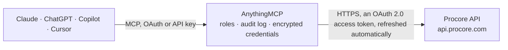

<!-- Generated by scripts/export-github-catalog.mjs in the anythingmcp-website repository. Do not edit by hand. -->

# Procore MCP connector

Read Procore construction projects: companies, projects and directory, RFIs and submittals, daily and manpower logs, project documents and files, budget views and line items, subcontracts and purchase orders. The AnythingMCP connector gives Claude, ChatGPT, Microsoft Copilot, Cursor and Gemini 19 MCP tools for Procore, all read-only.

**Category:** [Construction](../construction.md) · **Tools:** 19 · **Setup guide:** [anythingmcp.com](https://anythingmcp.com/guides/procore-to-mcp) · [Deutsch](https://anythingmcp.com/de/guides/procore-to-mcp) · [Italiano](https://anythingmcp.com/it/guides/procore-to-mcp) · [Español](https://anythingmcp.com/es/guides/procore-to-mcp) · [日本語](https://anythingmcp.com/ja/guides/procore-to-mcp) · [Русский](https://anythingmcp.com/ru/guides/procore-to-mcp) · [中文](https://anythingmcp.com/zh/guides/procore-to-mcp)

## Start without code

No installation and no terminal: AnythingMCP Cloud runs the Procore connector for you, operated by helpcode.ai in Frankfurt, Germany.

1. **Click the button above** and create an account or sign in. The Procore connector opens, ready to install.
2. **Sign in with your Procore account** when AnythingMCP asks. The first time, an admin creates a small app in the Procore developer console. Every click is in the [step-by-step guide](https://anythingmcp.com/guides/procore-to-mcp).
3. **Click Install.** AnythingMCP shows the address of your MCP server.
4. **Add that address to your assistant:** [Claude](https://anythingmcp.com/guides/connect-procore-to-claude) · [ChatGPT](https://anythingmcp.com/guides/connect-procore-to-chatgpt) · [Microsoft Copilot](https://anythingmcp.com/guides/connect-procore-to-copilot) · [Cursor](https://anythingmcp.com/guides/connect-procore-to-cursor) · [Gemini CLI](https://anythingmcp.com/guides/connect-procore-to-gemini) · [Meta Muse](https://anythingmcp.com/guides/connect-procore-to-muse).
5. **Ask your first question**, for example: *Find purchase order PO-2026-114 for project Sunset Mall, I need vendor and grand total*

Prefer help with the setup? [Talk to us](https://anythingmcp.com/contact).

## How it works

- **The AI client** speaks MCP (Streamable HTTP) to AnythingMCP and only sees tool names, descriptions and results. It never gets the Procore credentials.
- **AnythingMCP** checks the client's role, builds the call from the tool definition, adds the credentials (an OAuth 2.0 access token, refreshed automatically), calls Procore, logs the call and returns the result.
- **Procore** sees an ordinary API client with the rights of the account the credentials belong to.

## Tools

| Tool | What it does | Access |
|---|---|---|
| [`procore_list_companies`](#procore_list_companies) | The Procore companies the authorized user belongs to, with company id, name and whether it is active. | read |
| [`procore_get_me`](#procore_get_me) | The authorized Procore user: id, login (email) and name. | read |
| [`procore_list_projects`](#procore_list_projects) | Projects of a company with id, name, project number, address, stage, status, start and completion dates. | read |
| [`procore_get_project`](#procore_get_project) | One project with its full details: number, address, stage, type, office, dates, value, owner and custom fields. | read |
| [`procore_list_company_users`](#procore_list_company_users) | People in the company directory with id, name, email, job title, company (vendor) and whether they are employees or active. | read |
| [`procore_list_project_users`](#procore_list_project_users) | People in one project's directory with id, name, email, company and permission template. | read |
| [`procore_list_rfis`](#procore_list_rfis) | RFIs of a project with number, subject, status, ball in court, assignees, RFI manager, due date and cost or schedule impact. | read |
| [`procore_get_rfi`](#procore_get_rfi) | One RFI with its question, answers (official and others), assignees, distribution list, attachments, due date and impacts. | read |
| [`procore_list_submittals`](#procore_list_submittals) | Submittals of a project with number, revision, title, type, status, spec section, ball in court, approvers and required-on-site date. | read |
| [`procore_get_submittal`](#procore_get_submittal) | One submittal with its workflow (approvers and responses), attachments, distribution, dates and linked drawings. | read |
| [`procore_list_daily_logs`](#procore_list_daily_logs) | All daily log entries of a project for one day or a date range, grouped by log type (manpower, notes, weather, deliveries, inspections, safety violations… | read |
| [`procore_list_manpower_logs`](#procore_list_manpower_logs) | Manpower log entries of a project: company or trade, number of workers, hours and location per day. | read |
| [`procore_list_folders`](#procore_list_folders) | The root of a project's Documents tool: folders and files at the top level with id, name, size and update date. | read |
| [`procore_get_folder`](#procore_get_folder) | One folder of a project's Documents tool with its subfolders and files (id, name, size, version, updated by). | read |
| [`procore_get_file`](#procore_get_file) | One file of a project's Documents tool with its versions, size, uploader and the download URL of each version. | read |
| [`procore_list_budget_views`](#procore_list_budget_views) | The budget views configured for a project (e.g. Procore Standard Budget) with id and name. | read |
| [`procore_list_budget_rows`](#procore_list_budget_rows) | Budget line items of a project in one budget view: cost code, category, original budget, approved changes, revised budget, committed and direct costs, forecast. | read |
| [`procore_list_subcontracts`](#procore_list_subcontracts) | Subcontracts (work order contracts) of a project with number, title, vendor, status, executed flag and grand total. | read |
| [`procore_list_purchase_orders`](#procore_list_purchase_orders) | Purchase order contracts of a project with number, title, vendor, status, executed flag and grand total. | read |

## Tool reference

Every parameter as the AI client sees it in `tools/list`. Source: [`packages/backend/src/adapters/intl/procore.json`](../../../packages/backend/src/adapters/intl/procore.json).

### `procore_list_companies`

The Procore companies the authorized user belongs to, with company id, name and whether it is active. Start here: every other tool needs the company id.

**Access:** read · **Call:** `GET /rest/v1.0/companies`

| Parameter | Type | Required | Description |
|---|---|---|---|
| `page` | integer | no | Page number, starting at 1. |
| `per_page` | integer | no | Items per page (default 100, maximum 100 on most lists). |

### `procore_get_me`

The authorized Procore user: id, login (email) and name. Use it to confirm which account the connector acts as.

**Access:** read · **Call:** `GET /rest/v1.0/me`

No parameters.

### `procore_list_projects`

Projects of a company with id, name, project number, address, stage, status, start and completion dates. Company admins see all projects, other users only those they were added to.

**Access:** read · **Call:** `GET /rest/v1.0/companies/{company_id}/projects`

| Parameter | Type | Required | Description |
|---|---|---|---|
| `company_id` | integer | yes | Procore company id from list_companies. Sent as the Procore-Company-Id header, which Procore requires on company data. |
| `status` | `Active` \| `Inactive` \| `All` | no | Filter by project status (default Active). |
| `page` | integer | no | Page number, starting at 1. |
| `per_page` | integer | no | Items per page (default 100, maximum 100 on most lists). |

### `procore_get_project`

One project with its full details: number, address, stage, type, office, dates, value, owner and custom fields.

**Access:** read · **Call:** `GET /rest/v1.0/projects/{project_id}`

| Parameter | Type | Required | Description |
|---|---|---|---|
| `company_id` | integer | yes | Procore company id from list_companies. Sent as the Procore-Company-Id header, which Procore requires on company data. |
| `project_id` | integer | yes | Project id from list_projects. |

### `procore_list_company_users`

People in the company directory with id, name, email, job title, company (vendor) and whether they are employees or active. Use it to resolve user ids on RFIs or logs.

**Access:** read · **Call:** `GET /rest/v1.3/companies/{company_id}/users`

| Parameter | Type | Required | Description |
|---|---|---|---|
| `company_id` | integer | yes | Procore company id from list_companies. Sent as the Procore-Company-Id header, which Procore requires on company data. |
| `search` | string | no | Search by name or email. |
| `page` | integer | no | Page number, starting at 1. |
| `per_page` | integer | no | Items per page (default 100, maximum 100 on most lists). |

### `procore_list_project_users`

People in one project's directory with id, name, email, company and permission template. Use it to see who is on a project team.

**Access:** read · **Call:** `GET /rest/v1.0/projects/{project_id}/users`

| Parameter | Type | Required | Description |
|---|---|---|---|
| `company_id` | integer | yes | Procore company id from list_companies. Sent as the Procore-Company-Id header, which Procore requires on company data. |
| `project_id` | integer | yes | Project id from list_projects. |
| `page` | integer | no | Page number, starting at 1. |
| `per_page` | integer | no | Items per page (default 100, maximum 100 on most lists). |

### `procore_list_rfis`

RFIs of a project with number, subject, status, ball in court, assignees, RFI manager, due date and cost or schedule impact. Filter by status to find open questions.

**Access:** read · **Call:** `GET /rest/v1.0/projects/{project_id}/rfis`

| Parameter | Type | Required | Description |
|---|---|---|---|
| `company_id` | integer | yes | Procore company id from list_companies. Sent as the Procore-Company-Id header, which Procore requires on company data. |
| `project_id` | integer | yes | Project id from list_projects. |
| `status` | `draft` \| `open` \| `closed` | no | Only RFIs with this status. |
| `search` | string | no | Search in number and subject. |
| `page` | integer | no | Page number, starting at 1. |
| `per_page` | integer | no | Items per page (default 100, maximum 100 on most lists). |

### `procore_get_rfi`

One RFI with its question, answers (official and others), assignees, distribution list, attachments, due date and impacts. Use the id from list_rfis.

**Access:** read · **Call:** `GET /rest/v1.0/projects/{project_id}/rfis/{rfi_id}`

| Parameter | Type | Required | Description |
|---|---|---|---|
| `company_id` | integer | yes | Procore company id from list_companies. Sent as the Procore-Company-Id header, which Procore requires on company data. |
| `project_id` | integer | yes | Project id from list_projects. |
| `rfi_id` | integer | yes | RFI id from list_rfis. |

### `procore_list_submittals`

Submittals of a project with number, revision, title, type, status, spec section, ball in court, approvers and required-on-site date. Use it to track what is waiting for review.

**Access:** read · **Call:** `GET /rest/v1.1/projects/{project_id}/submittals`

| Parameter | Type | Required | Description |
|---|---|---|---|
| `company_id` | integer | yes | Procore company id from list_companies. Sent as the Procore-Company-Id header, which Procore requires on company data. |
| `project_id` | integer | yes | Project id from list_projects. |
| `search` | string | no | Search in number and title. |
| `page` | integer | no | Page number, starting at 1. |
| `per_page` | integer | no | Items per page (default 100, maximum 100 on most lists). |

### `procore_get_submittal`

One submittal with its workflow (approvers and responses), attachments, distribution, dates and linked drawings. Use the id from list_submittals.

**Access:** read · **Call:** `GET /rest/v1.1/projects/{project_id}/submittals/{submittal_id}`

| Parameter | Type | Required | Description |
|---|---|---|---|
| `company_id` | integer | yes | Procore company id from list_companies. Sent as the Procore-Company-Id header, which Procore requires on company data. |
| `project_id` | integer | yes | Project id from list_projects. |
| `submittal_id` | integer | yes | Submittal id from list_submittals. |

### `procore_list_daily_logs`

All daily log entries of a project for one day or a date range, grouped by log type (manpower, notes, weather, deliveries, inspections, safety violations and more). Use it for site reports.

**Access:** read · **Call:** `GET /rest/v1.0/projects/{project_id}/daily_logs`

| Parameter | Type | Required | Description |
|---|---|---|---|
| `company_id` | integer | yes | Procore company id from list_companies. Sent as the Procore-Company-Id header, which Procore requires on company data. |
| `project_id` | integer | yes | Project id from list_projects. |
| `log_date` | string | no | One day, YYYY-MM-DD. |
| `start_date` | string | no | Start of a date range, YYYY-MM-DD (use with end_date). |
| `end_date` | string | no | End of the date range, YYYY-MM-DD. |

### `procore_list_manpower_logs`

Manpower log entries of a project: company or trade, number of workers, hours and location per day. Use it to report crew size over a period.

**Access:** read · **Call:** `GET /rest/v1.0/projects/{project_id}/manpower_logs`

| Parameter | Type | Required | Description |
|---|---|---|---|
| `company_id` | integer | yes | Procore company id from list_companies. Sent as the Procore-Company-Id header, which Procore requires on company data. |
| `project_id` | integer | yes | Project id from list_projects. |
| `log_date` | string | no | One day, YYYY-MM-DD. |
| `start_date` | string | no | Start of a date range, YYYY-MM-DD (use with end_date). |
| `end_date` | string | no | End of the date range, YYYY-MM-DD. |

### `procore_list_folders`

The root of a project's Documents tool: folders and files at the top level with id, name, size and update date. Use get_folder to open a subfolder.

**Access:** read · **Call:** `GET /rest/v1.0/folders`

| Parameter | Type | Required | Description |
|---|---|---|---|
| `company_id` | integer | yes | Procore company id from list_companies. Sent as the Procore-Company-Id header, which Procore requires on company data. |
| `project_id` | integer | yes | Project id from list_projects. |

### `procore_get_folder`

One folder of a project's Documents tool with its subfolders and files (id, name, size, version, updated by). Walk the tree with the folder ids it returns.

**Access:** read · **Call:** `GET /rest/v1.0/folders/{folder_id}`

| Parameter | Type | Required | Description |
|---|---|---|---|
| `company_id` | integer | yes | Procore company id from list_companies. Sent as the Procore-Company-Id header, which Procore requires on company data. |
| `project_id` | integer | yes | Project id from list_projects. |
| `folder_id` | integer | yes | Folder id from list_folders or a parent get_folder. |

### `procore_get_file`

One file of a project's Documents tool with its versions, size, uploader and the download URL of each version. Use the id from get_folder.

**Access:** read · **Call:** `GET /rest/v1.0/files/{file_id}`

| Parameter | Type | Required | Description |
|---|---|---|---|
| `company_id` | integer | yes | Procore company id from list_companies. Sent as the Procore-Company-Id header, which Procore requires on company data. |
| `project_id` | integer | yes | Project id from list_projects. |
| `file_id` | integer | yes | File id from list_folders or get_folder. |

### `procore_list_budget_views`

The budget views configured for a project (e.g. Procore Standard Budget) with id and name. Pick one for list_budget_rows.

**Access:** read · **Call:** `GET /rest/v1.0/budget_views`

| Parameter | Type | Required | Description |
|---|---|---|---|
| `company_id` | integer | yes | Procore company id from list_companies. Sent as the Procore-Company-Id header, which Procore requires on company data. |
| `project_id` | integer | yes | Project id from list_projects. |
| `page` | integer | no | Page number, starting at 1. |
| `per_page` | integer | no | Items per page (default 100, maximum 100 on most lists). |

### `procore_list_budget_rows`

Budget line items of a project in one budget view: cost code, category, original budget, approved changes, revised budget, committed and direct costs, forecast. Use it for cost reports.

**Access:** read · **Call:** `GET /rest/v1.0/budget_views/{budget_view_id}/detail_rows`

| Parameter | Type | Required | Description |
|---|---|---|---|
| `company_id` | integer | yes | Procore company id from list_companies. Sent as the Procore-Company-Id header, which Procore requires on company data. |
| `project_id` | integer | yes | Project id from list_projects. |
| `budget_view_id` | integer | yes | Budget view id from list_budget_views. |
| `page` | integer | no | Page number, starting at 1. |
| `per_page` | integer | no | Items per page (default 100, maximum 100 on most lists). |

### `procore_list_subcontracts`

Subcontracts (work order contracts) of a project with number, title, vendor, status, executed flag and grand total. Use it with list_purchase_orders for all commitments.

**Access:** read · **Call:** `GET /rest/v1.0/work_order_contracts`

| Parameter | Type | Required | Description |
|---|---|---|---|
| `company_id` | integer | yes | Procore company id from list_companies. Sent as the Procore-Company-Id header, which Procore requires on company data. |
| `project_id` | integer | yes | Project id from list_projects. |
| `page` | integer | no | Page number, starting at 1. |
| `per_page` | integer | no | Items per page (default 100, maximum 100 on most lists). |

### `procore_list_purchase_orders`

Purchase order contracts of a project with number, title, vendor, status, executed flag and grand total. Together with list_subcontracts these are the project's commitments.

**Access:** read · **Call:** `GET /rest/v1.0/purchase_order_contracts`

| Parameter | Type | Required | Description |
|---|---|---|---|
| `company_id` | integer | yes | Procore company id from list_companies. Sent as the Procore-Company-Id header, which Procore requires on company data. |
| `project_id` | integer | yes | Project id from list_projects. |
| `page` | integer | no | Page number, starting at 1. |
| `per_page` | integer | no | Items per page (default 100, maximum 100 on most lists). |

## Run it yourself

AnythingMCP is open source (AGPL-3.0). [Run it with Docker](../../../README.md#run-it-yourself), open **Connectors → Store**, pick **Procore** and enter `PROCORE_CLIENT_ID`, `PROCORE_CLIENT_SECRET`, then add your MCP server URL to the AI client.

[← Construction connectors](../construction.md) · [All categories](../README.md)
