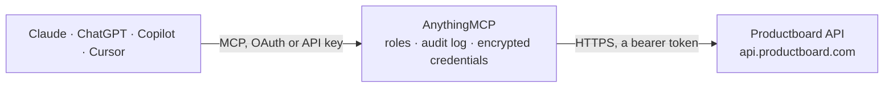

<!-- Generated by scripts/export-github-catalog.mjs in the anythingmcp-website repository. Do not edit by hand. -->

# Productboard MCP connector

Productboard product management through the REST API v2: products, components, features, initiatives, objectives and key results, releases, companies and users as entities with custom fields and … The AnythingMCP connector gives Claude, ChatGPT, Microsoft Copilot, Cursor and Gemini 23 MCP tools for Productboard: 16 read and 7 can change data.

**Category:** [Project Management](../project-management.md) · **Tools:** 23 · **Setup guide:** [anythingmcp.com](https://anythingmcp.com/guides/productboard-to-mcp) · [Deutsch](https://anythingmcp.com/de/guides/productboard-to-mcp) · [Italiano](https://anythingmcp.com/it/guides/productboard-to-mcp) · [Español](https://anythingmcp.com/es/guides/productboard-to-mcp) · [日本語](https://anythingmcp.com/ja/guides/productboard-to-mcp) · [Русский](https://anythingmcp.com/ru/guides/productboard-to-mcp) · [中文](https://anythingmcp.com/zh/guides/productboard-to-mcp)

## Start without code

No installation and no terminal: AnythingMCP Cloud runs the Productboard connector for you, operated by helpcode.ai in Frankfurt, Germany.

1. **Click the button above** and create an account or sign in. The Productboard connector opens, ready to install.
2. **Paste the API key or token from your Productboard account.** Every click is in the [step-by-step guide](https://anythingmcp.com/guides/productboard-to-mcp).
3. **Click Install.** AnythingMCP shows the address of your MCP server.
4. **Add that address to your assistant:** [Claude](https://anythingmcp.com/guides/connect-productboard-to-claude) · [ChatGPT](https://anythingmcp.com/guides/connect-productboard-to-chatgpt) · [Microsoft Copilot](https://anythingmcp.com/guides/connect-productboard-to-copilot) · [Cursor](https://anythingmcp.com/guides/connect-productboard-to-cursor) · [Gemini CLI](https://anythingmcp.com/guides/connect-productboard-to-gemini) · [Meta Muse](https://anythingmcp.com/guides/connect-productboard-to-muse).
5. **Ask your first question**, for example: *Show me the Productboard company record for customer 'NordicHealth Oy' (company page and created date).*

Prefer help with the setup? [Talk to us](https://anythingmcp.com/contact).

## How it works

- **The AI client** speaks MCP (Streamable HTTP) to AnythingMCP and only sees tool names, descriptions and results. It never gets the Productboard credentials.
- **AnythingMCP** checks the client's role, builds the call from the tool definition, adds the credentials (a bearer token), calls Productboard, logs the call and returns the result.
- **Productboard** sees an ordinary API client with the rights of the account the credentials belong to.

## Tools

| Tool | What it does | Access |
|---|---|---|
| [`productboard_list_entity_configurations`](#productboard_list_entity_configurations) | List the entity types of the workspace (product, component, feature, subfeature, initiative, objective, keyResult, release, releaseGroup, user, company,… | read |
| [`productboard_get_entity_configuration`](#productboard_get_entity_configuration) | Fields of one entity type (e.g. feature or company): standard and custom fields with their types, whether they are required, and the allowed patch operations. | read |
| [`productboard_list_entities`](#productboard_list_entities) | List entities (features, components, products, initiatives, objectives, key results, releases, companies, users, ...) with their fields, newest first. | read |
| [`productboard_search_entities`](#productboard_search_entities) | Search entities with a structured filter: several types or ids, created or updated date ranges, field values (name, archived, owner, status, teams, creator,… | read |
| [`productboard_get_entity`](#productboard_get_entity) | One entity (feature, component, product, initiative, objective, key result, release, company, user, ...) by id with all its fields, its relationships and… | read |
| [`productboard_create_entity`](#productboard_create_entity) | Create an entity: a feature, subfeature, component, product, initiative, objective, key result, release, release group, company or user. | write |
| [`productboard_update_entity`](#productboard_update_entity) | Update an entity. | write |
| [`productboard_list_entity_relationships`](#productboard_list_entity_relationships) | Relationships of an entity: its parent, children, linked entities and blockers (type parent, child, link, isBlockedBy, isBlocking) with the target id and type. | read |
| [`productboard_create_entity_relationship`](#productboard_create_entity_relationship) | Add a relationship from one entity to another: link (related items), isBlockedBy or isBlocking (dependencies), or child. | write |
| [`productboard_set_entity_parent`](#productboard_set_entity_parent) | Set or replace the parent of an entity, e.g. move a feature to another component, a subfeature under a feature or a key result under an objective. | write |
| [`productboard_list_field_values`](#productboard_list_field_values) | Allowed values of a select, multi-select, tag or status field (custom field UUID, or a standard field name such as status or tags), with their ids. | read |
| [`productboard_list_note_configurations`](#productboard_list_note_configurations) | Note types of the workspace (textNote, conversationNote, opportunityNote) with their fields, required fields and patch operations. | read |
| [`productboard_list_notes`](#productboard_list_notes) | List customer feedback notes, newest first, with name, content, tags, owner, processed and archived state. | read |
| [`productboard_search_notes`](#productboard_search_notes) | Full-text search over notes, optionally combined with filters on tags, owner, processed or archived state, dates, customer and linked entities. | read |
| [`productboard_get_note`](#productboard_get_note) | One note by id with its fields (name, content, tags, owner, creator, processed, archived), metadata source and the links.html URL to open it in Productboard. | read |
| [`productboard_create_note`](#productboard_create_note) | Capture customer feedback as a note in the Productboard Insights inbox: a title, the feedback text, optional tags, owner, source record, the customer (user… | write |
| [`productboard_update_note`](#productboard_update_note) | Update a note. | write |
| [`productboard_list_note_relationships`](#productboard_list_note_relationships) | Relationships of a note: the customer (user or company) it came from and the entities (features, components, products) it is linked to. | read |
| [`productboard_link_note`](#productboard_link_note) | Link a note to a feature, subfeature, component or product (type link, the insight then counts for that item), or assign its customer (type customer, a user… | write |
| [`productboard_list_members`](#productboard_list_members) | Members of the Productboard workspace (name, email, role), oldest first. | read |
| [`productboard_get_member`](#productboard_get_member) | One workspace member by id: name, email, role, disabled or invited state and teams. | read |
| [`productboard_list_teams`](#productboard_list_teams) | Teams of the workspace with name, handle and description, newest first. | read |
| [`productboard_list_team_members`](#productboard_list_team_members) | Members of one team (name, email, role), newest membership first, with cursor paging. | read |

## Tool reference

Every parameter as the AI client sees it in `tools/list`. Source: [`packages/backend/src/adapters/intl/productboard.json`](../../../packages/backend/src/adapters/intl/productboard.json).

### `productboard_list_entity_configurations`

List the entity types of the workspace (product, component, feature, subfeature, initiative, objective, keyResult, release, releaseGroup, user, company, ...) with their fields: standard and custom fields (custom ones keyed by UUID), field types, which are required on create and which patch operations they accept. Call this before creating or filtering entities.

**Access:** read · **Call:** `GET /entities/configurations`

| Parameter | Type | Required | Description |
|---|---|---|---|
| `types` | string[] | no | Only these entity types, e.g. ["feature", "initiative"]. Leave empty for all. |

### `productboard_get_entity_configuration`

Fields of one entity type (e.g. feature or company): standard and custom fields with their types, whether they are required, and the allowed patch operations.

**Access:** read · **Call:** `GET /entities/configurations/{type}`

| Parameter | Type | Required | Description |
|---|---|---|---|
| `type` | string | yes | Entity type, e.g. feature, component, product, initiative, objective, keyResult, release, releaseGroup, company, user. |

### `productboard_list_entities`

List entities (features, components, products, initiatives, objectives, key results, releases, companies, users, ...) with their fields, newest first. Filter by type, name, owner, status, team, parent or archived state. Returns links.next when more pages exist.

**Access:** read · **Call:** `GET /entities`

| Parameter | Type | Required | Description |
|---|---|---|---|
| `types` | string[] | no | Entity types to list, e.g. ["feature"], ["objective", "keyResult"] or ["company"]. Use the types from productboard_list_entity_configurations. |
| `name` | string | no | Only entities with this name. |
| `owner_email` | string | no | Only entities owned by the member with this email (needs the members:pii:read permission). |
| `owner_id` | string | no | Only entities owned by the member with this id. |
| `status_name` | string | no | Only entities in the status with this name, e.g. In progress. |
| `status_id` | string | no | Only entities in the status with this id. |
| `team_name` | string | no | Only entities assigned to the team with this name. |
| `parent_id` | string | no | Only direct children of this entity, e.g. the features of a component. |
| `archived` | boolean | no | true for archived entities only, false for active ones only. |
| `fields` | string[] | no | Return only these fields, e.g. ["name", "status", "owner"]; ["all"] also returns empty fields. Default: all non-empty fields. |
| `page_cursor` | string | no | The pageCursor value from links.next of the previous page. |

### `productboard_search_entities`

Search entities with a structured filter: several types or ids, created or updated date ranges, field values (name, archived, owner, status, teams, creator, custom fields by UUID, company domain, user email) and relationships (parent, customer). Can limit the returned fields. Read-only although it is a POST.

**Access:** read · **Call:** `POST /entities/search`

| Parameter | Type | Required | Description |
|---|---|---|---|
| `types` | string[] | no | Entity types to search, e.g. ["feature", "initiative"]. |
| `ids` | string[] | no | Only these entity ids. |
| `field_filters` | object | no | Field filters, e.g. {"archived": false, "status": [{"name": "In progress"}], "owner": [{"email": "jane@example.com"}]}, {"domain": "example.com"} for companies or {"email": {"eq": "jane@example.com"}} for users. Custom fields by UUID. |
| `relationship_filters` | object | no | Relationship filters, e.g. {"parent": [{"id": "<component id>"}]}. |
| `created_at` | object | no | Creation date range, e.g. {"from": "2026-01-01T00:00:00Z", "to": "2026-06-30T23:59:59Z"}. |
| `updated_at` | object | no | Last update date range, same shape as created_at. |
| `return_fields` | string[] | no | Return only these fields, e.g. ["name", "status", "owner"]. |
| `page_cursor` | string | no | The pageCursor value from links.next of the previous page. |

### `productboard_get_entity`

One entity (feature, component, product, initiative, objective, key result, release, company, user, ...) by id with all its fields, its relationships and the links.html URL to open it in Productboard.

**Access:** read · **Call:** `GET /entities/{id}`

| Parameter | Type | Required | Description |
|---|---|---|---|
| `id` | string | yes | Entity id (UUID). |
| `fields` | string[] | no | Return only these fields; ["all"] also returns empty fields. |

### `productboard_create_entity`

Create an entity: a feature, subfeature, component, product, initiative, objective, key result, release, release group, company or user. Pass the type and its fields as the workspace configuration names them; set the parent through relationships.

**Access:** write · **Call:** `POST /entities`

| Parameter | Type | Required | Description |
|---|---|---|---|
| `type` | string | yes | Entity type, e.g. feature, subfeature, component, product, initiative, objective, keyResult, release, releaseGroup, company, user. |
| `fields` | object | yes | Field values, e.g. {"name": "Dark mode", "description": "
Text
", "status": {"name": "New idea"}, "owner": {"email": "jane@example.com"}, "tags": [{"name": "Q4"}], "timeframe": {"startDate": "2026-10-01", "endDate": "2026-12-31", "granularity": "month"}}. Custom fields by UUID. A company takes {"name": ..., "domain": ...}, a user {"name": ..., "email": ...}. |
| `relationships` | object[] | no | Relationships to create with it, e.g. [{"type": "parent", "target": {"id": "<component or feature id>"}}]. Types: parent, child, link, isBlockedBy, isBlocking. |
| `source` | object | no | Optional origin record, e.g. {"system": "Jira", "recordId": "PROJ-456", "url": "https://..."}. |

### `productboard_update_entity`

Update an entity. fields overwrites the given values (null clears one); patch applies operations: set, addItems and removeItems on lists such as tags or teams, clear on a field path. Fields not named stay unchanged.

**Access:** write · **Call:** `PATCH /entities/{id}`

| Parameter | Type | Required | Description |
|---|---|---|---|
| `id` | string | yes | Entity id (UUID). |
| `fields` | object | no | Values to set, e.g. {"name": "Improved feature", "status": {"name": "In progress"}, "owner": {"email": "jane@example.com"}}. |
| `patch` | object[] | no | Patch operations, e.g. [{"op": "addItems", "path": "tags", "value": [{"name": "Q1"}]}, {"op": "clear", "path": "timeframe.startDate"}]. |

### `productboard_list_entity_relationships`

Relationships of an entity: its parent, children, linked entities and blockers (type parent, child, link, isBlockedBy, isBlocking) with the target id and type. Use it to walk the hierarchy, e.g. the features of a component.

**Access:** read · **Call:** `GET /entities/{id}/relationships`

| Parameter | Type | Required | Description |
|---|---|---|---|
| `id` | string | yes | Entity id (UUID). |
| `type` | `parent` \| `child` \| `link` \| `isBlockedBy` \| `isBlocking` | no | Only this relationship type. |
| `target_type` | string | no | Only relationships to entities of this type, e.g. feature. |
| `target_id` | string | no | Only the relationship to this entity id. |
| `page_cursor` | string | no | The pageCursor value from links.next of the previous page. |

### `productboard_create_entity_relationship`

Add a relationship from one entity to another: link (related items), isBlockedBy or isBlocking (dependencies), or child. To move an entity under a new parent use productboard_set_entity_parent.

**Access:** write · **Call:** `POST /entities/{id}/relationships`

| Parameter | Type | Required | Description |
|---|---|---|---|
| `id` | string | yes | Entity id the relationship starts from. |
| `type` | `link` \| `isBlockedBy` \| `isBlocking` \| `child` | yes | Relationship type. |
| `target_id` | string | yes | Id of the other entity. |

### `productboard_set_entity_parent`

Set or replace the parent of an entity, e.g. move a feature to another component, a subfeature under a feature or a key result under an objective. The old parent link is replaced.

**Access:** write · **Call:** `PUT /entities/{id}/relationships/parent`

| Parameter | Type | Required | Description |
|---|---|---|---|
| `id` | string | yes | Entity id to move. |
| `parent_id` | string | yes | Id of the new parent entity. |

### `productboard_list_field_values`

Allowed values of a select, multi-select, tag or status field (custom field UUID, or a standard field name such as status or tags), with their ids. Use it to pick a valid value before creating or updating an entity.

**Access:** read · **Call:** `GET /entities/fields/{field_id}/values`

| Parameter | Type | Required | Description |
|---|---|---|---|
| `field_id` | string | yes | Field identifier: the UUID of a custom field, or the API name of a standard field (e.g. status, tags). |
| `entity_types` | string[] | no | Only values assigned for these entity types, e.g. ["feature"]. |
| `query` | string | no | Text to search in the value names. |
| `page_cursor` | string | no | The pageCursor value from links.next of the previous page. |

### `productboard_list_note_configurations`

Note types of the workspace (textNote, conversationNote, opportunityNote) with their fields, required fields and patch operations. Call it before creating or filtering notes.

**Access:** read · **Call:** `GET /notes/configurations`

| Parameter | Type | Required | Description |
|---|---|---|---|
| `types` | string[] | no | Only these note types, e.g. ["textNote"]. |

### `productboard_list_notes`

List customer feedback notes, newest first, with name, content, tags, owner, processed and archived state. Filter by creation or update time, owner, creator, source system or state. Returns links.next when more pages exist.

**Access:** read · **Call:** `GET /notes`

| Parameter | Type | Required | Description |
|---|---|---|---|
| `types` | string[] | no | Only these note types, e.g. ["textNote", "conversationNote"]. |
| `processed` | boolean | no | true for processed notes, false for unprocessed (and archived) ones. |
| `archived` | boolean | no | true for archived notes only, false for non-archived ones. |
| `owner_email` | string | no | Only notes owned by this member email (needs the members:pii:read permission). |
| `creator_email` | string | no | Only notes created by this member email (needs the members:pii:read permission). |
| `source_system` | string | no | Only notes imported from this source system, e.g. intercom or zendesk. |
| `source_record_id` | string | no | Only the note with this record id in the source system. |
| `created_from` | string | no | Created at or after this ISO 8601 date-time, e.g. 2026-10-01T00:00:00Z. |
| `created_to` | string | no | Created at or before this ISO 8601 date-time. |
| `updated_from` | string | no | Updated at or after this ISO 8601 date-time. |
| `updated_to` | string | no | Updated at or before this ISO 8601 date-time. |
| `page_cursor` | string | no | The pageCursor value from links.next of the previous page. |

### `productboard_search_notes`

Full-text search over notes, optionally combined with filters on tags, owner, processed or archived state, dates, customer and linked entities. Read-only although it is a POST.

**Access:** read · **Call:** `POST /notes/search`

| Parameter | Type | Required | Description |
|---|---|---|---|
| `query` | string | no | Words to search for in the note name and content, e.g. onboarding. |
| `types` | string[] | no | Only these note types, e.g. ["textNote"]. |
| `field_filters` | object | no | Field filters, e.g. {"tag": [{"name": "important"}], "processed": false, "owner": [{"email": "jane@example.com"}]}. |
| `relationship_filters` | object | no | Relationship filters, e.g. {"customer": [{"id": "<company or user id>"}], "link": [{"id": "<feature id>"}]}. |
| `created_at` | object | no | Creation date range, e.g. {"from": "2026-01-01T00:00:00Z", "to": "2026-06-30T23:59:59Z"}. |
| `updated_at` | object | no | Last update date range, same shape as created_at. |
| `return_fields` | string[] | no | Return only these fields, e.g. ["name", "content", "tags"]. |
| `page_cursor` | string | no | The pageCursor value from links.next of the previous page. |

### `productboard_get_note`

One note by id with its fields (name, content, tags, owner, creator, processed, archived), metadata source and the links.html URL to open it in Productboard.

**Access:** read · **Call:** `GET /notes/{id}`

| Parameter | Type | Required | Description |
|---|---|---|---|
| `id` | string | yes | Note id (UUID). |

### `productboard_create_note`

Capture customer feedback as a note in the Productboard Insights inbox: a title, the feedback text, optional tags, owner, source record, the customer (user or company) and the features it relates to.

**Access:** write · **Call:** `POST /notes`

| Parameter | Type | Required | Description |
|---|---|---|---|
| `type` | `textNote` \| `conversationNote` | yes | Note type: textNote (default choice for plain feedback) or conversationNote. |
| `name` | string | yes | Note title, e.g. Feature request: dark mode. |
| `content` | string | yes | The feedback text (plain text or simple HTML). |
| `tags` | object[] | no | Tags, e.g. [{"name": "mobile"}, {"name": "q4"}]. |
| `owner` | object | no | Owning member, e.g. {"email": "jane@example.com"}. |
| `relationships` | object[] | no | Customer and linked entities, e.g. [{"type": "customer", "target": {"email": "buyer@example.com", "type": "user"}}, {"type": "customer", "target": {"id": "<company id>", "type": "company"}}, {"type": "link", "target": {"id": "<feature id>", "type": "link"}}]. |
| `source` | object | no | Optional origin record, e.g. {"system": "support", "recordId": "ticket-12345", "url": "https://..."}. |

### `productboard_update_note`

Update a note. fields overwrites the given values (name, content, owner, processed, archived, ...); patch applies set, addItems, removeItems or clear, e.g. to add tags. Fields not named stay unchanged.

**Access:** write · **Call:** `PATCH /notes/{id}`

| Parameter | Type | Required | Description |
|---|---|---|---|
| `id` | string | yes | Note id (UUID). |
| `fields` | object | no | Values to set, e.g. {"name": "New title", "processed": true, "owner": {"email": "jane@example.com"}}. |
| `patch` | object[] | no | Patch operations, e.g. [{"op": "addItems", "path": "tags", "value": [{"name": "urgent"}]}]. |

### `productboard_list_note_relationships`

Relationships of a note: the customer (user or company) it came from and the entities (features, components, products) it is linked to.

**Access:** read · **Call:** `GET /notes/{id}/relationships`

| Parameter | Type | Required | Description |
|---|---|---|---|
| `id` | string | yes | Note id (UUID). |
| `type` | `customer` \| `link` | no | Only customer or only link relationships. |
| `target_type` | `user` \| `company` \| `feature` \| `subfeature` \| `product` \| `component` | no | Only targets of this type. |
| `page_cursor` | string | no | The pageCursor value from links.next of the previous page. |

### `productboard_link_note`

Link a note to a feature, subfeature, component or product (type link, the insight then counts for that item), or assign its customer (type customer, a user or company).

**Access:** write · **Call:** `POST /notes/{id}/relationships`

| Parameter | Type | Required | Description |
|---|---|---|---|
| `id` | string | yes | Note id (UUID). |
| `type` | `link` \| `customer` | yes | link to attach the note to an entity, customer to set the user or company it came from. |
| `target` | object | yes | For link: {"id": "<feature id>", "type": "link"}. For customer: {"id": "<id>", "type": "company"}, {"id": "<id>", "type": "user"} or {"email": "buyer@example.com", "type": "user"}. |

### `productboard_list_members`

Members of the Productboard workspace (name, email, role), oldest first. Use them as owners of entities and notes.

**Access:** read · **Call:** `GET /members`

| Parameter | Type | Required | Description |
|---|---|---|---|
| `query` | string | no | Text to search in member names and emails. |
| `roles` | string[] | no | Only these roles, e.g. ["admin", "maker"]. |
| `include_disabled` | boolean | no | Also return disabled members. |
| `page_cursor` | string | no | The pageCursor value from links.next of the previous page. |

### `productboard_get_member`

One workspace member by id: name, email, role, disabled or invited state and teams.

**Access:** read · **Call:** `GET /members/{id}`

| Parameter | Type | Required | Description |
|---|---|---|---|
| `id` | string | yes | Member id (UUID). |

### `productboard_list_teams`

Teams of the workspace with name, handle and description, newest first. Teams can be assigned to entities.

**Access:** read · **Call:** `GET /teams`

| Parameter | Type | Required | Description |
|---|---|---|---|
| `query` | string | no | Text to search in team names. |
| `page_cursor` | string | no | The pageCursor value from links.next of the previous page. |

### `productboard_list_team_members`

Members of one team (name, email, role), newest membership first, with cursor paging.

**Access:** read · **Call:** `GET /teams/{id}/members`

| Parameter | Type | Required | Description |
|---|---|---|---|
| `id` | string | yes | Team id (UUID) from productboard_list_teams. |
| `page_cursor` | string | no | The pageCursor value from links.next of the previous page. |

## Run it yourself

AnythingMCP is open source (AGPL-3.0). [Run it with Docker](../../../README.md#run-it-yourself), open **Connectors → Store**, pick **Productboard** and enter `PRODUCTBOARD_API_TOKEN`, then add your MCP server URL to the AI client.

[← Project Management connectors](../project-management.md) · [All categories](../README.md)
