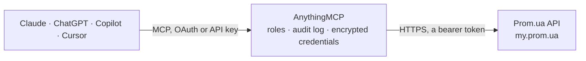

<!-- Generated by scripts/export-github-catalog.mjs in the anythingmcp-website repository. Do not edit by hand. -->

# Prom.ua MCP connector

Prom.ua seller API for Ukrainian marketplace stores: orders with buyer and delivery details, order status changes, products and product groups, clients and buyer messages. The AnythingMCP connector gives Claude, ChatGPT, Microsoft Copilot, Cursor and Gemini 11 MCP tools for Prom.ua: 10 read and 1 can change data.

**Category:** [E-commerce](../e-commerce.md) · **Tools:** 11 · **Setup guide:** [anythingmcp.com](https://anythingmcp.com/guides/prom-ua-to-mcp) · [Deutsch](https://anythingmcp.com/de/guides/prom-ua-to-mcp) · [Italiano](https://anythingmcp.com/it/guides/prom-ua-to-mcp) · [Español](https://anythingmcp.com/es/guides/prom-ua-to-mcp) · [日本語](https://anythingmcp.com/ja/guides/prom-ua-to-mcp) · [Русский](https://anythingmcp.com/ru/guides/prom-ua-to-mcp) · [中文](https://anythingmcp.com/zh/guides/prom-ua-to-mcp)

## Start without code

No installation and no terminal: AnythingMCP Cloud runs the Prom.ua connector for you, operated by helpcode.ai in Frankfurt, Germany.

1. **Click the button above** and create an account or sign in. The Prom.ua connector opens, ready to install.
2. **Paste the API key or token from your Prom.ua account.** Every click is in the [step-by-step guide](https://anythingmcp.com/guides/prom-ua-to-mcp).
3. **Click Install.** AnythingMCP shows the address of your MCP server.
4. **Add that address to your assistant:** [Claude](https://anythingmcp.com/guides/connect-prom-ua-to-claude) · [ChatGPT](https://anythingmcp.com/guides/connect-prom-ua-to-chatgpt) · [Microsoft Copilot](https://anythingmcp.com/guides/connect-prom-ua-to-copilot) · [Cursor](https://anythingmcp.com/guides/connect-prom-ua-to-cursor) · [Gemini CLI](https://anythingmcp.com/guides/connect-prom-ua-to-gemini) · [Meta Muse](https://anythingmcp.com/guides/connect-prom-ua-to-muse).
5. **Ask your first question**, for example: *Show me order 92047 from last week — buyer name, delivery address and item SKUs*

Prefer help with the setup? [Talk to us](https://anythingmcp.com/contact).

## How it works

- **The AI client** speaks MCP (Streamable HTTP) to AnythingMCP and only sees tool names, descriptions and results. It never gets the Prom.ua credentials.
- **AnythingMCP** checks the client's role, builds the call from the tool definition, adds the credentials (a bearer token), calls Prom.ua, logs the call and returns the result.
- **Prom.ua** sees an ordinary API client with the rights of the account the credentials belong to.

## Tools

| Tool | What it does | Access |
|---|---|---|
| [`prom_ua_list_orders`](#prom_ua_list_orders) | List Prom.ua orders of the company, newest first, with buyer, contact, delivery and payment details and the ordered products. | read |
| [`prom_ua_get_order`](#prom_ua_get_order) | Get one Prom.ua order by its numeric id: buyer and contact data, delivery method and address, payment, status and the products with quantities and prices. | read |
| [`prom_ua_list_order_statuses`](#prom_ua_list_order_statuses) | List the order statuses available to this Prom.ua company, including custom statuses and their ids. | read |
| [`prom_ua_set_order_status`](#prom_ua_set_order_status) | Change the status of one or more Prom.ua orders (received, delivered, canceled, paid) or set a custom status. | write |
| [`prom_ua_list_products`](#prom_ua_list_products) | List products of the Prom.ua store with name, SKU, price, availability, group and images. | read |
| [`prom_ua_get_product`](#prom_ua_get_product) | Get one Prom.ua product by its numeric Prom id, with description, prices, stock state, group and images. | read |
| [`prom_ua_get_product_by_external_id`](#prom_ua_get_product_by_external_id) | Get one Prom.ua product by the id it has in the seller's own accounting or ERP system (external_id). | read |
| [`prom_ua_list_groups`](#prom_ua_list_groups) | List the product groups (store categories) of the Prom.ua company with ids, names and parent groups. | read |
| [`prom_ua_list_clients`](#prom_ua_list_clients) | List the store's Prom.ua clients (buyers) with contact data, or search them by name, phone number or e-mail. | read |
| [`prom_ua_get_client`](#prom_ua_get_client) | Get one Prom.ua client by numeric id, with contact details and order statistics. | read |
| [`prom_ua_list_messages`](#prom_ua_list_messages) | List messages that buyers sent to the store through Prom.ua (questions about products and orders), filtered by read status or date. | read |

## Tool reference

Every parameter as the AI client sees it in `tools/list`. Source: [`packages/backend/src/adapters/intl/prom-ua.json`](../../../packages/backend/src/adapters/intl/prom-ua.json).

### `prom_ua_list_orders`

List Prom.ua orders of the company, newest first, with buyer, contact, delivery and payment details and the ordered products. Filter by status and by creation or last-change time.

**Access:** read · **Call:** `GET /orders/list`

| Parameter | Type | Required | Description |
|---|---|---|---|
| `status` | string | no | Order status: pending, received, delivered, canceled, draft or paid. |
| `date_from` | string | no | Orders created after this time. UTC date and time, e.g. 2026-10-01T00:00:00. |
| `date_to` | string | no | Orders created before this time. UTC date and time, e.g. 2026-10-01T00:00:00. |
| `last_modified_from` | string | no | Orders changed after this time. UTC date and time, e.g. 2026-10-01T00:00:00. |
| `last_modified_to` | string | no | Orders changed before this time. UTC date and time, e.g. 2026-10-01T00:00:00. |
| `limit` | integer | no | Maximum records in the response, e.g. 50. |
| `last_id` | integer | no | Paging cursor: return only orders whose id is not higher than this. Pass the lowest id of the previous page and skip that record if it comes back. |
| `sort_dir` | `asc` \| `desc` | no | Sort direction, desc (newest first) by default. |

### `prom_ua_get_order`

Get one Prom.ua order by its numeric id: buyer and contact data, delivery method and address, payment, status and the products with quantities and prices.

**Access:** read · **Call:** `GET /orders/{id}`

| Parameter | Type | Required | Description |
|---|---|---|---|
| `id` | integer | yes | Order id from prom_ua_list_orders. |

### `prom_ua_list_order_statuses`

List the order statuses available to this Prom.ua company, including custom statuses and their ids.

**Access:** read · **Call:** `GET /order_status_options/list`

No parameters.

### `prom_ua_set_order_status`

Change the status of one or more Prom.ua orders (received, delivered, canceled, paid) or set a custom status. This changes real orders that the buyer can see: show the order ids and the new status to the user and get an explicit confirmation before calling it.

**Access:** write · **Call:** `POST /orders/set_status`

| Parameter | Type | Required | Description |
|---|---|---|---|
| `ids` | integer[] | yes | Order ids to update, e.g. [123456789]. |
| `status` | `received` \| `delivered` \| `canceled` \| `paid` | no | New status. Leave out when setting custom_status_id. |
| `cancellation_reason` | `not_available` \| `buyers_request` \| `duplicate` \| `invalid_phone_number` \| `another` \| `payment_not_received` \| `no_product_variants` | no | Required when status is canceled. |
| `cancellation_text` | string | no | Explanation for the buyer; required when cancellation_reason is another. |
| `custom_status_id` | integer | no | Id of a custom status from prom_ua_list_order_statuses, sent together with ids instead of status. |

### `prom_ua_list_products`

List products of the Prom.ua store with name, SKU, price, availability, group and images. Narrow to one product group or to products changed in a time window.

**Access:** read · **Call:** `GET /products/list`

| Parameter | Type | Required | Description |
|---|---|---|---|
| `group_id` | integer | no | Only products of this group, id from prom_ua_list_groups. |
| `last_modified_from` | string | no | Products changed after this time. UTC date and time, e.g. 2026-10-01T00:00:00. |
| `last_modified_to` | string | no | Products changed before this time. UTC date and time, e.g. 2026-10-01T00:00:00. |
| `limit` | integer | no | Maximum records in the response, e.g. 50. |
| `last_id` | integer | no | Paging cursor: return only products whose id is not higher than this. Pass the lowest id of the previous page and skip that record if it comes back. |

### `prom_ua_get_product`

Get one Prom.ua product by its numeric Prom id, with description, prices, stock state, group and images.

**Access:** read · **Call:** `GET /products/{id}`

| Parameter | Type | Required | Description |
|---|---|---|---|
| `id` | integer | yes | Product id from prom_ua_list_products. |

### `prom_ua_get_product_by_external_id`

Get one Prom.ua product by the id it has in the seller's own accounting or ERP system (external_id).

**Access:** read · **Call:** `GET /products/by_external_id/{external_id}`

| Parameter | Type | Required | Description |
|---|---|---|---|
| `external_id` | string | yes | The product's external_id as set by the seller's system, e.g. SKU-1042. |

### `prom_ua_list_groups`

List the product groups (store categories) of the Prom.ua company with ids, names and parent groups.

**Access:** read · **Call:** `GET /groups/list`

| Parameter | Type | Required | Description |
|---|---|---|---|
| `last_modified_from` | string | no | Groups changed after this time. UTC date and time, e.g. 2026-10-01T00:00:00. |
| `last_modified_to` | string | no | Groups changed before this time. UTC date and time, e.g. 2026-10-01T00:00:00. |
| `limit` | integer | no | Maximum records in the response, e.g. 50. |
| `last_id` | integer | no | Paging cursor: return only groups whose id is not higher than this. Pass the lowest id of the previous page and skip that record if it comes back. |

### `prom_ua_list_clients`

List the store's Prom.ua clients (buyers) with contact data, or search them by name, phone number or e-mail.

**Access:** read · **Call:** `GET /clients/list`

| Parameter | Type | Required | Description |
|---|---|---|---|
| `search_term` | string | no | Name, phone number or e-mail to search for. |
| `limit` | integer | no | Maximum records in the response, e.g. 50. |
| `last_id` | integer | no | Paging cursor: return only clients whose id is not higher than this. Pass the lowest id of the previous page and skip that record if it comes back. |

### `prom_ua_get_client`

Get one Prom.ua client by numeric id, with contact details and order statistics.

**Access:** read · **Call:** `GET /clients/{id}`

| Parameter | Type | Required | Description |
|---|---|---|---|
| `id` | integer | yes | Client id from prom_ua_list_clients or from an order. |

### `prom_ua_list_messages`

List messages that buyers sent to the store through Prom.ua (questions about products and orders), filtered by read status or date.

**Access:** read · **Call:** `GET /messages/list`

| Parameter | Type | Required | Description |
|---|---|---|---|
| `status` | `unread` \| `read` \| `deleted` | no | Message status. |
| `date_from` | string | no | Messages created after this time. UTC date and time, e.g. 2026-10-01T00:00:00. |
| `date_to` | string | no | Messages created before this time. UTC date and time, e.g. 2026-10-01T00:00:00. |
| `limit` | integer | no | Maximum records in the response, e.g. 50. |
| `last_id` | integer | no | Paging cursor: return only messages whose id is not higher than this. Pass the lowest id of the previous page and skip that record if it comes back. |

## Run it yourself

AnythingMCP is open source (AGPL-3.0). [Run it with Docker](../../../README.md#run-it-yourself), open **Connectors → Store**, pick **Prom.ua** and enter `PROM_UA_API_TOKEN`, then add your MCP server URL to the AI client.

[← E-commerce connectors](../e-commerce.md) · [All categories](../README.md)
