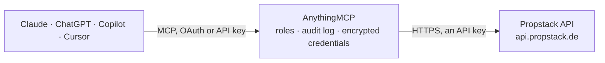

<!-- Generated by scripts/export-github-catalog.mjs in the anythingmcp-website repository. Do not edit by hand. -->

# Propstack MCP connector

Propstack — the CRM German estate agents run on: properties, contacts, enquiries, activities, projects and saved searches. The AnythingMCP connector gives Claude, ChatGPT, Microsoft Copilot, Cursor and Gemini 8 MCP tools for Propstack, all read-only.

**Category:** [Real Estate](../real-estate.md) · **Tools:** 8 · **Setup guide:** [anythingmcp.com](https://anythingmcp.com/guides/propstack-to-mcp) · [Deutsch](https://anythingmcp.com/de/guides/propstack-to-mcp) · [Italiano](https://anythingmcp.com/it/guides/propstack-to-mcp) · [Español](https://anythingmcp.com/es/guides/propstack-to-mcp) · [日本語](https://anythingmcp.com/ja/guides/propstack-to-mcp) · [Русский](https://anythingmcp.com/ru/guides/propstack-to-mcp) · [中文](https://anythingmcp.com/zh/guides/propstack-to-mcp)

## Start without code

No installation and no terminal: AnythingMCP Cloud runs the Propstack connector for you, operated by helpcode.ai in Frankfurt, Germany.

1. **Click the button above** and create an account or sign in. The Propstack connector opens, ready to install.
2. **Paste the API key or token from your Propstack account.** Every click is in the [step-by-step guide](https://anythingmcp.com/guides/propstack-to-mcp).
3. **Click Install.** AnythingMCP shows the address of your MCP server.
4. **Add that address to your assistant:** [Claude](https://anythingmcp.com/guides/connect-propstack-to-claude) · [ChatGPT](https://anythingmcp.com/guides/connect-propstack-to-chatgpt) · [Microsoft Copilot](https://anythingmcp.com/guides/connect-propstack-to-copilot) · [Cursor](https://anythingmcp.com/guides/connect-propstack-to-cursor) · [Gemini CLI](https://anythingmcp.com/guides/connect-propstack-to-gemini) · [Meta Muse](https://anythingmcp.com/guides/connect-propstack-to-muse).
5. **Ask your first question**, for example: *Show the full listing for Hauptstraße 12, 80331 München — I need the property record and attached documents.*

Prefer help with the setup? [Talk to us](https://anythingmcp.com/contact).

## How it works

- **The AI client** speaks MCP (Streamable HTTP) to AnythingMCP and only sees tool names, descriptions and results. It never gets the Propstack credentials.
- **AnythingMCP** checks the client's role, builds the call from the tool definition, adds the credentials (an API key), calls Propstack, logs the call and returns the result.
- **Propstack** sees an ordinary API client with the rights of the account the credentials belong to.

## Tools

| Tool | What it does | Access |
|---|---|---|
| [`propstack_list_properties`](#propstack_list_properties) | List property listings (Propstack calls them units/Objekte) with their address, price, living area, room count, marketing type and status. | read |
| [`propstack_get_property`](#propstack_get_property) | Read one property listing in full: full address, all price and area fields, the description texts, images, documents and the assigned broker. | read |
| [`propstack_list_contacts`](#propstack_list_contacts) | List contacts — buyers, sellers, landlords and tenants — with their name, e-mail, phone and the client source they came from. | read |
| [`propstack_get_contact`](#propstack_get_contact) | Read one contact in full: contact details, search profile, the properties they are linked to and their consent flags. | read |
| [`propstack_list_enquiries`](#propstack_list_enquiries) | List enquiries (Anfragen) — a person asking about a specific listing. | read |
| [`propstack_list_activities`](#propstack_list_activities) | List activities — calls, viewings, e-mails and notes logged against a contact or a property. | read |
| [`propstack_list_projects`](#propstack_list_projects) | List projects — the developments several units belong to — with their name, address and the number of units in each. | read |
| [`propstack_list_brokers`](#propstack_list_brokers) | List the brokers (users) in the account with their name, e-mail and the office they belong to, to resolve who owns a listing or a contact. | read |

## Tool reference

Every parameter as the AI client sees it in `tools/list`. Source: [`packages/backend/src/adapters/de/propstack.json`](../../../packages/backend/src/adapters/de/propstack.json).

### `propstack_list_properties`

List property listings (Propstack calls them units/Objekte) with their address, price, living area, room count, marketing type and status. The main query for 'what do we have on the market'.

**Access:** read · **Call:** `GET /units`

| Parameter | Type | Required | Description |
|---|---|---|---|
| `page` | number | no | Page number, starting at 1. |
| `per` | number | no | Rows per page (default 20; keep it at 500 or below to avoid timeouts). |
| `status` | string | no | Status id the listing must be in; several ids comma-separated. Status ids are account-specific (Propstack: Objekt-Stati). |
| `marketing_type` | `BUY` \| `RENT` | no | `BUY` for sale listings or `RENT` for rentals. |
| `q` | string | no | Full-text search over unit_id, street, zip_code, city, district and exposee_id. |
| `project_id` | number | no | Only the units of one project. |
| `expand` | number | no | Pass 1 for the detailed JSON, custom fields included. |

### `propstack_get_property`

Read one property listing in full: full address, all price and area fields, the description texts, images, documents and the assigned broker.

**Access:** read · **Call:** `GET /units/{id}`

| Parameter | Type | Required | Description |
|---|---|---|---|
| `id` | number | yes | Numeric Propstack property id. |

### `propstack_list_contacts`

List contacts — buyers, sellers, landlords and tenants — with their name, e-mail, phone and the client source they came from.

**Access:** read · **Call:** `GET /contacts`

| Parameter | Type | Required | Description |
|---|---|---|---|
| `page` | number | no | Page number, starting at 1. |
| `per` | number | no | Rows per page (default 20). |
| `q` | string | no | Search term matched against first name, last name, e-mails, address and phone numbers. |
| `expand` | number | no | Pass 1 to expand related objects. |

### `propstack_get_contact`

Read one contact in full: contact details, search profile, the properties they are linked to and their consent flags.

**Access:** read · **Call:** `GET /contacts/{id}`

| Parameter | Type | Required | Description |
|---|---|---|---|
| `id` | number | yes | Numeric Propstack contact id. |

### `propstack_list_enquiries`

List enquiries (Anfragen) — a person asking about a specific listing. Propstack stores them as activities of type enquiry; each row carries its date, source and the linked contact and property.

**Access:** read · **Call:** `GET /activities`

| Parameter | Type | Required | Description |
|---|---|---|---|
| `page` | number | no | Page number, starting at 1. |
| `per` | number | no | Rows per page. |
| `property_id` | number | no | Restrict to enquiries about one property. |
| `expand` | number | no | Pass 1 to expand related objects. |

### `propstack_list_activities`

List activities — calls, viewings, e-mails and notes logged against a contact or a property. The interaction history a broker actually needs.

**Access:** read · **Call:** `GET /activities`

| Parameter | Type | Required | Description |
|---|---|---|---|
| `page` | number | no | Page number, starting at 1. |
| `per` | number | no | Rows per page. |
| `client_id` | number | no | Restrict to activities on one contact. |
| `property_id` | number | no | Restrict to activities on one property. |

### `propstack_list_projects`

List projects — the developments several units belong to — with their name, address and the number of units in each.

**Access:** read · **Call:** `GET /projects`

| Parameter | Type | Required | Description |
|---|---|---|---|
| `page` | number | no | Page number, starting at 1. |
| `per` | number | no | Rows per page. |

### `propstack_list_brokers`

List the brokers (users) in the account with their name, e-mail and the office they belong to, to resolve who owns a listing or a contact.

**Access:** read · **Call:** `GET /brokers`

| Parameter | Type | Required | Description |
|---|---|---|---|
| `page` | number | no | Page number, starting at 1. |
| `per` | number | no | Rows per page. |

## Run it yourself

AnythingMCP is open source (AGPL-3.0). [Run it with Docker](../../../README.md#run-it-yourself), open **Connectors → Store**, pick **Propstack** and enter `PROPSTACK_API_KEY`, then add your MCP server URL to the AI client.

[← Real Estate connectors](../real-estate.md) · [All categories](../README.md)
