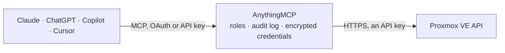

<!-- Generated by scripts/export-github-catalog.mjs in the anythingmcp-website repository. Do not edit by hand. -->

# Proxmox VE MCP connector

Proxmox Virtual Environment: cluster nodes, virtual machines and containers with their status and resource usage, storage, backup tasks and the task log. The AnythingMCP connector gives Claude, ChatGPT, Microsoft Copilot, Cursor and Gemini 11 MCP tools for Proxmox VE, all read-only.

**Category:** [Infrastructure](../infrastructure.md) · **Tools:** 11 · **Setup guide:** [anythingmcp.com](https://anythingmcp.com/guides/proxmox-to-mcp) · [Deutsch](https://anythingmcp.com/de/guides/proxmox-to-mcp) · [Italiano](https://anythingmcp.com/it/guides/proxmox-to-mcp) · [Español](https://anythingmcp.com/es/guides/proxmox-to-mcp) · [日本語](https://anythingmcp.com/ja/guides/proxmox-to-mcp) · [Русский](https://anythingmcp.com/ru/guides/proxmox-to-mcp) · [中文](https://anythingmcp.com/zh/guides/proxmox-to-mcp)

## Start without code

No installation and no terminal: AnythingMCP Cloud runs the Proxmox VE connector for you, operated by helpcode.ai in Frankfurt, Germany.

1. **Click the button above** and create an account or sign in. The Proxmox VE connector opens, ready to install.
2. **Paste the API key or token from your Proxmox VE account.** Every click is in the [step-by-step guide](https://anythingmcp.com/guides/proxmox-to-mcp).
3. **Click Install.** AnythingMCP shows the address of your MCP server.
4. **Add that address to your assistant:** [Claude](https://anythingmcp.com/guides/connect-proxmox-to-claude) · [ChatGPT](https://anythingmcp.com/guides/connect-proxmox-to-chatgpt) · [Microsoft Copilot](https://anythingmcp.com/guides/connect-proxmox-to-copilot) · [Cursor](https://anythingmcp.com/guides/connect-proxmox-to-cursor) · [Gemini CLI](https://anythingmcp.com/guides/connect-proxmox-to-gemini) · [Meta Muse](https://anythingmcp.com/guides/connect-proxmox-to-muse).
5. **Ask your first question**, for example: *What's the live status and resource usage of VM 210 'web-prod-01' on node pve02?*

Prefer help with the setup? [Talk to us](https://anythingmcp.com/contact).

## How it works

- **The AI client** speaks MCP (Streamable HTTP) to AnythingMCP and only sees tool names, descriptions and results. It never gets the Proxmox VE credentials.
- **AnythingMCP** checks the client's role, builds the call from the tool definition, adds the credentials (an API key), calls Proxmox VE, logs the call and returns the result.
- **Proxmox VE** sees an ordinary API client with the rights of the account the credentials belong to.

## Tools

| Tool | What it does | Access |
|---|---|---|
| [`proxmox_get_version`](#proxmox_get_version) | Read the Proxmox VE version and release of the connected node. | read |
| [`proxmox_list_cluster_resources`](#proxmox_list_cluster_resources) | List every VM, container, node and storage across the whole cluster in one call, with status, CPU, memory and disk usage. | read |
| [`proxmox_list_nodes`](#proxmox_list_nodes) | List the cluster's nodes with their status, uptime, CPU count and memory. | read |
| [`proxmox_get_node_status`](#proxmox_get_node_status) | Read one node's live status: load average, CPU and memory usage, root filesystem usage, kernel version and uptime. | read |
| [`proxmox_list_vms`](#proxmox_list_vms) | List the QEMU virtual machines on one node, with their VMID, name, status, CPU and memory allocation and current usage. | read |
| [`proxmox_get_vm_status`](#proxmox_get_vm_status) | Read one virtual machine's live status: running or stopped, uptime, CPU and memory usage, disk and network throughput. | read |
| [`proxmox_get_vm_config`](#proxmox_get_vm_config) | Read one virtual machine's configuration: its disks, network interfaces, boot order, CPU type and the notes recorded against it. | read |
| [`proxmox_list_containers`](#proxmox_list_containers) | List the LXC containers on one node with their VMID, name, status and resource usage. | read |
| [`proxmox_list_storage`](#proxmox_list_storage) | List the storage configured on one node with each store's type, total and used space, and what content it accepts. | read |
| [`proxmox_list_backups`](#proxmox_list_backups) | List the backup archives on one storage, with their VMID, creation time, size and format — the answer to 'when was this last backed up'. | read |
| [`proxmox_list_tasks`](#proxmox_list_tasks) | List recent tasks on one node with their type, VMID, user, start time and exit status — where a failed backup or migration shows up. | read |

## Tool reference

Every parameter as the AI client sees it in `tools/list`. Source: [`packages/backend/src/adapters/intl/proxmox.json`](../../../packages/backend/src/adapters/intl/proxmox.json).

### `proxmox_get_version`

Read the Proxmox VE version and release of the connected node. No parameters and the lightest possible permission — the fastest proof that URL, token id and secret all line up.

**Access:** read · **Call:** `GET /version`

No parameters.

### `proxmox_list_cluster_resources`

List every VM, container, node and storage across the whole cluster in one call, with status, CPU, memory and disk usage. The best starting point — it needs no node name.

**Access:** read · **Call:** `GET /cluster/resources`

| Parameter | Type | Required | Description |
|---|---|---|---|
| `type` | string | no | Restrict to one kind: vm, storage, node or sdn. |

### `proxmox_list_nodes`

List the cluster's nodes with their status, uptime, CPU count and memory. The node names every per-node tool needs.

**Access:** read · **Call:** `GET /nodes`

No parameters.

### `proxmox_get_node_status`

Read one node's live status: load average, CPU and memory usage, root filesystem usage, kernel version and uptime.

**Access:** read · **Call:** `GET /nodes/{node}/status`

| Parameter | Type | Required | Description |
|---|---|---|---|
| `node` | string | yes | Node name, from proxmox_list_nodes. |

### `proxmox_list_vms`

List the QEMU virtual machines on one node, with their VMID, name, status, CPU and memory allocation and current usage.

**Access:** read · **Call:** `GET /nodes/{node}/qemu`

| Parameter | Type | Required | Description |
|---|---|---|---|
| `node` | string | yes | Node name, from proxmox_list_nodes. |

### `proxmox_get_vm_status`

Read one virtual machine's live status: running or stopped, uptime, CPU and memory usage, disk and network throughput.

**Access:** read · **Call:** `GET /nodes/{node}/qemu/{vmid}/status/current`

| Parameter | Type | Required | Description |
|---|---|---|---|
| `node` | string | yes | Node name. |
| `vmid` | number | yes | VMID of the virtual machine. |

### `proxmox_get_vm_config`

Read one virtual machine's configuration: its disks, network interfaces, boot order, CPU type and the notes recorded against it.

**Access:** read · **Call:** `GET /nodes/{node}/qemu/{vmid}/config`

| Parameter | Type | Required | Description |
|---|---|---|---|
| `node` | string | yes | Node name. |
| `vmid` | number | yes | VMID of the virtual machine. |

### `proxmox_list_containers`

List the LXC containers on one node with their VMID, name, status and resource usage. Containers are a separate collection from VMs.

**Access:** read · **Call:** `GET /nodes/{node}/lxc`

| Parameter | Type | Required | Description |
|---|---|---|---|
| `node` | string | yes | Node name, from proxmox_list_nodes. |

### `proxmox_list_storage`

List the storage configured on one node with each store's type, total and used space, and what content it accepts.

**Access:** read · **Call:** `GET /nodes/{node}/storage`

| Parameter | Type | Required | Description |
|---|---|---|---|
| `node` | string | yes | Node name. |
| `content` | string | no | Restrict to storage accepting one content type, e.g. backup, images, iso. |

### `proxmox_list_backups`

List the backup archives on one storage, with their VMID, creation time, size and format — the answer to 'when was this last backed up'.

**Access:** read · **Call:** `GET /nodes/{node}/storage/{storage}/content`

| Parameter | Type | Required | Description |
|---|---|---|---|
| `node` | string | yes | Node name. |
| `storage` | string | yes | Storage id, from proxmox_list_storage. |
| `vmid` | number | no | Restrict to one VM's backups. |

### `proxmox_list_tasks`

List recent tasks on one node with their type, VMID, user, start time and exit status — where a failed backup or migration shows up.

**Access:** read · **Call:** `GET /nodes/{node}/tasks`

| Parameter | Type | Required | Description |
|---|---|---|---|
| `node` | string | yes | Node name. |
| `limit` | number | no | Maximum tasks to return. |
| `errors` | number | no | Pass 1 to list only tasks that failed. |
| `vmid` | number | no | Restrict to one VM's tasks. |

## Run it yourself

AnythingMCP is open source (AGPL-3.0). [Run it with Docker](../../../README.md#run-it-yourself), open **Connectors → Store**, pick **Proxmox VE** and enter `PROXMOX_URL`, `PROXMOX_TOKEN_ID`, `PROXMOX_TOKEN_SECRET`, then add your MCP server URL to the AI client.

[← Infrastructure connectors](../infrastructure.md) · [All categories](../README.md)
