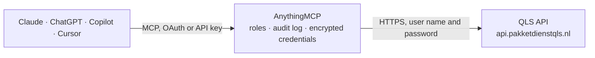

<!-- Generated by scripts/export-github-catalog.mjs in the anythingmcp-website repository. Do not edit by hand. -->

# QLS MCP connector

Ship and fulfil with Pakketdienst QLS from an AI agent: parcel shipments with labels and tracking, shipping products and delivery options, service points, fulfilment orders, fulfilment products and … The AnythingMCP connector gives Claude, ChatGPT, Microsoft Copilot, Cursor and Gemini 49 MCP tools for QLS: 30 read and 19 can change data.

**Category:** [Logistics](../logistics.md) · **Tools:** 49 · **Setup guide:** [anythingmcp.com](https://anythingmcp.com/guides/qls-to-mcp) · [Deutsch](https://anythingmcp.com/de/guides/qls-to-mcp) · [Italiano](https://anythingmcp.com/it/guides/qls-to-mcp) · [Español](https://anythingmcp.com/es/guides/qls-to-mcp) · [日本語](https://anythingmcp.com/ja/guides/qls-to-mcp) · [Русский](https://anythingmcp.com/ru/guides/qls-to-mcp) · [中文](https://anythingmcp.com/zh/guides/qls-to-mcp)

## Start without code

No installation and no terminal: AnythingMCP Cloud runs the QLS connector for you, operated by helpcode.ai in Frankfurt, Germany.

1. **Click the button above** and create an account or sign in. The QLS connector opens, ready to install.
2. **Paste the API key or token from your QLS account.** Every click is in the [step-by-step guide](https://anythingmcp.com/guides/qls-to-mcp).
3. **Click Install.** AnythingMCP shows the address of your MCP server.
4. **Add that address to your assistant:** [Claude](https://anythingmcp.com/guides/connect-qls-to-claude) · [ChatGPT](https://anythingmcp.com/guides/connect-qls-to-chatgpt) · [Microsoft Copilot](https://anythingmcp.com/guides/connect-qls-to-copilot) · [Cursor](https://anythingmcp.com/guides/connect-qls-to-cursor) · [Gemini CLI](https://anythingmcp.com/guides/connect-qls-to-gemini) · [Meta Muse](https://anythingmcp.com/guides/connect-qls-to-muse).
5. **Ask your first question**, for example: *Show the QLS parcel for invoice reference INV-2026-045, shipped to Klomp Elektronica B.V.*

Prefer help with the setup? [Talk to us](https://anythingmcp.com/contact).

## How it works

- **The AI client** speaks MCP (Streamable HTTP) to AnythingMCP and only sees tool names, descriptions and results. It never gets the QLS credentials.
- **AnythingMCP** checks the client's role, builds the call from the tool definition, adds the credentials (user name and password), calls QLS, logs the call and returns the result.
- **QLS** sees an ordinary API client with the rights of the account the credentials belong to.

## Tools

| Tool | What it does | Access |
|---|---|---|
| [`qls_list_companies`](#qls_list_companies) | List the QLS companies the API user may act for, with their id and name. | read |
| [`qls_get_company`](#qls_get_company) | Get one QLS company (id and name) by its id, to confirm which account the API user works on. | read |
| [`qls_list_brands`](#qls_list_brands) | List the brands (trade names) of a company. | read |
| [`qls_get_brand`](#qls_get_brand) | Get one brand (trade name) of a company by its id, with its name. | read |
| [`qls_list_shipping_products`](#qls_list_shipping_products) | List the shipping products (shipping methods such as DHL or PostNL parcel, mailbox or service point) the company may use, with their price per country and… | read |
| [`qls_list_service_points`](#qls_list_service_points) | Find carrier service points (pick-up points) near a postal code for every service point product the company has enabled, with address, opening times and the… | read |
| [`qls_list_product_service_points`](#qls_list_product_service_points) | Find service points near a postal code for one shipping product (for example only DHL service points), with address, opening times and servicepoint_code. | read |
| [`qls_list_shipments`](#qls_list_shipments) | List the parcel shipments of a company with status (created, printed, pre_transit, in_transit, delivered, returned_to_sender), barcode, tracking id and… | read |
| [`qls_get_shipment`](#qls_get_shipment) | Get one shipment with status, weight in grams, barcode, tracking id and URL. | read |
| [`qls_get_shipment_return`](#qls_get_shipment_return) | Get the return shipment created for a shipment (status, barcode, tracking), when the consumer sent the parcel back with a return label. | read |
| [`qls_list_fulfillment_orders`](#qls_list_fulfillment_orders) | List fulfilment orders (orders QLS picks, packs and ships from its warehouse) with status (error_validation, concept, received, pending, partically_sent,… | read |
| [`qls_get_fulfillment_order`](#qls_get_fulfillment_order) | Get one fulfilment order with status, amounts ordered, reserved and delivered, receiver, products, deliveries and the shipments (barcode, tracking URL) that… | read |
| [`qls_list_fulfillment_products`](#qls_list_fulfillment_products) | List the fulfilment products (articles stored at QLS) with name, EAN, SKU, article number, total, reserved and blocked stock and prices. | read |
| [`qls_get_fulfillment_product`](#qls_get_fulfillment_product) | Get one fulfilment product with EAN, SKU, prices, stock totals and the warehouse locations (zone, rack, shelf, best-before) where it is stored. | read |
| [`qls_list_stock`](#qls_list_stock) | List stock per fulfilment product only: total, reserved, available, salable, sold, backorder, incoming and forecast amounts. | read |
| [`qls_get_product_stock`](#qls_get_product_stock) | Get the warehouse stock records of one fulfilment product: per location the current and reserved amount, batch and best-before date. | read |
| [`qls_list_backorders`](#qls_list_backorders) | List the fulfilment products that are in backorder (ordered but not in stock) with the missing amount, to see what to replenish. | read |
| [`qls_list_returns`](#qls_list_returns) | List returns handled by QLS (v2) with status (created, approved, rejected, partially_rejected, quarantine, incomplete, completed and more), the original… | read |
| [`qls_get_return`](#qls_get_return) | Get one return (v2) with status, consumer, original shipment and order and the returned products with expected and received amounts and reason. | read |
| [`qls_list_purchase_orders`](#qls_list_purchase_orders) | List purchase orders (announced inbound deliveries of goods to the QLS warehouse, v2) with status (created, in_transit, arrived, partially_arrived,… | read |
| [`qls_list_purchase_orders_in_transit`](#qls_list_purchase_orders_in_transit) | List the purchase orders whose goods are on their way to the QLS warehouse (v2), with deliveries, products and estimated arrival. | read |
| [`qls_get_purchase_order`](#qls_get_purchase_order) | Get one purchase order (v2) with its products and amounts, suppliers, deliveries (barcode, estimated arrival, received) and labels. | read |
| [`qls_list_suppliers`](#qls_list_suppliers) | List the suppliers of a company (id and name), used on purchase orders and linked to fulfilment products for reports. | read |
| [`qls_create_shipment`](#qls_create_shipment) | Create a parcel shipment (v2) and get its barcode, tracking URL and label URLs (label_pdf_url, label_zpl_url). | write |
| [`qls_create_fulfillment_order`](#qls_create_fulfillment_order) | Create a fulfilment order: QLS picks the products from its stock, packs and ships them to the receiver. | write |
| [`qls_update_fulfillment_order`](#qls_update_fulfillment_order) | Change a fulfilment order that has not left the warehouse: put it on hold or release it, change the processable date, your reference, the remarks or the… | write |
| [`qls_cancel_fulfillment_order`](#qls_cancel_fulfillment_order) | Cancel a fulfilment order that has not been shipped yet; its reserved stock is released. | write |
| [`qls_create_fulfillment_product`](#qls_create_fulfillment_product) | Create a fulfilment product (an article QLS will store and ship) with name, EAN, SKU, image and prices. | write |
| [`qls_update_fulfillment_product`](#qls_update_fulfillment_product) | Update a fulfilment product: EAN, SKU, image or prices. | write |
| [`qls_delete_fulfillment_product`](#qls_delete_fulfillment_product) | Delete a fulfilment product that has no stock or open orders. | write |
| [`qls_create_return_from_order`](#qls_create_return_from_order) | Announce a return for a fulfilment order (v2): QLS expects the listed products back and processes them on arrival. | write |
| [`qls_create_purchase_order`](#qls_create_purchase_order) | Announce an inbound delivery of goods to the QLS warehouse (v2 purchase order) with the products and amounts, suppliers and the expected deliveries. | write |
| [`qls_create_return`](#qls_create_return) | Announce a return to the QLS warehouse (v2) without a fulfilment order to start from, e.g. a parcel you shipped yourself or a return the consumer already… | write |
| [`qls_archive_return`](#qls_archive_return) | Archive a return (v2) once it is handled, so it leaves the working list of open returns in the QLS portal. | write |
| [`qls_get_fulfillment_order_product`](#qls_get_fulfillment_order_product) | Get one line of a fulfilment order: the product, the name on the order, and the amounts ordered, reserved and delivered. | read |
| [`qls_add_fulfillment_order_product`](#qls_add_fulfillment_order_product) | Add a product line to a fulfilment order that has not been picked yet. | write |
| [`qls_update_fulfillment_order_product`](#qls_update_fulfillment_order_product) | Change the amount, name or unit price of one line of a fulfilment order that has not been picked yet. | write |
| [`qls_list_product_barcodes`](#qls_list_product_barcodes) | List the extra barcodes of a fulfilment product: codes besides the main EAN that the warehouse scanner also accepts for it (supplier codes, old EANs). | read |
| [`qls_add_product_barcode`](#qls_add_product_barcode) | Add an extra barcode to a fulfilment product, so the warehouse recognises goods that arrive with another code than the main EAN. | write |
| [`qls_list_product_master_cartons`](#qls_list_product_master_cartons) | List the master cartons (omdozen) of a fulfilment product: how many units one carton holds and the carton EAN, used when goods arrive or are shipped by the… | read |
| [`qls_list_product_suppliers`](#qls_list_product_suppliers) | List the suppliers linked to a fulfilment product, with the supplier code of the product at each supplier. | read |
| [`qls_link_product_supplier`](#qls_link_product_supplier) | Link a supplier to a fulfilment product by name, with the product code at that supplier. | write |
| [`qls_get_supplier`](#qls_get_supplier) | Get one supplier of the company by its id: the id and name used on purchase orders and fulfilment products. | read |
| [`qls_create_supplier`](#qls_create_supplier) | Create a supplier for the company, to use on purchase orders and link to fulfilment products. | write |
| [`qls_update_supplier`](#qls_update_supplier) | Rename a supplier of the company. | write |
| [`qls_update_purchase_order`](#qls_update_purchase_order) | Change an announced inbound purchase order (v2) before the goods arrive: title, pre-order flag, suppliers, products and amounts, and expected deliveries. | write |
| [`qls_cancel_purchase_order`](#qls_cancel_purchase_order) | Cancel an announced inbound purchase order (v2), so the warehouse no longer expects the goods. | write |
| [`qls_list_webhook_types`](#qls_list_webhook_types) | List the event types QLS can send webhooks for (e.g. shipment and order status changes), to explain what a configured webhook reports. | read |
| [`qls_list_webhooks`](#qls_list_webhooks) | List the webhooks configured for the company: target URL and the event types each one receives. | read |

## Tool reference

Every parameter as the AI client sees it in `tools/list`. Source: [`packages/backend/src/adapters/nl/qls.json`](../../../packages/backend/src/adapters/nl/qls.json).

### `qls_list_companies`

List the QLS companies the API user may act for, with their id and name. Call this first: every other tool needs the company id it returns.

**Access:** read · **Call:** `GET /companies`

No parameters.

### `qls_get_company`

Get one QLS company (id and name) by its id, to confirm which account the API user works on.

**Access:** read · **Call:** `GET /companies/{company_id}`

| Parameter | Type | Required | Description |
|---|---|---|---|
| `company_id` | string | yes | Company id (a UUID) from qls_list_companies. |

### `qls_list_brands`

List the brands (trade names) of a company. A brand carries the sender, return and customs addresses and policies; creating a shipment or a fulfilment order needs its brand_id.

**Access:** read · **Call:** `GET /companies/{company_id}/brands`

| Parameter | Type | Required | Description |
|---|---|---|---|
| `company_id` | string | yes | Company id (a UUID) from qls_list_companies. |

### `qls_get_brand`

Get one brand (trade name) of a company by its id, with its name.

**Access:** read · **Call:** `GET /companies/{company_id}/brands/{brand_id}`

| Parameter | Type | Required | Description |
|---|---|---|---|
| `company_id` | string | yes | Company id (a UUID) from qls_list_companies. |
| `brand_id` | string | yes | Brand id from qls_list_brands. |

### `qls_list_shipping_products`

List the shipping products (shipping methods such as DHL or PostNL parcel, mailbox or service point) the company may use, with their price per country and weight band, maximum dimensions, delivery options and the combinations of options. A shipment needs a product id and a product_combination_id from this list.

**Access:** read · **Call:** `GET /companies/{company_id}/products`

| Parameter | Type | Required | Description |
|---|---|---|---|
| `company_id` | string | yes | Company id (a UUID) from qls_list_companies. |

### `qls_list_service_points`

Find carrier service points (pick-up points) near a postal code for every service point product the company has enabled, with address, opening times and the servicepoint_code to put on a shipment or order.

**Access:** read · **Call:** `GET /companies/{company_id}/service-points/{country}/{postal_code}`

| Parameter | Type | Required | Description |
|---|---|---|---|
| `company_id` | string | yes | Company id (a UUID) from qls_list_companies. |
| `country` | string | yes | Two-letter country code, e.g. NL or BE. |
| `postal_code` | string | yes | Postal code to search around, e.g. 1234AB. |

### `qls_list_product_service_points`

Find service points near a postal code for one shipping product (for example only DHL service points), with address, opening times and servicepoint_code.

**Access:** read · **Call:** `GET /companies/{company_id}/products/{product_id}/service-points/{country}/{postal_code}`

| Parameter | Type | Required | Description |
|---|---|---|---|
| `company_id` | string | yes | Company id (a UUID) from qls_list_companies. |
| `product_id` | integer | yes | Shipping product id from qls_list_shipping_products. |
| `country` | string | yes | Two-letter country code, e.g. NL. |
| `postal_code` | string | yes | Postal code to search around, e.g. 1234AB. |

### `qls_list_shipments`

List the parcel shipments of a company with status (created, printed, pre_transit, in_transit, delivered, returned_to_sender), barcode, tracking id and tracking URL. Filter by reference, barcode, status, brand, receiver fields or created/modified dates, or search freely.

**Access:** read · **Call:** `GET /companies/{company_id}/shipments`

| Parameter | Type | Required | Description |
|---|---|---|---|
| `company_id` | string | yes | Company id (a UUID) from qls_list_companies. |
| `reference` | string | no | Your shipment reference. |
| `barcode` | string | no | Carrier barcode. |
| `status` | `created` \| `printed` \| `pre_transit` \| `in_transit` \| `delivered` \| `returned_to_sender` | no | Shipment status. |
| `brand_id` | string | no | Only shipments of this brand. |
| `created_after` | string | no | Only shipments created after this date, e.g. 2026-10-01 00:00:00. |
| `created_before` | string | no | Only shipments created before this date. |
| `modified_after` | string | no | Only shipments changed after this date. |
| `modified_before` | string | no | Only shipments changed before this date. |
| `receiver_name` | string | no | Receiver name. |
| `receiver_postalcode` | string | no | Receiver postal code. |
| `receiver_country` | string | no | Receiver country code. |
| `receiver_email` | string | no | Receiver email address. |
| `shop_integration_reference` | string | no | Order reference of the connected web shop. |
| `search` | string | no | Free text search over the shipments. |
| `page` | integer | no | Page number, starting at 1. The answer carries pagination (page, pageCount, nextPage); call again with the next page while nextPage is true. |

### `qls_get_shipment`

Get one shipment with status, weight in grams, barcode, tracking id and URL. Set with_label to true to also get the label as a PDF URL and a ZPL URL.

**Access:** read · **Call:** `GET /companies/{company_id}/shipments/{shipment_id}`

| Parameter | Type | Required | Description |
|---|---|---|---|
| `company_id` | string | yes | Company id (a UUID) from qls_list_companies. |
| `shipment_id` | string | yes | Shipment id (UUID). |
| `with_label` | boolean | no | true adds the label URLs (label, label_zpl) to the answer. |

### `qls_get_shipment_return`

Get the return shipment created for a shipment (status, barcode, tracking), when the consumer sent the parcel back with a return label.

**Access:** read · **Call:** `GET /companies/{company_id}/shipments/{shipment_id}/returns`

| Parameter | Type | Required | Description |
|---|---|---|---|
| `company_id` | string | yes | Company id (a UUID) from qls_list_companies. |
| `shipment_id` | string | yes | Id of the original shipment. |

### `qls_list_fulfillment_orders`

List fulfilment orders (orders QLS picks, packs and ships from its warehouse) with status (error_validation, concept, received, pending, partically_sent, sent), receiver, ordered products, deliveries and their shipments. Filter by status, customer reference, brand, receiver fields or dates.

**Access:** read · **Call:** `GET /companies/{company_id}/fulfillment/orders`

| Parameter | Type | Required | Description |
|---|---|---|---|
| `company_id` | string | yes | Company id (a UUID) from qls_list_companies. |
| `status` | `error_validation` \| `concept` \| `received` \| `pending` \| `partically_sent` \| `sent` | no | Order status. |
| `customer_reference` | string | no | Your order reference, e.g. the web shop order number. |
| `brand_id` | string | no | Only orders of this brand. |
| `created_after` | string | no | Only orders created after this date, e.g. 2026-10-01 00:00:00. |
| `created_before` | string | no | Only orders created before this date. |
| `modified_after` | string | no | Only orders changed after this date. |
| `modified_before` | string | no | Only orders changed before this date. |
| `receiver_name` | string | no | Receiver name. |
| `receiver_postalcode` | string | no | Receiver postal code. |
| `receiver_email` | string | no | Receiver email address. |
| `shop_integration_reference` | string | no | Order reference of the connected web shop. |
| `search` | string | no | Free text search over the orders. |
| `page` | integer | no | Page number, starting at 1. The answer carries pagination (page, pageCount, nextPage); call again with the next page while nextPage is true. |

### `qls_get_fulfillment_order`

Get one fulfilment order with status, amounts ordered, reserved and delivered, receiver, products, deliveries and the shipments (barcode, tracking URL) that left the warehouse.

**Access:** read · **Call:** `GET /companies/{company_id}/fulfillment/orders/{order_id}`

| Parameter | Type | Required | Description |
|---|---|---|---|
| `company_id` | string | yes | Company id (a UUID) from qls_list_companies. |
| `order_id` | string | yes | Fulfilment order id (UUID). |

### `qls_list_fulfillment_products`

List the fulfilment products (articles stored at QLS) with name, EAN, SKU, article number, total, reserved and blocked stock and prices. Filter by name, EAN, SKU, article number, stock levels or dates.

**Access:** read · **Call:** `GET /companies/{company_id}/fulfillment/products`

| Parameter | Type | Required | Description |
|---|---|---|---|
| `company_id` | string | yes | Company id (a UUID) from qls_list_companies. |
| `name` | string | no | Product name. |
| `ean` | string | no | EAN barcode. |
| `sku` | string | no | Your SKU. |
| `article_number` | string | no | QLS article number. |
| `amount_available_greater_than` | integer | no | Only products with more available stock than this. |
| `amount_available_less_than` | integer | no | Only products with less available stock than this, e.g. 1 for out of stock. |
| `created_after` | string | no | Only products created after this date. |
| `modified_after` | string | no | Only products changed after this date. |
| `page` | integer | no | Page number, starting at 1. The answer carries pagination (page, pageCount, nextPage); call again with the next page while nextPage is true. |

### `qls_get_fulfillment_product`

Get one fulfilment product with EAN, SKU, prices, stock totals and the warehouse locations (zone, rack, shelf, best-before) where it is stored.

**Access:** read · **Call:** `GET /companies/{company_id}/fulfillment/products/{product_id}`

| Parameter | Type | Required | Description |
|---|---|---|---|
| `company_id` | string | yes | Company id (a UUID) from qls_list_companies. |
| `product_id` | string | yes | Fulfilment product id (UUID). |

### `qls_list_stock`

List stock per fulfilment product only: total, reserved, available, salable, sold, backorder, incoming and forecast amounts. 100 products per page. Lighter than qls_list_fulfillment_products for stock checks.

**Access:** read · **Call:** `GET /companies/{company_id}/fulfillment/products/stock`

| Parameter | Type | Required | Description |
|---|---|---|---|
| `company_id` | string | yes | Company id (a UUID) from qls_list_companies. |
| `product_id` | string | no | Only this fulfilment product id. |
| `modified_after` | string | no | Only products changed after this moment, format d-m-Y H:i, e.g. 1-10-2026 00:00. |
| `modified_before` | string | no | Only products changed before this moment, format d-m-Y H:i. |
| `created_after` | string | no | Only products created after this moment, format d-m-Y H:i. |
| `created_before` | string | no | Only products created before this moment, format d-m-Y H:i. |
| `page` | integer | no | Page number, starting at 1. The answer carries pagination (page, pageCount, nextPage); call again with the next page while nextPage is true. |

### `qls_get_product_stock`

Get the warehouse stock records of one fulfilment product: per location the current and reserved amount, batch and best-before date.

**Access:** read · **Call:** `GET /companies/{company_id}/fulfillment/products/{product_id}/stocks`

| Parameter | Type | Required | Description |
|---|---|---|---|
| `company_id` | string | yes | Company id (a UUID) from qls_list_companies. |
| `product_id` | string | yes | Fulfilment product id (UUID). |

### `qls_list_backorders`

List the fulfilment products that are in backorder (ordered but not in stock) with the missing amount, to see what to replenish.

**Access:** read · **Call:** `GET /companies/{company_id}/fulfillment/products/backorders`

| Parameter | Type | Required | Description |
|---|---|---|---|
| `company_id` | string | yes | Company id (a UUID) from qls_list_companies. |
| `created_after` | string | no | Only backorders created after this moment. |
| `created_before` | string | no | Only backorders created before this moment. |

### `qls_list_returns`

List returns handled by QLS (v2) with status (created, approved, rejected, partially_rejected, quarantine, incomplete, completed and more), the original shipment and order, consumer and returned products with reason. 100 per page.

**Access:** read · **Call:** `GET /v2/companies/{company_id}/returns`

| Parameter | Type | Required | Description |
|---|---|---|---|
| `company_id` | string | yes | Company id (a UUID) from qls_list_companies. |
| `status` | `created` \| `approved` \| `rejected` \| `partially_rejected` \| `quarantine` \| `partially_in_quarantine` \| `incomplete` \| `more_than_complete` \| `completed` | no | Return status. |
| `created_after` | string | no | Only returns created after this moment. |
| `created_before` | string | no | Only returns created before this moment. |
| `processed_after` | string | no | Only returns processed after this moment. |
| `processed_before` | string | no | Only returns processed before this moment. |
| `page` | integer | no | Page number, starting at 1. The answer carries pagination (page, pageCount, nextPage); call again with the next page while nextPage is true. |

### `qls_get_return`

Get one return (v2) with status, consumer, original shipment and order and the returned products with expected and received amounts and reason.

**Access:** read · **Call:** `GET /v2/companies/{company_id}/returns/{return_id}`

| Parameter | Type | Required | Description |
|---|---|---|---|
| `company_id` | string | yes | Company id (a UUID) from qls_list_companies. |
| `return_id` | string | yes | Return id. |

### `qls_list_purchase_orders`

List purchase orders (announced inbound deliveries of goods to the QLS warehouse, v2) with status (created, in_transit, arrived, partially_arrived, processing, closed, archived, cancelled). 100 per page.

**Access:** read · **Call:** `GET /v2/companies/{company_id}/purchase-orders`

| Parameter | Type | Required | Description |
|---|---|---|---|
| `company_id` | string | yes | Company id (a UUID) from qls_list_companies. |
| `status` | `created` \| `arrived` \| `partially_arrived` \| `in_transit` \| `processing` \| `closed` \| `archived` \| `cancelled` | no | Purchase order status. |
| `customer_title` | string | no | Your title of the purchase order. |
| `created_after` | string | no | Only purchase orders created after this moment, format d-m-Y H:i, e.g. 1-10-2026 00:00. |
| `created_before` | string | no | Only purchase orders created before this moment, format d-m-Y H:i. |
| `modified_after` | string | no | Only purchase orders changed after this moment, format d-m-Y H:i. |
| `modified_before` | string | no | Only purchase orders changed before this moment, format d-m-Y H:i. |
| `page` | integer | no | Page number, starting at 1. The answer carries pagination (page, pageCount, nextPage); call again with the next page while nextPage is true. |

### `qls_list_purchase_orders_in_transit`

List the purchase orders whose goods are on their way to the QLS warehouse (v2), with deliveries, products and estimated arrival.

**Access:** read · **Call:** `GET /v2/companies/{company_id}/purchase-orders/in-transit`

| Parameter | Type | Required | Description |
|---|---|---|---|
| `company_id` | string | yes | Company id (a UUID) from qls_list_companies. |
| `page` | integer | no | Page number, starting at 1. The answer carries pagination (page, pageCount, nextPage); call again with the next page while nextPage is true. |

### `qls_get_purchase_order`

Get one purchase order (v2) with its products and amounts, suppliers, deliveries (barcode, estimated arrival, received) and labels.

**Access:** read · **Call:** `GET /v2/companies/{company_id}/purchase-orders/{purchase_order_id}`

| Parameter | Type | Required | Description |
|---|---|---|---|
| `company_id` | string | yes | Company id (a UUID) from qls_list_companies. |
| `purchase_order_id` | integer | yes | Purchase order id. |

### `qls_list_suppliers`

List the suppliers of a company (id and name), used on purchase orders and linked to fulfilment products for reports.

**Access:** read · **Call:** `GET /companies/{company_id}/suppliers`

| Parameter | Type | Required | Description |
|---|---|---|---|
| `company_id` | string | yes | Company id (a UUID) from qls_list_companies. |

### `qls_create_shipment`

Create a parcel shipment (v2) and get its barcode, tracking URL and label URLs (label_pdf_url, label_zpl_url). Needs brand_id, product_combination_id (from qls_list_shipping_products) and the receiver; sender and return address default to the brand. Books a real parcel with the carrier and costs money: show the receiver, product and weight and get a yes first.

**Access:** write · **Call:** `POST /v2/companies/{company_id}/shipments`

| Parameter | Type | Required | Description |
|---|---|---|---|
| `company_id` | string | yes | Company id (a UUID) from qls_list_companies. |
| `brand_id` | string | yes | Brand id from qls_list_brands. |
| `product_combination_id` | integer | yes | Combination id of the shipping product and its options, from qls_list_shipping_products (combinations[].id). |
| `receiver_contact` | object | yes | Address: {"name": "...", "companyname": "...", "street": "...", "housenumber": "12", "address2": "", "postalcode": "1234AB", "locality": "Amsterdam", "country": "NL", "email": "...", "phone": "..."}. street, postalcode, locality and country are required; country is a two-letter ISO code. |
| `reference` | string | no | Your reference, e.g. the order number. |
| `weight` | integer | no | Weight in grams. |
| `servicepoint_code` | string | no | servicepoint_code from qls_list_service_points to ship to a pick-up point. |
| `cod_amount` | number | no | Cash on delivery amount in euros, only with a COD product. |
| `customs_shipment_type` | `commercial` \| `documents` \| `return` \| `sample` | no | Customs type for shipments outside the EU. |
| `customs_invoice_number` | string | no | Invoice number for customs. |
| `shipment_products` | object[] | no | Contents for customs: [{"amount": 1, "name": "T-shirt", "country_code_of_origin": "NL", "hs_code": "610910", "price_per_unit": 19.95, "weight_per_unit": 200, "ean": "...", "sku": "...", "currency": "EUR"}]. |
| `sender_contact` | object | no | Sender address, only to override the brand address. Same shape as receiver_contact. |
| `return_contact` | object | no | Return address, only to override the brand address. Same shape as receiver_contact. |
| `zpl_direct` | boolean | no | true to get the ZPL label directly. |

### `qls_create_fulfillment_order`

Create a fulfilment order: QLS picks the products from its stock, packs and ships them to the receiver. Needs brand_id, the receiver and the products (fulfilment product id or EAN/SKU with amount). Starts a real shipment from the warehouse: show the receiver and lines and get a yes first.

**Access:** write · **Call:** `POST /companies/{company_id}/fulfillment/orders`

| Parameter | Type | Required | Description |
|---|---|---|---|
| `company_id` | string | yes | Company id (a UUID) from qls_list_companies. |
| `brand_id` | string | yes | Brand id from qls_list_brands. |
| `receiver_contact` | object | yes | Address: {"name": "...", "companyname": "...", "street": "...", "housenumber": "12", "address2": "", "postalcode": "1234AB", "locality": "Amsterdam", "country": "NL", "email": "...", "phone": "..."}. street, postalcode, locality and country are required; country is a two-letter ISO code. |
| `products` | object[] | yes | Order lines: [{"product_id": "<fulfilment product id>", "amount_ordered": 2, "name": "..."}]. Use the ids from qls_list_fulfillment_products. |
| `customer_reference` | string | no | Your order number, shown in reports and on the packing slip. |
| `servicepoint_code` | string | no | servicepoint_code to deliver to a pick-up point. |
| `delivery_options` | string[] | no | Delivery option tags of the shipping product, e.g. ["signature"]; see qls_list_shipping_products (options[].tag). |
| `processable` | string | no | Date and time from which QLS may process the order, to hold it until then. |
| `total_price` | number | no | Order total, for customs and insurance. |
| `custom_values` | object[] | no | Extra key/value pairs: [{"key": "...", "value": "..."}]. |

### `qls_update_fulfillment_order`

Change a fulfilment order that has not left the warehouse: put it on hold or release it, change the processable date, your reference, the remarks or the service point. Confirm the change with the user first.

**Access:** write · **Call:** `PUT /companies/{company_id}/fulfillment/orders/{order_id}`

| Parameter | Type | Required | Description |
|---|---|---|---|
| `company_id` | string | yes | Company id (a UUID) from qls_list_companies. |
| `order_id` | string | yes | Fulfilment order id. |
| `hold` | boolean | no | true holds the order, false releases it. |
| `processable` | string | no | Date and time from which QLS may process the order. |
| `customer_reference` | string | no | New order reference. |
| `customer_remarks` | string | no | Remarks for the warehouse. |
| `servicepoint_code` | string | no | New service point code. |

### `qls_cancel_fulfillment_order`

Cancel a fulfilment order that has not been shipped yet; its reserved stock is released. Cannot be undone: name the order and get a yes first.

**Access:** write · **Call:** `POST /companies/{company_id}/fulfillment/orders/{order_id}/cancel`

| Parameter | Type | Required | Description |
|---|---|---|---|
| `company_id` | string | yes | Company id (a UUID) from qls_list_companies. |
| `order_id` | string | yes | Fulfilment order id. |

### `qls_create_fulfillment_product`

Create a fulfilment product (an article QLS will store and ship) with name, EAN, SKU, image and prices. Confirm the data with the user first.

**Access:** write · **Call:** `POST /companies/{company_id}/fulfillment/products`

| Parameter | Type | Required | Description |
|---|---|---|---|
| `company_id` | string | yes | Company id (a UUID) from qls_list_companies. |
| `name` | string | yes | Product name. |
| `ean` | string | no | EAN barcode. |
| `sku` | string | no | Your SKU. |
| `image_url` | string | no | URL of a product image. |
| `price_cost` | number | no | Cost price in euros. |
| `price_store` | number | no | Sales price in euros. |
| `order_unit` | number | no | Order unit (pieces per unit). |

### `qls_update_fulfillment_product`

Update a fulfilment product: EAN, SKU, image or prices. Send only the fields to change and confirm them with the user first.

**Access:** write · **Call:** `PUT /companies/{company_id}/fulfillment/products/{product_id}`

| Parameter | Type | Required | Description |
|---|---|---|---|
| `company_id` | string | yes | Company id (a UUID) from qls_list_companies. |
| `product_id` | string | yes | Fulfilment product id. |
| `ean` | string | no | EAN barcode. |
| `sku` | string | no | Your SKU. |
| `image_url` | string | no | URL of a product image. |
| `price_cost` | number | no | Cost price in euros. |
| `price_store` | number | no | Sales price in euros. |
| `order_unit` | number | no | Order unit (pieces per unit). |

### `qls_delete_fulfillment_product`

Delete a fulfilment product that has no stock or open orders. Cannot be undone. Installed switched off; name the product and get a yes first.

**Access:** write · **Call:** `DELETE /companies/{company_id}/fulfillment/products/{product_id}`

| Parameter | Type | Required | Description |
|---|---|---|---|
| `company_id` | string | yes | Company id (a UUID) from qls_list_companies. |
| `product_id` | string | yes | Fulfilment product id. |

### `qls_create_return_from_order`

Announce a return for a fulfilment order (v2): QLS expects the listed products back and processes them on arrival. Confirm the products and amounts with the user first.

**Access:** write · **Call:** `POST /v2/companies/{company_id}/returns/order/{order_id}`

| Parameter | Type | Required | Description |
|---|---|---|---|
| `company_id` | string | yes | Company id (a UUID) from qls_list_companies. |
| `order_id` | string | yes | Fulfilment order id the goods were shipped with. |
| `return_products` | object[] | no | [{"product_id": "<fulfilment product id>", "ean": "...", "amount_expected": 1}]. |
| `client_note` | string | no | Note for the warehouse, e.g. the return reason. |

### `qls_create_purchase_order`

Announce an inbound delivery of goods to the QLS warehouse (v2 purchase order) with the products and amounts, suppliers and the expected deliveries. Confirm the lines with the user first.

**Access:** write · **Call:** `POST /v2/companies/{company_id}/purchase-orders`

| Parameter | Type | Required | Description |
|---|---|---|---|
| `company_id` | string | yes | Company id (a UUID) from qls_list_companies. |
| `customer_title` | string | no | Your title or number for the purchase order. |
| `purchase_order_products` | object[] | yes | [{"fulfillment_product_id": "<id>", "amount": 100}]. |
| `suppliers` | string[] | no | Supplier ids from qls_list_suppliers. |
| `deliveries` | object[] | no | Expected deliveries: [{"barcode": "...", "estimated_arrival": "2026-11-05"}]. |
| `pre_order` | boolean | no | true when the goods may already be sold before they arrive. |

### `qls_create_return`

Announce a return to the QLS warehouse (v2) without a fulfilment order to start from, e.g. a parcel you shipped yourself or a return the consumer already sent: the brand, optionally the original shipment or order, the return shipment or its barcode, the consumer and the products expected back with a reason. QLS checks the goods on arrival. For a return of a fulfilment order use qls_create_return_from_order. Returns the new return. Confirm the products and amounts with the user first.

**Access:** write · **Call:** `POST /v2/companies/{company_id}/returns`

| Parameter | Type | Required | Description |
|---|---|---|---|
| `company_id` | string | yes | Company id (a UUID) from qls_list_companies. |
| `brand_id` | string | yes | Brand id (UUID) from qls_list_brands. |
| `main_order_id` | string | no | Fulfilment order id the goods were originally shipped with, if any. |
| `main_shipment_id` | string | no | Original outbound shipment id (UUID), if any. |
| `return_shipment_id` | string | no | Return shipment id (UUID), e.g. from qls_get_shipment_return. |
| `return_shipment_barcode` | string | no | Barcode of the return parcel, when the shipment is not known to QLS. |
| `consumer_contact` | object | no | Who sends the goods back: {"name": "...", "companyname": "...", "street": "...", "housenumber": "12", "address2": "...", "postalcode": "1234AB", "locality": "...", "country": "NL", "email": "...", "phone": "..."}. QLS requires name, companyname, street, housenumber, postalcode, locality and country when you send it. |
| `return_products` | object[] | no | Products expected back: [{"product_id": "<fulfilment product id>", "ean": "...", "amount_expected": 1, "amount_ordered": 1, "reason": "too small"}]; shipment_product_id links a line of the original shipment. |
| `client_note` | string | no | Note for the warehouse. |

### `qls_archive_return`

Archive a return (v2) once it is handled, so it leaves the working list of open returns in the QLS portal. Returns the archived return. Name the return and confirm with the user first.

**Access:** write · **Call:** `PATCH /v2/companies/{company_id}/returns/{return_id}/archive`

| Parameter | Type | Required | Description |
|---|---|---|---|
| `company_id` | string | yes | Company id (a UUID) from qls_list_companies. |
| `return_id` | string | yes | Return id (UUID) from qls_list_returns. |

### `qls_get_fulfillment_order_product`

Get one line of a fulfilment order: the product, the name on the order, and the amounts ordered, reserved and delivered. The line id is the `products[].id` of qls_get_fulfillment_order, not the fulfilment product id.

**Access:** read · **Call:** `GET /companies/{company_id}/fulfillment/orders/{order_id}/products/{order_product_id}`

| Parameter | Type | Required | Description |
|---|---|---|---|
| `company_id` | string | yes | Company id (a UUID) from qls_list_companies. |
| `order_id` | string | yes | Fulfilment order id (UUID) from qls_list_fulfillment_orders. |
| `order_product_id` | string | yes | Order line id: `products[].id` of the order. |

### `qls_add_fulfillment_order_product`

Add a product line to a fulfilment order that has not been picked yet. Returns the order lines. Confirm product and amount with the user first, because the warehouse picks and ships what is on the order.

**Access:** write · **Call:** `POST /companies/{company_id}/fulfillment/orders/{order_id}/products`

| Parameter | Type | Required | Description |
|---|---|---|---|
| `company_id` | string | yes | Company id (a UUID) from qls_list_companies. |
| `order_id` | string | yes | Fulfilment order id (UUID) from qls_list_fulfillment_orders. |
| `product_id` | string | yes | Fulfilment product id (UUID) from qls_list_fulfillment_products. |
| `amount_ordered` | integer | yes | Number of units. |
| `name` | string | no | Product name as printed on the packing slip; defaults to the product name. |
| `price_per_unit` | string | no | Price per unit in euros, e.g. "19.95", for customs and the packing slip. |

### `qls_update_fulfillment_order_product`

Change the amount, name or unit price of one line of a fulfilment order that has not been picked yet. Confirm the change with the user first.

**Access:** write · **Call:** `PUT /companies/{company_id}/fulfillment/orders/{order_id}/products/{order_product_id}`

| Parameter | Type | Required | Description |
|---|---|---|---|
| `company_id` | string | yes | Company id (a UUID) from qls_list_companies. |
| `order_id` | string | yes | Fulfilment order id (UUID) from qls_list_fulfillment_orders. |
| `order_product_id` | string | yes | Order line id: `products[].id` of the order. |
| `amount_ordered` | integer | no | New number of units. |
| `name` | string | no | New name on the packing slip. |
| `price_per_unit` | string | no | New price per unit in euros, e.g. "19.95". |

### `qls_list_product_barcodes`

List the extra barcodes of a fulfilment product: codes besides the main EAN that the warehouse scanner also accepts for it (supplier codes, old EANs).

**Access:** read · **Call:** `GET /companies/{company_id}/fulfillment/products/{product_id}/barcodes`

| Parameter | Type | Required | Description |
|---|---|---|---|
| `company_id` | string | yes | Company id (a UUID) from qls_list_companies. |
| `product_id` | string | yes | Fulfilment product id (UUID) from qls_list_fulfillment_products. |

### `qls_add_product_barcode`

Add an extra barcode to a fulfilment product, so the warehouse recognises goods that arrive with another code than the main EAN. Confirm the code with the user first.

**Access:** write · **Call:** `POST /companies/{company_id}/fulfillment/products/{product_id}/barcodes`

| Parameter | Type | Required | Description |
|---|---|---|---|
| `company_id` | string | yes | Company id (a UUID) from qls_list_companies. |
| `product_id` | string | yes | Fulfilment product id (UUID) from qls_list_fulfillment_products. |
| `barcode` | string | yes | The extra barcode to add. |

### `qls_list_product_master_cartons`

List the master cartons (omdozen) of a fulfilment product: how many units one carton holds and the carton EAN, used when goods arrive or are shipped by the carton.

**Access:** read · **Call:** `GET /companies/{company_id}/fulfillment/products/{product_id}/master-cartons`

| Parameter | Type | Required | Description |
|---|---|---|---|
| `company_id` | string | yes | Company id (a UUID) from qls_list_companies. |
| `product_id` | string | yes | Fulfilment product id (UUID) from qls_list_fulfillment_products. |

### `qls_list_product_suppliers`

List the suppliers linked to a fulfilment product, with the supplier code of the product at each supplier.

**Access:** read · **Call:** `GET /companies/{company_id}/fulfillment/products/{product_id}/suppliers`

| Parameter | Type | Required | Description |
|---|---|---|---|
| `company_id` | string | yes | Company id (a UUID) from qls_list_companies. |
| `product_id` | string | yes | Fulfilment product id (UUID) from qls_list_fulfillment_products. |

### `qls_link_product_supplier`

Link a supplier to a fulfilment product by name, with the product code at that supplier. QLS creates the supplier when no supplier of that name exists yet. Confirm with the user first.

**Access:** write · **Call:** `POST /companies/{company_id}/fulfillment/products/{product_id}/suppliers`

| Parameter | Type | Required | Description |
|---|---|---|---|
| `company_id` | string | yes | Company id (a UUID) from qls_list_companies. |
| `product_id` | string | yes | Fulfilment product id (UUID) from qls_list_fulfillment_products. |
| `supplier_name` | string | yes | Supplier name (as in qls_list_suppliers, or a new one). |
| `supplier_code` | string | no | The product code at that supplier. |

### `qls_get_supplier`

Get one supplier of the company by its id: the id and name used on purchase orders and fulfilment products.

**Access:** read · **Call:** `GET /companies/{company_id}/suppliers/{supplier_id}`

| Parameter | Type | Required | Description |
|---|---|---|---|
| `company_id` | string | yes | Company id (a UUID) from qls_list_companies. |
| `supplier_id` | string | yes | Supplier id from qls_list_suppliers. |

### `qls_create_supplier`

Create a supplier for the company, to use on purchase orders and link to fulfilment products. Returns the supplier with its id.

**Access:** write · **Call:** `POST /companies/{company_id}/suppliers`

| Parameter | Type | Required | Description |
|---|---|---|---|
| `company_id` | string | yes | Company id (a UUID) from qls_list_companies. |
| `name` | string | yes | Supplier name. |

### `qls_update_supplier`

Rename a supplier of the company. Confirm the new name with the user first.

**Access:** write · **Call:** `PATCH /companies/{company_id}/suppliers/{supplier_id}`

| Parameter | Type | Required | Description |
|---|---|---|---|
| `company_id` | string | yes | Company id (a UUID) from qls_list_companies. |
| `supplier_id` | string | yes | Supplier id from qls_list_suppliers. |
| `name` | string | yes | New supplier name. |

### `qls_update_purchase_order`

Change an announced inbound purchase order (v2) before the goods arrive: title, pre-order flag, suppliers, products and amounts, and expected deliveries. The lists you send replace the current ones, so read the order first (qls_get_purchase_order) and send every line to keep. Confirm the change with the user first.

**Access:** write · **Call:** `PUT /v2/companies/{company_id}/purchase-orders/{purchase_order_id}`

| Parameter | Type | Required | Description |
|---|---|---|---|
| `company_id` | string | yes | Company id (a UUID) from qls_list_companies. |
| `purchase_order_id` | string | yes | Purchase order id from qls_list_purchase_orders. |
| `customer_title` | string | no | Your title or number for the purchase order. |
| `purchase_order_products` | object[] | no | [{"fulfillment_product_id": "<id>", "amount": 100}]. |
| `suppliers` | string[] | no | Supplier ids from qls_list_suppliers. |
| `deliveries` | object[] | no | Expected deliveries: [{"barcode": "...", "estimated_arrival": "2026-11-05"}]. |
| `pre_order` | boolean | no | true when the goods may already be sold before they arrive. |

### `qls_cancel_purchase_order`

Cancel an announced inbound purchase order (v2), so the warehouse no longer expects the goods. Cannot be undone: name the order and get a yes first. Installed switched off.

**Access:** write · **Call:** `POST /v2/companies/{company_id}/purchase-orders/{purchase_order_id}/cancel`

| Parameter | Type | Required | Description |
|---|---|---|---|
| `company_id` | string | yes | Company id (a UUID) from qls_list_companies. |
| `purchase_order_id` | string | yes | Purchase order id from qls_list_purchase_orders. |

### `qls_list_webhook_types`

List the event types QLS can send webhooks for (e.g. shipment and order status changes), to explain what a configured webhook reports.

**Access:** read · **Call:** `GET /v2/companies/{company_id}/webhook-types`

| Parameter | Type | Required | Description |
|---|---|---|---|
| `company_id` | string | yes | Company id (a UUID) from qls_list_companies. |

### `qls_list_webhooks`

List the webhooks configured for the company: target URL and the event types each one receives. Read-only; use it to check why an integration does or does not get status updates.

**Access:** read · **Call:** `GET /v2/companies/{company_id}/webhooks`

| Parameter | Type | Required | Description |
|---|---|---|---|
| `company_id` | string | yes | Company id (a UUID) from qls_list_companies. |

## Run it yourself

AnythingMCP is open source (AGPL-3.0). [Run it with Docker](../../../README.md#run-it-yourself), open **Connectors → Store**, pick **QLS** and enter `QLS_USERNAME`, `QLS_PASSWORD`, then add your MCP server URL to the AI client.

[← Logistics connectors](../logistics.md) · [All categories](../README.md)
