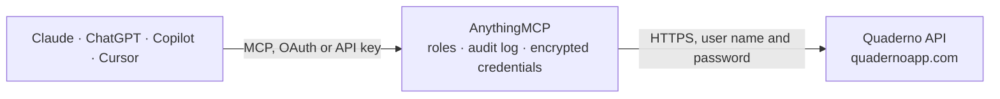

<!-- Generated by scripts/export-github-catalog.mjs in the anythingmcp-website repository. Do not edit by hand. -->

# Quaderno MCP connector

Run Quaderno tax and invoicing from your AI: calculate sales tax, VAT and GST for any location, validate VAT numbers, search contacts, invoices, credit notes, quotes, expenses and products, issue and … The AnythingMCP connector gives Claude, ChatGPT, Microsoft Copilot, Cursor and Gemini 22 MCP tools for Quaderno: 17 read and 5 can change data.

**Category:** [Accounting](../accounting.md) · **Tools:** 22 · **Setup guide:** [anythingmcp.com](https://anythingmcp.com/guides/quaderno-to-mcp) · [Deutsch](https://anythingmcp.com/de/guides/quaderno-to-mcp) · [Italiano](https://anythingmcp.com/it/guides/quaderno-to-mcp) · [Español](https://anythingmcp.com/es/guides/quaderno-to-mcp) · [日本語](https://anythingmcp.com/ja/guides/quaderno-to-mcp) · [Русский](https://anythingmcp.com/ru/guides/quaderno-to-mcp) · [中文](https://anythingmcp.com/zh/guides/quaderno-to-mcp)

## Start without code

No installation and no terminal: AnythingMCP Cloud runs the Quaderno connector for you, operated by helpcode.ai in Frankfurt, Germany.

1. **Click the button above** and create an account or sign in. The Quaderno connector opens, ready to install.
2. **Paste the API key or token from your Quaderno account.** Every click is in the [step-by-step guide](https://anythingmcp.com/guides/quaderno-to-mcp).
3. **Click Install.** AnythingMCP shows the address of your MCP server.
4. **Add that address to your assistant:** [Claude](https://anythingmcp.com/guides/connect-quaderno-to-claude) · [ChatGPT](https://anythingmcp.com/guides/connect-quaderno-to-chatgpt) · [Microsoft Copilot](https://anythingmcp.com/guides/connect-quaderno-to-copilot) · [Cursor](https://anythingmcp.com/guides/connect-quaderno-to-cursor) · [Gemini CLI](https://anythingmcp.com/guides/connect-quaderno-to-gemini) · [Meta Muse](https://anythingmcp.com/guides/connect-quaderno-to-muse).
5. **Ask your first question**, for example: *Show invoice INV-2026-110 for customer Müller GmbH from October 2026*

Prefer help with the setup? [Talk to us](https://anythingmcp.com/contact).

## How it works

- **The AI client** speaks MCP (Streamable HTTP) to AnythingMCP and only sees tool names, descriptions and results. It never gets the Quaderno credentials.
- **AnythingMCP** checks the client's role, builds the call from the tool definition, adds the credentials (user name and password), calls Quaderno, logs the call and returns the result.
- **Quaderno** sees an ordinary API client with the rights of the account the credentials belong to.

## Tools

| Tool | What it does | Access |
|---|---|---|
| [`quaderno_ping`](#quaderno_ping) | Check that the API key works and see the requests left in the current rate-limit window. | read |
| [`quaderno_list_contacts`](#quaderno_list_contacts) | List or search customers and suppliers (contacts) by name, email or tax id: id, kind (person or company), name, email, tax id and tax status, address and… | read |
| [`quaderno_get_contact`](#quaderno_get_contact) | Get one contact with full address, phone, website, language, default discount, notes and the link to their billing area. | read |
| [`quaderno_create_contact`](#quaderno_create_contact) | Create a customer or supplier contact. | write |
| [`quaderno_delete_contact`](#quaderno_delete_contact) | Delete one contact for good. | write |
| [`quaderno_list_invoices`](#quaderno_list_invoices) | List or search invoices by number, customer name or PO number, issue date range, state or customer: id, number, dates, state (outstanding, late,… | read |
| [`quaderno_get_invoice`](#quaderno_get_invoice) | Get one invoice in full: customer and billing address, line items with their taxes, the tax breakdown, payments, deliveries, alerts, the public link and the… | read |
| [`quaderno_create_invoice`](#quaderno_create_invoice) | Issue a new invoice. | write |
| [`quaderno_deliver_invoice`](#quaderno_deliver_invoice) | Email an invoice to its customer from Quaderno, with the PDF and the link to it. | write |
| [`quaderno_list_credit_notes`](#quaderno_list_credit_notes) | List or search credit notes (refunds and corrections of invoices) by number, customer name or PO number, issue date range or state: id, number, dates,… | read |
| [`quaderno_get_credit_note`](#quaderno_get_credit_note) | Get one credit note in full: customer, line items, tax breakdown, payments, deliveries, the related invoice, the public link and the PDF link. | read |
| [`quaderno_list_quotes`](#quaderno_list_quotes) | List or search quotes (Quaderno calls them proformas; they replaced estimates) by number, customer name or PO number, issue date range, state (outstanding,… | read |
| [`quaderno_get_quote`](#quaderno_get_quote) | Get one quote (proforma) in full: customer, line items, tax breakdown, validity, the public link and the PDF link. | read |
| [`quaderno_list_expenses`](#quaderno_list_expenses) | List or search expenses (purchase invoices from suppliers) by number, supplier name or PO number, issue date range, state or supplier: id, date, state,… | read |
| [`quaderno_list_products`](#quaderno_list_products) | List or search products (items) by name or code: id, code, name, description, unit cost, currency, kind (one-off or subscription), product type (good or… | read |
| [`quaderno_calculate_tax`](#quaderno_calculate_tax) | Calculate the sales tax, VAT or GST for a sale to a customer location: tax name, rate, taxable part, tax amount, subtotal and total, the jurisdiction… | read |
| [`quaderno_validate_tax_id`](#quaderno_validate_tax_id) | Check a business tax id against the official registry of its country (EU VIES, UK, Switzerland, Quebec, Australia, New Zealand): returns valid true, false,… | read |
| [`quaderno_list_tax_jurisdictions`](#quaderno_list_tax_jurisdictions) | List the tax jurisdictions Quaderno knows, optionally for one country or region: id, name, country and region. | read |
| [`quaderno_list_tax_codes`](#quaderno_list_tax_codes) | List the tax codes products can be classified with (e.g. eservice, saas, ebook, consulting, standard, reduced, exempt): id, name and what each covers. | read |
| [`quaderno_list_reports`](#quaderno_list_reports) | List the reports requested so far: id, type (tax_summary, invoices_list, credits_list), state, period, when it completed and the download URL. | read |
| [`quaderno_request_report`](#quaderno_request_report) | Ask Quaderno to build a report for a period: tax_summary (taxes collected per jurisdiction, for filing returns), invoices_list or credits_list. | write |
| [`quaderno_get_report`](#quaderno_get_report) | Check one report request: state (pending, suceeded or failed), period, when it completed and the report_url to download it once ready. | read |

## Tool reference

Every parameter as the AI client sees it in `tools/list`. Source: [`packages/backend/src/adapters/intl/quaderno.json`](../../../packages/backend/src/adapters/intl/quaderno.json).

### `quaderno_ping`

Check that the API key works and see the requests left in the current rate-limit window. Does not count as a real API call. Read-only.

**Access:** read · **Call:** `GET /ping`

No parameters.

### `quaderno_list_contacts`

List or search customers and suppliers (contacts) by name, email or tax id: id, kind (person or company), name, email, tax id and tax status, address and payment processor id. Newest first. Read-only.

**Access:** read · **Call:** `GET /contacts`

| Parameter | Type | Required | Description |
|---|---|---|---|
| `q` | string | no | Search in full name, email or tax id (case-sensitive). |
| `processor_id` | string | no | Only the contact with this payment processor id, e.g. a Stripe customer id. |
| `limit` | integer | no | Records per page, 1 to 100. Default 25. |
| `created_before` | integer | no | Next page: the id of the last record of the previous page. More pages exist while _headers.x-pages-hasmore is true. |

### `quaderno_get_contact`

Get one contact with full address, phone, website, language, default discount, notes and the link to their billing area. Read-only.

**Access:** read · **Call:** `GET /contacts/{contact_id}`

| Parameter | Type | Required | Description |
|---|---|---|---|
| `contact_id` | integer | yes | Contact id from quaderno_list_contacts. |

### `quaderno_create_contact`

Create a customer or supplier contact. For a company set kind to company and put the company name in first_name. Tax id and country decide how Quaderno taxes the contact. Before calling, show the user the details and confirm with the user first and wait for their yes.

**Access:** write · **Call:** `POST /contacts`

| Parameter | Type | Required | Description |
|---|---|---|---|
| `kind` | `person` \| `company` | no | person (default) or company. |
| `first_name` | string | yes | First name of a person, or the full name of a company. Required. |
| `last_name` | string | no | Last name of a person. |
| `contact_person` | string | no | Contact person at a company. |
| `email` | string | no | Email address, where invoices are delivered. |
| `tax_id` | string | no | VAT number or other tax id, e.g. DE123456789. |
| `tax_status` | `taxable` \| `exempt` \| `reverse` | no | taxable (default), exempt, or reverse for reverse charge. |
| `street_line_1` | string | no | Street address. |
| `street_line_2` | string | no | Apartment, suite or building. |
| `postal_code` | string | no | ZIP or postal code. |
| `city` | string | no | City. |
| `region` | string | no | State, province or region. |
| `country` | string | no | 2-letter ISO country code, e.g. DE. |
| `language` | string | no | 2-letter language code for documents sent to the contact, e.g. en. |
| `phone_1` | string | no | Phone number. |
| `notes` | string | no | Internal notes. |

### `quaderno_delete_contact`

Delete one contact for good. Installed switched off. Only when the user asks to delete that exact contact: show its name and tax id, confirm with the user first, and wait for their yes. Contacts with documents cannot be deleted.

**Access:** write · **Call:** `DELETE /contacts/{contact_id}`

| Parameter | Type | Required | Description |
|---|---|---|---|
| `contact_id` | integer | yes | Contact id from quaderno_list_contacts. |

### `quaderno_list_invoices`

List or search invoices by number, customer name or PO number, issue date range, state or customer: id, number, dates, state (outstanding, late, uncollectible, paid, refunded, archived), currency, amounts in cents, customer, country, tax id and the public link. Newest first. Read-only.

**Access:** read · **Call:** `GET /invoices`

| Parameter | Type | Required | Description |
|---|---|---|---|
| `q` | string | no | Search in invoice number, customer name or PO number. |
| `date` | string | no | Issue date range as from,to, e.g. 2026-01-01,2026-03-31. |
| `state` | `outstanding` \| `late` \| `uncollectible` \| `paid` | no | Only invoices in this state. |
| `contact` | integer | no | Only invoices of this contact id. |
| `processor_id` | string | no | Only the invoice with this payment processor id. |
| `limit` | integer | no | Records per page, 1 to 100. Default 25. |
| `created_before` | integer | no | Next page: the id of the last record of the previous page. More pages exist while _headers.x-pages-hasmore is true. |

### `quaderno_get_invoice`

Get one invoice in full: customer and billing address, line items with their taxes, the tax breakdown, payments, deliveries, alerts, the public link and the PDF link. Read-only.

**Access:** read · **Call:** `GET /invoices/{invoice_id}`

| Parameter | Type | Required | Description |
|---|---|---|---|
| `invoice_id` | integer | yes | Invoice id from quaderno_list_invoices. |

### `quaderno_create_invoice`

Issue a new invoice. Quaderno numbers it, calculates the taxes for the customer's location and tax status unless the items carry their own tax, and keeps it as a legal tax document: an issued invoice cannot be deleted, only voided or credited. Give contact as {"id": 123} for an existing contact or as new contact details. payment_method records full payment at once and marks it paid. Before calling, show the user the customer, items, prices and currency and confirm with the user first and wait for their yes. Creating does not email it; use quaderno_deliver_invoice for that.

**Access:** write · **Call:** `POST /invoices`

| Parameter | Type | Required | Description |
|---|---|---|---|
| `contact` | object | yes | The customer: {"id": 123} for an existing contact, or details such as {"first_name": "Acme GmbH", "kind": "company", "country": "DE", "tax_id": "DE123456789", "email": "billing@acme.example"}. |
| `items` | object[] | yes | Line items, each {"description": "...", "quantity": 1, "unit_price": 100.0} (or total_amount instead of unit_price), optionally product_code, discount_rate and tax_1_name, tax_1_rate, tax_1_country to override the tax. |
| `currency` | string | no | 3-letter currency code in upper case, e.g. EUR. Default: the account currency. |
| `issue_date` | string | no | Issue date, YYYY-MM-DD. Default today. |
| `due_date` | string | no | Payment due date, YYYY-MM-DD. |
| `po_number` | string | no | Customer's purchase order number. |
| `subject` | string | no | Short title shown on the invoice. |
| `notes` | string | no | Notes printed on the invoice. |
| `payment_details` | string | no | Payment instructions shown to the customer. |
| `tag_list` | string[] | no | Tags for filtering. |
| `payment_method` | `credit_card` \| `cash` \| `wire_transfer` \| `direct_debit` \| `check` \| `iou` \| `paypal` \| `offset` \| `other` | no | Only if the invoice is already paid in full: records the payment with this method. |

### `quaderno_deliver_invoice`

Email an invoice to its customer from Quaderno, with the PDF and the link to it. The customer receives it at once and it cannot be unsent; the contact needs an email address. Before calling, tell the user which invoice goes to which address and confirm with the user first and wait for their yes.

**Access:** write · **Call:** `GET /invoices/{invoice_id}/deliver`

| Parameter | Type | Required | Description |
|---|---|---|---|
| `invoice_id` | integer | yes | Invoice id from quaderno_list_invoices. |

### `quaderno_list_credit_notes`

List or search credit notes (refunds and corrections of invoices) by number, customer name or PO number, issue date range or state: id, number, dates, state, currency, amounts in cents, customer and link. Newest first. Read-only.

**Access:** read · **Call:** `GET /credits`

| Parameter | Type | Required | Description |
|---|---|---|---|
| `q` | string | no | Search in credit note number, customer name or PO number. |
| `date` | string | no | Issue date range as from,to, e.g. 2026-01-01,2026-03-31. |
| `state` | `outstanding` \| `late` \| `paid` | no | Only credit notes in this state. |
| `processor_id` | string | no | Only the credit note with this payment processor id. |
| `limit` | integer | no | Records per page, 1 to 100. Default 25. |
| `created_before` | integer | no | Next page: the id of the last record of the previous page. More pages exist while _headers.x-pages-hasmore is true. |

### `quaderno_get_credit_note`

Get one credit note in full: customer, line items, tax breakdown, payments, deliveries, the related invoice, the public link and the PDF link. Read-only.

**Access:** read · **Call:** `GET /credits/{credit_note_id}`

| Parameter | Type | Required | Description |
|---|---|---|---|
| `credit_note_id` | integer | yes | Credit note id from quaderno_list_credit_notes. |

### `quaderno_list_quotes`

List or search quotes (Quaderno calls them proformas; they replaced estimates) by number, customer name or PO number, issue date range, state (outstanding, accepted, declined, invoiced, late) or customer: id, number, dates, state, currency, amounts in cents, customer and link. Newest first. Read-only.

**Access:** read · **Call:** `GET /proformas`

| Parameter | Type | Required | Description |
|---|---|---|---|
| `q` | string | no | Search in quote number, customer name or PO number. |
| `date` | string | no | Issue date range as from,to, e.g. 2026-01-01,2026-03-31. |
| `state` | `outstanding` \| `accepted` \| `declined` \| `invoiced` \| `late` | no | Only quotes in this state. |
| `contact` | integer | no | Only quotes of this contact id. |
| `limit` | integer | no | Records per page, 1 to 100. Default 25. |
| `created_before` | integer | no | Next page: the id of the last record of the previous page. More pages exist while _headers.x-pages-hasmore is true. |

### `quaderno_get_quote`

Get one quote (proforma) in full: customer, line items, tax breakdown, validity, the public link and the PDF link. Read-only.

**Access:** read · **Call:** `GET /proformas/{quote_id}`

| Parameter | Type | Required | Description |
|---|---|---|---|
| `quote_id` | integer | yes | Quote id from quaderno_list_quotes. |

### `quaderno_list_expenses`

List or search expenses (purchase invoices from suppliers) by number, supplier name or PO number, issue date range, state or supplier: id, date, state, currency, amounts in cents, supplier and subject. Newest first. Read-only.

**Access:** read · **Call:** `GET /expenses`

| Parameter | Type | Required | Description |
|---|---|---|---|
| `q` | string | no | Search in expense number, supplier name or PO number. |
| `date` | string | no | Issue date range as from,to, e.g. 2026-01-01,2026-03-31. |
| `state` | `outstanding` \| `late` \| `paid` | no | Only expenses in this state. |
| `contact` | integer | no | Only expenses of this supplier contact id. |
| `limit` | integer | no | Records per page, 1 to 100. Default 25. |
| `created_before` | integer | no | Next page: the id of the last record of the previous page. More pages exist while _headers.x-pages-hasmore is true. |

### `quaderno_list_products`

List or search products (items) by name or code: id, code, name, description, unit cost, currency, kind (one-off or subscription), product type (good or service), tax class and stock. Read-only.

**Access:** read · **Call:** `GET /items`

| Parameter | Type | Required | Description |
|---|---|---|---|
| `q` | string | no | Search in product name or code (case-sensitive). |
| `limit` | integer | no | Records per page, 1 to 100. Default 25. |
| `created_before` | integer | no | Next page: the id of the last record of the previous page. More pages exist while _headers.x-pages-hasmore is true. |

### `quaderno_calculate_tax`

Calculate the sales tax, VAT or GST for a sale to a customer location: tax name, rate, taxable part, tax amount, subtotal and total, the jurisdiction (country, region, county, city) and a status with a notice, for example reverse charge for a valid EU VAT number. Calculates only, records nothing. Read-only.

**Access:** read · **Call:** `GET /tax_rates/calculate`

| Parameter | Type | Required | Description |
|---|---|---|---|
| `to_country` | string | yes | Customer's country, 2-letter ISO code, e.g. FR. Required. |
| `to_postal_code` | string | no | Customer's ZIP or postal code. Needed for the US, Canada and some regions. |
| `to_city` | string | no | Customer's city. Recommended for US sales tax. |
| `to_street` | string | no | Customer's street address. Recommended for US sales tax. |
| `tax_id` | string | no | Customer's tax id, e.g. an EU VAT number; Quaderno validates it. |
| `tax_code` | `consulting` \| `eservice` \| `ebook` \| `saas` \| `standard` \| `reduced` \| `exempt` | no | What is sold. Default: the account's default tax code. See quaderno_list_tax_codes. |
| `product_type` | `good` \| `service` | no | Good or service. Default: the account default. |
| `amount` | number | no | Amount of the sale, in the currency unit (e.g. 99.90), to get the tax amount and total. |
| `tax_behavior` | `inclusive` \| `exclusive` | no | Whether amount already includes tax. |
| `currency` | string | no | 3-letter currency code. Default: the account currency. |
| `date` | string | no | Date of the sale, YYYY-MM-DD. Default today. |
| `from_country` | string | no | Seller's country, 2-letter ISO code. Default: the account's country. |
| `from_postal_code` | string | no | Seller's postal code. Default: the account's. |

### `quaderno_validate_tax_id`

Check a business tax id against the official registry of its country (EU VIES, UK, Switzerland, Quebec, Australia, New Zealand): returns valid true, false, or null when the registry could not be reached. Read-only.

**Access:** read · **Call:** `GET /tax_ids/validate`

| Parameter | Type | Required | Description |
|---|---|---|---|
| `country` | string | yes | Country of registration, 2-letter ISO code, e.g. DE. |
| `tax_id` | string | yes | The tax id, e.g. DE123456789. |

### `quaderno_list_tax_jurisdictions`

List the tax jurisdictions Quaderno knows, optionally for one country or region: id, name, country and region. Read-only.

**Access:** read · **Call:** `GET /jurisdictions`

| Parameter | Type | Required | Description |
|---|---|---|---|
| `country` | string | no | 2-letter ISO country code, upper case, e.g. CA. |
| `region` | string | no | Region code, e.g. BC, or none for jurisdictions without a region. |

### `quaderno_list_tax_codes`

List the tax codes products can be classified with (e.g. eservice, saas, ebook, consulting, standard, reduced, exempt): id, name and what each covers. Read-only.

**Access:** read · **Call:** `GET /tax_codes`

No parameters.

### `quaderno_list_reports`

List the reports requested so far: id, type (tax_summary, invoices_list, credits_list), state, period, when it completed and the download URL. Read-only.

**Access:** read · **Call:** `GET /reporting/requests`

No parameters.

### `quaderno_request_report`

Ask Quaderno to build a report for a period: tax_summary (taxes collected per jurisdiction, for filing returns), invoices_list or credits_list. It is built in the background; check it with quaderno_get_report until state is no longer pending, then use report_url. Before calling, tell the user the report type and period and confirm with the user first and wait for their yes.

**Access:** write · **Call:** `POST /reporting/requests`

| Parameter | Type | Required | Description |
|---|---|---|---|
| `report_type` | `tax_summary` \| `invoices_list` \| `credits_list` | yes | Which report. |
| `from_date` | string | yes | First day of the period, YYYY-MM-DD. |
| `to_date` | string | yes | Last day of the period, YYYY-MM-DD. |

### `quaderno_get_report`

Check one report request: state (pending, suceeded or failed), period, when it completed and the report_url to download it once ready. Read-only.

**Access:** read · **Call:** `GET /reporting/requests/{report_id}`

| Parameter | Type | Required | Description |
|---|---|---|---|
| `report_id` | integer | yes | Report request id from quaderno_list_reports or quaderno_request_report. |

## Run it yourself

AnythingMCP is open source (AGPL-3.0). [Run it with Docker](../../../README.md#run-it-yourself), open **Connectors → Store**, pick **Quaderno** and enter `QUADERNO_ACCOUNT_NAME`, `QUADERNO_API_KEY`, then add your MCP server URL to the AI client.

[← Accounting connectors](../accounting.md) · [All categories](../README.md)
