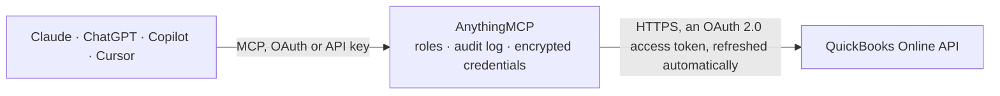

<!-- Generated by scripts/export-github-catalog.mjs in the anythingmcp-website repository. Do not edit by hand. -->

# QuickBooks Online MCP connector

Let your AI work with QuickBooks Online: query customers, vendors, items, invoices, bills, payments and accounts, read single records, run Profit and Loss, Balance Sheet and aged receivables and … The AnythingMCP connector gives Claude, ChatGPT, Microsoft Copilot, Cursor and Gemini 17 MCP tools for QuickBooks Online: 12 read and 5 can change data.

**Category:** [Accounting](../accounting.md) · **Tools:** 17 · **Setup guide:** [anythingmcp.com](https://anythingmcp.com/guides/quickbooks-online-to-mcp) · [Deutsch](https://anythingmcp.com/de/guides/quickbooks-online-to-mcp) · [Italiano](https://anythingmcp.com/it/guides/quickbooks-online-to-mcp) · [Español](https://anythingmcp.com/es/guides/quickbooks-online-to-mcp) · [日本語](https://anythingmcp.com/ja/guides/quickbooks-online-to-mcp) · [Русский](https://anythingmcp.com/ru/guides/quickbooks-online-to-mcp) · [中文](https://anythingmcp.com/zh/guides/quickbooks-online-to-mcp)

## Start without code

No installation and no terminal: AnythingMCP Cloud runs the QuickBooks Online connector for you, operated by helpcode.ai in Frankfurt, Germany.

1. **Click the button above** and create an account or sign in. The QuickBooks Online connector opens, ready to install.
2. **Sign in with your QuickBooks Online account** when AnythingMCP asks. The first time, an admin creates a small app in the QuickBooks Online developer console. Every click is in the [step-by-step guide](https://anythingmcp.com/guides/quickbooks-online-to-mcp).
3. **Click Install.** AnythingMCP shows the address of your MCP server.
4. **Add that address to your assistant:** [Claude](https://anythingmcp.com/guides/connect-quickbooks-online-to-claude) · [ChatGPT](https://anythingmcp.com/guides/connect-quickbooks-online-to-chatgpt) · [Microsoft Copilot](https://anythingmcp.com/guides/connect-quickbooks-online-to-copilot) · [Cursor](https://anythingmcp.com/guides/connect-quickbooks-online-to-cursor) · [Gemini CLI](https://anythingmcp.com/guides/connect-quickbooks-online-to-gemini) · [Meta Muse](https://anythingmcp.com/guides/connect-quickbooks-online-to-muse).
5. **Ask your first question**, for example: *Show invoice INV-2026-110 and its current balance and due date*

Prefer help with the setup? [Talk to us](https://anythingmcp.com/contact).

## How it works

- **The AI client** speaks MCP (Streamable HTTP) to AnythingMCP and only sees tool names, descriptions and results. It never gets the QuickBooks Online credentials.
- **AnythingMCP** checks the client's role, builds the call from the tool definition, adds the credentials (an OAuth 2.0 access token, refreshed automatically), calls QuickBooks Online, logs the call and returns the result.
- **QuickBooks Online** sees an ordinary API client with the rights of the account the credentials belong to.

## Tools

| Tool | What it does | Access |
|---|---|---|
| [`qbo_get_company_info`](#qbo_get_company_info) | Read the connected company: CompanyName, LegalName, addresses, email, phone, Country, FiscalYearStartMonth, the company's start date and its settings. | read |
| [`qbo_query`](#qbo_query) | Run a read-only QuickBooks query (SQL-like, one entity, no joins): e.g. "select * from Invoice where Balance > '0' orderby DueDate startposition 1… | read |
| [`qbo_get_customer`](#qbo_get_customer) | Read one customer by its Id (the numeric Id from qbo_query, not a document number or name), with contact details, addresses, Balance and terms. | read |
| [`qbo_get_invoice`](#qbo_get_invoice) | Read one invoice by its Id (the numeric Id from qbo_query, not a document number or name), with its lines, totals, Balance, due date, EmailStatus and linked… | read |
| [`qbo_get_item`](#qbo_get_item) | Read one item (product or service) by its Id (the numeric Id from qbo_query, not a document number or name), with prices, income and expense accounts and,… | read |
| [`qbo_get_vendor`](#qbo_get_vendor) | Read one vendor by its Id (the numeric Id from qbo_query, not a document number or name), with contact details, addresses and Balance. | read |
| [`qbo_get_bill`](#qbo_get_bill) | Read one bill (a vendor's invoice to the company) by its Id (the numeric Id from qbo_query, not a document number or name), with its lines, due date and… | read |
| [`qbo_get_payment`](#qbo_get_payment) | Read one customer payment by its Id (the numeric Id from qbo_query, not a document number or name), with the invoices it was applied to (Line.LinkedTxn). | read |
| [`qbo_create_customer`](#qbo_create_customer) | Create a customer. | write |
| [`qbo_update_customer`](#qbo_update_customer) | Change some fields of a customer (sparse update); fields not named keep their values. | write |
| [`qbo_create_invoice`](#qbo_create_invoice) | Create an invoice for a customer. | write |
| [`qbo_send_invoice`](#qbo_send_invoice) | Email an invoice to the customer as a PDF from QuickBooks, to the invoice's BillEmail or to send_to (which also becomes the invoice's BillEmail). | write |
| [`qbo_delete_invoice`](#qbo_delete_invoice) | Delete an invoice permanently (it disappears from reports; QuickBooks keeps it in the audit log). | write |
| [`qbo_report_profit_and_loss`](#qbo_report_profit_and_loss) | Profit and Loss report (income, cost of goods sold, expenses, net income) for a period, as QuickBooks' report JSON: Header, Columns and nested Rows with… | read |
| [`qbo_report_balance_sheet`](#qbo_report_balance_sheet) | Balance Sheet report (assets, liabilities, equity) as of the end of a period, as QuickBooks' report JSON with nested Rows. | read |
| [`qbo_report_aged_receivables`](#qbo_report_aged_receivables) | Aged Receivables summary: what each customer owes, split into Current, 1-30, 31-60, 61-90 and 91+ days past due, as of report_date (default today). | read |
| [`qbo_report_aged_payables`](#qbo_report_aged_payables) | Aged Payables summary: what the company owes each vendor, split into Current, 1-30, 31-60, 61-90 and 91+ days past due, as of report_date (default today). | read |

## Tool reference

Every parameter as the AI client sees it in `tools/list`. Source: [`packages/backend/src/adapters/intl/quickbooks-online.json`](../../../packages/backend/src/adapters/intl/quickbooks-online.json).

### `qbo_get_company_info`

Read the connected company: CompanyName, LegalName, addresses, email, phone, Country, FiscalYearStartMonth, the company's start date and its settings. Call it first to confirm which company (realm) the connector reads.

**Access:** read · **Call:** `GET /companyinfo/{QBO_REALM_ID}`

No parameters.

### `qbo_query`

Run a read-only QuickBooks query (SQL-like, one entity, no joins): e.g. "select * from Invoice where Balance > '0' orderby DueDate startposition 1 maxresults 100", "select Id, DisplayName, Balance from Customer where Active = true", "select count(*) from Bill where TxnDate >= '2026-01-01'". Returns QueryResponse with the entity list, startPosition and maxResults. Page with STARTPOSITION (1-based) and MAXRESULTS (up to 1000).

**Access:** read · **Call:** `GET /query`

| Parameter | Type | Required | Description |
|---|---|---|---|
| `query` | string | yes | The query. Grammar: SELECT * \| Field1, Field2 \| COUNT(*) FROM Entity [WHERE Field op value [AND Field op value ...]] [ORDERBY Field [ASC\|DESC]] [STARTPOSITION n] [MAXRESULTS n]. Operators: =, <, >, <=, >=, IN ('a','b'), LIKE '%text%' (on names). Strings and dates in single quotes, a quote inside as \'. No OR, no JOIN, no GROUP BY. Entities: Customer, Vendor, Employee, Item, Account, Invoice, Estimate, SalesReceipt, Payment, CreditMemo, RefundReceipt, Bill, BillPayment, Purchase, PurchaseOrder, VendorCredit, Deposit, Transfer, JournalEntry, TimeActivity, Class, Department, Term, TaxCode, TaxRate, PaymentMethod, CompanyCurrency. |

### `qbo_get_customer`

Read one customer by its Id (the numeric Id from qbo_query, not a document number or name), with contact details, addresses, Balance and terms. Returns {"Customer": {...}} with every field, including SyncToken.

**Access:** read · **Call:** `GET /customer/{id}`

| Parameter | Type | Required | Description |
|---|---|---|---|
| `id` | string | yes | The customer's Id, e.g. "42". |

### `qbo_get_invoice`

Read one invoice by its Id (the numeric Id from qbo_query, not a document number or name), with its lines, totals, Balance, due date, EmailStatus and linked payments. Returns {"Invoice": {...}} with every field, including SyncToken.

**Access:** read · **Call:** `GET /invoice/{id}`

| Parameter | Type | Required | Description |
|---|---|---|---|
| `id` | string | yes | The invoice's Id, e.g. "42". |

### `qbo_get_item`

Read one item (product or service) by its Id (the numeric Id from qbo_query, not a document number or name), with prices, income and expense accounts and, for inventory items, QtyOnHand. Returns {"Item": {...}} with every field, including SyncToken.

**Access:** read · **Call:** `GET /item/{id}`

| Parameter | Type | Required | Description |
|---|---|---|---|
| `id` | string | yes | The item (product or service)'s Id, e.g. "42". |

### `qbo_get_vendor`

Read one vendor by its Id (the numeric Id from qbo_query, not a document number or name), with contact details, addresses and Balance. Returns {"Vendor": {...}} with every field, including SyncToken.

**Access:** read · **Call:** `GET /vendor/{id}`

| Parameter | Type | Required | Description |
|---|---|---|---|
| `id` | string | yes | The vendor's Id, e.g. "42". |

### `qbo_get_bill`

Read one bill (a vendor's invoice to the company) by its Id (the numeric Id from qbo_query, not a document number or name), with its lines, due date and Balance. Returns {"Bill": {...}} with every field, including SyncToken.

**Access:** read · **Call:** `GET /bill/{id}`

| Parameter | Type | Required | Description |
|---|---|---|---|
| `id` | string | yes | The bill (a vendor's invoice to the company)'s Id, e.g. "42". |

### `qbo_get_payment`

Read one customer payment by its Id (the numeric Id from qbo_query, not a document number or name), with the invoices it was applied to (Line.LinkedTxn). Returns {"Payment": {...}} with every field, including SyncToken.

**Access:** read · **Call:** `GET /payment/{id}`

| Parameter | Type | Required | Description |
|---|---|---|---|
| `id` | string | yes | The customer payment's Id, e.g. "42". |

### `qbo_create_customer`

Create a customer. DisplayName must be unique across customers, vendors and employees (error 6240 otherwise; search with qbo_query first). Returns {"Customer": {...}} with the new Id.

**Access:** write · **Call:** `POST /customer`

| Parameter | Type | Required | Description |
|---|---|---|---|
| `display_name` | string | yes | Unique display name, e.g. "Acme GmbH" or "Ana Diaz". No colon (:), tab or line break: QuickBooks rejects them with error 2040 (a colon separates sub-customers). |
| `company_name` | string | no | Company name. |
| `given_name` | string | no | First name of the contact person. |
| `family_name` | string | no | Last name of the contact person. |
| `primary_email_addr` | object | no | Email, e.g. {"Address": "billing@acme.example"}. |
| `primary_phone` | object | no | Phone, e.g. {"FreeFormNumber": "+49 761 1234567"}. |
| `bill_addr` | object | no | Billing address, e.g. {"Line1": "Hauptstr. 1", "City": "Freiburg", "PostalCode": "79098", "Country": "DE"}. |
| `notes` | string | no | Free-form notes on the customer. |
| `additional_fields` | object | no | Any other Customer fields as QuickBooks names them, e.g. {"CurrencyRef": {"value": "EUR"}, "SalesTermRef": {"value": "3"}, "Taxable": true}. |

### `qbo_update_customer`

Change some fields of a customer (sparse update); fields not named keep their values. Needs the customer's Id and current SyncToken from qbo_get_customer. Set active false to make a customer inactive (QuickBooks does not delete customers). Returns the updated customer with its new SyncToken.

**Access:** write · **Call:** `POST /customer`

| Parameter | Type | Required | Description |
|---|---|---|---|
| `id` | string | yes | The customer's Id. |
| `sync_token` | string | yes | The SyncToken from the latest read of the customer; a stale one fails with error 5010. |
| `display_name` | string | no | New display name, unique, without colon (:), tab or line break. |
| `active` | boolean | no | false makes the customer inactive (hidden from lists), true reactivates it. |
| `additional_fields` | object | no | Other fields to set, e.g. {"PrimaryEmailAddr": {"Address": "new@acme.example"}, "Notes": "..."}. |

### `qbo_create_invoice`

Create an invoice for a customer. It is booked right away (QuickBooks has no draft invoices) and is not emailed. Lines reference items by Id, e.g. [{"DetailType": "SalesItemLineDetail", "Amount": 200, "Description": "Consulting", "SalesItemLineDetail": {"ItemRef": {"value": "1"}, "Qty": 2, "UnitPrice": 100}}]. Returns {"Invoice": {...}} with Id, DocNumber and TotalAmt.

**Access:** write · **Call:** `POST /invoice`

| Parameter | Type | Required | Description |
|---|---|---|---|
| `customer_id` | string | yes | The customer's Id (qbo_query on Customer). |
| `lines` | object[] | yes | Invoice lines in QuickBooks format. Each SalesItemLineDetail line needs Amount (= Qty x UnitPrice) and ItemRef.value (an Item Id from qbo_query on Item); a DescriptionOnly line holds text. |
| `txn_date` | string | no | Invoice date, YYYY-MM-DD (default today). |
| `due_date` | string | no | Due date, YYYY-MM-DD (default from the customer's terms). |
| `doc_number` | string | no | Invoice number; leave empty to let QuickBooks number it when custom transaction numbers are off. |
| `bill_email` | object | no | Recipient for a later qbo_send_invoice, e.g. {"Address": "billing@acme.example"}. |
| `private_note` | string | no | Internal memo, not shown to the customer. |
| `additional_fields` | object | no | Other Invoice fields, e.g. {"CustomerMemo": {"value": "Thank you!"}, "SalesTermRef": {"value": "3"}, "CurrencyRef": {"value": "EUR"}, "TxnTaxDetail": {...}}. |

### `qbo_send_invoice`

Email an invoice to the customer as a PDF from QuickBooks, to the invoice's BillEmail or to send_to (which also becomes the invoice's BillEmail). Sets EmailStatus to EmailSent. Installed switched off: it sends email to a customer in the company's name.

**Access:** write · **Call:** `POST /invoice/{id}/send`

| Parameter | Type | Required | Description |
|---|---|---|---|
| `id` | string | yes | The invoice's Id. |
| `send_to` | string | no | Optional recipient address; default: the invoice's BillEmail. |

### `qbo_delete_invoice`

Delete an invoice permanently (it disappears from reports; QuickBooks keeps it in the audit log). Needs Id and the current SyncToken from qbo_get_invoice. Installed switched off.

**Access:** write · **Call:** `POST /invoice`

| Parameter | Type | Required | Description |
|---|---|---|---|
| `id` | string | yes | The invoice's Id. |
| `sync_token` | string | yes | The invoice's current SyncToken. |

### `qbo_report_profit_and_loss`

Profit and Loss report (income, cost of goods sold, expenses, net income) for a period, as QuickBooks' report JSON: Header, Columns and nested Rows with ColData values. Use start_date and end_date or date_macro; summarize_column_by "Month" gives one column per month.

**Access:** read · **Call:** `GET /reports/ProfitAndLoss`

| Parameter | Type | Required | Description |
|---|---|---|---|
| `start_date` | string | no | First day, YYYY-MM-DD. With end_date; or use date_macro instead. |
| `end_date` | string | no | Last day, YYYY-MM-DD. |
| `date_macro` | `Today` \| `Yesterday` \| `This Week` \| `Last Week` \| `This Week-to-date` \| `This Month` \| `Last Month` \| `This Month-to-date` \| `This Fiscal Quarter` \| `Last Fiscal Quarter` \| `This Fiscal Quarter-to-date` \| `This Fiscal Year` \| `Last Fiscal Year` \| `This Fiscal Year-to-date` \| `This Calendar Year` \| `Last Calendar Year` \| `This Calendar Year-to-date` | no | A named period instead of start_date and end_date, e.g. "This Fiscal Year", "Last Month", "This Quarter-to-date", "Last Year". |
| `accounting_method` | `Accrual` \| `Cash` | no | "Accrual" or "Cash" (default: the company's preference). |
| `summarize_column_by` | `Total` \| `Month` \| `Week` \| `Days` \| `Quarter` \| `Year` \| `Customers` \| `Vendors` \| `Classes` \| `Departments` \| `Employees` \| `ProductsAndServices` | no | Columns of the report: "Total" (default), or one per Month, Quarter, Year, Week, Days, or per Customers, Vendors, Classes, Departments, ProductsAndServices. |
| `customer` | string | no | Optional customer Id(s), comma-separated, to filter. |
| `department` | string | no | Optional department (location) Id(s), comma-separated. |

### `qbo_report_balance_sheet`

Balance Sheet report (assets, liabilities, equity) as of the end of a period, as QuickBooks' report JSON with nested Rows. Use start_date and end_date or date_macro; summarize_column_by "Month" or "Quarter" compares periods.

**Access:** read · **Call:** `GET /reports/BalanceSheet`

| Parameter | Type | Required | Description |
|---|---|---|---|
| `start_date` | string | no | First day, YYYY-MM-DD. With end_date; or use date_macro instead. |
| `end_date` | string | no | Last day, YYYY-MM-DD. |
| `date_macro` | `Today` \| `Yesterday` \| `This Week` \| `Last Week` \| `This Week-to-date` \| `This Month` \| `Last Month` \| `This Month-to-date` \| `This Fiscal Quarter` \| `Last Fiscal Quarter` \| `This Fiscal Quarter-to-date` \| `This Fiscal Year` \| `Last Fiscal Year` \| `This Fiscal Year-to-date` \| `This Calendar Year` \| `Last Calendar Year` \| `This Calendar Year-to-date` | no | A named period instead of start_date and end_date, e.g. "This Fiscal Year", "Last Month", "This Quarter-to-date", "Last Year". |
| `accounting_method` | `Accrual` \| `Cash` | no | "Accrual" or "Cash" (default: the company's preference). |
| `summarize_column_by` | `Total` \| `Month` \| `Week` \| `Days` \| `Quarter` \| `Year` \| `Customers` \| `Vendors` \| `Classes` \| `Departments` \| `Employees` \| `ProductsAndServices` | no | Columns of the report: "Total" (default), or one per Month, Quarter, Year, Week, Days, or per Customers, Vendors, Classes, Departments, ProductsAndServices. |

### `qbo_report_aged_receivables`

Aged Receivables summary: what each customer owes, split into Current, 1-30, 31-60, 61-90 and 91+ days past due, as of report_date (default today).

**Access:** read · **Call:** `GET /reports/AgedReceivables`

| Parameter | Type | Required | Description |
|---|---|---|---|
| `report_date` | string | no | As-of date, YYYY-MM-DD (default today). |
| `aging_period` | integer | no | Days per aging column (default 30). |
| `num_periods` | integer | no | Number of aging columns (default 4). |
| `customer` | string | no | Optional customer Id(s), comma-separated. |

### `qbo_report_aged_payables`

Aged Payables summary: what the company owes each vendor, split into Current, 1-30, 31-60, 61-90 and 91+ days past due, as of report_date (default today).

**Access:** read · **Call:** `GET /reports/AgedPayables`

| Parameter | Type | Required | Description |
|---|---|---|---|
| `report_date` | string | no | As-of date, YYYY-MM-DD (default today). |
| `aging_period` | integer | no | Days per aging column (default 30). |
| `num_periods` | integer | no | Number of aging columns (default 4). |
| `vendor` | string | no | Optional vendor Id(s), comma-separated. |

## Run it yourself

AnythingMCP is open source (AGPL-3.0). [Run it with Docker](../../../README.md#run-it-yourself), open **Connectors → Store**, pick **QuickBooks Online** and enter `QBO_CLIENT_ID`, `QBO_CLIENT_SECRET`, `QBO_REALM_ID`, `QBO_API_URL`, then add your MCP server URL to the AI client.

[← Accounting connectors](../accounting.md) · [All categories](../README.md)
