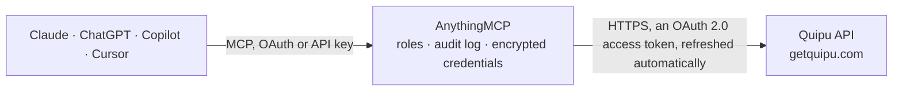

<!-- Generated by scripts/export-github-catalog.mjs in the anythingmcp-website repository. Do not edit by hand. -->

# Quipu MCP connector

Quipu — Spanish invoicing and bookkeeping for autónomos and small companies: issued and received invoices, contacts, book entries and accounting categories. The AnythingMCP connector gives Claude, ChatGPT, Microsoft Copilot, Cursor and Gemini 7 MCP tools for Quipu, all read-only.

**Category:** [Accounting](../accounting.md) · **Tools:** 7 · **Setup guide:** [anythingmcp.com](https://anythingmcp.com/guides/quipu-to-mcp) · [Deutsch](https://anythingmcp.com/de/guides/quipu-to-mcp) · [Italiano](https://anythingmcp.com/it/guides/quipu-to-mcp) · [Español](https://anythingmcp.com/es/guides/quipu-to-mcp) · [日本語](https://anythingmcp.com/ja/guides/quipu-to-mcp) · [Русский](https://anythingmcp.com/ru/guides/quipu-to-mcp) · [中文](https://anythingmcp.com/zh/guides/quipu-to-mcp)

## Start without code

No installation and no terminal: AnythingMCP Cloud runs the Quipu connector for you, operated by helpcode.ai in Frankfurt, Germany.

1. **Click the button above** and create an account or sign in. The Quipu connector opens, ready to install.
2. **Sign in with your Quipu account** when AnythingMCP asks. The first time, an admin creates a small app in the Quipu developer console. Every click is in the [step-by-step guide](https://anythingmcp.com/guides/quipu-to-mcp).
3. **Click Install.** AnythingMCP shows the address of your MCP server.
4. **Add that address to your assistant:** [Claude](https://anythingmcp.com/guides/connect-quipu-to-claude) · [ChatGPT](https://anythingmcp.com/guides/connect-quipu-to-chatgpt) · [Microsoft Copilot](https://anythingmcp.com/guides/connect-quipu-to-copilot) · [Cursor](https://anythingmcp.com/guides/connect-quipu-to-cursor) · [Gemini CLI](https://anythingmcp.com/guides/connect-quipu-to-gemini) · [Meta Muse](https://anythingmcp.com/guides/connect-quipu-to-muse).
5. **Ask your first question**, for example: *What is invoice FAC-2026-118 issued to Taller Norte, show date, total, IVA, IRPF and payment status*

Prefer help with the setup? [Talk to us](https://anythingmcp.com/contact).

## How it works

- **The AI client** speaks MCP (Streamable HTTP) to AnythingMCP and only sees tool names, descriptions and results. It never gets the Quipu credentials.
- **AnythingMCP** checks the client's role, builds the call from the tool definition, adds the credentials (an OAuth 2.0 access token, refreshed automatically), calls Quipu, logs the call and returns the result.
- **Quipu** sees an ordinary API client with the rights of the account the credentials belong to.

## Tools

| Tool | What it does | Access |
|---|---|---|
| [`quipu_list_contacts`](#quipu_list_contacts) | List contacts — customers and suppliers — with their name, NIF, address and the country they invoice from. | read |
| [`quipu_get_contact`](#quipu_get_contact) | Read one contact by id, with their full tax data, address and the default payment terms recorded against them. | read |
| [`quipu_list_invoices`](#quipu_list_invoices) | List issued invoices with their number, date, contact, IVA and IRPF amounts, total and payment state — the revenue side. | read |
| [`quipu_get_invoice`](#quipu_get_invoice) | Read one issued invoice in full: every line with its quantity, price, IVA rate and IRPF retention, plus the totals and the payments applied. | read |
| [`quipu_list_expenses`](#quipu_list_expenses) | List received supplier invoices (Quipu's invoices of kind `expenses`) with their date, supplier, category, IVA and total — the cost side of the ledger. | read |
| [`quipu_list_book_entries`](#quipu_list_book_entries) | List all book entries in one place — invoices, tickets (simplified receipts), paysheets and additional incomes — with number, date, counterpart and totals. | read |
| [`quipu_list_accounting_categories`](#quipu_list_accounting_categories) | List the accounting categories expenses are filed under, so a cost breakdown uses the categories the bookkeeper actually uses. | read |

## Tool reference

Every parameter as the AI client sees it in `tools/list`. Source: [`packages/backend/src/adapters/es/quipu.json`](../../../packages/backend/src/adapters/es/quipu.json).

### `quipu_list_contacts`

List contacts — customers and suppliers — with their name, NIF, address and the country they invoice from.

**Access:** read · **Call:** `GET /contacts`

| Parameter | Type | Required | Description |
|---|---|---|---|
| `page_number` | number | no | Page number, starting at 1. |
| `page_size` | number | no | Rows per page, 1 to 100 (default 25). |
| `q` | string | no | Free-text search across contact fields (name, NIF, e-mail…). |
| `kind` | `client` \| `supplier` \| `employee` | no | Only contacts of this kind. |

### `quipu_get_contact`

Read one contact by id, with their full tax data, address and the default payment terms recorded against them.

**Access:** read · **Call:** `GET /contacts/{contactId}`

| Parameter | Type | Required | Description |
|---|---|---|---|
| `contactId` | string | yes | Quipu contact id. |

### `quipu_list_invoices`

List issued invoices with their number, date, contact, IVA and IRPF amounts, total and payment state — the revenue side.

**Access:** read · **Call:** `GET /invoices`

| Parameter | Type | Required | Description |
|---|---|---|---|
| `page_number` | number | no | Page number, starting at 1. |
| `page_size` | number | no | Rows per page, 1 to 100 (default 25). |
| `period` | string | no | Period to filter by: a quarter like 2026Q1 or a month like 2026-09. |
| `payment_status` | `paid` \| `unpaid` \| `due` \| `pending` | no | Payment state. `unpaid` covers both pending and overdue. |
| `q` | string | no | Free-text search. |
| `contact_id` | string | no | Only entries of this contact id. |
| `include` | string | no | Relationships to resolve inline, comma-separated. Allowed: items, contact, accounting_category, accounting_subcategory, items.accounting_category, items.accounting_subcategory. |

### `quipu_get_invoice`

Read one issued invoice in full: every line with its quantity, price, IVA rate and IRPF retention, plus the totals and the payments applied.

**Access:** read · **Call:** `GET /invoices/{invoiceId}`

| Parameter | Type | Required | Description |
|---|---|---|---|
| `invoiceId` | string | yes | Quipu invoice id. |
| `include` | string | no | Relationships to resolve inline, comma-separated. Allowed: items, contact, accounting_category, accounting_subcategory, items.accounting_category, items.accounting_subcategory. |

### `quipu_list_expenses`

List received supplier invoices (Quipu's invoices of kind `expenses`) with their date, supplier, category, IVA and total — the cost side of the ledger. Tickets and paysheets are in quipu_list_book_entries.

**Access:** read · **Call:** `GET /invoices`

| Parameter | Type | Required | Description |
|---|---|---|---|
| `page_number` | number | no | Page number, starting at 1. |
| `page_size` | number | no | Rows per page, 1 to 100 (default 25). |
| `period` | string | no | Period to filter by: a quarter like 2026Q1 or a month like 2026-09. |
| `payment_status` | `paid` \| `unpaid` \| `due` \| `pending` | no | Payment state. `unpaid` covers both pending and overdue. |
| `q` | string | no | Free-text search. |
| `contact_id` | string | no | Only entries of this contact id. |
| `include` | string | no | Relationships to resolve inline, comma-separated. Allowed: items, contact, accounting_category, accounting_subcategory, items.accounting_category, items.accounting_subcategory. |

### `quipu_list_book_entries`

List all book entries in one place — invoices, tickets (simplified receipts), paysheets and additional incomes — with number, date, counterpart and totals. Use it when a question spans more than full invoices, e.g. every cost of a quarter.

**Access:** read · **Call:** `GET /book_entries`

| Parameter | Type | Required | Description |
|---|---|---|---|
| `page_number` | number | no | Page number, starting at 1. |
| `page_size` | number | no | Rows per page, 1 to 100 (default 25). |
| `type` | `invoices` \| `tickets` \| `paysheets` \| `additional_incomes` | no | Only entries of this type. |
| `kind` | `income` \| `expenses` | no | Income or expenses. |
| `period` | string | no | Period to filter by: a quarter like 2026Q1 or a month like 2026-09. |
| `payment_status` | `paid` \| `unpaid` \| `due` \| `pending` | no | Payment state. `unpaid` covers both pending and overdue. |
| `q` | string | no | Free-text search. |
| `contact_id` | string | no | Only entries of this contact id. |
| `sort` | `number` \| `-number` \| `issue_date` \| `-issue_date` \| `counterpart_name` \| `-counterpart_name` \| `total_amount` \| `-total_amount` \| `total_amount_without_taxes` \| `-total_amount_without_taxes` | no | Sort field; `-` prefix for descending. |
| `include` | string | no | Relationships to resolve inline, comma-separated. Allowed: items, contact, accounting_category, accounting_subcategory, items.accounting_category, items.accounting_subcategory. |

### `quipu_list_accounting_categories`

List the accounting categories expenses are filed under, so a cost breakdown uses the categories the bookkeeper actually uses.

**Access:** read · **Call:** `GET /accounting_categories`

| Parameter | Type | Required | Description |
|---|---|---|---|
| `page_number` | number | no | Page number, starting at 1. |
| `page_size` | number | no | Rows per page, 1 to 100 (default 25). |
| `kind` | string | no | Comma-separated kinds: expenses, income, assets, capital, creditor_debitor, financial. |

## Run it yourself

AnythingMCP is open source (AGPL-3.0). [Run it with Docker](../../../README.md#run-it-yourself), open **Connectors → Store**, pick **Quipu** and enter `QUIPU_CLIENT_ID`, `QUIPU_CLIENT_SECRET`, then add your MCP server URL to the AI client.

[← Accounting connectors](../accounting.md) · [All categories](../README.md)
