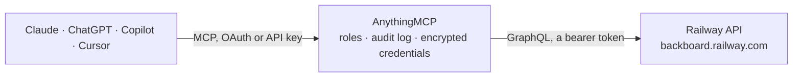

<!-- Generated by scripts/export-github-catalog.mjs in the anythingmcp-website repository. Do not edit by hand. -->

# Railway MCP connector

Let your AI look after your Railway apps: list projects, environments and services, check deployments and read their build and runtime logs, see which environment variables are set (names only), … The AnythingMCP connector gives Claude, ChatGPT, Microsoft Copilot, Cursor and Gemini 14 MCP tools for Railway: 12 read and 2 can change data.

**Category:** [Infrastructure](../infrastructure.md) · **Tools:** 14 · **Setup guide:** [anythingmcp.com](https://anythingmcp.com/guides/railway-to-mcp) · [Deutsch](https://anythingmcp.com/de/guides/railway-to-mcp) · [Italiano](https://anythingmcp.com/it/guides/railway-to-mcp) · [Español](https://anythingmcp.com/es/guides/railway-to-mcp) · [日本語](https://anythingmcp.com/ja/guides/railway-to-mcp) · [Русский](https://anythingmcp.com/ru/guides/railway-to-mcp) · [中文](https://anythingmcp.com/zh/guides/railway-to-mcp)

## Start without code

No installation and no terminal: AnythingMCP Cloud runs the Railway connector for you, operated by helpcode.ai in Frankfurt, Germany.

1. **Click the button above** and create an account or sign in. The Railway connector opens, ready to install.
2. **Paste the API key or token from your Railway account.** Every click is in the [step-by-step guide](https://anythingmcp.com/guides/railway-to-mcp).
3. **Click Install.** AnythingMCP shows the address of your MCP server.
4. **Add that address to your assistant:** [Claude](https://anythingmcp.com/guides/connect-railway-to-claude) · [ChatGPT](https://anythingmcp.com/guides/connect-railway-to-chatgpt) · [Microsoft Copilot](https://anythingmcp.com/guides/connect-railway-to-copilot) · [Cursor](https://anythingmcp.com/guides/connect-railway-to-cursor) · [Gemini CLI](https://anythingmcp.com/guides/connect-railway-to-gemini) · [Meta Muse](https://anythingmcp.com/guides/connect-railway-to-muse).
5. **Ask your first question**, for example: *Show environments and latest deployments for project 'NordicPayments' (needed for month-end billing).*

Prefer help with the setup? [Talk to us](https://anythingmcp.com/contact).

## How it works

- **The AI client** speaks MCP (Streamable HTTP) to AnythingMCP and only sees tool names, descriptions and results. It never gets the Railway credentials.
- **AnythingMCP** checks the client's role, builds the call from the tool definition, adds the credentials (a bearer token), calls Railway, logs the call and returns the result.
- **Railway** sees an ordinary API client with the rights of the account the credentials belong to.

## Tools

| Tool | What it does | Access |
|---|---|---|
| [`railway_get_me`](#railway_get_me) | Read the Railway account behind an account token: id, name, email, username and its workspaces (id, name). | read |
| [`railway_list_projects`](#railway_list_projects) | List the projects the token can see, most recently updated first: id, name, description, workspace and created and updated dates. | read |
| [`railway_get_project`](#railway_get_project) | Read one project with its environments and services, and per service and environment: region, replicas, start command, public domains and the latest… | read |
| [`railway_get_service_instance`](#railway_get_service_instance) | Read how one service runs in one environment: builder, build and start commands, root directory, health check, region, replicas, restart policy, cron… | read |
| [`railway_list_deployments`](#railway_list_deployments) | List the deployments of a project, environment or service, newest first: id, status (SUCCESS, FAILED, CRASHED, BUILDING, DEPLOYING, REMOVED...), created… | read |
| [`railway_get_deployment`](#railway_get_deployment) | Read one deployment: status and when it last changed, service and environment, URL, whether it can be redeployed or rolled back, whether it was stopped, and… | read |
| [`railway_get_deployment_logs`](#railway_get_deployment_logs) | Read the runtime logs of a deployment (what the running app printed): timestamp, severity and message per line. | read |
| [`railway_get_build_logs`](#railway_get_build_logs) | Read the build logs of a deployment (installing dependencies, building the image): timestamp, severity and message per line. | read |
| [`railway_redeploy_deployment`](#railway_redeploy_deployment) | Redeploy a deployment: Railway builds it again from the same source (or reuses the image with use_previous_image_tag) and replaces the running deployment of… | write |
| [`railway_restart_deployment`](#railway_restart_deployment) | Restart a running deployment without building it again: its containers stop and start, so the service is briefly unavailable. | write |
| [`railway_list_variable_names`](#railway_list_variable_names) | List the names of the environment variables of a service (or the shared variables of an environment), without their values, which are often passwords and keys. | read |
| [`railway_get_variable_values`](#railway_get_variable_values) | Read the environment variables of a service with their values. | read |
| [`railway_get_estimated_usage`](#railway_get_estimated_usage) | Estimate the usage of the current billing period up to its end for a project or a workspace, per measurement (CPU in vCPU minutes, memory and disk in GB… | read |
| [`railway_get_usage`](#railway_get_usage) | Read the measured usage of a project or workspace over a period, per measurement and, with group_by, per service or environment (CPU in vCPU minutes, memory… | read |

## Tool reference

Every parameter as the AI client sees it in `tools/list`. Source: [`packages/backend/src/adapters/intl/railway.json`](../../../packages/backend/src/adapters/intl/railway.json).

### `railway_get_me`

Read the Railway account behind an account token: id, name, email, username and its workspaces (id, name). Works only with an account token; a workspace token has no user and Railway answers Not Authorized. Read-only.

**Access:** read · **Call:** `query query Me { me { id name email username workspaces { id name } } }`

No parameters.

### `railway_list_projects`

List the projects the token can see, most recently updated first: id, name, description, workspace and created and updated dates. Read-only.

**Access:** read · **Call:** `query query Projects($first: Int, $after: String, $workspaceId: String) { projects(first: $first, after: $after, workspaceId: $workspaceId, orderBy: UPDATED_AT_DESC) { pageInfo { hasNextPage endCursor } edges { node { id name description createdAt updatedAt workspace { id name } } } } }`

| Parameter | Type | Required | Description |
|---|---|---|---|
| `workspace_id` | string | no | Only projects of this workspace (id from railway_get_me or a project's workspace). |
| `first` | integer | no | Items per page (default 20). |
| `after` | string | no | Cursor for the next page: pageInfo.endCursor from the previous answer, while pageInfo.hasNextPage is true. |

### `railway_get_project`

Read one project with its environments and services, and per service and environment: region, replicas, start command, public domains and the latest deployment (id, status, time). The ids found here are what the deployment, variable and usage tools take. Read-only.

**Access:** read · **Call:** `query query Project($id: String!) { project(id: $id) { id name description createdAt updatedAt workspace { id name } environments { edges { node { id name isEphemeral } } } services { edges { node { id name icon createdAt serviceInstances { edges { node { environmentId region numReplicas startCommand source { repo image } domains { serviceDomains { domain } customDomains { domain } } latestDeployment { id status createdAt staticUrl } } } } } } } } }`

| Parameter | Type | Required | Description |
|---|---|---|---|
| `project_id` | string | yes | Project id (a UUID) from railway_list_projects. |

### `railway_get_service_instance`

Read how one service runs in one environment: builder, build and start commands, root directory, health check, region, replicas, restart policy, cron schedule, sleep setting, source repository or image, domains and the latest deployment. Read-only.

**Access:** read · **Call:** `query query ServiceInstance($serviceId: String!, $environmentId: String!) { serviceInstance(serviceId: $serviceId, environmentId: $environmentId) { id serviceId serviceName environmentId builder buildCommand startCommand rootDirectory healthcheckPath healthcheckTimeout region numReplicas restartPolicyType restartPolicyMaxRetries cronSchedule nextCronRunAt sleepApplication source { repo image } domains { serviceDomains { domain targetPort } customDomains { domain targetPort } } latestDeployment { id status createdAt staticUrl } } }`

| Parameter | Type | Required | Description |
|---|---|---|---|
| `service_id` | string | yes | Service id (a UUID) from railway_get_project. |
| `environment_id` | string | yes | Environment id (a UUID) from railway_get_project, e.g. the production environment. |

### `railway_list_deployments`

List the deployments of a project, environment or service, newest first: id, status (SUCCESS, FAILED, CRASHED, BUILDING, DEPLOYING, REMOVED...), created time, URL, whether it can be redeployed or rolled back, and the commit or image it came from. Read-only.

**Access:** read · **Call:** `query query Deployments($first: Int, $after: String, $projectId: String, $environmentId: String, $serviceId: String) { deployments(first: $first, after: $after, input: { projectId: $projectId, environmentId: $environmentId, serviceId: $serviceId }) { pageInfo { hasNextPage endCursor } edges { node { id status createdAt updatedAt staticUrl canRedeploy canRollback serviceId environmentId meta } } } }`

| Parameter | Type | Required | Description |
|---|---|---|---|
| `project_id` | string | no | Project id (a UUID) from railway_list_projects. |
| `environment_id` | string | no | Environment id (a UUID) from railway_get_project, e.g. the production environment. |
| `service_id` | string | no | Service id (a UUID) from railway_get_project. |
| `first` | integer | no | Items per page (default 20). |
| `after` | string | no | Cursor for the next page: pageInfo.endCursor from the previous answer, while pageInfo.hasNextPage is true. |

### `railway_get_deployment`

Read one deployment: status and when it last changed, service and environment, URL, whether it can be redeployed or rolled back, whether it was stopped, and the commit or image it came from. Read-only.

**Access:** read · **Call:** `query query Deployment($id: String!) { deployment(id: $id) { id status statusUpdatedAt createdAt updatedAt url staticUrl canRedeploy canRollback deploymentStopped projectId service { id name } environment { id name } meta } }`

| Parameter | Type | Required | Description |
|---|---|---|---|
| `deployment_id` | string | no | Deployment id (a UUID) from railway_list_deployments or latestDeployment in railway_get_project. |

### `railway_get_deployment_logs`

Read the runtime logs of a deployment (what the running app printed): timestamp, severity and message per line. Logs can contain whatever the app prints, so treat them as sensitive. Read-only.

**Access:** read · **Call:** `query query DeploymentLogs($deploymentId: String!, $limit: Int, $filter: String, $startDate: DateTime, $endDate: DateTime) { deploymentLogs(deploymentId: $deploymentId, limit: $limit, filter: $filter, startDate: $startDate, endDate: $endDate) { timestamp severity message } }`

| Parameter | Type | Required | Description |
|---|---|---|---|
| `deployment_id` | string | yes | Deployment id (a UUID) from railway_list_deployments or latestDeployment in railway_get_project. |
| `limit` | integer | no | Most log lines to return (default 200). |
| `filter` | string | no | Railway log filter, e.g. a word to search for, @level:error, or "connection refused" in quotes. |
| `start_date` | string | no | Only lines after this time, ISO 8601. |
| `end_date` | string | no | Only lines before this time, ISO 8601. |

### `railway_get_build_logs`

Read the build logs of a deployment (installing dependencies, building the image): timestamp, severity and message per line. Use it when a deployment has status FAILED. Read-only.

**Access:** read · **Call:** `query query BuildLogs($deploymentId: String!, $limit: Int, $filter: String, $startDate: DateTime, $endDate: DateTime) { buildLogs(deploymentId: $deploymentId, limit: $limit, filter: $filter, startDate: $startDate, endDate: $endDate) { timestamp severity message } }`

| Parameter | Type | Required | Description |
|---|---|---|---|
| `deployment_id` | string | yes | Deployment id (a UUID) from railway_list_deployments or latestDeployment in railway_get_project. |
| `limit` | integer | no | Most log lines to return (default 200). |
| `filter` | string | no | Railway log filter, e.g. a word to search for, @level:error, or "connection refused" in quotes. |
| `start_date` | string | no | Only lines after this time, ISO 8601. |
| `end_date` | string | no | Only lines before this time, ISO 8601. |

### `railway_redeploy_deployment`

Redeploy a deployment: Railway builds it again from the same source (or reuses the image with use_previous_image_tag) and replaces the running deployment of that service, which can briefly interrupt it and is billed as usage. Before calling, tell the user which service and environment will be redeployed and wait for their yes. Returns the new deployment's id and status.

**Access:** write · **Call:** `mutation mutation DeploymentRedeploy($id: String!, $usePreviousImageTag: Boolean) { deploymentRedeploy(id: $id, usePreviousImageTag: $usePreviousImageTag) { id status createdAt } }`

| Parameter | Type | Required | Description |
|---|---|---|---|
| `deployment_id` | string | yes | Deployment id (a UUID) from railway_list_deployments or latestDeployment in railway_get_project. |
| `use_previous_image_tag` | boolean | no | Reuse the image already built instead of building again (faster). |

### `railway_restart_deployment`

Restart a running deployment without building it again: its containers stop and start, so the service is briefly unavailable. Before calling, tell the user which service and environment will restart and wait for their yes. Returns true when Railway accepted the restart.

**Access:** write · **Call:** `mutation mutation DeploymentRestart($id: String!) { deploymentRestart(id: $id) }`

| Parameter | Type | Required | Description |
|---|---|---|---|
| `deployment_id` | string | yes | Deployment id (a UUID) from railway_list_deployments or latestDeployment in railway_get_project. |

### `railway_list_variable_names`

List the names of the environment variables of a service (or the shared variables of an environment), without their values, which are often passwords and keys. Use it to check whether a variable is set. Read-only.

**Access:** read · **Call:** `query query VariableNames($projectId: String!, $environmentId: String!, $serviceId: String) { variables(projectId: $projectId, environmentId: $environmentId, serviceId: $serviceId, unrendered: true) }`

| Parameter | Type | Required | Description |
|---|---|---|---|
| `project_id` | string | yes | Project id (a UUID) from railway_list_projects. |
| `environment_id` | string | yes | Environment id (a UUID) from railway_get_project, e.g. the production environment. |
| `service_id` | string | no | Service id for that service's variables; omit for the environment's shared variables. |

### `railway_get_variable_values`

Read the environment variables of a service with their values. Values are usually secrets (database passwords, API keys, connection strings) and leave Railway into the AI conversation. Installed switched off; an administrator turns it on deliberately. References to other services stay unresolved (for example ${{Postgres.DATABASE_URL}}) unless unrendered is false. Before calling, ask the user whether the values may be shown. Read-only.

**Access:** read · **Call:** `query query VariableValues($projectId: String!, $environmentId: String!, $serviceId: String, $unrendered: Boolean) { variables(projectId: $projectId, environmentId: $environmentId, serviceId: $serviceId, unrendered: $unrendered) }`

| Parameter | Type | Required | Description |
|---|---|---|---|
| `project_id` | string | yes | Project id (a UUID) from railway_list_projects. |
| `environment_id` | string | yes | Environment id (a UUID) from railway_get_project, e.g. the production environment. |
| `service_id` | string | no | Service id for that service's variables; omit for the environment's shared variables. |
| `unrendered` | boolean | no | true (default) keeps references such as ${{Postgres.DATABASE_URL}} as written; false resolves them to their final values, which exposes more secrets. |

### `railway_get_estimated_usage`

Estimate the usage of the current billing period up to its end for a project or a workspace, per measurement (CPU in vCPU minutes, memory and disk in GB minutes, egress in GB). These are usage figures, not dollars; the instructions explain how to turn them into a cost. Pass project_id or workspace_id. Read-only.

**Access:** read · **Call:** `query query EstimatedUsage($measurements: [MetricMeasurement!]!, $projectId: String, $workspaceId: String) { estimatedUsage(measurements: $measurements, projectId: $projectId, workspaceId: $workspaceId) { measurement estimatedValue projectId } }`

| Parameter | Type | Required | Description |
|---|---|---|---|
| `project_id` | string | no | Estimate this project (from railway_list_projects). |
| `workspace_id` | string | no | Estimate the whole workspace instead. |
| `measurements` | `CPU_USAGE` \| `MEMORY_USAGE_GB` \| `NETWORK_TX_GB` \| `NETWORK_RX_GB` \| `DISK_USAGE_GB` \| `EPHEMERAL_DISK_USAGE_GB` \| `BACKUP_USAGE_GB`[] | no | What to measure (default CPU_USAGE, MEMORY_USAGE_GB, NETWORK_TX_GB, DISK_USAGE_GB). |

### `railway_get_usage`

Read the measured usage of a project or workspace over a period, per measurement and, with group_by, per service or environment (CPU in vCPU minutes, memory and disk in GB minutes, network in GB). Without dates Railway uses the current billing period. Pass project_id or workspace_id. Read-only.

**Access:** read · **Call:** `query query Usage($measurements: [MetricMeasurement!]!, $projectId: String, $workspaceId: String, $startDate: DateTime, $endDate: DateTime, $groupBy: [MetricTag!]) { usage(measurements: $measurements, projectId: $projectId, workspaceId: $workspaceId, startDate: $startDate, endDate: $endDate, groupBy: $groupBy) { measurement value tags { projectId serviceId environmentId region } } }`

| Parameter | Type | Required | Description |
|---|---|---|---|
| `project_id` | string | no | Usage of this project. |
| `workspace_id` | string | no | Usage of the whole workspace instead. |
| `measurements` | `CPU_USAGE` \| `MEMORY_USAGE_GB` \| `NETWORK_TX_GB` \| `NETWORK_RX_GB` \| `DISK_USAGE_GB` \| `EPHEMERAL_DISK_USAGE_GB` \| `BACKUP_USAGE_GB`[] | no | What to measure (default CPU_USAGE, MEMORY_USAGE_GB, NETWORK_TX_GB, DISK_USAGE_GB). |
| `start_date` | string | no | Start of the period, ISO 8601. |
| `end_date` | string | no | End of the period, ISO 8601. |
| `group_by` | `PROJECT_ID` \| `SERVICE_ID` \| `ENVIRONMENT_ID` \| `REGION`[] | no | Split the totals, e.g. ["SERVICE_ID"]. |

## Run it yourself

AnythingMCP is open source (AGPL-3.0). [Run it with Docker](../../../README.md#run-it-yourself), open **Connectors → Store**, pick **Railway** and enter `RAILWAY_API_TOKEN`, then add your MCP server URL to the AI client.

[← Infrastructure connectors](../infrastructure.md) · [All categories](../README.md)
