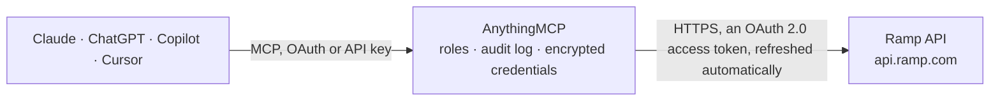

<!-- Generated by scripts/export-github-catalog.mjs in the anythingmcp-website repository. Do not edit by hand. -->

# Ramp MCP connector

Let your AI read your Ramp account: cards, funds and spend limits, transactions, reimbursements, bills, vendors, receipts, statements, GL accounts and users. The AnythingMCP connector gives Claude, ChatGPT, Microsoft Copilot, Cursor and Gemini 31 MCP tools for Ramp: 28 read and 3 can change data.

**Category:** [Banking](../banking.md) · **Tools:** 31 · **Setup guide:** [anythingmcp.com](https://anythingmcp.com/guides/ramp-to-mcp) · [Deutsch](https://anythingmcp.com/de/guides/ramp-to-mcp) · [Italiano](https://anythingmcp.com/it/guides/ramp-to-mcp) · [Español](https://anythingmcp.com/es/guides/ramp-to-mcp) · [日本語](https://anythingmcp.com/ja/guides/ramp-to-mcp) · [Русский](https://anythingmcp.com/ru/guides/ramp-to-mcp) · [中文](https://anythingmcp.com/zh/guides/ramp-to-mcp)

## Start without code

No installation and no terminal: AnythingMCP Cloud runs the Ramp connector for you, operated by helpcode.ai in Frankfurt, Germany.

1. **Click the button above** and create an account or sign in. The Ramp connector opens, ready to install.
2. **Sign in with your Ramp account** when AnythingMCP asks. The first time, an admin creates a small app in the Ramp developer console. Every click is in the [step-by-step guide](https://anythingmcp.com/guides/ramp-to-mcp).
3. **Click Install.** AnythingMCP shows the address of your MCP server.
4. **Add that address to your assistant:** [Claude](https://anythingmcp.com/guides/connect-ramp-to-claude) · [ChatGPT](https://anythingmcp.com/guides/connect-ramp-to-chatgpt) · [Microsoft Copilot](https://anythingmcp.com/guides/connect-ramp-to-copilot) · [Cursor](https://anythingmcp.com/guides/connect-ramp-to-cursor) · [Gemini CLI](https://anythingmcp.com/guides/connect-ramp-to-gemini) · [Meta Muse](https://anythingmcp.com/guides/connect-ramp-to-muse).
5. **Ask your first question**, for example: *What's the status and last four of Anna Keller's physical Ramp card (anna.keller@northbridge.de)?*

Prefer help with the setup? [Talk to us](https://anythingmcp.com/contact).

## How it works

- **The AI client** speaks MCP (Streamable HTTP) to AnythingMCP and only sees tool names, descriptions and results. It never gets the Ramp credentials.
- **AnythingMCP** checks the client's role, builds the call from the tool definition, adds the credentials (an OAuth 2.0 access token, refreshed automatically), calls Ramp, logs the call and returns the result.
- **Ramp** sees an ordinary API client with the rights of the account the credentials belong to.

## Tools

| Tool | What it does | Access |
|---|---|---|
| [`ramp_get_business`](#ramp_get_business) | Read the Ramp business: id, legal name, name on cards, active flag, billing address, website and whether reimbursements are on. | read |
| [`ramp_get_business_balance`](#ramp_get_business_balance) | Read the Ramp business balance: card limit, available card limit, card balance including pending, statement balance and the previous and next billing date. | read |
| [`ramp_list_users`](#ramp_list_users) | List Ramp users with id, name, email, role, status, department, location, manager and entity. | read |
| [`ramp_get_user`](#ramp_get_user) | Read one Ramp user by id: name, email, role, status, department, location, manager and entity. | read |
| [`ramp_list_departments`](#ramp_list_departments) | List the departments in Ramp (id and name). | read |
| [`ramp_list_locations`](#ramp_list_locations) | List the locations in Ramp (id, name and business entity). | read |
| [`ramp_list_entities`](#ramp_list_entities) | List the business entities (subsidiaries) in Ramp with id, name, currency, whether it is the primary entity, its locations and the connected ERP subsidiary. | read |
| [`ramp_list_physical_cards`](#ramp_list_physical_cards) | List Ramp physical cards with id, display name, card holder, last four digits, state, whether it is suspended (locked), fund and shipping status. | read |
| [`ramp_get_physical_card`](#ramp_get_physical_card) | Read one Ramp physical card by id: display name, card holder, last four digits, state, suspended flag, fund and shipping status. | read |
| [`ramp_list_virtual_cards`](#ramp_list_virtual_cards) | List Ramp virtual cards with id, owner user id, fund id and whether the card is suspended. | read |
| [`ramp_get_virtual_card`](#ramp_get_virtual_card) | Read one Ramp virtual card by id: owner user id, fund id and suspended flag. | read |
| [`ramp_list_funds`](#ramp_list_funds) | List Ramp funds (spend limits) with name, state, balance (cleared, pending, total), spending restrictions (limit, interval, allowed and blocked categories,… | read |
| [`ramp_get_fund`](#ramp_get_fund) | Read one Ramp fund (spend limit) by id: balance, spending restrictions, spend program, members and cards. | read |
| [`ramp_list_spend_programs`](#ramp_list_spend_programs) | List Ramp spend programs (templates for funds, such as a travel or education stipend) with name, description, permitted spend types and restrictions. | read |
| [`ramp_get_spend_program`](#ramp_get_spend_program) | Read one Ramp spend program by id: name, description, permitted spend types and restrictions. | read |
| [`ramp_list_transactions`](#ramp_list_transactions) | List Ramp card transactions with amount (in dollars), currency, state, time, merchant, category, memo, card, card holder, fund, receipts, statement and… | read |
| [`ramp_get_transaction`](#ramp_get_transaction) | Read one Ramp transaction by id with amounts (original and merchant currency), merchant and location, category, memo, card holder, receipts, line items,… | read |
| [`ramp_list_reimbursements`](#ramp_list_reimbursements) | List Ramp reimbursements (out-of-pocket and mileage) with type, state, merchant, memo, amounts, transaction date, submission, approval and payment dates,… | read |
| [`ramp_get_reimbursement`](#ramp_get_reimbursement) | Read one Ramp reimbursement by id: type, state, merchant, memo, amounts, dates, employee, fund, trip and receipts. | read |
| [`ramp_list_bills`](#ramp_list_bills) | List Ramp Bill Pay bills with invoice number, status and status summary, approval status, amount, vendor, owner, issue, due and paid dates, payment method… | read |
| [`ramp_get_bill`](#ramp_get_bill) | Read one Ramp bill by id: invoice number, statuses, amount, vendor, owner, dates, payment method, line items and invoice links. | read |
| [`ramp_list_vendors`](#ramp_list_vendors) | List the vendors in Ramp with name, legal name, active flag, country, category, owner, ERP id, payment terms, default payment method and spend (year to… | read |
| [`ramp_get_vendor`](#ramp_get_vendor) | Read one Ramp vendor by id: names, status, country, category, owner, ERP id, payment terms, default payment method and spend totals. | read |
| [`ramp_list_receipts`](#ramp_list_receipts) | List receipts uploaded to Ramp with the transaction or reimbursement they belong to, the user and a temporary download link. | read |
| [`ramp_get_receipt`](#ramp_get_receipt) | Read one Ramp receipt by id: transaction or reimbursement, user, creation date and a temporary download link. | read |
| [`ramp_list_gl_accounts`](#ramp_list_gl_accounts) | List the general ledger accounts synced from the accounting system into Ramp, with id, name, code, classification (for example EXPENSE), active flag and… | read |
| [`ramp_list_statements`](#ramp_list_statements) | List Ramp card statements with period, opening and ending balance, charges, credits, payments and a temporary PDF link. | read |
| [`ramp_get_statement`](#ramp_get_statement) | Read one Ramp statement by id: period, balances, charges, credits, payments and a temporary PDF link. | read |
| [`ramp_lock_card`](#ramp_lock_card) | Suspend (lock) a Ramp card so it cannot be used, for example when it is lost. | write |
| [`ramp_unlock_card`](#ramp_unlock_card) | Lift the suspension of a Ramp card so it can be used again. | write |
| [`ramp_update_transaction_memo`](#ramp_update_transaction_memo) | Set the memo of a Ramp transaction (at most 255 characters), for example the business purpose. | write |

## Tool reference

Every parameter as the AI client sees it in `tools/list`. Source: [`packages/backend/src/adapters/intl/ramp.json`](../../../packages/backend/src/adapters/intl/ramp.json).

### `ramp_get_business`

Read the Ramp business: id, legal name, name on cards, active flag, billing address, website and whether reimbursements are on. Cheap; use it first to check the connection. Needs business:read.

**Access:** read · **Call:** `GET /business`

No parameters.

### `ramp_get_business_balance`

Read the Ramp business balance: card limit, available card limit, card balance including pending, statement balance and the previous and next billing date. Plain numbers are in dollars; the *_amount objects are in cents. Needs business:read.

**Access:** read · **Call:** `GET /business/balance`

No parameters.

### `ramp_list_users`

List Ramp users with id, name, email, role, status, department, location, manager and entity. Filter by email, role, status, department, location or entity. Suspended users are left out unless you ask for them. Personal data: show only what the user asked for. Paged. Needs users:read.

**Access:** read · **Call:** `GET /users`

| Parameter | Type | Required | Description |
|---|---|---|---|
| `email` | string | no | Exact email address. |
| `role` | `AUDITOR` \| `BUSINESS_ADMIN` \| `BUSINESS_BOOKKEEPER` \| `BUSINESS_OWNER` \| `BUSINESS_USER` \| `GUEST_USER` \| `IT_ADMIN` | no | Only users with this role. |
| `status` | `USER_ACTIVE` \| `USER_DRAFT` \| `USER_INACTIVE` \| `USER_SUSPENDED` | no | Only users with this status. |
| `department_id` | string | no | Only users in this department (id from ramp_list_departments). |
| `location_id` | string | no | Only users at this location (id from ramp_list_locations). |
| `entity_id` | string | no | Only users of this business entity (id from ramp_list_entities). |
| `employee_id` | string | no | Only the user with this employee id. |
| `start` | string | no | Cursor for the next page: the value of the start parameter inside page.next of the previous answer. Leave it out for the first page; page.next is null on the last page. |
| `page_size` | integer | no | Results per page, 2 to 100 (Ramp default 20). |

### `ramp_get_user`

Read one Ramp user by id: name, email, role, status, department, location, manager and entity. Needs users:read.

**Access:** read · **Call:** `GET /users/{user_id}`

| Parameter | Type | Required | Description |
|---|---|---|---|
| `user_id` | string | yes | User id from ramp_list_users or a card holder. |

### `ramp_list_departments`

List the departments in Ramp (id and name). Paged. Needs departments:read.

**Access:** read · **Call:** `GET /departments`

| Parameter | Type | Required | Description |
|---|---|---|---|
| `start` | string | no | Cursor for the next page: the value of the start parameter inside page.next of the previous answer. Leave it out for the first page; page.next is null on the last page. |
| `page_size` | integer | no | Results per page, 2 to 100 (Ramp default 20). |

### `ramp_list_locations`

List the locations in Ramp (id, name and business entity). Filter by entity. Paged. Needs locations:read.

**Access:** read · **Call:** `GET /locations`

| Parameter | Type | Required | Description |
|---|---|---|---|
| `entity_id` | string | no | Only locations of this business entity. |
| `start` | string | no | Cursor for the next page: the value of the start parameter inside page.next of the previous answer. Leave it out for the first page; page.next is null on the last page. |
| `page_size` | integer | no | Results per page, 2 to 100 (Ramp default 20). |

### `ramp_list_entities`

List the business entities (subsidiaries) in Ramp with id, name, currency, whether it is the primary entity, its locations and the connected ERP subsidiary. Bank account details are removed on purpose. Paged. Needs entities:read.

**Access:** read · **Call:** `GET /entities`

| Parameter | Type | Required | Description |
|---|---|---|---|
| `entity_name` | string | no | Only entities with this name. |
| `currency` | string | no | Only entities in this currency, e.g. USD. |
| `hide_inactive` | boolean | no | Leave out inactive entities. |
| `start` | string | no | Cursor for the next page: the value of the start parameter inside page.next of the previous answer. Leave it out for the first page; page.next is null on the last page. |
| `page_size` | integer | no | Results per page, 2 to 100 (Ramp default 20). |

### `ramp_list_physical_cards`

List Ramp physical cards with id, display name, card holder, last four digits, state, whether it is suspended (locked), fund and shipping status. Never returns the card number or CVC. By default only activated cards; filter by user or display name. Paged. Needs cards:read.

**Access:** read · **Call:** `GET /cards/physical`

| Parameter | Type | Required | Description |
|---|---|---|---|
| `user_id` | string | no | Only cards of this user. |
| `display_name` | string | no | Only cards with this display name. |
| `include_activated_only` | boolean | no | Only activated cards (Ramp default true). |
| `include_terminated_only` | boolean | no | Only terminated cards (Ramp default false). |
| `start` | string | no | Cursor for the next page: the value of the start parameter inside page.next of the previous answer. Leave it out for the first page; page.next is null on the last page. |
| `page_size` | integer | no | Results per page, 2 to 100 (Ramp default 20). |

### `ramp_get_physical_card`

Read one Ramp physical card by id: display name, card holder, last four digits, state, suspended flag, fund and shipping status. Never returns the card number, CVC or shipping address. Needs cards:read.

**Access:** read · **Call:** `GET /cards/physical/{card_id}`

| Parameter | Type | Required | Description |
|---|---|---|---|
| `card_id` | string | yes | Card id from ramp_list_physical_cards or a transaction. |

### `ramp_list_virtual_cards`

List Ramp virtual cards with id, owner user id, fund id and whether the card is suspended. Never returns card numbers. Filter by user or entity; terminated cards are left out unless is_terminated is true. Paged. Needs cards:read.

**Access:** read · **Call:** `GET /cards/virtual`

| Parameter | Type | Required | Description |
|---|---|---|---|
| `user_id` | string | no | Only cards of this user. |
| `entity_id` | string | no | Only cards of this business entity. |
| `is_terminated` | boolean | no | Only terminated cards (Ramp default false). |
| `start` | string | no | Cursor for the next page: the value of the start parameter inside page.next of the previous answer. Leave it out for the first page; page.next is null on the last page. |
| `page_size` | integer | no | Results per page, 2 to 100 (Ramp default 20). |

### `ramp_get_virtual_card`

Read one Ramp virtual card by id: owner user id, fund id and suspended flag. Needs cards:read.

**Access:** read · **Call:** `GET /cards/virtual/{card_id}`

| Parameter | Type | Required | Description |
|---|---|---|---|
| `card_id` | string | yes | Virtual card id from ramp_list_virtual_cards. |

### `ramp_list_funds`

List Ramp funds (spend limits) with name, state, balance (cleared, pending, total), spending restrictions (limit, interval, allowed and blocked categories, per-transaction limit), spend program, members and cards. CurrencyAmount objects {amount, currency_code} are in the smallest unit (cents for USD). Filter by user, card, spend program, entity or creation date. Paged. Needs funds:read.

**Access:** read · **Call:** `GET /funds`

| Parameter | Type | Required | Description |
|---|---|---|---|
| `user_id` | string | no | Only funds owned by this user. |
| `card_id` | string | no | Only funds linked to this card. |
| `spend_program_id` | string | no | Only funds of this spend program. |
| `entity_id` | string | no | Only funds of this business entity. |
| `display_name` | string | no | Only funds with this display name. |
| `is_terminated` | boolean | no | Only terminated funds. |
| `created_after` | string | no | Only funds created after this date-time (ISO 8601, e.g. 2026-01-15T00:00:00Z). |
| `created_before` | string | no | Only funds created before this date-time (ISO 8601). |
| `start` | string | no | Cursor for the next page: the value of the start parameter inside page.next of the previous answer. Leave it out for the first page; page.next is null on the last page. |
| `page_size` | integer | no | Results per page, 2 to 100 (Ramp default 20). |

### `ramp_get_fund`

Read one Ramp fund (spend limit) by id: balance, spending restrictions, spend program, members and cards. CurrencyAmount objects {amount, currency_code} are in the smallest unit (cents for USD). Needs funds:read.

**Access:** read · **Call:** `GET /funds/{fund_id}`

| Parameter | Type | Required | Description |
|---|---|---|---|
| `fund_id` | string | yes | Fund id from ramp_list_funds, a card or a transaction's limit_id. |

### `ramp_list_spend_programs`

List Ramp spend programs (templates for funds, such as a travel or education stipend) with name, description, permitted spend types and restrictions. Paged. Needs spend_programs:read.

**Access:** read · **Call:** `GET /spend-programs`

| Parameter | Type | Required | Description |
|---|---|---|---|
| `start` | string | no | Cursor for the next page: the value of the start parameter inside page.next of the previous answer. Leave it out for the first page; page.next is null on the last page. |
| `page_size` | integer | no | Results per page, 2 to 100 (Ramp default 20). |

### `ramp_get_spend_program`

Read one Ramp spend program by id: name, description, permitted spend types and restrictions. Needs spend_programs:read.

**Access:** read · **Call:** `GET /spend-programs/{spend_program_id}`

| Parameter | Type | Required | Description |
|---|---|---|---|
| `spend_program_id` | string | yes | Spend program id from ramp_list_spend_programs. |

### `ramp_list_transactions`

List Ramp card transactions with amount (in dollars), currency, state, time, merchant, category, memo, card, card holder, fund, receipts, statement and accounting sync status. Declined transactions are left out unless state is DECLINED or ALL. Filter by date, user, card, department, location, merchant, fund, spend program, entity, amount, approval or sync status, or requires_memo to find transactions missing a memo. Sort with one order_by flag. Paged. Financial data: share only what the user asked for. Needs transactions:read.

**Access:** read · **Call:** `GET /transactions`

| Parameter | Type | Required | Description |
|---|---|---|---|
| `from_date` | string | no | Only transactions after this date-time (ISO 8601), compared with user_transaction_time. |
| `to_date` | string | no | Only transactions before this date-time (ISO 8601). |
| `user_id` | string | no | Only transactions of this user. |
| `card_id` | string | no | Only transactions of this physical card. |
| `department_id` | string | no | Only this department. |
| `location_id` | string | no | Only this location. |
| `merchant_id` | string | no | Only this merchant. |
| `limit_id` | string | no | Only this fund (limit). |
| `spend_program_id` | string | no | Only this spend program. |
| `entity_id` | string | no | Only this business entity. |
| `statement_id` | string | no | Only transactions on this statement. |
| `trip_id` | string | no | Only this trip. |
| `state` | `ALL` \| `CLEARED` \| `COMPLETION` \| `DECLINED` \| `ERROR` \| `PENDING` \| `PENDING_INITIATION` | no | Transaction state. ALL includes declined transactions. |
| `approval_status` | `AWAITING_EMPLOYEE` \| `AWAITING_EMPLOYEE_CHANGES_REQUESTED` \| `AWAITING_EMPLOYEE_MISSING_ITEMS` \| `AWAITING_EMPLOYEE_REPAYMENT_FAILED` \| `AWAITING_EMPLOYEE_REPAYMENT_REQUESTED` \| `AWAITING_REVIEWER` \| `FULLY_APPROVED` | no | Only this approval status. |
| `sync_status` | `NOT_SYNC_READY` \| `SYNCED` \| `SYNC_READY` | no | Only this accounting sync status. |
| `requires_memo` | boolean | no | true: only transactions that need a memo and have none. |
| `min_amount` | number | no | Only transactions above this amount, in US dollars. |
| `max_amount` | number | no | Only transactions below this amount, in US dollars. |
| `order_by_date_desc` | boolean | no | Newest first. |
| `order_by_date_asc` | boolean | no | Oldest first. |
| `order_by_amount_desc` | boolean | no | Largest first. |
| `order_by_amount_asc` | boolean | no | Smallest first. |
| `start` | string | no | Cursor for the next page: the value of the start parameter inside page.next of the previous answer. Leave it out for the first page; page.next is null on the last page. |
| `page_size` | integer | no | Results per page, 2 to 100 (Ramp default 20). |

### `ramp_get_transaction`

Read one Ramp transaction by id with amounts (original and merchant currency), merchant and location, category, memo, card holder, receipts, line items, accounting codes, policy violations, attendees, disputes and decline details. Needs transactions:read.

**Access:** read · **Call:** `GET /transactions/{transaction_id}`

| Parameter | Type | Required | Description |
|---|---|---|---|
| `transaction_id` | string | yes | Transaction id from ramp_list_transactions. |

### `ramp_list_reimbursements`

List Ramp reimbursements (out-of-pocket and mileage) with type, state, merchant, memo, amounts, transaction date, submission, approval and payment dates, employee, fund, trip and receipts. CurrencyAmount objects {amount, currency_code} are in the smallest unit (cents for USD). Filter by user, state, dates, entity, trip or sync status. Read only: this connector cannot pay a reimbursement. Paged. Needs reimbursements:read.

**Access:** read · **Call:** `GET /reimbursements`

| Parameter | Type | Required | Description |
|---|---|---|---|
| `user_id` | string | no | Only reimbursements of this user. |
| `state` | string | no | Only reimbursements in this state, e.g. PENDING, APPROVED, REIMBURSED, REJECTED. |
| `direction` | `BUSINESS_TO_USER` \| `USER_TO_BUSINESS` | no | BUSINESS_TO_USER (default) or USER_TO_BUSINESS for repayments. |
| `from_transaction_date` | string | no | Only reimbursements whose expense date is after this date (ISO 8601). |
| `to_transaction_date` | string | no | Only reimbursements whose expense date is before this date (ISO 8601). |
| `from_submitted_at` | string | no | Only reimbursements submitted after this date-time (ISO 8601). |
| `to_submitted_at` | string | no | Only reimbursements submitted before this date-time (ISO 8601). |
| `entity_id` | string | no | Only this business entity. |
| `trip_id` | string | no | Only this trip. |
| `has_been_approved` | boolean | no | true: only approved; false: only not yet approved. |
| `sync_status` | `NOT_SYNC_READY` \| `SYNCED` \| `SYNC_READY` | no | Only this accounting sync status. |
| `start` | string | no | Cursor for the next page: the value of the start parameter inside page.next of the previous answer. Leave it out for the first page; page.next is null on the last page. |
| `page_size` | integer | no | Results per page, 2 to 100 (Ramp default 20). |

### `ramp_get_reimbursement`

Read one Ramp reimbursement by id: type, state, merchant, memo, amounts, dates, employee, fund, trip and receipts. Needs reimbursements:read.

**Access:** read · **Call:** `GET /reimbursements/{reimbursement_id}`

| Parameter | Type | Required | Description |
|---|---|---|---|
| `reimbursement_id` | string | yes | Reimbursement id from ramp_list_reimbursements. |

### `ramp_list_bills`

List Ramp Bill Pay bills with invoice number, status and status summary, approval status, amount, vendor, owner, issue, due and paid dates, payment method and date and invoice links. CurrencyAmount objects {amount, currency_code} are in the smallest unit (cents for USD). Filter by vendor, status summaries, approval or payment status, dates, amount or entity. Read only: this connector cannot pay, approve or release a bill. Paged. Needs bills:read.

**Access:** read · **Call:** `GET /bills`

| Parameter | Type | Required | Description |
|---|---|---|---|
| `vendor_id` | string | no | Only bills of this vendor (id from ramp_list_vendors). |
| `status_summaries` | string | no | Comma-separated status summaries, e.g. APPROVAL_PENDING,PAYMENT_SCHEDULED. Values: APPROVAL_PENDING, APPROVAL_REJECTED, ARCHIVED, AWAITING_PAYMENT, AWAITING_RELEASE, BLOCKED, HELD_BY_PROVIDER, ON_HOLD, PAYMENT_COMPLETED, PAYMENT_DETAILS_MISSING, PAYMENT_ERROR, PAYMENT_NOT_INSTRUCTED, PAYMENT_PROCESSING, PAYMENT_READY, PAYMENT_SCHEDULED, PENDING_VENDOR_APPROVAL, WAITING_FOR_TRANSACTION_MATCH, WAITING_FOR_TRANSFER_MATCH, WAITING_FOR_VENDOR. |
| `approval_status` | `APPROVED` \| `INITIALIZED` \| `PENDING` \| `REJECTED` \| `TERMINATED` | no | Only this approval status. |
| `payment_status` | `OPEN` \| `PAID` | no | OPEN (not fully paid) or PAID. |
| `invoice_number` | string | no | Exact invoice number. |
| `entity_id` | string | no | Only this business entity. |
| `from_due_date` | string | no | Only bills due on or after this date (ISO 8601). |
| `to_due_date` | string | no | Only bills due on or before this date (ISO 8601). |
| `from_issued_date` | string | no | Only bills issued on or after this date (ISO 8601). |
| `to_issued_date` | string | no | Only bills issued on or before this date (ISO 8601). |
| `from_paid_at` | string | no | Only bills paid on or after this date (ISO 8601). |
| `to_paid_at` | string | no | Only bills paid on or before this date (ISO 8601). |
| `min_amount` | number | no | Only bills of at least this amount. |
| `max_amount` | number | no | Only bills of at most this amount. |
| `start` | string | no | Cursor for the next page: the value of the start parameter inside page.next of the previous answer. Leave it out for the first page; page.next is null on the last page. |
| `page_size` | integer | no | Results per page, 2 to 100 (Ramp default 20). |

### `ramp_get_bill`

Read one Ramp bill by id: invoice number, statuses, amount, vendor, owner, dates, payment method, line items and invoice links. Needs bills:read.

**Access:** read · **Call:** `GET /bills/{bill_id}`

| Parameter | Type | Required | Description |
|---|---|---|---|
| `bill_id` | string | yes | Bill id from ramp_list_bills. |

### `ramp_list_vendors`

List the vendors in Ramp with name, legal name, active flag, country, category, owner, ERP id, payment terms, default payment method and spend (year to date, last 30 and 365 days, all time). Bank details and tax ids are not returned. Filter by name, merchant, owner or dates. Paged. Needs vendors:read.

**Access:** read · **Call:** `GET /vendors`

| Parameter | Type | Required | Description |
|---|---|---|---|
| `name` | string | no | Only vendors with this name. |
| `is_active` | boolean | no | true: only active vendors. |
| `merchant_id` | string | no | Only the vendor linked to this card merchant. |
| `vendor_owner_id` | string | no | Only vendors owned by this user. |
| `from_created_at` | string | no | Only vendors created after this date-time (ISO 8601). |
| `from_updated_at` | string | no | Only vendors updated after this date-time (ISO 8601). |
| `start` | string | no | Cursor for the next page: the value of the start parameter inside page.next of the previous answer. Leave it out for the first page; page.next is null on the last page. |
| `page_size` | integer | no | Results per page, 2 to 100 (Ramp default 20). |

### `ramp_get_vendor`

Read one Ramp vendor by id: names, status, country, category, owner, ERP id, payment terms, default payment method and spend totals. Bank details and tax ids are not returned. Needs vendors:read.

**Access:** read · **Call:** `GET /vendors/{vendor_id}`

| Parameter | Type | Required | Description |
|---|---|---|---|
| `vendor_id` | string | yes | Vendor id from ramp_list_vendors or a bill. |

### `ramp_list_receipts`

List receipts uploaded to Ramp with the transaction or reimbursement they belong to, the user and a temporary download link. Filter by transaction, reimbursement or dates; include_ocr_data adds the amounts and line items Ramp read from the receipt. Paged. Needs receipts:read.

**Access:** read · **Call:** `GET /receipts`

| Parameter | Type | Required | Description |
|---|---|---|---|
| `transaction_id` | string | no | Only receipts of this transaction. |
| `reimbursement_id` | string | no | Only receipts of this reimbursement. |
| `created_after` | string | no | Only receipts created after this date-time (ISO 8601). |
| `created_before` | string | no | Only receipts created before this date-time (ISO 8601). |
| `include_ocr_data` | boolean | no | Also return the data Ramp extracted from the receipt. |
| `start` | string | no | Cursor for the next page: the value of the start parameter inside page.next of the previous answer. Leave it out for the first page; page.next is null on the last page. |
| `page_size` | integer | no | Results per page, 2 to 100 (Ramp default 20). |

### `ramp_get_receipt`

Read one Ramp receipt by id: transaction or reimbursement, user, creation date and a temporary download link. Needs receipts:read.

**Access:** read · **Call:** `GET /receipts/{receipt_id}`

| Parameter | Type | Required | Description |
|---|---|---|---|
| `receipt_id` | string | yes | Receipt id from ramp_list_receipts or a transaction. |
| `include_ocr_data` | boolean | no | Also return the data Ramp extracted from the receipt. |

### `ramp_list_gl_accounts`

List the general ledger accounts synced from the accounting system into Ramp, with id, name, code, classification (for example EXPENSE), active flag and provider (for example QuickBooks). Filter by code or active flag. Paged. Needs accounting:read.

**Access:** read · **Call:** `GET /accounting/accounts`

| Parameter | Type | Required | Description |
|---|---|---|---|
| `code` | string | no | Only the account with this code. |
| `is_active` | boolean | no | true: only active accounts. |
| `remote_id` | string | no | Only the account with this id in the accounting system. |
| `start` | string | no | Cursor for the next page: the value of the start parameter inside page.next of the previous answer. Leave it out for the first page; page.next is null on the last page. |
| `page_size` | integer | no | Results per page, 2 to 100 (Ramp default 20). |

### `ramp_list_statements`

List Ramp card statements with period, opening and ending balance, charges, credits, payments and a temporary PDF link. CurrencyAmount objects {amount, currency_code} are in the smallest unit (cents for USD). Filter by end date. Paged. Needs statements:read.

**Access:** read · **Call:** `GET /statements`

| Parameter | Type | Required | Description |
|---|---|---|---|
| `from_date` | string | no | Only statements ending on or after this date (ISO 8601). |
| `to_date` | string | no | Only statements ending on or before this date (ISO 8601). |
| `start` | string | no | Cursor for the next page: the value of the start parameter inside page.next of the previous answer. Leave it out for the first page; page.next is null on the last page. |
| `page_size` | integer | no | Results per page, 2 to 100 (Ramp default 20). |

### `ramp_get_statement`

Read one Ramp statement by id: period, balances, charges, credits, payments and a temporary PDF link. The list of statement lines is left out; use ramp_list_transactions with statement_id for them. Needs statements:read.

**Access:** read · **Call:** `GET /statements/{statement_id}`

| Parameter | Type | Required | Description |
|---|---|---|---|
| `statement_id` | string | yes | Statement id from ramp_list_statements. |

### `ramp_lock_card`

Suspend (lock) a Ramp card so it cannot be used, for example when it is lost. Reversible with ramp_unlock_card. Ramp documents this on physical card ids from ramp_list_physical_cards. Confirm the card (name and last four digits) with the user before calling. Installed switched off; needs the cards:write scope.

**Access:** write · **Call:** `POST /cards/physical/{card_id}/suspension`

| Parameter | Type | Required | Description |
|---|---|---|---|
| `card_id` | string | yes | Card id from ramp_list_physical_cards. |

### `ramp_unlock_card`

Lift the suspension of a Ramp card so it can be used again. Only when the user explicitly asks; confirm the card (name and last four digits) before calling. Installed switched off; needs the cards:write scope.

**Access:** write · **Call:** `DELETE /cards/physical/{card_id}/suspension`

| Parameter | Type | Required | Description |
|---|---|---|---|
| `card_id` | string | yes | Card id from ramp_list_physical_cards. |

### `ramp_update_transaction_memo`

Set the memo of a Ramp transaction (at most 255 characters), for example the business purpose. Replaces the existing memo. Show the user the transaction and the new memo and confirm before calling. Installed switched off; needs the memos:write scope.

**Access:** write · **Call:** `POST /memos/{transaction_id}`

| Parameter | Type | Required | Description |
|---|---|---|---|
| `transaction_id` | string | yes | Transaction id from ramp_list_transactions. |
| `memo` | string | yes | The memo text, at most 255 characters. |

## Run it yourself

AnythingMCP is open source (AGPL-3.0). [Run it with Docker](../../../README.md#run-it-yourself), open **Connectors → Store**, pick **Ramp** and enter `RAMP_CLIENT_ID`, `RAMP_CLIENT_SECRET`, then add your MCP server URL to the AI client.

[← Banking connectors](../banking.md) · [All categories](../README.md)
