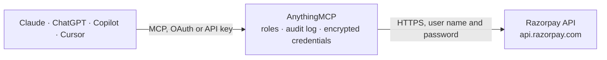

<!-- Generated by scripts/export-github-catalog.mjs in the anythingmcp-website repository. Do not edit by hand. -->

# Razorpay MCP connector

India's leading payment gateway. The AnythingMCP connector gives Claude, ChatGPT, Microsoft Copilot, Cursor and Gemini 4 MCP tools for Razorpay: 2 read and 2 can change data.

**Category:** [Payments](../payments.md) · **Tools:** 4 · **Setup guide:** [anythingmcp.com](https://anythingmcp.com/guides/razorpay-to-mcp) · [Deutsch](https://anythingmcp.com/de/guides/razorpay-to-mcp) · [Italiano](https://anythingmcp.com/it/guides/razorpay-to-mcp) · [Español](https://anythingmcp.com/es/guides/razorpay-to-mcp) · [日本語](https://anythingmcp.com/ja/guides/razorpay-to-mcp) · [Русский](https://anythingmcp.com/ru/guides/razorpay-to-mcp) · [中文](https://anythingmcp.com/zh/guides/razorpay-to-mcp)

## Start without code

No installation and no terminal: AnythingMCP Cloud runs the Razorpay connector for you, operated by helpcode.ai in Frankfurt, Germany.

1. **Click the button above** and create an account or sign in. The Razorpay connector opens, ready to install.
2. **Paste the API key or token from your Razorpay account.** Every click is in the [step-by-step guide](https://anythingmcp.com/guides/razorpay-to-mcp).
3. **Click Install.** AnythingMCP shows the address of your MCP server.
4. **Add that address to your assistant:** [Claude](https://anythingmcp.com/guides/connect-razorpay-to-claude) · [ChatGPT](https://anythingmcp.com/guides/connect-razorpay-to-chatgpt) · [Microsoft Copilot](https://anythingmcp.com/guides/connect-razorpay-to-copilot) · [Cursor](https://anythingmcp.com/guides/connect-razorpay-to-cursor) · [Gemini CLI](https://anythingmcp.com/guides/connect-razorpay-to-gemini) · [Meta Muse](https://anythingmcp.com/guides/connect-razorpay-to-muse).
5. **Ask your first question**, for example: *Check payment pay_F3k9a2 for order ORD-2026-301, did it capture and what was the method and fees?*

Prefer help with the setup? [Talk to us](https://anythingmcp.com/contact).

## How it works

- **The AI client** speaks MCP (Streamable HTTP) to AnythingMCP and only sees tool names, descriptions and results. It never gets the Razorpay credentials.
- **AnythingMCP** checks the client's role, builds the call from the tool definition, adds the credentials (user name and password), calls Razorpay, logs the call and returns the result.
- **Razorpay** sees an ordinary API client with the rights of the account the credentials belong to.

## Tools

| Tool | What it does | Access |
|---|---|---|
| [`razorpay_create_order`](#razorpay_create_order) | Create a Razorpay order. | write |
| [`razorpay_fetch_payment`](#razorpay_fetch_payment) | Fetch a single payment by its id (prefix `pay_`). | read |
| [`razorpay_list_refunds`](#razorpay_list_refunds) | List refunds across the account, optionally filtered by payment id. | read |
| [`razorpay_create_payment_link`](#razorpay_create_payment_link) | Create a Razorpay-hosted payment link (short_url) you can send by email/SMS/WhatsApp. | write |

## Tool reference

Every parameter as the AI client sees it in `tools/list`. Source: [`packages/backend/src/adapters/in/razorpay.json`](../../../packages/backend/src/adapters/in/razorpay.json).

### `razorpay_create_order`

Create a Razorpay order. Orders are the recommended flow: create on the server, attach to a checkout, receive payment, then verify the resulting payment. Returns the order id (prefix `order_`) needed for the checkout.

**Access:** write · **Call:** `POST /orders`

| Parameter | Type | Required | Description |
|---|---|---|---|
| `amount` | number | yes | Amount in the smallest currency unit (e.g. 10000 = ₹100.00 for INR). |
| `currency` | string | yes | ISO-4217 currency code: 'INR', 'USD', 'EUR', 'GBP', etc. |
| `receipt` | string | no | Your internal receipt / order id (max 40 chars). Shown on the Razorpay dashboard for reconciliation. |
| `notes` | object | no | Optional key-value object of arbitrary metadata (max 15 keys, key+value ≤ 256 chars). |
| `payment_capture` | number | no | 1 = auto-capture on payment success (default), 0 = authorize only, capture later via API. |

### `razorpay_fetch_payment`

Fetch a single payment by its id (prefix `pay_`). Returns status (created/authorized/captured/refunded/failed), amount, method (card/upi/netbanking/wallet/emi), card/bank/upi details, fees, tax, and any error code/description.

**Access:** read · **Call:** `GET /payments/{payment_id}`

| Parameter | Type | Required | Description |
|---|---|---|---|
| `payment_id` | string | yes | Razorpay payment id (prefix 'pay_'). |

### `razorpay_list_refunds`

List refunds across the account, optionally filtered by payment id. Returns refund id, payment id, amount, status (pending/processed/failed), created_at, and speed (normal/optimum/instant).

**Access:** read · **Call:** `GET /refunds`

| Parameter | Type | Required | Description |
|---|---|---|---|
| `payment_id` | string | no | Optional — return only refunds for this payment id. |
| `count` | number | no | Max results (default 10, max 100). |
| `skip` | number | no | Offset for pagination. |

### `razorpay_create_payment_link`

Create a Razorpay-hosted payment link (short_url) you can send by email/SMS/WhatsApp. The customer pays on Razorpay's page; you get a webhook + can verify via fetch_payment. Returns the link id and short_url.

**Access:** write · **Call:** `POST /payment_links`

| Parameter | Type | Required | Description |
|---|---|---|---|
| `amount` | number | yes | Amount in smallest currency unit (e.g. 10000 = ₹100 for INR). |
| `currency` | string | yes | ISO-4217 currency code (e.g. 'INR'). |
| `description` | string | yes | Description shown to the customer on the payment page (max 2048 chars). |
| `customer` | object | no | Customer object: { name, email, contact }. Pre-fills the checkout form. |
| `notify` | object | no | Channels to send the link on: { sms: true/false, email: true/false }. |
| `reminder_enable` | boolean | no | Whether Razorpay should send automatic reminders before expiry. |
| `expire_by` | number | no | Unix epoch seconds — link expires at this time. |

## Run it yourself

AnythingMCP is open source (AGPL-3.0). [Run it with Docker](../../../README.md#run-it-yourself), open **Connectors → Store**, pick **Razorpay** and enter `RAZORPAY_KEY_ID`, `RAZORPAY_KEY_SECRET`, then add your MCP server URL to the AI client.

[← Payments connectors](../payments.md) · [All categories](../README.md)
