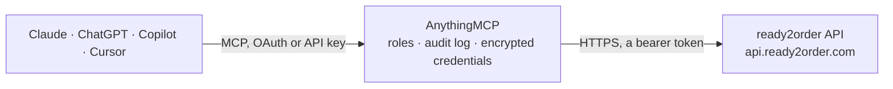

<!-- Generated by scripts/export-github-catalog.mjs in the anythingmcp-website repository. Do not edit by hand. -->

# ready2order MCP connector

Connect the ready2order POS (Registrierkasse) to your AI: products, prices and stock, product groups, bills and daily sales, open orders, customers, payment methods and VAT rates, with confirmed … The AnythingMCP connector gives Claude, ChatGPT, Microsoft Copilot, Cursor and Gemini 26 MCP tools for ready2order: 19 read and 7 can change data.

**Category:** [Payments](../payments.md) · **Tools:** 26 · **Setup guide:** [anythingmcp.com](https://anythingmcp.com/guides/ready2order-to-mcp) · [Deutsch](https://anythingmcp.com/de/guides/ready2order-to-mcp) · [Italiano](https://anythingmcp.com/it/guides/ready2order-to-mcp) · [Español](https://anythingmcp.com/es/guides/ready2order-to-mcp) · [日本語](https://anythingmcp.com/ja/guides/ready2order-to-mcp) · [Русский](https://anythingmcp.com/ru/guides/ready2order-to-mcp) · [中文](https://anythingmcp.com/zh/guides/ready2order-to-mcp)

## Start without code

No installation and no terminal: AnythingMCP Cloud runs the ready2order connector for you, operated by helpcode.ai in Frankfurt, Germany.

1. **Click the button above** and create an account or sign in. The ready2order connector opens, ready to install.
2. **Paste the API key or token from your ready2order account.** Every click is in the [step-by-step guide](https://anythingmcp.com/guides/ready2order-to-mcp).
3. **Click Install.** AnythingMCP shows the address of your MCP server.
4. **Add that address to your assistant:** [Claude](https://anythingmcp.com/guides/connect-ready2order-to-claude) · [ChatGPT](https://anythingmcp.com/guides/connect-ready2order-to-chatgpt) · [Microsoft Copilot](https://anythingmcp.com/guides/connect-ready2order-to-copilot) · [Cursor](https://anythingmcp.com/guides/connect-ready2order-to-cursor) · [Gemini CLI](https://anythingmcp.com/guides/connect-ready2order-to-gemini) · [Meta Muse](https://anythingmcp.com/guides/connect-ready2order-to-muse).
5. **Ask your first question**, for example: *Show me bill 2026-INV-0789 and its totals for customer GastroWiesn GmbH.*

Prefer help with the setup? [Talk to us](https://anythingmcp.com/contact).

## How it works

- **The AI client** speaks MCP (Streamable HTTP) to AnythingMCP and only sees tool names, descriptions and results. It never gets the ready2order credentials.
- **AnythingMCP** checks the client's role, builds the call from the tool definition, adds the credentials (a bearer token), calls ready2order, logs the call and returns the result.
- **ready2order** sees an ordinary API client with the rights of the account the credentials belong to.

## Tools

| Tool | What it does | Access |
|---|---|---|
| [`ready2order_list_products`](#ready2order_list_products) | List the products (Artikel) of the ready2order register with price, VAT, item number, barcode, stock level and product group. | read |
| [`ready2order_get_product`](#ready2order_get_product) | Get one product by id with all its settings (price, VAT, stock, unit, flags), optionally with its group, variations and price levels. | read |
| [`ready2order_create_product`](#ready2order_create_product) | Create a product in the register, with name and price, VAT (product_vat or product_vat_id), product group and optional item number, barcode, unit and stock. | write |
| [`ready2order_update_product`](#ready2order_update_product) | Change fields of an existing product: name, price, VAT, product group, item number, barcode, description, active or sold-out flag, unit and more. | write |
| [`ready2order_get_product_stock`](#ready2order_get_product_stock) | Get the current stock, reorder level (Meldebestand), safety stock and unit of one product by its id. | read |
| [`ready2order_get_stock_by_item_number`](#ready2order_get_stock_by_item_number) | Get the current stock, reorder level and safety stock of a product looked up by its item number (Artikelnummer) instead of its id. | read |
| [`ready2order_update_product_stock`](#ready2order_update_product_stock) | Change a product's stock: set an absolute count after an inventory (product_stock) or add and subtract a quantity (product_stockDelta, e.g. 24 for goods… | write |
| [`ready2order_delete_product`](#ready2order_delete_product) | Delete a product from the register. | write |
| [`ready2order_list_product_groups`](#ready2order_list_product_groups) | List the product groups (Produktgruppen, the categories of the POS), with id, name, parent group and type. | read |
| [`ready2order_list_group_products`](#ready2order_list_group_products) | List all products that belong to one product group (category), with their prices and settings. | read |
| [`ready2order_create_product_group`](#ready2order_create_product_group) | Create a product group (category) in the register, optionally below a parent group. | write |
| [`ready2order_list_bills`](#ready2order_list_bills) | List the bills (Belege, receipts and invoices) of a period with number, date, total, net, VAT, tip, customer and payment state; the main source for sales… | read |
| [`ready2order_get_bill`](#ready2order_get_bill) | Get one bill by id with its lines, payments, totals, VAT breakdown and customer. | read |
| [`ready2order_get_bill_pdf`](#ready2order_get_bill_pdf) | Get a temporary download link for the PDF of a bill, e.g. to send a copy to a customer. | read |
| [`ready2order_list_open_orders`](#ready2order_list_open_orders) | List the open orders of the register (items ordered but not yet billed, e.g. on a restaurant table), optionally per table or product and grouped by table or… | read |
| [`ready2order_list_tables`](#ready2order_list_tables) | List the tables of the register (gastronomy floor plan), with id, name or number, description, sort order, table area and whether the table is temporary. | read |
| [`ready2order_list_table_areas`](#ready2order_list_table_areas) | List the table areas (rooms or zones such as inside, terrace or bar) with id, name, short name, sort order and whether they are active. | read |
| [`ready2order_list_customers`](#ready2order_list_customers) | List the customers stored in the register with number, name, company, VAT id, group, notes and addresses. | read |
| [`ready2order_get_customer`](#ready2order_get_customer) | Get one customer by id with contact data, VAT id, group and addresses. | read |
| [`ready2order_create_customer`](#ready2order_create_customer) | Create a customer in the register, e.g. for invoices to a company. | write |
| [`ready2order_update_customer`](#ready2order_update_customer) | Change an existing customer's contact data, VAT id, group or notes. | write |
| [`ready2order_list_customer_groups`](#ready2order_list_customer_groups) | List the customer groups (Kundengruppen) with their ids, needed to create a customer. | read |
| [`ready2order_list_payment_methods`](#ready2order_list_payment_methods) | List the payment methods configured in the register (cash, card, voucher and so on) with their ids and types. | read |
| [`ready2order_list_vat_rates`](#ready2order_list_vat_rates) | List the VAT rates configured for the account with id, rate and code, for creating products with product_vat_id. | read |
| [`ready2order_get_daily_report_status`](#ready2order_get_daily_report_status) | Tell whether a daily report (Tagesabschluss period) is currently open in the register. | read |
| [`ready2order_list_users`](#ready2order_list_users) | List the register's users (cashiers and admins) with their ids and names. | read |

## Tool reference

Every parameter as the AI client sees it in `tools/list`. Source: [`packages/backend/src/adapters/de/ready2order.json`](../../../packages/backend/src/adapters/de/ready2order.json).

### `ready2order_list_products`

List the products (Artikel) of the ready2order register with price, VAT, item number, barcode, stock level and product group. Search by keyword with q, or exactly by name, item number or barcode; filter by product group or by changes since a time. Paged with page and limit. Read-only.

**Access:** read · **Call:** `GET /products`

| Parameter | Type | Required | Description |
|---|---|---|---|
| `q` | string | no | Keyword search over the products. |
| `name` | string | no | Exact product name. |
| `itemNumber` | string | no | Exact item number. |
| `barcode` | string | no | Exact barcode. |
| `productgroup_id` | integer | no | Only products of this product group. |
| `updatedAfter` | string | no | Only products changed after this time, e.g. 2026-10-01 00:00:00. |
| `page` | integer | no | Page number, starting at 1. |
| `limit` | integer | no | Products per page, e.g. 50. |
| `includeProductGroup` | boolean | no | Include each product's product group. |
| `includeProductVariations` | boolean | no | Include the product variations (add-ons and modifications). |
| `includePriceLevels` | boolean | no | Include the price levels. |

### `ready2order_get_product`

Get one product by id with all its settings (price, VAT, stock, unit, flags), optionally with its group, variations and price levels. Read-only.

**Access:** read · **Call:** `GET /products/{id}`

| Parameter | Type | Required | Description |
|---|---|---|---|
| `id` | integer | yes | The product_id. |
| `includeProductGroup` | boolean | no | Include each product's product group. |
| `includeProductVariations` | boolean | no | Include the product variations (add-ons and modifications). |
| `includePriceLevels` | boolean | no | Include the price levels. |

### `ready2order_create_product`

Create a product in the register, with name and price, VAT (product_vat or product_vat_id), product group and optional item number, barcode, unit and stock. It appears in the POS at once. Writes to the live ready2order register: describe the change and get the user's confirmation before calling.

**Access:** write · **Call:** `POST /products`

| Parameter | Type | Required | Description |
|---|---|---|---|
| `product_name` | string | yes | Product name as shown in the register. |
| `product_price` | string | yes | Price as a decimal string, e.g. 4.50. Gross or net according to product_priceIncludesVat. |
| `product_priceIncludesVat` | boolean | no | true if product_price includes VAT (the usual setting for retail and gastronomy). |
| `product_vat` | string | no | VAT rate in percent as a decimal string, e.g. 20 or 10 in Austria, 19 or 7 in Germany. Give this or product_vat_id. |
| `product_vat_id` | integer | no | Id of a VAT rate from ready2order_list_vat_rates. Give this or product_vat. |
| `productgroup_id` | integer | no | Product group id from ready2order_list_product_groups. |
| `product_itemnumber` | string | no | Item number (Artikelnummer). |
| `product_barcode` | string | no | Barcode (EAN). |
| `product_externalReference` | string | no | Your own reference, e.g. the id in a webshop or ERP. |
| `product_description` | string | no | Description. |
| `product_active` | boolean | no | false hides the product in the register so it cannot be sold. |
| `product_soldOut` | boolean | no | true marks the product sold out in the register, whatever the stock says. |
| `product_discountable` | boolean | no | Whether discounts and coupons apply to the product. |
| `product_stock_enabled` | boolean | no | Turn stock tracking on or off for the product. |
| `product_unit_identifier` | `beutel` \| `bottle` \| `can` \| `centiliter` \| `gram` \| `hours` \| `karton` \| `kilo` \| `liter` \| `m2` \| `meter` \| `milliliter` \| `pair` \| `palette` \| `piece` \| `qm` \| `raummeter` \| `sack` \| `schuettraummeter` \| `ton` | no | Unit the product is sold and counted in. |
| `product_type` | string | no | food or drink for gastronomy side dishes and extras; leave out for ordinary products. |
| `product_customPrice` | boolean | no | Let the cashier type the price at checkout. |
| `product_customQuantity` | boolean | no | Let the cashier type a quantity (e.g. weight) at checkout. |
| `product_accountingCode` | string | no | Revenue account used in accounting exports such as DATEV. |
| `product_sortIndex` | integer | no | Position in the product group. |
| `product_stock_value` | string | no | Initial stock quantity as a decimal string, e.g. 24. Needs product_stock_enabled. |

### `ready2order_update_product`

Change fields of an existing product: name, price, VAT, product group, item number, barcode, description, active or sold-out flag, unit and more. Only the fields given are sent; the others keep their values. Stock is changed with ready2order_update_product_stock. Writes to the live ready2order register: describe the change and get the user's confirmation before calling.

**Access:** write · **Call:** `PUT /products/{id}`

| Parameter | Type | Required | Description |
|---|---|---|---|
| `id` | integer | yes | The product_id to change. |
| `product_name` | string | no | Product name as shown in the register. |
| `product_price` | string | no | Price as a decimal string, e.g. 4.50. Gross or net according to product_priceIncludesVat. |
| `product_priceIncludesVat` | boolean | no | true if product_price includes VAT (the usual setting for retail and gastronomy). |
| `product_vat` | string | no | VAT rate in percent as a decimal string, e.g. 20 or 10 in Austria, 19 or 7 in Germany. Give this or product_vat_id. |
| `product_vat_id` | integer | no | Id of a VAT rate from ready2order_list_vat_rates. Give this or product_vat. |
| `productgroup_id` | integer | no | Product group id from ready2order_list_product_groups. |
| `product_itemnumber` | string | no | Item number (Artikelnummer). |
| `product_barcode` | string | no | Barcode (EAN). |
| `product_externalReference` | string | no | Your own reference, e.g. the id in a webshop or ERP. |
| `product_description` | string | no | Description. |
| `product_active` | boolean | no | false hides the product in the register so it cannot be sold. |
| `product_soldOut` | boolean | no | true marks the product sold out in the register, whatever the stock says. |
| `product_discountable` | boolean | no | Whether discounts and coupons apply to the product. |
| `product_stock_enabled` | boolean | no | Turn stock tracking on or off for the product. |
| `product_unit_identifier` | `beutel` \| `bottle` \| `can` \| `centiliter` \| `gram` \| `hours` \| `karton` \| `kilo` \| `liter` \| `m2` \| `meter` \| `milliliter` \| `pair` \| `palette` \| `piece` \| `qm` \| `raummeter` \| `sack` \| `schuettraummeter` \| `ton` | no | Unit the product is sold and counted in. |
| `product_type` | string | no | food or drink for gastronomy side dishes and extras; leave out for ordinary products. |
| `product_customPrice` | boolean | no | Let the cashier type the price at checkout. |
| `product_customQuantity` | boolean | no | Let the cashier type a quantity (e.g. weight) at checkout. |
| `product_accountingCode` | string | no | Revenue account used in accounting exports such as DATEV. |
| `product_sortIndex` | integer | no | Position in the product group. |

### `ready2order_get_product_stock`

Get the current stock, reorder level (Meldebestand), safety stock and unit of one product by its id. Read-only.

**Access:** read · **Call:** `GET /products/{id}/stock`

| Parameter | Type | Required | Description |
|---|---|---|---|
| `id` | integer | yes | The product_id. |

### `ready2order_get_stock_by_item_number`

Get the current stock, reorder level and safety stock of a product looked up by its item number (Artikelnummer) instead of its id. Read-only.

**Access:** read · **Call:** `GET /products/itemNumber/{itemNumber}/stock`

| Parameter | Type | Required | Description |
|---|---|---|---|
| `itemNumber` | string | yes | The product's item number. |

### `ready2order_update_product_stock`

Change a product's stock: set an absolute count after an inventory (product_stock) or add and subtract a quantity (product_stockDelta, e.g. 24 for goods received, -2 for breakage). Can also set the reorder level and safety stock. Give product_stock or product_stockDelta, not both. Writes to the live ready2order register: describe the change and get the user's confirmation before calling.

**Access:** write · **Call:** `PUT /products/{id}/stock`

| Parameter | Type | Required | Description |
|---|---|---|---|
| `id` | integer | yes | The product_id. |
| `product_stock` | string | no | New absolute stock, as a decimal string, e.g. 36. |
| `product_stockDelta` | string | no | Quantity to add (positive) or remove (negative), as a decimal string, e.g. -2. |
| `product_reorderLevel` | string | no | Reorder level: at or below it ready2order sends a low-stock e-mail. |
| `product_safetyStock` | string | no | Recommended reorder quantity shown with the low-stock e-mail. |

### `ready2order_delete_product`

Delete a product from the register. Installed switched off; turn it on deliberately. Setting product_active false with ready2order_update_product hides a product without deleting it. Writes to the live ready2order register: describe the change and get the user's confirmation before calling.

**Access:** write · **Call:** `DELETE /products/{id}`

| Parameter | Type | Required | Description |
|---|---|---|---|
| `id` | integer | yes | The product_id to delete. |

### `ready2order_list_product_groups`

List the product groups (Produktgruppen, the categories of the POS), with id, name, parent group and type. Read-only.

**Access:** read · **Call:** `GET /productgroups`

| Parameter | Type | Required | Description |
|---|---|---|---|
| `page` | integer | no | Page number, starting at 1. |
| `limit` | integer | no | Groups per page. |

### `ready2order_list_group_products`

List all products that belong to one product group (category), with their prices and settings. Read-only.

**Access:** read · **Call:** `GET /productgroups/{id}/products`

| Parameter | Type | Required | Description |
|---|---|---|---|
| `id` | integer | yes | The productgroup_id. |

### `ready2order_create_product_group`

Create a product group (category) in the register, optionally below a parent group. Writes to the live ready2order register: describe the change and get the user's confirmation before calling.

**Access:** write · **Call:** `POST /productgroups`

| Parameter | Type | Required | Description |
|---|---|---|---|
| `productgroup_name` | string | yes | Group name. |
| `productgroup_description` | string | no | Description. |
| `productgroup_shortcut` | string | no | Short name shown on the POS button. |
| `productgroup_parent` | integer | no | Id of the parent group, for a sub-group. |
| `productgroup_active` | boolean | no | false hides the group in the POS. |
| `productgroup_sortIndex` | integer | no | Position among the groups. |
| `productgroup_type_id` | integer | no | Group type id; leave out for the default. |

### `ready2order_list_bills`

List the bills (Belege, receipts and invoices) of a period with number, date, total, net, VAT, tip, customer and payment state; the main source for sales figures. Filter by date of the bill or of its daily report (Tagesabschluss), by customer or table, or search. With items true each bill includes its sold lines, for sales per product. Paged with offset and limit; the answer carries count. Read-only.

**Access:** read · **Call:** `GET /document/invoice`

| Parameter | Type | Required | Description |
|---|---|---|---|
| `dateFrom` | string | no | Start, a date (2026-10-01, in the account's time zone) or an ISO 8601 date-time (2026-10-01T06:00:00Z). |
| `dateTo` | string | no | End, same formats. |
| `dateField` | `bill` \| `daily_report` | no | bill filters by the bill's own date, daily_report by the start of its daily report (default). |
| `query` | string | no | Search text, e.g. a bill number. |
| `customerId` | integer | no | Only bills of this customer. |
| `tableId` | integer | no | Only bills of this table. |
| `items` | boolean | no | Include the sold lines of each bill. |
| `payments` | boolean | no | Include the payments of each bill (payment method and amount). |
| `discounts` | boolean | no | Include the discounts of each bill. |
| `testMode` | boolean | no | true for bills made in training mode instead of live ones. |
| `offset` | integer | no | Number of bills to skip, for the next page. |
| `limit` | integer | no | Bills per page, e.g. 100. |

### `ready2order_get_bill`

Get one bill by id with its lines, payments, totals, VAT breakdown and customer. Read-only.

**Access:** read · **Call:** `GET /document/invoice/{id}`

| Parameter | Type | Required | Description |
|---|---|---|---|
| `id` | integer | yes | The invoice_id of the bill. |

### `ready2order_get_bill_pdf`

Get a temporary download link for the PDF of a bill, e.g. to send a copy to a customer. Read-only.

**Access:** read · **Call:** `GET /document/invoice/{id}/pdf`

| Parameter | Type | Required | Description |
|---|---|---|---|
| `id` | integer | yes | The invoice_id of the bill. |
| `format` | string | no | Paper format of the PDF; ready2order uses A4 unless told otherwise. |

### `ready2order_list_open_orders`

List the open orders of the register (items ordered but not yet billed, e.g. on a restaurant table), optionally per table or product and grouped by table or product. Read-only.

**Access:** read · **Call:** `GET /orders`

| Parameter | Type | Required | Description |
|---|---|---|---|
| `table_id` | integer | no | Only orders of this table. |
| `product_id` | integer | no | Only orders of this product. |
| `groupBy` | `table_id` \| `product_id` | no | Group the result by table_id or product_id. |
| `page` | integer | no | Page number, starting at 1. |
| `limit` | integer | no | Orders per page. |

### `ready2order_list_tables`

List the tables of the register (gastronomy floor plan), with id, name or number, description, sort order, table area and whether the table is temporary. Read-only.

**Access:** read · **Call:** `GET /tables`

| Parameter | Type | Required | Description |
|---|---|---|---|
| `page` | integer | no | Page number, starting at 1. |
| `limit` | integer | no | Tables per page. |

### `ready2order_list_table_areas`

List the table areas (rooms or zones such as inside, terrace or bar) with id, name, short name, sort order and whether they are active. Read-only.

**Access:** read · **Call:** `GET /tableAreas`

| Parameter | Type | Required | Description |
|---|---|---|---|
| `page` | integer | no | Page number, starting at 1. |
| `limit` | integer | no | Table areas per page. |

### `ready2order_list_customers`

List the customers stored in the register with number, name, company, VAT id, group, notes and addresses. Paged with page and limit. Read-only.

**Access:** read · **Call:** `GET /customers`

| Parameter | Type | Required | Description |
|---|---|---|---|
| `page` | integer | no | Page number, starting at 1. |
| `limit` | integer | no | Customers per page. |

### `ready2order_get_customer`

Get one customer by id with contact data, VAT id, group and addresses. Read-only.

**Access:** read · **Call:** `GET /customers/{id}`

| Parameter | Type | Required | Description |
|---|---|---|---|
| `id` | integer | yes | The customer_id. |

### `ready2order_create_customer`

Create a customer in the register, e.g. for invoices to a company. A customer group is required (see ready2order_list_customer_groups). Writes to the live ready2order register: describe the change and get the user's confirmation before calling.

**Access:** write · **Call:** `POST /customers`

| Parameter | Type | Required | Description |
|---|---|---|---|
| `customerCategory_id` | integer | yes | Customer group id from ready2order_list_customer_groups. |
| `customer_number` | integer | no | Customer number. |
| `salutation` | string | no | Salutation, e.g. Herr or Frau. |
| `title` | string | no | Academic title, e.g. Dr. |
| `firstName` | string | no | First name. |
| `lastName` | string | no | Last name. |
| `company` | string | no | Company name. |
| `uid` | string | no | VAT id (UID), e.g. ATU12345678. |
| `email` | string | no | E-mail address. |
| `phone` | string | no | Phone number. |
| `mobilePhone` | string | no | Mobile number. |
| `street` | string | no | Street and number. |
| `zip` | string | no | Postal code. |
| `city` | string | no | City. |
| `birthday` | string | no | Birthday, YYYY-MM-DD. |
| `notes` | string | no | Internal notes. |

### `ready2order_update_customer`

Change an existing customer's contact data, VAT id, group or notes. Only the fields given are sent. Writes to the live ready2order register: describe the change and get the user's confirmation before calling.

**Access:** write · **Call:** `PUT /customers/{id}`

| Parameter | Type | Required | Description |
|---|---|---|---|
| `id` | integer | yes | The customer_id to change. |
| `customerCategory_id` | integer | no | Customer group id from ready2order_list_customer_groups. |
| `customer_number` | integer | no | Customer number. |
| `salutation` | string | no | Salutation, e.g. Herr or Frau. |
| `title` | string | no | Academic title, e.g. Dr. |
| `firstName` | string | no | First name. |
| `lastName` | string | no | Last name. |
| `company` | string | no | Company name. |
| `uid` | string | no | VAT id (UID), e.g. ATU12345678. |
| `email` | string | no | E-mail address. |
| `phone` | string | no | Phone number. |
| `mobilePhone` | string | no | Mobile number. |
| `street` | string | no | Street and number. |
| `zip` | string | no | Postal code. |
| `city` | string | no | City. |
| `birthday` | string | no | Birthday, YYYY-MM-DD. |
| `notes` | string | no | Internal notes. |

### `ready2order_list_customer_groups`

List the customer groups (Kundengruppen) with their ids, needed to create a customer. Read-only.

**Access:** read · **Call:** `GET /customerCategories`

No parameters.

### `ready2order_list_payment_methods`

List the payment methods configured in the register (cash, card, voucher and so on) with their ids and types. Read-only.

**Access:** read · **Call:** `GET /paymentMethods`

| Parameter | Type | Required | Description |
|---|---|---|---|
| `withDeleted` | boolean | no | Also list deleted payment methods, to read old bills. |

### `ready2order_list_vat_rates`

List the VAT rates configured for the account with id, rate and code, for creating products with product_vat_id. Read-only; also a quick check that the token works.

**Access:** read · **Call:** `GET /vat-rates`

No parameters.

### `ready2order_get_daily_report_status`

Tell whether a daily report (Tagesabschluss period) is currently open in the register. Read-only.

**Access:** read · **Call:** `GET /dailyReport/status`

No parameters.

### `ready2order_list_users`

List the register's users (cashiers and admins) with their ids and names. Read-only.

**Access:** read · **Call:** `GET /users`

| Parameter | Type | Required | Description |
|---|---|---|---|
| `page` | integer | no | Page number, starting at 1. |
| `limit` | integer | no | Users per page. |

## Run it yourself

AnythingMCP is open source (AGPL-3.0). [Run it with Docker](../../../README.md#run-it-yourself), open **Connectors → Store**, pick **ready2order** and enter `READY2ORDER_ACCOUNT_TOKEN`, then add your MCP server URL to the AI client.

[← Payments connectors](../payments.md) · [All categories](../README.md)
