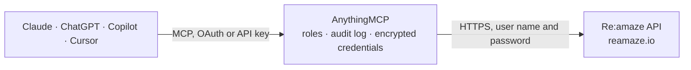

<!-- Generated by scripts/export-github-catalog.mjs in the anythingmcp-website repository. Do not edit by hand. -->

# Re:amaze MCP connector

Re:amaze helpdesk from any AI agent: read and answer conversations across email, chat and social channels, post replies and internal notes, manage contacts and their notes, FAQ articles, channels, … The AnythingMCP connector gives Claude, ChatGPT, Microsoft Copilot, Cursor and Gemini 24 MCP tools for Re:amaze: 16 read and 8 can change data.

**Category:** [Customer Support](../support.md) · **Tools:** 24 · **Setup guide:** [anythingmcp.com](https://anythingmcp.com/guides/reamaze-to-mcp) · [Deutsch](https://anythingmcp.com/de/guides/reamaze-to-mcp) · [Italiano](https://anythingmcp.com/it/guides/reamaze-to-mcp) · [Español](https://anythingmcp.com/es/guides/reamaze-to-mcp) · [日本語](https://anythingmcp.com/ja/guides/reamaze-to-mcp) · [Русский](https://anythingmcp.com/ru/guides/reamaze-to-mcp) · [中文](https://anythingmcp.com/zh/guides/reamaze-to-mcp)

## Start without code

No installation and no terminal: AnythingMCP Cloud runs the Re:amaze connector for you, operated by helpcode.ai in Frankfurt, Germany.

1. **Click the button above** and create an account or sign in. The Re:amaze connector opens, ready to install.
2. **Paste the API key or token from your Re:amaze account.** Every click is in the [step-by-step guide](https://anythingmcp.com/guides/reamaze-to-mcp).
3. **Click Install.** AnythingMCP shows the address of your MCP server.
4. **Add that address to your assistant:** [Claude](https://anythingmcp.com/guides/connect-reamaze-to-claude) · [ChatGPT](https://anythingmcp.com/guides/connect-reamaze-to-chatgpt) · [Microsoft Copilot](https://anythingmcp.com/guides/connect-reamaze-to-copilot) · [Cursor](https://anythingmcp.com/guides/connect-reamaze-to-cursor) · [Gemini CLI](https://anythingmcp.com/guides/connect-reamaze-to-gemini) · [Meta Muse](https://anythingmcp.com/guides/connect-reamaze-to-muse).
5. **Ask your first question.**

Prefer help with the setup? [Talk to us](https://anythingmcp.com/contact).

## How it works

- **The AI client** speaks MCP (Streamable HTTP) to AnythingMCP and only sees tool names, descriptions and results. It never gets the Re:amaze credentials.
- **AnythingMCP** checks the client's role, builds the call from the tool definition, adds the credentials (user name and password), calls Re:amaze, logs the call and returns the result.
- **Re:amaze** sees an ordinary API client with the rights of the account the credentials belong to.

## Tools

| Tool | What it does | Access |
|---|---|---|
| [`reamaze_list_conversations`](#reamaze_list_conversations) | List conversations of the brand, 30 per page, newest first by creation unless `sort` says otherwise. | read |
| [`reamaze_get_conversation`](#reamaze_get_conversation) | Get one conversation: subject, slug, status, tags, first message, last staff and last customer message, author, assignee, channel, custom data and followers. | read |
| [`reamaze_list_conversation_messages`](#reamaze_list_conversation_messages) | List the messages of one conversation, newest first, 30 per page: body, visibility (0 reply, 1 internal note), origin, created_at, user (sender), recipients… | read |
| [`reamaze_list_messages`](#reamaze_list_messages) | List messages across all conversations of the brand, newest first, 30 per page, each with its conversation (subject, slug, channel). | read |
| [`reamaze_create_conversation`](#reamaze_create_conversation) | Create a new conversation on behalf of a customer in a channel, with its first message. | write |
| [`reamaze_update_conversation`](#reamaze_update_conversation) | Update a conversation: status (e.g. 2 Done, 5 On Hold with hold_until), tags (replaces the tag list), custom data, assignee, or move it to another email… | write |
| [`reamaze_create_message`](#reamaze_create_message) | Add a message to a conversation. | write |
| [`reamaze_list_contacts`](#reamaze_list_contacts) | List or search the account's contacts (customers), 30 per page: name, email, friendly_name, mobile and notes. | read |
| [`reamaze_get_contact_identities`](#reamaze_get_contact_identities) | List the identities of one contact: each type (email, mobile, twitter, facebook, instagram, igsid) and identifier. | read |
| [`reamaze_create_contact`](#reamaze_create_contact) | Create a contact with an email or a mobile number (E.164, e.g. +12223334444). | write |
| [`reamaze_update_contact`](#reamaze_update_contact) | Update a contact's name, friendly name, avatar URL or data attributes, and optionally add notes. | write |
| [`reamaze_list_contact_notes`](#reamaze_list_contact_notes) | List all notes on one contact: id, note text, created_at, updated_at and creator (staff name and email). | read |
| [`reamaze_add_contact_note`](#reamaze_add_contact_note) | Add one note to a contact, optionally attributed to another staff user. | write |
| [`reamaze_list_articles`](#reamaze_list_articles) | List or search the brand's FAQ (help center) articles, 30 per page: title, body, slug, status (0 Published, 1 Draft, 4 Internal), url, author and topic. | read |
| [`reamaze_get_article`](#reamaze_get_article) | Get one FAQ article by slug: title, full body, status, url, author, topic and timestamps. | read |
| [`reamaze_create_article`](#reamaze_create_article) | Create a FAQ article in a topic. | write |
| [`reamaze_update_article`](#reamaze_update_article) | Update a FAQ article's title, body or status (0 Published, 1 Draft, 4 Internal). | write |
| [`reamaze_list_channels`](#reamaze_list_channels) | List the brand's channels: name, slug (used as category elsewhere), email, channel type (1 Email, 2 Twitter, 3 Facebook, 6 Chat, 8 Instagram, 9 SMS, 10… | read |
| [`reamaze_get_channel`](#reamaze_get_channel) | Get one channel by slug: name, email, type, visibility, spam filter, reply-from settings, signature, verification state and brand. | read |
| [`reamaze_list_staff`](#reamaze_list_staff) | List the account's staff users, 30 per page, oldest first: name, email, created_at and role. | read |
| [`reamaze_list_response_templates`](#reamaze_list_response_templates) | List or search response templates (canned replies) of the brand, including the user's personal ones: id, name, body and template group. | read |
| [`reamaze_get_response_template`](#reamaze_get_response_template) | Get one response template (canned reply) by id: its name, full body text and template group. | read |
| [`reamaze_list_satisfaction_ratings`](#reamaze_list_satisfaction_ratings) | List customer satisfaction survey ratings, 30 per page: id, rating (1 to 5), comment, user_id, assignee_id, conversation_id and timestamps. | read |
| [`reamaze_get_report`](#reamaze_get_report) | Get a support report between two dates (default the last 30 days; at least 1 day, at most 1 year). | read |

## Tool reference

Every parameter as the AI client sees it in `tools/list`. Source: [`packages/backend/src/adapters/intl/reamaze.json`](../../../packages/backend/src/adapters/intl/reamaze.json).

### `reamaze_list_conversations`

List conversations of the brand, 30 per page, newest first by creation unless `sort` says otherwise. Each has slug (its id), subject, status (0 Open, 1 Responded, 2 Done, 3 Spam, 4 Archived, 5 On Hold), tag_list, first message, last_customer_message, author, assignee, category (channel) and followers. By default only unarchived conversations are returned. Use it to triage the inbox or find a customer's threads.

**Access:** read · **Call:** `GET /conversations`

| Parameter | Type | Required | Description |
|---|---|---|---|
| `filter` | `archived` \| `open` \| `unassigned` \| `all` | no | Only archived, open, unassigned or all conversations. Default: unarchived. |
| `for` | string | no | Email of a user (customer or staff): only conversations relevant to that user. |
| `for_id` | string | no | SSO user id of a customer: only conversations relevant to that customer. |
| `sort` | `updated` \| `changed` | no | updated: by last customer message, newest first; changed: by any update or status change. |
| `tag` | string | no | Comma-separated tags the conversations must carry. |
| `category` | string | no | Channel slug (e.g. support) to list only that channel. |
| `origin` | string | no | Where the conversation was created: number or name, e.g. 1 or email, 0 or native (chat), 9 or sms, 15 or whatsapp. |
| `start_date` | string | no | ISO 8601 date-time: latest customer message on or after it. |
| `end_date` | string | no | ISO 8601 date-time: latest customer message on or before it. |
| `page` | integer | no | Page number, from 1. |

### `reamaze_get_conversation`

Get one conversation: subject, slug, status, tags, first message, last staff and last customer message, author, assignee, channel, custom data and followers. By default `slug` is the conversation slug; with id_type ref it is the reference id, with id_type origin the origin id within a channel (then pass category).

**Access:** read · **Call:** `GET /conversations/{slug}`

| Parameter | Type | Required | Description |
|---|---|---|---|
| `slug` | string | yes | Conversation slug (or reference / origin id with id_type). |
| `id_type` | `ref` \| `origin` | no | How to read `slug`: ref for a reference id, origin for an origin id. |
| `category` | string | no | Channel slug, required with id_type origin. |
| `channel` | string | no | Channel type, optional with id_type origin. |

### `reamaze_list_conversation_messages`

List the messages of one conversation, newest first, 30 per page: body, visibility (0 reply, 1 internal note), origin, created_at, user (sender), recipients and attachments. Use it to read a whole thread before answering.

**Access:** read · **Call:** `GET /conversations/{slug}/messages`

| Parameter | Type | Required | Description |
|---|---|---|---|
| `slug` | string | yes | Conversation slug. |
| `filter` | `staff` \| `customer` | no | Only staff or only customer messages. |
| `include` | `original_body` | no | original_body adds the message HTML when there is one. |
| `page` | integer | no | Page number, from 1. |

### `reamaze_list_messages`

List messages across all conversations of the brand, newest first, 30 per page, each with its conversation (subject, slug, channel). Filter by sender type, sender email, channel, tag, origin or creation date. Use it for activity over a period, e.g. everything a staff member sent yesterday.

**Access:** read · **Call:** `GET /messages`

| Parameter | Type | Required | Description |
|---|---|---|---|
| `filter` | `staff` \| `customer` | no | Only staff or only customer messages. |
| `sent_by` | string | no | Email of the sender. |
| `category` | string | no | Channel slug. |
| `tag` | string | no | Comma-separated conversation tags. |
| `origin` | integer | no | Origin code: 0 chat, 1 email, 2 Twitter, 3 Facebook, 7 API, 8 Instagram, 9 SMS, 10 voice, 15 WhatsApp, 16 staff outbound, 17 contact form, 19 Instagram DM, 22 TikTok. |
| `start_date` | string | no | ISO 8601 date-time: created on or after it. |
| `end_date` | string | no | ISO 8601 date-time: created on or before it. |
| `include` | `original_body` | no | original_body adds the message HTML when there is one. |
| `page` | integer | no | Page number, from 1. |

### `reamaze_create_conversation`

Create a new conversation on behalf of a customer in a channel, with its first message. Returns the new conversation with its slug. Notifications go out as for any new conversation unless suppress_notifications is true. Use it for support forms, follow-ups or outbound threads.

**Access:** write · **Call:** `POST /conversations`

| Parameter | Type | Required | Description |
|---|---|---|---|
| `category` | string | yes | Slug of the channel to create it in (reamaze_list_channels). |
| `subject` | string | yes | Subject line. |
| `body` | string | yes | First message text (Markdown). |
| `user_name` | string | no | Customer name. |
| `user_email` | string | yes | Customer email. |
| `user_data` | object | no | Customer data attributes, one level of key/value pairs. Replaces the customer's existing attributes. |
| `recipients` | string[] | no | Extra participants (emails) copied on this and later messages. |
| `tag_list` | string[] | no | Tags to set. |
| `status` | integer | no | Initial status: 0 Open, 1 Responded, 2 Done, 5 On Hold. |
| `hold_until` | string | no | ISO 8601 date-time when status is 5 (On Hold). |
| `assignee` | string | no | Email of the staff user to assign. |
| `data` | object | no | Custom field attributes of the conversation, key/value pairs. |
| `attachments` | string[] | no | URLs of files Re:amaze fetches and attaches. |
| `suppress_notifications` | boolean | no | true: send no email or integration notifications for this message. |

### `reamaze_update_conversation`

Update a conversation: status (e.g. 2 Done, 5 On Hold with hold_until), tags (replaces the tag list), custom data, assignee, or move it to another email channel. Returns the updated conversation. Pass only what should change.

**Access:** write · **Call:** `PUT /conversations/{slug}`

| Parameter | Type | Required | Description |
|---|---|---|---|
| `slug` | string | yes | Conversation slug. |
| `status` | integer | no | 0 Open, 1 Responded, 2 Done, 3 Spam, 4 Archived, 5 On Hold. |
| `hold_until` | string | no | ISO 8601 date-time when status is 5 (On Hold). |
| `tag_list` | string[] | no | The full new list of tags. |
| `data` | object | no | Custom field attributes to set, key/value pairs. |
| `assignee` | object | no | Staff user to assign, as {"email": "staff@example.com"}. |
| `category` | string | no | Slug of an email channel to move the conversation to. |
| `brand` | string | no | Brand host name of the destination channel, only when moving to another brand. |

### `reamaze_create_message`

Add a message to a conversation. visibility 0 (default) is a reply that Re:amaze sends to the customer at once over the conversation's channel; visibility 1 is an internal note only staff see. Show the user a reply's text before sending. Returns the created message.

**Access:** write · **Call:** `POST /conversations/{slug}/messages`

| Parameter | Type | Required | Description |
|---|---|---|---|
| `slug` | string | yes | Conversation slug. |
| `body` | string | yes | Message text (Markdown). |
| `visibility` | `0` \| `1` | no | 0 reply to the customer, 1 internal note. |
| `user` | object | no | Sender as {"email": ..., "name": ...}; default is the token's user. |
| `recipients` | string[] | no | Emails or phone numbers to receive this and later messages. |
| `attachment` | string | no | URL of a file Re:amaze fetches and attaches. |
| `origin_id` | string | no | Your unique id for the message, to avoid duplicates. |
| `suppress_notifications` | boolean | no | true: send no email or integration notifications. |
| `suppress_autoresolve` | boolean | no | true: do not mark the conversation Done after a staff reply. |
| `suppress_surveys` | boolean | no | true: send no satisfaction survey. |

### `reamaze_list_contacts`

List or search the account's contacts (customers), 30 per page: name, email, friendly_name, mobile and notes. Search by name or email with `q`. Contacts belong to the account, not to one brand.

**Access:** read · **Call:** `GET /contacts`

| Parameter | Type | Required | Description |
|---|---|---|---|
| `q` | string | no | Search text over name and email. |
| `type` | `email` \| `mobile` | no | Only contacts with an email address or with a phone number. |
| `sort` | `date` | no | date: newest first. Default: by name. |
| `page` | integer | no | Page number, from 1. |

### `reamaze_get_contact_identities`

List the identities of one contact: each type (email, mobile, twitter, facebook, instagram, igsid) and identifier. Use it to see every channel a customer can be reached on.

**Access:** read · **Call:** `GET /contacts/{email}/identities`

| Parameter | Type | Required | Description |
|---|---|---|---|
| `email` | string | yes | Contact email address. |

### `reamaze_create_contact`

Create a contact with an email or a mobile number (E.164, e.g. +12223334444). Optional: name, your own user id, avatar URL, notes and data attributes. Returns the contact; 422 when it exists or is invalid.

**Access:** write · **Call:** `POST /contacts`

| Parameter | Type | Required | Description |
|---|---|---|---|
| `name` | string | no | Full name. |
| `email` | string | no | Email address (this or mobile is required). |
| `mobile` | string | no | Phone number in E.164 form without spaces. |
| `id` | string | no | The contact's id in your own application or login system. |
| `external_avatar_url` | string | no | Absolute URL of an avatar image. |
| `notes` | string[] | no | Notes to create, one per entry. |
| `data` | object | no | Customer data attributes, one level of key/value pairs. |

### `reamaze_update_contact`

Update a contact's name, friendly name, avatar URL or data attributes, and optionally add notes. Email and mobile cannot be changed. The contact is found by email, or by another identifier with identifier_type (mobile, facebook, twitter, instagram).

**Access:** write · **Call:** `PUT /contacts/{identifier}`

| Parameter | Type | Required | Description |
|---|---|---|---|
| `identifier` | string | yes | Contact email, or the value matching identifier_type (e.g. +12223334444). |
| `identifier_type` | `mobile` \| `facebook` \| `twitter` \| `instagram` | no | Type of `identifier` when it is not an email. |
| `name` | string | no | Full name. |
| `friendly_name` | string | no | Short name used in greetings. |
| `external_avatar_url` | string | no | Absolute URL of an avatar image. |
| `data` | object | no | Customer data attributes, one level of key/value pairs. |
| `notes` | string[] | no | New notes to add, one per entry. |

### `reamaze_list_contact_notes`

List all notes on one contact: id, note text, created_at, updated_at and creator (staff name and email).

**Access:** read · **Call:** `GET /contacts/{identifier}/notes`

| Parameter | Type | Required | Description |
|---|---|---|---|
| `identifier` | string | yes | Contact email or phone number. |

### `reamaze_add_contact_note`

Add one note to a contact, optionally attributed to another staff user. Returns all notes of the contact including the new one.

**Access:** write · **Call:** `POST /contacts/{identifier}/notes`

| Parameter | Type | Required | Description |
|---|---|---|---|
| `identifier` | string | yes | Contact email or phone number. |
| `body` | string | yes | Note text. |
| `creator_email` | string | no | Email of the staff user the note is attributed to. Default: the token's user. |
| `created_at` | string | no | ISO 8601 date-time of the note. Default: now. |

### `reamaze_list_articles`

List or search the brand's FAQ (help center) articles, 30 per page: title, body, slug, status (0 Published, 1 Draft, 4 Internal), url, author and topic. Default: published articles only. Use it to find an answer to quote to a customer.

**Access:** read · **Call:** `GET /articles`

| Parameter | Type | Required | Description |
|---|---|---|---|
| `q` | string | no | Keywords to search for. |
| `status` | `published` \| `draft` \| `internal` | no | Which articles to list. Default: published. |
| `page` | integer | no | Page number, from 1. |

### `reamaze_get_article`

Get one FAQ article by slug: title, full body, status, url, author, topic and timestamps.

**Access:** read · **Call:** `GET /articles/{slug}`

| Parameter | Type | Required | Description |
|---|---|---|---|
| `slug` | string | yes | Article slug. |

### `reamaze_create_article`

Create a FAQ article in a topic. status 1 (Draft) keeps it unpublished for review; 0 publishes it, 4 makes it internal. Returns the new article.

**Access:** write · **Call:** `POST /topics/{topic_slug}/articles`

| Parameter | Type | Required | Description |
|---|---|---|---|
| `topic_slug` | string | yes | Slug of the FAQ topic (the topic.slug of an existing article). |
| `title` | string | yes | Article title. |
| `body` | string | yes | Article body. |
| `status` | `0` \| `1` \| `4` | no | 0 Published, 1 Draft, 4 Internal. |

### `reamaze_update_article`

Update a FAQ article's title, body or status (0 Published, 1 Draft, 4 Internal). Returns the updated article.

**Access:** write · **Call:** `PUT /articles/{slug}`

| Parameter | Type | Required | Description |
|---|---|---|---|
| `slug` | string | yes | Article slug. |
| `title` | string | no | New title. |
| `body` | string | no | New body; replaces the old one. |
| `status` | `0` \| `1` \| `4` | no | 0 Published, 1 Draft, 4 Internal. |

### `reamaze_list_channels`

List the brand's channels: name, slug (used as category elsewhere), email, channel type (1 Email, 2 Twitter, 3 Facebook, 6 Chat, 8 Instagram, 9 SMS, 10 Voice, 12 Messenger, 15 WhatsApp, 16 Instagram DM, 20 TikTok), visibility, signature and brand. Also checks the connection.

**Access:** read · **Call:** `GET /channels`

| Parameter | Type | Required | Description |
|---|---|---|---|
| `channel` | `email` \| `facebook` \| `twitter` \| `chat` | no | Only channels of this type. |

### `reamaze_get_channel`

Get one channel by slug: name, email, type, visibility, spam filter, reply-from settings, signature, verification state and brand.

**Access:** read · **Call:** `GET /channels/{slug}`

| Parameter | Type | Required | Description |
|---|---|---|---|
| `slug` | string | yes | Channel slug. |

### `reamaze_list_staff`

List the account's staff users, 30 per page, oldest first: name, email, created_at and role. Use the emails to assign conversations.

**Access:** read · **Call:** `GET /staff`

| Parameter | Type | Required | Description |
|---|---|---|---|
| `page` | integer | no | Page number, from 1. |

### `reamaze_list_response_templates`

List or search response templates (canned replies) of the brand, including the user's personal ones: id, name, body and template group.

**Access:** read · **Call:** `GET /response_templates`

| Parameter | Type | Required | Description |
|---|---|---|---|
| `q` | string | no | Keywords to search for. |
| `page` | integer | no | Page number, from 1. |

### `reamaze_get_response_template`

Get one response template (canned reply) by id: its name, full body text and template group.

**Access:** read · **Call:** `GET /response_templates/{id}`

| Parameter | Type | Required | Description |
|---|---|---|---|
| `id` | integer | yes | Response template id. |

### `reamaze_list_satisfaction_ratings`

List customer satisfaction survey ratings, 30 per page: id, rating (1 to 5), comment, user_id, assignee_id, conversation_id and timestamps. Default: all brands of the account. Needs the access_reports permission.

**Access:** read · **Call:** `GET /satisfaction_ratings`

| Parameter | Type | Required | Description |
|---|---|---|---|
| `brand` | string | no | Brand host name to filter on, or all_brands. |
| `rating` | integer | no | Only this rating. |
| `assignee_id` | string | no | Only ratings of conversations assigned to this staff id. |
| `created_after` | string | no | ISO 8601 date-time. |
| `created_before` | string | no | ISO 8601 date-time. |
| `updated_after` | string | no | ISO 8601 date-time. |
| `updated_before` | string | no | ISO 8601 date-time. |
| `page` | integer | no | Page number, from 1. |

### `reamaze_get_report`

Get a support report between two dates (default the last 30 days; at least 1 day, at most 1 year). report: volume (conversations per day), response_time (seconds per day plus averages, trends and the share answered within an hour, day, week), staff (responses, response time and appreciations per staff member), tags (conversations per tag) or channel_summary (per channel: responses, response time, active, resolved and archived conversations, satisfaction, thread size). Default: all brands. Needs the access_reports permission.

**Access:** read · **Call:** `GET /reports/{report}`

| Parameter | Type | Required | Description |
|---|---|---|---|
| `report` | `volume` \| `response_time` \| `staff` \| `tags` \| `channel_summary` | yes | Which report. |
| `start_date` | string | no | First day, YYYY-MM-DD. |
| `end_date` | string | no | Last day, YYYY-MM-DD. |
| `brand` | string | no | Brand host name to limit the report to one brand. |

## Run it yourself

AnythingMCP is open source (AGPL-3.0). [Run it with Docker](../../../README.md#run-it-yourself), open **Connectors → Store**, pick **Re:amaze** and enter `REAMAZE_BRAND`, `REAMAZE_LOGIN_EMAIL`, `REAMAZE_API_TOKEN`, then add your MCP server URL to the AI client.

[← Customer Support connectors](../support.md) · [All categories](../README.md)
