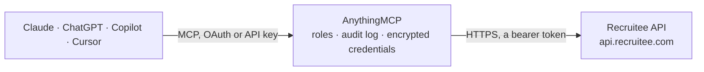

<!-- Generated by scripts/export-github-catalog.mjs in the anythingmcp-website repository. Do not edit by hand. -->

# Recruitee MCP connector

Recruitee applicant tracking: jobs (offers) and talent pools, candidates and full search, pipelines and stages, placements, notes, tags, departments, locations, interviews and evaluations, tasks and activity. The AnythingMCP connector gives Claude, ChatGPT, Microsoft Copilot, Cursor and Gemini 45 MCP tools for Recruitee: 26 read and 19 can change data.

**Category:** [HR](../hr.md) · **Tools:** 45 · **Setup guide:** [anythingmcp.com](https://anythingmcp.com/guides/recruitee-to-mcp) · [Deutsch](https://anythingmcp.com/de/guides/recruitee-to-mcp) · [Italiano](https://anythingmcp.com/it/guides/recruitee-to-mcp) · [Español](https://anythingmcp.com/es/guides/recruitee-to-mcp) · [日本語](https://anythingmcp.com/ja/guides/recruitee-to-mcp) · [Русский](https://anythingmcp.com/ru/guides/recruitee-to-mcp) · [中文](https://anythingmcp.com/zh/guides/recruitee-to-mcp)

## Start without code

No installation and no terminal: AnythingMCP Cloud runs the Recruitee connector for you, operated by helpcode.ai in Frankfurt, Germany.

1. **Click the button above** and create an account or sign in. The Recruitee connector opens, ready to install.
2. **Paste the API key or token from your Recruitee account.** Every click is in the [step-by-step guide](https://anythingmcp.com/guides/recruitee-to-mcp).
3. **Click Install.** AnythingMCP shows the address of your MCP server.
4. **Add that address to your assistant:** [Claude](https://anythingmcp.com/guides/connect-recruitee-to-claude) · [ChatGPT](https://anythingmcp.com/guides/connect-recruitee-to-chatgpt) · [Microsoft Copilot](https://anythingmcp.com/guides/connect-recruitee-to-copilot) · [Cursor](https://anythingmcp.com/guides/connect-recruitee-to-cursor) · [Gemini CLI](https://anythingmcp.com/guides/connect-recruitee-to-gemini) · [Meta Muse](https://anythingmcp.com/guides/connect-recruitee-to-muse).
5. **Ask your first question**, for example: *Find candidate with email laura.koskinen@talentmail.fi for job JS-2026-14, show placement stage and last activity*

Prefer help with the setup? [Talk to us](https://anythingmcp.com/contact).

## How it works

- **The AI client** speaks MCP (Streamable HTTP) to AnythingMCP and only sees tool names, descriptions and results. It never gets the Recruitee credentials.
- **AnythingMCP** checks the client's role, builds the call from the tool definition, adds the credentials (a bearer token), calls Recruitee, logs the call and returns the result.
- **Recruitee** sees an ordinary API client with the rights of the account the credentials belong to.

## Tools

| Tool | What it does | Access |
|---|---|---|
| [`recruitee_get_current_admin`](#recruitee_get_current_admin) | The team member (admin) the token belongs to: id, name, email, role and time zone. | read |
| [`recruitee_list_admins`](#recruitee_list_admins) | Team members (admins) of the company with id, name, email and role; ids are used for task assignees, interview participants and followers. | read |
| [`recruitee_list_offers`](#recruitee_list_offers) | Jobs and talent pools (Recruitee calls them offers): id, title, status, kind, department, locations, recruiter, candidate counts, pipeline and careers site URL. | read |
| [`recruitee_get_offer`](#recruitee_get_offer) | One job or talent pool by id with description, requirements, locations, department, hiring team and its pipeline stages (ids used to move candidates). | read |
| [`recruitee_list_offer_notes`](#recruitee_list_offer_notes) | Internal team notes on a job (offer), with author, text and time of each note. | read |
| [`recruitee_list_candidates`](#recruitee_list_candidates) | List candidates with name, emails, phones, source, tags, rating, placements (job, stage, disqualified) and creation date. | read |
| [`recruitee_search_candidates`](#recruitee_search_candidates) | Full candidate search across the database with filters on text, tags, sources, stages, ratings, dates, custom fields, education and experience. | read |
| [`recruitee_get_candidate`](#recruitee_get_candidate) | One candidate by id: contact details, CV and cover letter links, sources, tags, custom fields, ratings, placements (job, stage, disqualification) and open… | read |
| [`recruitee_list_candidate_notes`](#recruitee_list_candidate_notes) | Team notes on a candidate with author, text, pinned flag and time of each note. | read |
| [`recruitee_list_candidate_activities`](#recruitee_list_candidate_activities) | Activity history of a candidate: applications, stage moves, emails, notes, evaluations and events, newest first. | read |
| [`recruitee_list_activities`](#recruitee_list_activities) | Company-wide activity feed (applications, stage changes, notes, emails, evaluations), filterable by candidates, offers, event names and dates. | read |
| [`recruitee_list_placements`](#recruitee_list_placements) | Candidates in a job's pipeline (placements): placement id, candidate, stage, disqualification, rating, upcoming event and overdue date. | read |
| [`recruitee_list_pipeline_templates`](#recruitee_list_pipeline_templates) | Pipeline templates with their stages (id, name, category such as apply, interview, offer, hire). | read |
| [`recruitee_get_pipeline_template`](#recruitee_get_pipeline_template) | One pipeline template with all its stages in order (stage id, name and category). | read |
| [`recruitee_list_disqualify_reasons`](#recruitee_list_disqualify_reasons) | Reasons a candidate can be disqualified with (id and name), for recruitee_disqualify_candidate. | read |
| [`recruitee_list_departments`](#recruitee_list_departments) | Departments of the company with id, name and offer counts, to filter or create jobs. | read |
| [`recruitee_get_department`](#recruitee_get_department) | One department by id with its name and translations, to resolve the department_id of a job. | read |
| [`recruitee_list_locations`](#recruitee_list_locations) | Job locations with id, name, address, city, country and active flag. | read |
| [`recruitee_get_location`](#recruitee_get_location) | One job location by id with its full address, translations and active flag. | read |
| [`recruitee_list_tags`](#recruitee_list_tags) | Candidate tags of the company with id, name and how many candidates carry them. | read |
| [`recruitee_list_sources`](#recruitee_list_sources) | Candidate sources (where applicants came from) with id and name. | read |
| [`recruitee_list_interview_events`](#recruitee_list_interview_events) | Scheduled interviews and other events: candidate, job, participants, start and end, location or video link, status. | read |
| [`recruitee_get_interview_event`](#recruitee_get_interview_event) | One interview event with participants, times, location and the candidate. | read |
| [`recruitee_list_interview_results`](#recruitee_list_interview_results) | Evaluations and scorecards written about candidates, with reviewer, rating and answers. | read |
| [`recruitee_list_tasks`](#recruitee_list_tasks) | Recruiting tasks of the company: title, description, candidate, assignees, due date and completion. | read |
| [`recruitee_list_candidate_tasks`](#recruitee_list_candidate_tasks) | Tasks linked to one candidate with assignees, due date and completion. | read |
| [`recruitee_create_candidate`](#recruitee_create_candidate) | Add a candidate, optionally applied to jobs. | write |
| [`recruitee_update_candidate`](#recruitee_update_candidate) | Change a candidate's profile: name, emails, phones, links, cover letter or sources. | write |
| [`recruitee_delete_candidate`](#recruitee_delete_candidate) | Delete a candidate with all their data. | write |
| [`recruitee_add_candidate_tags`](#recruitee_add_candidate_tags) | Add tags to a candidate by name; tag names that do not exist yet are created. | write |
| [`recruitee_remove_candidate_tags`](#recruitee_remove_candidate_tags) | Remove tags from a candidate (the tags stay in the company list). | write |
| [`recruitee_add_candidate_field`](#recruitee_add_candidate_field) | Add a profile field to a candidate, e.g. skills, languages, nationality or a single-line value. | write |
| [`recruitee_create_candidate_note`](#recruitee_create_candidate_note) | Write a team note on a candidate's profile (visible to the hiring team, not to the candidate). | write |
| [`recruitee_assign_candidate`](#recruitee_assign_candidate) | Put an existing candidate into a job's pipeline (first stage) or a talent pool. | write |
| [`recruitee_change_stage`](#recruitee_change_stage) | Move a candidate's placement to another pipeline stage. | write |
| [`recruitee_disqualify_candidate`](#recruitee_disqualify_candidate) | Disqualify a candidate in one job (placement) with a reason. | write |
| [`recruitee_requalify_candidate`](#recruitee_requalify_candidate) | Requalify a disqualified candidate in one job (placement), back into the pipeline. | write |
| [`recruitee_remove_placement`](#recruitee_remove_placement) | Remove a candidate from a job's pipeline, with that placement's stage history. | write |
| [`recruitee_create_offer`](#recruitee_create_offer) | Create a job (or talent pool) as a draft; publish it with recruitee_publish_offer. | write |
| [`recruitee_update_offer`](#recruitee_update_offer) | Change a job's fields, e.g. title, description, requirements, department, locations or salary. | write |
| [`recruitee_publish_offer`](#recruitee_publish_offer) | Publish a job on the careers site and job boards set up for it. | write |
| [`recruitee_unpublish_offer`](#recruitee_unpublish_offer) | Unpublish a job: it leaves the careers site but keeps its candidates. | write |
| [`recruitee_close_offer`](#recruitee_close_offer) | Close a job: no new applications, candidates stay in the pipeline. | write |
| [`recruitee_create_task`](#recruitee_create_task) | Create a recruiting task for team members, optionally linked to a candidate and with a due date. | write |
| [`recruitee_complete_task`](#recruitee_complete_task) | Mark a task as completed, or reopen it with completed false. | write |

## Tool reference

Every parameter as the AI client sees it in `tools/list`. Source: [`packages/backend/src/adapters/intl/recruitee.json`](../../../packages/backend/src/adapters/intl/recruitee.json).

### `recruitee_get_current_admin`

The team member (admin) the token belongs to: id, name, email, role and time zone. The install check.

**Access:** read · **Call:** `GET /admin`

No parameters.

### `recruitee_list_admins`

Team members (admins) of the company with id, name, email and role; ids are used for task assignees, interview participants and followers.

**Access:** read · **Call:** `GET /admins`

| Parameter | Type | Required | Description |
|---|---|---|---|
| `authorized_for_candidate_id` | integer | no | Only team members who can access this candidate. |

### `recruitee_list_offers`

Jobs and talent pools (Recruitee calls them offers): id, title, status, kind, department, locations, recruiter, candidate counts, pipeline and careers site URL.

**Access:** read · **Call:** `GET /offers`

| Parameter | Type | Required | Description |
|---|---|---|---|
| `statuses` | string[] | no | draft, published, internal, closed, archived. Omit for all. |
| `kind` | `job` \| `talent_pool` | no | job or talent_pool. Omit for both. |
| `department_ids` | integer[] | no | Only these department ids. |
| `location_ids` | integer[] | no | Only these location ids. |
| `tag_ids` | integer[] | no | Only these offer tag ids. |
| `offer_ids` | integer[] | no | Only these offer ids. |
| `recruiter_ids` | integer[] | no | Only offers with these recruiter admin ids. |
| `hiring_manager_ids` | integer[] | no | Only offers with these hiring manager admin ids. |
| `include` | string[] | no | Extra parts: description, requirements, highlight, work_models, salary, dynamic_fields, follower_ids, location_ids, requisition_ids, tags, counters. |
| `limit` | integer | no | Results per page (default 1000). |
| `page` | integer | no | Page number, from 1. |

### `recruitee_get_offer`

One job or talent pool by id with description, requirements, locations, department, hiring team and its pipeline stages (ids used to move candidates).

**Access:** read · **Call:** `GET /offers/{id}`

| Parameter | Type | Required | Description |
|---|---|---|---|
| `id` | integer | yes | Offer id. |

### `recruitee_list_offer_notes`

Internal team notes on a job (offer), with author, text and time of each note.

**Access:** read · **Call:** `GET /offers/{offer_id}/notes`

| Parameter | Type | Required | Description |
|---|---|---|---|
| `offer_id` | integer | yes | Offer id. |

### `recruitee_list_candidates`

List candidates with name, emails, phones, source, tags, rating, placements (job, stage, disqualified) and creation date. Contains personal data.

**Access:** read · **Call:** `GET /candidates`

| Parameter | Type | Required | Description |
|---|---|---|---|
| `query` | string | no | Search the candidate's name or job. |
| `offer_id` | integer | no | Only candidates of this offer. |
| `qualified` | boolean | no | true only qualified candidates. |
| `disqualified` | boolean | no | true only disqualified candidates. |
| `deleted` | boolean | no | true only deleted candidates. |
| `ids` | string | no | Comma-separated candidate ids, e.g. 234221,4211412. |
| `created_after` | string | no | Only candidates created after this date, YYYY-MM-DD. |
| `sort` | `by_date` \| `by_last_message` | no | by_date (default) or by_last_message. |
| `limit` | integer | no | Results per call, default 100, max 1000. |
| `offset` | integer | no | Results to skip: previous offset plus limit. |

### `recruitee_search_candidates`

Full candidate search across the database with filters on text, tags, sources, stages, ratings, dates, custom fields, education and experience.

**Access:** read · **Call:** `GET /search/new/candidates`

| Parameter | Type | Required | Description |
|---|---|---|---|
| `filters_json` | string | no | Filters as a JSON array string, e.g. [{"field":"all","query":"python developer"}] for full text, [{"filter":"tags","id":{"in":[12]}}] for tags, [{"field":"created_at","gte":"2026-10-01"}] for dates. Combine several objects in the array. |
| `sort_by` | string | no | Field and direction, e.g. created_at_desc (default), relevance_desc, candidate_name_asc, last_activity_at_desc, candidate_rating_desc. |
| `limit` | integer | no | Results per page (default 60). |
| `page` | integer | no | Page number, from 1. |

### `recruitee_get_candidate`

One candidate by id: contact details, CV and cover letter links, sources, tags, custom fields, ratings, placements (job, stage, disqualification) and open question answers.

**Access:** read · **Call:** `GET /candidates/{id}`

| Parameter | Type | Required | Description |
|---|---|---|---|
| `id` | integer | yes | Candidate id. |

### `recruitee_list_candidate_notes`

Team notes on a candidate with author, text, pinned flag and time of each note.

**Access:** read · **Call:** `GET /candidates/{candidate_id}/notes`

| Parameter | Type | Required | Description |
|---|---|---|---|
| `candidate_id` | integer | yes | Candidate id. |

### `recruitee_list_candidate_activities`

Activity history of a candidate: applications, stage moves, emails, notes, evaluations and events, newest first.

**Access:** read · **Call:** `GET /tracking/candidates/{candidate_id}/activities`

| Parameter | Type | Required | Description |
|---|---|---|---|
| `candidate_id` | integer | yes | Candidate id. |

### `recruitee_list_activities`

Company-wide activity feed (applications, stage changes, notes, emails, evaluations), filterable by candidates, offers, event names and dates.

**Access:** read · **Call:** `GET /tracking/activities`

| Parameter | Type | Required | Description |
|---|---|---|---|
| `candidates` | integer[] | no | Only these candidate ids. |
| `offers` | integer[] | no | Only these offer ids. |
| `events` | string[] | no | Only these activity event names. |
| `start_date` | string | no | From date, YYYY-MM-DD. |
| `end_date` | string | no | To date, YYYY-MM-DD. |
| `limit` | integer | no | Results per page (default 20). |
| `page` | integer | no | Page number, from 1. |

### `recruitee_list_placements`

Candidates in a job's pipeline (placements): placement id, candidate, stage, disqualification, rating, upcoming event and overdue date.

**Access:** read · **Call:** `GET /offers/{offer_id}/placements`

| Parameter | Type | Required | Description |
|---|---|---|---|
| `offer_id` | integer | yes | Offer id. |
| `stage_id` | integer | no | Only this pipeline stage. |
| `qualified` | boolean | no | true only qualified. |
| `disqualified` | boolean | no | true only disqualified. |
| `sort_by` | string | no | Sort field. |
| `sort_order` | `asc` \| `desc` | no | asc or desc. |
| `with_tags` | boolean | no | Include tags (default false). |

### `recruitee_list_pipeline_templates`

Pipeline templates with their stages (id, name, category such as apply, interview, offer, hire).

**Access:** read · **Call:** `GET /pipeline_templates`

| Parameter | Type | Required | Description |
|---|---|---|---|
| `title` | string | no | Only templates with this title. |

### `recruitee_get_pipeline_template`

One pipeline template with all its stages in order (stage id, name and category).

**Access:** read · **Call:** `GET /pipeline_templates/{id}`

| Parameter | Type | Required | Description |
|---|---|---|---|
| `id` | integer | yes | Pipeline template id. |

### `recruitee_list_disqualify_reasons`

Reasons a candidate can be disqualified with (id and name), for recruitee_disqualify_candidate.

**Access:** read · **Call:** `GET /disqualify_reasons`

No parameters.

### `recruitee_list_departments`

Departments of the company with id, name and offer counts, to filter or create jobs.

**Access:** read · **Call:** `GET /departments`

No parameters.

### `recruitee_get_department`

One department by id with its name and translations, to resolve the department_id of a job.

**Access:** read · **Call:** `GET /departments/{id}`

| Parameter | Type | Required | Description |
|---|---|---|---|
| `id` | integer | yes | Department id. |

### `recruitee_list_locations`

Job locations with id, name, address, city, country and active flag.

**Access:** read · **Call:** `GET /locations`

| Parameter | Type | Required | Description |
|---|---|---|---|
| `query` | string | no | Search term. |
| `scope` | `active` \| `archived` \| `all` | no | active, archived or all (default). |
| `view_mode` | `brief` \| `full` | no | brief (default) or full with translations and offer counters. |
| `limit` | integer | no | Results per page (default 60). |
| `page` | integer | no | Page number, from 1. |

### `recruitee_get_location`

One job location by id with its full address, translations and active flag.

**Access:** read · **Call:** `GET /locations/{id}`

| Parameter | Type | Required | Description |
|---|---|---|---|
| `id` | integer | yes | Location id. |

### `recruitee_list_tags`

Candidate tags of the company with id, name and how many candidates carry them.

**Access:** read · **Call:** `GET /tags`

| Parameter | Type | Required | Description |
|---|---|---|---|
| `query` | string | no | Search term. |
| `sort_by` | `name` \| `taggings_count` | no | name or taggings_count. |
| `sort_order` | `asc` \| `desc` | no | asc (default) or desc. |

### `recruitee_list_sources`

Candidate sources (where applicants came from) with id and name.

**Access:** read · **Call:** `GET /sources`

No parameters.

### `recruitee_list_interview_events`

Scheduled interviews and other events: candidate, job, participants, start and end, location or video link, status.

**Access:** read · **Call:** `GET /interview/events`

| Parameter | Type | Required | Description |
|---|---|---|---|
| `scope` | `my` \| `all` | no | my or all (default). |
| `status` | `upcoming` \| `past_due` \| `all` | no | upcoming (default), past_due or all. |
| `candidate_id` | integer | no | Only events of this candidate. |
| `admin_ids` | integer[] | no | Only events of these team members. |
| `start_date` | string | no | Range start, YYYY-MM-DD. |
| `end_date` | string | no | Range end, YYYY-MM-DD. |
| `timezone` | string | no | Time zone of the range, e.g. Europe/Amsterdam. |
| `limit` | integer | no | Results per page (default unlimited). |
| `page` | integer | no | Page number, with limit. |

### `recruitee_get_interview_event`

One interview event with participants, times, location and the candidate.

**Access:** read · **Call:** `GET /interview/events/{id}`

| Parameter | Type | Required | Description |
|---|---|---|---|
| `id` | integer | yes | Event id. |

### `recruitee_list_interview_results`

Evaluations and scorecards written about candidates, with reviewer, rating and answers.

**Access:** read · **Call:** `GET /interview/results`

| Parameter | Type | Required | Description |
|---|---|---|---|
| `candidate_id` | integer | no | Only results for this candidate. |
| `kind` | `evaluation` \| `questionnaire` \| `all` | no | evaluation, questionnaire or all (default). |
| `scope` | `my` \| `all` | no | my or all (default). |
| `admin_ids` | integer[] | no | Only results by these team members. |
| `limit` | integer | no | Results per page. |
| `page` | integer | no | Page number, with limit. |

### `recruitee_list_tasks`

Recruiting tasks of the company: title, description, candidate, assignees, due date and completion.

**Access:** read · **Call:** `GET /tasks`

| Parameter | Type | Required | Description |
|---|---|---|---|
| `scope` | `my` \| `unassigned` \| `all` | no | my, unassigned or all. |
| `status` | `completed` \| `uncompleted` | no | completed or uncompleted. |
| `admin_ids` | integer[] | no | Only tasks of these team members. |
| `sort_by` | `due_date` \| `created_at` \| `completed_at` | no | due_date, created_at or completed_at. |
| `sort_order` | `asc` \| `desc` | no | asc or desc. |
| `limit` | integer | no | Results per page. |
| `page` | integer | no | Page number. |

### `recruitee_list_candidate_tasks`

Tasks linked to one candidate with assignees, due date and completion.

**Access:** read · **Call:** `GET /candidates/{candidate_id}/tasks`

| Parameter | Type | Required | Description |
|---|---|---|---|
| `candidate_id` | integer | yes | Candidate id. |
| `status` | `completed` \| `uncompleted` | no | completed or uncompleted. |

### `recruitee_create_candidate`

Add a candidate, optionally applied to jobs. Recruitee may send automatic emails configured for the job.

**Access:** write · **Call:** `POST /candidates`

| Parameter | Type | Required | Description |
|---|---|---|---|
| `name` | string | yes | Full name. |
| `emails` | string[] | no | Email addresses. |
| `phones` | string[] | no | Phone numbers. |
| `links` | string[] | no | Links, e.g. a portfolio. |
| `social_links` | string[] | no | Social profile links, e.g. LinkedIn. |
| `cover_letter` | string | no | Cover letter text. |
| `sources` | string[] | no | Source tags, e.g. ["Referral"]. |
| `remote_cv_url` | string | no | Public URL of the CV file; Recruitee downloads and parses it. |
| `offers` | integer[] | no | Offer ids to apply the candidate to (first stage). Omit to add without a job. |

### `recruitee_update_candidate`

Change a candidate's profile: name, emails, phones, links, cover letter or sources. Only the fields sent change.

**Access:** write · **Call:** `PATCH /candidates/{id}`

| Parameter | Type | Required | Description |
|---|---|---|---|
| `id` | integer | yes | Candidate id. |
| `fields` | object | yes | Profile fields, e.g. {"name":"Ana Diaz","emails":["ana@example.com"],"phones":["+31 6 1234 5678"]}. |

### `recruitee_delete_candidate`

Delete a candidate with all their data. Cannot be undone; switched off at install.

**Access:** write · **Call:** `DELETE /candidates/{id}`

| Parameter | Type | Required | Description |
|---|---|---|---|
| `id` | integer | yes | Candidate id. |

### `recruitee_add_candidate_tags`

Add tags to a candidate by name; tag names that do not exist yet are created.

**Access:** write · **Call:** `POST /candidates/{candidate_id}/tags`

| Parameter | Type | Required | Description |
|---|---|---|---|
| `candidate_id` | integer | yes | Candidate id. |
| `tags` | string[] | yes | Tag names, e.g. ["Python","Senior"]. |

### `recruitee_remove_candidate_tags`

Remove tags from a candidate (the tags stay in the company list).

**Access:** write · **Call:** `DELETE /candidates/{candidate_id}/tags`

| Parameter | Type | Required | Description |
|---|---|---|---|
| `candidate_id` | integer | yes | Candidate id. |
| `tags` | string[] | yes | Tag names to remove. |

### `recruitee_add_candidate_field`

Add a profile field to a candidate, e.g. skills, languages, nationality or a single-line value.

**Access:** write · **Call:** `POST /custom_fields/candidates/{candidate_id}/fields`

| Parameter | Type | Required | Description |
|---|---|---|---|
| `candidate_id` | integer | yes | Candidate id. |
| `kind` | `single_line` \| `multi_line` \| `boolean` \| `address` \| `gender` \| `date_of_birth` \| `nationality` \| `language_skill` \| `skills` | yes | Field type. |
| `name` | string | no | Field name (for single_line, multi_line and boolean). |
| `values` | object[] | yes | Values, e.g. [{"text":"Python"}] for skills or single_line, [{"flag":true}] for boolean, [{"language_code":"de","level":"fluent"}] for language_skill, [{"country_code":"NL"}] for nationality, [{"date":"1990-04-01"}] for date_of_birth. |

### `recruitee_create_candidate_note`

Write a team note on a candidate's profile (visible to the hiring team, not to the candidate).

**Access:** write · **Call:** `POST /candidates/{candidate_id}/notes`

| Parameter | Type | Required | Description |
|---|---|---|---|
| `candidate_id` | integer | yes | Candidate id. |
| `text` | string | yes | Note text. |

### `recruitee_assign_candidate`

Put an existing candidate into a job's pipeline (first stage) or a talent pool. Returns the placement.

**Access:** write · **Call:** `POST /placements`

| Parameter | Type | Required | Description |
|---|---|---|---|
| `candidate_id` | integer | yes | Candidate id. |
| `offer_id` | integer | no | Offer (job) id. Give this or talent_pool_id. |
| `talent_pool_id` | integer | no | Talent pool id. |
| `location_ids` | integer[] | no | Location ids of the job the candidate applies for. |

### `recruitee_change_stage`

Move a candidate's placement to another pipeline stage. Moving to a hired stage can need hired_at, work_location_id and, with requisitions, opening_id.

**Access:** write · **Call:** `PATCH /placements/{placement_id}/change_stage`

| Parameter | Type | Required | Description |
|---|---|---|---|
| `placement_id` | integer | yes | Placement id (from recruitee_get_candidate or recruitee_list_placements). |
| `stage_id` | integer | yes | Target stage id (from recruitee_get_offer). |
| `proceed` | boolean | no | true places the candidate at the top of the stage. |
| `hired_at` | string | no | Hire date-time, ISO 8601, for a hired stage. |
| `job_starts_at` | string | no | Start date-time, ISO 8601. |
| `work_location_id` | integer | no | Work location id, needed when hiring. |
| `opening_id` | integer | no | Requisition opening id, needed when hiring with requisitions. |
| `run_actions` | boolean | no | true runs the stage's automated actions (e.g. emails). |

### `recruitee_disqualify_candidate`

Disqualify a candidate in one job (placement) with a reason. Reversible with recruitee_requalify_candidate.

**Access:** write · **Call:** `PATCH /placements/{placement_id}/disqualify`

| Parameter | Type | Required | Description |
|---|---|---|---|
| `placement_id` | integer | yes | Placement id. |
| `disqualify_reason_id` | integer | yes | Reason id from recruitee_list_disqualify_reasons. |

### `recruitee_requalify_candidate`

Requalify a disqualified candidate in one job (placement), back into the pipeline.

**Access:** write · **Call:** `PATCH /placements/{placement_id}/requalify`

| Parameter | Type | Required | Description |
|---|---|---|---|
| `placement_id` | integer | yes | Placement id. |

### `recruitee_remove_placement`

Remove a candidate from a job's pipeline, with that placement's stage history. Cannot be undone; switched off at install.

**Access:** write · **Call:** `DELETE /placements/{placement_id}`

| Parameter | Type | Required | Description |
|---|---|---|---|
| `placement_id` | integer | yes | Placement id. |

### `recruitee_create_offer`

Create a job (or talent pool) as a draft; publish it with recruitee_publish_offer.

**Access:** write · **Call:** `POST /offers`

| Parameter | Type | Required | Description |
|---|---|---|---|
| `title` | string | yes | Job title. |
| `kind` | `job` \| `talent_pool` | no | job (default) or talent_pool. |
| `description` | string | no | Job description (HTML allowed). |
| `requirements` | string | no | Requirements (HTML allowed). |
| `department_id` | integer | no | Department id. |
| `location_ids` | integer[] | no | Location ids from recruitee_list_locations. |
| `remote` | boolean | no | Show as remote. |
| `hybrid` | boolean | no | Show as hybrid. |
| `on_site` | boolean | no | Show as on-site. |

### `recruitee_update_offer`

Change a job's fields, e.g. title, description, requirements, department, locations or salary. Only the fields sent change.

**Access:** write · **Call:** `PATCH /offers/{id}`

| Parameter | Type | Required | Description |
|---|---|---|---|
| `id` | integer | yes | Offer id. |
| `fields` | object | yes | Offer fields, e.g. {"title":"Senior Engineer","salary":{"min":4000,"max":5500,"currency":"EUR","period":"month"}}. |

### `recruitee_publish_offer`

Publish a job on the careers site and job boards set up for it.

**Access:** write · **Call:** `PATCH /offers/{id}/publish`

| Parameter | Type | Required | Description |
|---|---|---|---|
| `id` | integer | yes | Offer id. |

### `recruitee_unpublish_offer`

Unpublish a job: it leaves the careers site but keeps its candidates.

**Access:** write · **Call:** `PATCH /offers/{id}/unpublish`

| Parameter | Type | Required | Description |
|---|---|---|---|
| `id` | integer | yes | Offer id. |

### `recruitee_close_offer`

Close a job: no new applications, candidates stay in the pipeline.

**Access:** write · **Call:** `PATCH /offers/{id}/close`

| Parameter | Type | Required | Description |
|---|---|---|---|
| `id` | integer | yes | Offer id. |

### `recruitee_create_task`

Create a recruiting task for team members, optionally linked to a candidate and with a due date.

**Access:** write · **Call:** `POST /tasks`

| Parameter | Type | Required | Description |
|---|---|---|---|
| `title` | string | yes | Task title. |
| `description` | string | no | Details. |
| `candidate_id` | integer | no | Candidate the task is about. |
| `admin_ids` | integer[] | no | Assignee team member ids from recruitee_list_admins. |
| `due_date` | string | no | Due date-time, ISO 8601. |
| `timezone` | string | no | Time zone of the due date, e.g. Europe/Amsterdam (required with due_date). |

### `recruitee_complete_task`

Mark a task as completed, or reopen it with completed false.

**Access:** write · **Call:** `PATCH /tasks/{id}/completion`

| Parameter | Type | Required | Description |
|---|---|---|---|
| `id` | integer | yes | Task id. |
| `completed` | boolean | yes | true completes, false reopens. |

## Run it yourself

AnythingMCP is open source (AGPL-3.0). [Run it with Docker](../../../README.md#run-it-yourself), open **Connectors → Store**, pick **Recruitee** and enter `RECRUITEE_COMPANY_ID`, `RECRUITEE_API_TOKEN`, then add your MCP server URL to the AI client.

[← HR connectors](../hr.md) · [All categories](../README.md)
