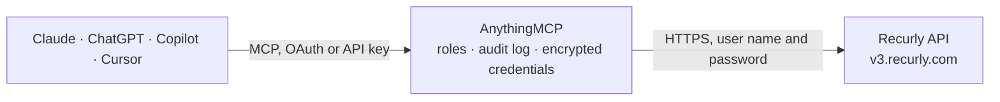

<!-- Generated by scripts/export-github-catalog.mjs in the anythingmcp-website repository. Do not edit by hand. -->

# Recurly MCP connector

Drive Recurly (subscription billing, US-focused) from any AI agent: accounts, subscriptions, invoices, plans, coupons. 11 tools, Basic-auth. The AnythingMCP connector gives Claude, ChatGPT, Microsoft Copilot, Cursor and Gemini 11 MCP tools for Recurly: 7 read and 4 can change data.

**Category:** [Payments](../payments.md) · **Tools:** 11 · **Setup guide:** [anythingmcp.com](https://anythingmcp.com/guides/recurly-to-mcp) · [Deutsch](https://anythingmcp.com/de/guides/recurly-to-mcp) · [Italiano](https://anythingmcp.com/it/guides/recurly-to-mcp) · [Español](https://anythingmcp.com/es/guides/recurly-to-mcp) · [日本語](https://anythingmcp.com/ja/guides/recurly-to-mcp) · [Русский](https://anythingmcp.com/ru/guides/recurly-to-mcp) · [中文](https://anythingmcp.com/zh/guides/recurly-to-mcp)

## Start without code

No installation and no terminal: AnythingMCP Cloud runs the Recurly connector for you, operated by helpcode.ai in Frankfurt, Germany.

1. **Click the button above** and create an account or sign in. The Recurly connector opens, ready to install.
2. **Paste the API key or token from your Recurly account.** Every click is in the [step-by-step guide](https://anythingmcp.com/guides/recurly-to-mcp).
3. **Click Install.** AnythingMCP shows the address of your MCP server.
4. **Add that address to your assistant:** [Claude](https://anythingmcp.com/guides/connect-recurly-to-claude) · [ChatGPT](https://anythingmcp.com/guides/connect-recurly-to-chatgpt) · [Microsoft Copilot](https://anythingmcp.com/guides/connect-recurly-to-copilot) · [Cursor](https://anythingmcp.com/guides/connect-recurly-to-cursor) · [Gemini CLI](https://anythingmcp.com/guides/connect-recurly-to-gemini) · [Meta Muse](https://anythingmcp.com/guides/connect-recurly-to-muse).
5. **Ask your first question**, for example: *Find the Recurly account for billing email finance@arsenio-solutions.de and show its balance and currency*

Prefer help with the setup? [Talk to us](https://anythingmcp.com/contact).

## How it works

- **The AI client** speaks MCP (Streamable HTTP) to AnythingMCP and only sees tool names, descriptions and results. It never gets the Recurly credentials.
- **AnythingMCP** checks the client's role, builds the call from the tool definition, adds the credentials (user name and password), calls Recurly, logs the call and returns the result.
- **Recurly** sees an ordinary API client with the rights of the account the credentials belong to.

## Tools

| Tool | What it does | Access |
|---|---|---|
| [`recurly_list_accounts`](#recurly_list_accounts) | List accounts (customers). | read |
| [`recurly_get_account`](#recurly_get_account) | Fetch one account. | read |
| [`recurly_create_account`](#recurly_create_account) | Create an account. | write |
| [`recurly_list_subscriptions`](#recurly_list_subscriptions) | List subscriptions with filters. | read |
| [`recurly_get_subscription`](#recurly_get_subscription) | Fetch one subscription. | read |
| [`recurly_create_subscription`](#recurly_create_subscription) | Create a subscription on an account. | write |
| [`recurly_cancel_subscription`](#recurly_cancel_subscription) | Cancel a subscription at the end of the current term. | write |
| [`recurly_terminate_subscription`](#recurly_terminate_subscription) | Immediately terminate a subscription with refund options (none/partial/full). | write |
| [`recurly_list_invoices`](#recurly_list_invoices) | List invoices across the site. | read |
| [`recurly_list_plans`](#recurly_list_plans) | List plans (subscription products). | read |
| [`recurly_list_coupons`](#recurly_list_coupons) | List coupons. | read |

## Tool reference

Every parameter as the AI client sees it in `tools/list`. Source: [`packages/backend/src/adapters/intl/recurly.json`](../../../packages/backend/src/adapters/intl/recurly.json).

### `recurly_list_accounts`

List accounts (customers).

**Access:** read · **Call:** `GET /accounts`

| Parameter | Type | Required | Description |
|---|---|---|---|
| `subscriber` | boolean | no | true = only with active subscription. |
| `email` | string | no | Filter by email. |
| `begin_time` | string | no | ISO 8601 — accounts modified after. |
| `end_time` | string | no | ISO 8601. |
| `sort` | string | no | created_at, updated_at. |
| `order` | string | no | asc or desc. |
| `limit` | integer | no | Per page (max 200). |

### `recurly_get_account`

Fetch one account.

**Access:** read · **Call:** `GET /accounts/{accountId}`

| Parameter | Type | Required | Description |
|---|---|---|---|
| `accountId` | string | yes | Account ID (or code prefixed with 'code-'). |

### `recurly_create_account`

Create an account. Required: code (your unique customer ID).

**Access:** write · **Call:** `POST /accounts`

| Parameter | Type | Required | Description |
|---|---|---|---|
| `code` | string | yes | Your unique customer code. |
| `username` | string | no | Username. |
| `email` | string | no | Email. |
| `first_name` | string | no | First name. |
| `last_name` | string | no | Last name. |
| `company` | string | no | Company. |
| `vat_number` | string | no | VAT number. |
| `preferred_locale` | string | no | Locale (en-US, de-DE, etc.). |
| `preferred_time_zone` | string | no | TZ database name. |
| `cc_emails` | string | no | Comma-separated CC emails for invoices. |
| `address` | object | no | {street1, street2?, city, region, postal_code, country, phone?}. |
| `billing_info` | object | no | {token_id?, number?, month?, year?, cvv?, first_name?, last_name?, address?}. |

### `recurly_list_subscriptions`

List subscriptions with filters.

**Access:** read · **Call:** `GET /subscriptions`

| Parameter | Type | Required | Description |
|---|---|---|---|
| `state` | string | no | future, active, paused, expired, canceled, failed. |
| `begin_time` | string | no | ISO 8601. |
| `end_time` | string | no | ISO 8601. |
| `sort` | string | no | created_at, updated_at. |
| `order` | string | no | asc or desc. |
| `limit` | integer | no | Per page. |

### `recurly_get_subscription`

Fetch one subscription.

**Access:** read · **Call:** `GET /subscriptions/{subscriptionId}`

| Parameter | Type | Required | Description |
|---|---|---|---|
| `subscriptionId` | string | yes | Subscription UUID. |

### `recurly_create_subscription`

Create a subscription on an account. Required: account.code OR account_id + plan_code + currency.

**Access:** write · **Call:** `POST /subscriptions`

| Parameter | Type | Required | Description |
|---|---|---|---|
| `plan_code` | string | yes | Plan code. |
| `currency` | string | yes | ISO 4217 currency (USD, EUR, etc.). |
| `account` | object | yes | {code:'EXISTING' OR code+billing_info+address+...} — Recurly auto-creates the account if it doesn't exist. |
| `unit_amount` | number | no | Override plan price. |
| `quantity` | integer | no | Default 1. |
| `coupon_code` | string | no | Coupon to apply. |
| `trial_ends_at` | string | no | ISO 8601 — extend/override trial. |
| `starts_at` | string | no | ISO 8601 — future start. |
| `po_number` | string | no | Purchase order. |
| `auto_renew` | boolean | no | Default true. false = cancels at period end. |

### `recurly_cancel_subscription`

Cancel a subscription at the end of the current term. Use recurly_terminate for immediate.

**Access:** write · **Call:** `PUT /subscriptions/{subscriptionId}/cancel`

| Parameter | Type | Required | Description |
|---|---|---|---|
| `subscriptionId` | string | yes | Subscription UUID. |

### `recurly_terminate_subscription`

Immediately terminate a subscription with refund options (none/partial/full).

**Access:** write · **Call:** `PUT /subscriptions/{subscriptionId}/terminate`

| Parameter | Type | Required | Description |
|---|---|---|---|
| `subscriptionId` | string | yes | Subscription UUID. |
| `refund` | string | no | none (default), partial, full. |
| `charge` | boolean | no | If true, post any unsettled charges. |

### `recurly_list_invoices`

List invoices across the site.

**Access:** read · **Call:** `GET /invoices`

| Parameter | Type | Required | Description |
|---|---|---|---|
| `state` | string | no | pending, processing, past_due, paid, failed, voided, closed. |
| `type` | string | no | charge, credit, legacy, non_legacy. |
| `begin_time` | string | no | ISO 8601. |
| `end_time` | string | no | ISO 8601. |
| `sort` | string | no | created_at, updated_at. |
| `limit` | integer | no | Per page. |

### `recurly_list_plans`

List plans (subscription products). Each has code, name, intervals[], currencies[], trial_length, setup_fee.

**Access:** read · **Call:** `GET /plans`

| Parameter | Type | Required | Description |
|---|---|---|---|
| `state` | string | no | active, inactive. |
| `limit` | integer | no | Per page. |

### `recurly_list_coupons`

List coupons.

**Access:** read · **Call:** `GET /coupons`

| Parameter | Type | Required | Description |
|---|---|---|---|
| `state` | string | no | redeemable, expired, maxed_out, inactive. |
| `limit` | integer | no | Per page. |

## Run it yourself

AnythingMCP is open source (AGPL-3.0). [Run it with Docker](../../../README.md#run-it-yourself), open **Connectors → Store**, pick **Recurly** and enter `RECURLY_API_KEY`, then add your MCP server URL to the AI client.

[← Payments connectors](../payments.md) · [All categories](../README.md)
