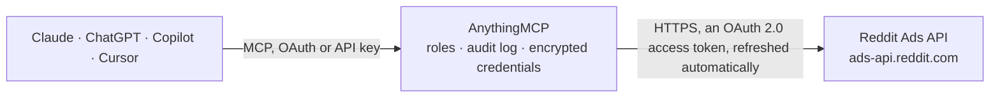

<!-- Generated by scripts/export-github-catalog.mjs in the anythingmcp-website repository. Do not edit by hand. -->

# Reddit Ads MCP connector

Read Reddit Ads accounts through the Ads API v3: businesses, ad accounts, campaigns, ad groups, ads, funding instruments, and performance reports with spend, impressions, clicks, conversions and … The AnythingMCP connector gives Claude, ChatGPT, Microsoft Copilot, Cursor and Gemini 12 MCP tools for Reddit Ads, all read-only.

**Category:** [Advertising](../advertising.md) · **Tools:** 12 · **Setup guide:** [anythingmcp.com](https://anythingmcp.com/guides/reddit-ads-to-mcp) · [Deutsch](https://anythingmcp.com/de/guides/reddit-ads-to-mcp) · [Italiano](https://anythingmcp.com/it/guides/reddit-ads-to-mcp) · [Español](https://anythingmcp.com/es/guides/reddit-ads-to-mcp) · [日本語](https://anythingmcp.com/ja/guides/reddit-ads-to-mcp) · [Русский](https://anythingmcp.com/ru/guides/reddit-ads-to-mcp) · [中文](https://anythingmcp.com/zh/guides/reddit-ads-to-mcp)

## Start without code

No installation and no terminal: AnythingMCP Cloud runs the Reddit Ads connector for you, operated by helpcode.ai in Frankfurt, Germany.

1. **Click the button above** and create an account or sign in. The Reddit Ads connector opens, ready to install.
2. **Sign in with your Reddit Ads account** when AnythingMCP asks. The first time, an admin creates a small app in the Reddit Ads developer console. Every click is in the [step-by-step guide](https://anythingmcp.com/guides/reddit-ads-to-mcp).
3. **Click Install.** AnythingMCP shows the address of your MCP server.
4. **Add that address to your assistant:** [Claude](https://anythingmcp.com/guides/connect-reddit-ads-to-claude) · [ChatGPT](https://anythingmcp.com/guides/connect-reddit-ads-to-chatgpt) · [Microsoft Copilot](https://anythingmcp.com/guides/connect-reddit-ads-to-copilot) · [Cursor](https://anythingmcp.com/guides/connect-reddit-ads-to-cursor) · [Gemini CLI](https://anythingmcp.com/guides/connect-reddit-ads-to-gemini) · [Meta Muse](https://anythingmcp.com/guides/connect-reddit-ads-to-muse).
5. **Ask your first question**, for example: *Which ad accounts under business BrightWave Media LLC use EUR and have status ACTIVE?*

Prefer help with the setup? [Talk to us](https://anythingmcp.com/contact).

## How it works

- **The AI client** speaks MCP (Streamable HTTP) to AnythingMCP and only sees tool names, descriptions and results. It never gets the Reddit Ads credentials.
- **AnythingMCP** checks the client's role, builds the call from the tool definition, adds the credentials (an OAuth 2.0 access token, refreshed automatically), calls Reddit Ads, logs the call and returns the result.
- **Reddit Ads** sees an ordinary API client with the rights of the account the credentials belong to.

## Tools

| Tool | What it does | Access |
|---|---|---|
| [`reddit_ads_get_me`](#reddit_ads_get_me) | Return the Reddit user the connector is authorized as (id, username). | read |
| [`reddit_ads_list_my_businesses`](#reddit_ads_list_my_businesses) | List the Reddit Ads businesses the authorized user belongs to, with business id and name. | read |
| [`reddit_ads_list_business_ad_accounts`](#reddit_ads_list_business_ad_accounts) | List the ad accounts of a business, with id, name, currency, time zone, attribution settings and status. | read |
| [`reddit_ads_get_ad_account`](#reddit_ads_get_ad_account) | Get one ad account: name, currency, time zone, business id, attribution windows, admin approval and suspension status. | read |
| [`reddit_ads_list_campaigns`](#reddit_ads_list_campaigns) | List the campaigns of an ad account with id, name, objective, configured_status, effective_status, spend cap, funding instrument and created and modified times. | read |
| [`reddit_ads_get_campaign`](#reddit_ads_get_campaign) | Get one campaign by id: objective, status, spend cap, budget optimization and funding instrument. | read |
| [`reddit_ads_list_ad_groups`](#reddit_ads_list_ad_groups) | List the ad groups of an ad account with id, campaign_id, name, status, bid strategy and value, goal, schedule and targeting (communities, interests,… | read |
| [`reddit_ads_get_ad_group`](#reddit_ads_get_ad_group) | Get one ad group by id with its bid, goal, schedule and full targeting. | read |
| [`reddit_ads_list_ads`](#reddit_ads_list_ads) | List the ads of an ad account with id, ad_group_id, campaign_id, name, post id, click URL, configured_status, effective_status and rejection reason. | read |
| [`reddit_ads_get_ad`](#reddit_ads_get_ad) | Get one ad by id: name, post, click URL, status and review outcome. | read |
| [`reddit_ads_list_funding_instruments`](#reddit_ads_list_funding_instruments) | List the funding instruments (credit cards, credit lines, insertion orders) of an ad account with id, type, credit limit, billable amount and validity dates. | read |
| [`reddit_ads_get_report`](#reddit_ads_get_report) | Run a performance report for an ad account and get the rows back at once: metrics such as IMPRESSIONS, CLICKS, SPEND, CTR, CPC, ECPM, REACH, conversions and… | read |

## Tool reference

Every parameter as the AI client sees it in `tools/list`. Source: [`packages/backend/src/adapters/intl/reddit-ads.json`](../../../packages/backend/src/adapters/intl/reddit-ads.json).

### `reddit_ads_get_me`

Return the Reddit user the connector is authorized as (id, username). Use it to confirm the authorization works and which account it belongs to; it is also the setup check.

**Access:** read · **Call:** `GET /me`

No parameters.

### `reddit_ads_list_my_businesses`

List the Reddit Ads businesses the authorized user belongs to, with business id and name. Start here: ad accounts live under a business, so you need a business id to list them.

**Access:** read · **Call:** `GET /me/businesses`

| Parameter | Type | Required | Description |
|---|---|---|---|
| `ad_account_id` | string | no | Optional: only the business that owns this ad account. |
| `role` | `BUSINESS_ADMIN` \| `CATALOG_ADMIN` | no | Optional: only businesses where the user has this role. |
| `page_size` | integer | no | Items per page, up to 1000. |
| `page_token` | string | no | Token from pagination.next_url of the previous answer (the page.token value in that URL), to read the next page. |

### `reddit_ads_list_business_ad_accounts`

List the ad accounts of a business, with id, name, currency, time zone, attribution settings and status. The account id is what every campaign, ad and report tool needs.

**Access:** read · **Call:** `GET /businesses/{business_id}/ad_accounts`

| Parameter | Type | Required | Description |
|---|---|---|---|
| `business_id` | string | yes | Business id from reddit_ads_list_my_businesses. |
| `ids` | string | no | Optional: only these ad account ids, comma-separated. |
| `page_size` | integer | no | Items per page, up to 1000. |
| `page_token` | string | no | Token from pagination.next_url of the previous answer (the page.token value in that URL), to read the next page. |

### `reddit_ads_get_ad_account`

Get one ad account: name, currency, time zone, business id, attribution windows, admin approval and suspension status. Use it to read the currency and time zone before interpreting spend in a report.

**Access:** read · **Call:** `GET /ad_accounts/{ad_account_id}`

| Parameter | Type | Required | Description |
|---|---|---|---|
| `ad_account_id` | string | yes | Ad account id from reddit_ads_list_business_ad_accounts (or the account id shown in Reddit Ads Manager). |

### `reddit_ads_list_campaigns`

List the campaigns of an ad account with id, name, objective, configured_status, effective_status, spend cap, funding instrument and created and modified times. Page with page_token.

**Access:** read · **Call:** `GET /ad_accounts/{ad_account_id}/campaigns`

| Parameter | Type | Required | Description |
|---|---|---|---|
| `ad_account_id` | string | yes | Ad account id from reddit_ads_list_business_ad_accounts (or the account id shown in Reddit Ads Manager). |
| `ids` | string | no | Optional: only these campaign ids, comma-separated (up to 200). |
| `page_size` | integer | no | Items per page, up to 1000. |
| `page_token` | string | no | Token from pagination.next_url of the previous answer (the page.token value in that URL), to read the next page. |

### `reddit_ads_get_campaign`

Get one campaign by id: objective, status, spend cap, budget optimization and funding instrument. Use it when you already have a campaign id from a list or a report row.

**Access:** read · **Call:** `GET /campaigns/{campaign_id}`

| Parameter | Type | Required | Description |
|---|---|---|---|
| `campaign_id` | string | yes | Campaign id from reddit_ads_list_campaigns. |

### `reddit_ads_list_ad_groups`

List the ad groups of an ad account with id, campaign_id, name, status, bid strategy and value, goal, schedule and targeting (communities, interests, keywords, geos, devices). Filter by campaign_id. Page with page_token.

**Access:** read · **Call:** `GET /ad_accounts/{ad_account_id}/ad_groups`

| Parameter | Type | Required | Description |
|---|---|---|---|
| `ad_account_id` | string | yes | Ad account id from reddit_ads_list_business_ad_accounts (or the account id shown in Reddit Ads Manager). |
| `campaign_id` | string | no | Optional: only ad groups of this campaign. |
| `ids` | string | no | Optional: only these ad group ids, comma-separated (up to 200). |
| `page_size` | integer | no | Items per page, up to 1000. |
| `page_token` | string | no | Token from pagination.next_url of the previous answer (the page.token value in that URL), to read the next page. |

### `reddit_ads_get_ad_group`

Get one ad group by id with its bid, goal, schedule and full targeting. Use it to explain why an ad group delivers or not, or to review its audience settings.

**Access:** read · **Call:** `GET /ad_groups/{ad_group_id}`

| Parameter | Type | Required | Description |
|---|---|---|---|
| `ad_group_id` | string | yes | Ad group id from reddit_ads_list_ad_groups. |

### `reddit_ads_list_ads`

List the ads of an ad account with id, ad_group_id, campaign_id, name, post id, click URL, configured_status, effective_status and rejection reason. Filter by campaign, ad group or status. Page with page_token.

**Access:** read · **Call:** `GET /ad_accounts/{ad_account_id}/ads`

| Parameter | Type | Required | Description |
|---|---|---|---|
| `ad_account_id` | string | yes | Ad account id from reddit_ads_list_business_ad_accounts (or the account id shown in Reddit Ads Manager). |
| `campaign_id` | string | no | Optional: only ads of these campaign ids, comma-separated. |
| `ad_group_id` | string | no | Optional: only ads of these ad group ids, comma-separated. |
| `ids` | string | no | Optional: only these ad ids, comma-separated. |
| `configured_status` | string | no | Optional: status set by the advertiser, comma-separated: ACTIVE, PAUSED, ARCHIVED, DELETED. |
| `effective_status` | string | no | Optional: computed status, comma-separated, e.g. ACTIVE, PENDING_APPROVAL, REJECTED, CAMPAIGN_PAUSED, AD_GROUP_PAUSED, PENDING_BILLING_INFO, COMPLETED. |
| `page_size` | integer | no | Items per page, up to 1000. |
| `page_token` | string | no | Token from pagination.next_url of the previous answer (the page.token value in that URL), to read the next page. |

### `reddit_ads_get_ad`

Get one ad by id: name, post, click URL, status and review outcome. Use it to put names on the ad ids returned by reddit_ads_get_report.

**Access:** read · **Call:** `GET /ads/{ad_id}`

| Parameter | Type | Required | Description |
|---|---|---|---|
| `ad_id` | string | yes | Ad id from reddit_ads_list_ads or from the AD_ID breakdown of a report. |

### `reddit_ads_list_funding_instruments`

List the funding instruments (credit cards, credit lines, insertion orders) of an ad account with id, type, credit limit, billable amount and validity dates. Use it to check why campaigns are pending billing.

**Access:** read · **Call:** `GET /ad_accounts/{ad_account_id}/funding_instruments`

| Parameter | Type | Required | Description |
|---|---|---|---|
| `ad_account_id` | string | yes | Ad account id from reddit_ads_list_business_ad_accounts (or the account id shown in Reddit Ads Manager). |
| `mode` | `ACTIVE` \| `INACTIVE` \| `UPCOMING` \| `SELECTABLE` \| `ALL` | no | Optional status filter. |
| `page_size` | integer | no | Items per page, up to 1000. |
| `page_token` | string | no | Token from pagination.next_url of the previous answer (the page.token value in that URL), to read the next page. |

### `reddit_ads_get_report`

Run a performance report for an ad account and get the rows back at once: metrics such as IMPRESSIONS, CLICKS, SPEND, CTR, CPC, ECPM, REACH, conversions and video views, split by up to 3 breakdowns (DATE, CAMPAIGN_ID, AD_GROUP_ID, AD_ID, COUNTRY, COMMUNITY, PLACEMENT...). Read-only, although it uses POST.

**Access:** read · **Call:** `POST /ad_accounts/{ad_account_id}/reports`

| Parameter | Type | Required | Description |
|---|---|---|---|
| `ad_account_id` | string | yes | Ad account id from reddit_ads_list_business_ad_accounts (or the account id shown in Reddit Ads Manager). |
| `starts_at` | string | yes | Start, ISO 8601 on a full hour in UTC, e.g. 2026-09-01T00:00:00Z. |
| `ends_at` | string | yes | End, ISO 8601 on a full hour, e.g. 2026-10-01T00:00:00Z. |
| `fields` | string[] | yes | Metrics, e.g. ["IMPRESSIONS","CLICKS","SPEND","CTR","CPC","ECPM","REACH","CONVERSION_PURCHASE_CLICKS","CONVERSION_PURCHASE_TOTAL_VALUE","VIDEO_STARTED"]. |
| `breakdowns` | string[] | no | Up to 3 of AD_ACCOUNT_ID, CAMPAIGN_ID, AD_GROUP_ID, AD_ID, DATE, HOUR, COUNTRY, REGION, DMA, COMMUNITY, INTEREST, KEYWORD, PLACEMENT, OS_TYPE, GENDER, LANGUAGE. HOUR only for ranges up to 7 days. |
| `filter` | string | no | Optional filter expression, e.g. campaign:effective_status==ACTIVE. Several conditions are comma-separated. |
| `time_zone_id` | string | no | Optional IANA time zone for the day boundaries, e.g. Europe/Berlin. Default UTC. |
| `page_size` | integer | no | Items per page, up to 1000. |
| `page_token` | string | no | Token from pagination.next_url of the previous answer (the page.token value in that URL), to read the next page. |

## Run it yourself

AnythingMCP is open source (AGPL-3.0). [Run it with Docker](../../../README.md#run-it-yourself), open **Connectors → Store**, pick **Reddit Ads** and enter `REDDIT_ADS_CLIENT_ID`, `REDDIT_ADS_CLIENT_SECRET`, then add your MCP server URL to the AI client.

[← Advertising connectors](../advertising.md) · [All categories](../README.md)
