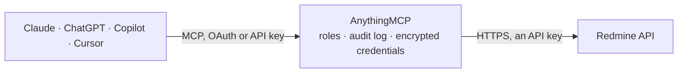

<!-- Generated by scripts/export-github-catalog.mjs in the anythingmcp-website repository. Do not edit by hand. -->

# Redmine MCP connector

Redmine project management: issues with their journals, projects, versions, time entries, users and the enumerations behind statuses, priorities and trackers. The AnythingMCP connector gives Claude, ChatGPT, Microsoft Copilot, Cursor and Gemini 10 MCP tools for Redmine: 9 read and 1 can change data.

**Category:** [Project Management](../project-management.md) · **Tools:** 10 · **Setup guide:** [anythingmcp.com](https://anythingmcp.com/guides/redmine-to-mcp) · [Deutsch](https://anythingmcp.com/de/guides/redmine-to-mcp) · [Italiano](https://anythingmcp.com/it/guides/redmine-to-mcp) · [Español](https://anythingmcp.com/es/guides/redmine-to-mcp) · [日本語](https://anythingmcp.com/ja/guides/redmine-to-mcp) · [Русский](https://anythingmcp.com/ru/guides/redmine-to-mcp) · [中文](https://anythingmcp.com/zh/guides/redmine-to-mcp)

## Start without code

No installation and no terminal: AnythingMCP Cloud runs the Redmine connector for you, operated by helpcode.ai in Frankfurt, Germany.

1. **Click the button above** and create an account or sign in. The Redmine connector opens, ready to install.
2. **Paste the API key or token from your Redmine account.** Every click is in the [step-by-step guide](https://anythingmcp.com/guides/redmine-to-mcp).
3. **Click Install.** AnythingMCP shows the address of your MCP server.
4. **Add that address to your assistant:** [Claude](https://anythingmcp.com/guides/connect-redmine-to-claude) · [ChatGPT](https://anythingmcp.com/guides/connect-redmine-to-chatgpt) · [Microsoft Copilot](https://anythingmcp.com/guides/connect-redmine-to-copilot) · [Cursor](https://anythingmcp.com/guides/connect-redmine-to-cursor) · [Gemini CLI](https://anythingmcp.com/guides/connect-redmine-to-gemini) · [Meta Muse](https://anythingmcp.com/guides/connect-redmine-to-muse).
5. **Ask your first question**, for example: *Show the full issue 4827 including journals — it's the PDF export bug reported 2026-10-12.*

Prefer help with the setup? [Talk to us](https://anythingmcp.com/contact).

## How it works

- **The AI client** speaks MCP (Streamable HTTP) to AnythingMCP and only sees tool names, descriptions and results. It never gets the Redmine credentials.
- **AnythingMCP** checks the client's role, builds the call from the tool definition, adds the credentials (an API key), calls Redmine, logs the call and returns the result.
- **Redmine** sees an ordinary API client with the rights of the account the credentials belong to.

## Tools

| Tool | What it does | Access |
|---|---|---|
| [`redmine_get_current_user`](#redmine_get_current_user) | Read the user the API key belongs to, with their login, name, e-mail and project memberships. | read |
| [`redmine_list_projects`](#redmine_list_projects) | List projects with their id, identifier, name, description and status. | read |
| [`redmine_list_issues`](#redmine_list_issues) | List issues with Redmine's filter operators. | read |
| [`redmine_get_issue`](#redmine_get_issue) | Read one issue in full with its journals — the comment and field-change history, which the list endpoint omits because it can be long. | read |
| [`redmine_list_project_versions`](#redmine_list_project_versions) | List the versions (milestones and sprints) of one project with their name, due date, status and sharing. | read |
| [`redmine_list_time_entries`](#redmine_list_time_entries) | List logged time entries with their user, issue, project, date, hours and activity — the raw data behind any effort report. | read |
| [`redmine_list_users`](#redmine_list_users) | List users with their login, name, e-mail and status, to resolve who an issue is assigned to. | read |
| [`redmine_list_issue_statuses`](#redmine_list_issue_statuses) | List the issue statuses this instance defines, with their id and whether each closes the issue. | read |
| [`redmine_list_trackers`](#redmine_list_trackers) | List the trackers (Bug, Feature, Support and any custom ones) with their id and default status, so a tracker_id filter can be composed. | read |
| [`redmine_add_issue_note`](#redmine_add_issue_note) | Add a note to an issue. | write |

## Tool reference

Every parameter as the AI client sees it in `tools/list`. Source: [`packages/backend/src/adapters/intl/redmine.json`](../../../packages/backend/src/adapters/intl/redmine.json).

### `redmine_get_current_user`

Read the user the API key belongs to, with their login, name, e-mail and project memberships. The fastest way to see which projects this connector can see.

**Access:** read · **Call:** `GET /users/current.json`

No parameters.

### `redmine_list_projects`

List projects with their id, identifier, name, description and status. The identifier string is what a project_id filter can take instead of the numeric id.

**Access:** read · **Call:** `GET /projects.json`

| Parameter | Type | Required | Description |
|---|---|---|---|
| `limit` | number | no | Rows per page, max 100. |
| `offset` | number | no | Rows to skip, for paging. |

### `redmine_list_issues`

List issues with Redmine's filter operators. `status_id=open` and `assigned_to_id=me` are the two that answer most questions.

**Access:** read · **Call:** `GET /issues.json`

| Parameter | Type | Required | Description |
|---|---|---|---|
| `project_id` | string | no | Numeric project id or the project identifier string. |
| `status_id` | string | no | `open`, `closed`, `*` for all, or a numeric status id. |
| `assigned_to_id` | string | no | `me` or a numeric user id. |
| `tracker_id` | number | no | Numeric tracker id, e.g. Bug or Feature. |
| `created_on` | string | no | Date filter, e.g. >=2026-01-01 or ><2026-01-01\|2026-03-31. |
| `updated_on` | string | no | Date filter on the last update, same syntax. |
| `sort` | string | no | Sort expression, e.g. `updated_on:desc`. |
| `limit` | number | no | Rows per page, max 100. |
| `offset` | number | no | Rows to skip, for paging. |

### `redmine_get_issue`

Read one issue in full with its journals — the comment and field-change history, which the list endpoint omits because it can be long.

**Access:** read · **Call:** `GET /issues/{issueId}.json`

| Parameter | Type | Required | Description |
|---|---|---|---|
| `issueId` | number | yes | Numeric issue id. |
| `include` | string | no | Comma-separated extras: journals, attachments, relations, children, watchers. |

### `redmine_list_project_versions`

List the versions (milestones and sprints) of one project with their name, due date, status and sharing.

**Access:** read · **Call:** `GET /projects/{projectId}/versions.json`

| Parameter | Type | Required | Description |
|---|---|---|---|
| `projectId` | string | yes | Numeric project id or the project identifier string. |

### `redmine_list_time_entries`

List logged time entries with their user, issue, project, date, hours and activity — the raw data behind any effort report.

**Access:** read · **Call:** `GET /time_entries.json`

| Parameter | Type | Required | Description |
|---|---|---|---|
| `project_id` | string | no | Numeric project id or the project identifier string. |
| `user_id` | string | no | `me` or a numeric user id. |
| `spent_on` | string | no | Date filter, e.g. >=2026-09-01 or ><2026-09-01\|2026-09-30. |
| `limit` | number | no | Rows per page, max 100. |
| `offset` | number | no | Rows to skip, for paging. |

### `redmine_list_users`

List users with their login, name, e-mail and status, to resolve who an issue is assigned to. Requires an administrator key.

**Access:** read · **Call:** `GET /users.json`

| Parameter | Type | Required | Description |
|---|---|---|---|
| `status` | number | no | 1 active, 2 registered, 3 locked. |
| `name` | string | no | Fragment matched against login, name and e-mail. |
| `limit` | number | no | Rows per page, max 100. |
| `offset` | number | no | Rows to skip, for paging. |

### `redmine_list_issue_statuses`

List the issue statuses this instance defines, with their id and whether each closes the issue. Needed to read a status_id filter correctly.

**Access:** read · **Call:** `GET /issue_statuses.json`

No parameters.

### `redmine_list_trackers`

List the trackers (Bug, Feature, Support and any custom ones) with their id and default status, so a tracker_id filter can be composed.

**Access:** read · **Call:** `GET /trackers.json`

No parameters.

### `redmine_add_issue_note`

Add a note to an issue. Writes to the live instance and notifies the watchers; set private_notes to keep it out of the customer's view.

**Access:** write · **Call:** `PUT /issues/{issueId}.json`

| Parameter | Type | Required | Description |
|---|---|---|---|
| `issueId` | number | yes | Numeric issue id. |
| `notes` | string | yes | Note text. Redmine's textile or markdown, depending on the instance's setting. |
| `private_notes` | boolean | no | When true, the note is visible only to users with the view-private-notes permission. |

## Run it yourself

AnythingMCP is open source (AGPL-3.0). [Run it with Docker](../../../README.md#run-it-yourself), open **Connectors → Store**, pick **Redmine** and enter `REDMINE_URL`, `REDMINE_API_KEY`, then add your MCP server URL to the AI client.

[← Project Management connectors](../project-management.md) · [All categories](../README.md)
