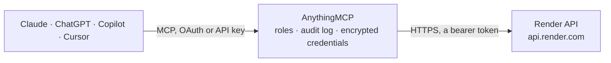

<!-- Generated by scripts/export-github-catalog.mjs in the anythingmcp-website repository. Do not edit by hand. -->

# Render MCP connector

Let your AI check and operate your Render services: services, deploys, logs, metrics, events, jobs, custom domains and Postgres and Key Value instances, and deploy, roll back, restart, suspend or … The AnythingMCP connector gives Claude, ChatGPT, Microsoft Copilot, Cursor and Gemini 26 MCP tools for Render: 19 read and 7 can change data.

**Category:** [Infrastructure](../infrastructure.md) · **Tools:** 26 · **Setup guide:** [anythingmcp.com](https://anythingmcp.com/guides/render-to-mcp) · [Deutsch](https://anythingmcp.com/de/guides/render-to-mcp) · [Italiano](https://anythingmcp.com/it/guides/render-to-mcp) · [Español](https://anythingmcp.com/es/guides/render-to-mcp) · [日本語](https://anythingmcp.com/ja/guides/render-to-mcp) · [Русский](https://anythingmcp.com/ru/guides/render-to-mcp) · [中文](https://anythingmcp.com/zh/guides/render-to-mcp)

## Start without code

No installation and no terminal: AnythingMCP Cloud runs the Render connector for you, operated by helpcode.ai in Frankfurt, Germany.

1. **Click the button above** and create an account or sign in. The Render connector opens, ready to install.
2. **Paste the API key or token from your Render account.** Every click is in the [step-by-step guide](https://anythingmcp.com/guides/render-to-mcp).
3. **Click Install.** AnythingMCP shows the address of your MCP server.
4. **Add that address to your assistant:** [Claude](https://anythingmcp.com/guides/connect-render-to-claude) · [ChatGPT](https://anythingmcp.com/guides/connect-render-to-chatgpt) · [Microsoft Copilot](https://anythingmcp.com/guides/connect-render-to-copilot) · [Cursor](https://anythingmcp.com/guides/connect-render-to-cursor) · [Gemini CLI](https://anythingmcp.com/guides/connect-render-to-gemini) · [Meta Muse](https://anythingmcp.com/guides/connect-render-to-muse).
5. **Ask your first question**, for example: *What's the latest deploy status for service named payflow-api in workspace Mercuria GmbH?*

Prefer help with the setup? [Talk to us](https://anythingmcp.com/contact).

## How it works

- **The AI client** speaks MCP (Streamable HTTP) to AnythingMCP and only sees tool names, descriptions and results. It never gets the Render credentials.
- **AnythingMCP** checks the client's role, builds the call from the tool definition, adds the credentials (a bearer token), calls Render, logs the call and returns the result.
- **Render** sees an ordinary API client with the rights of the account the credentials belong to.

## Tools

| Tool | What it does | Access |
|---|---|---|
| [`render_get_current_user`](#render_get_current_user) | Get the Render user the API key belongs to: id, name and email. | read |
| [`render_list_workspaces`](#render_list_workspaces) | List the workspaces (owners) the API key can reach: id, name, email, type (user or team) and whether two-factor authentication is on. | read |
| [`render_list_projects`](#render_list_projects) | List projects, which group services and databases into environments: id, name, workspace and environment ids. | read |
| [`render_list_services`](#render_list_services) | List services: id, name, type (web_service, private_service, background_worker, static_site, cron_job), repository and branch, URL, region, plan, runtime,… | read |
| [`render_get_service`](#render_get_service) | Get one service: type, repository, branch, auto deploy, URL, region, plan, runtime, instances, health check path, build and start commands, disk and… | read |
| [`render_list_deploys`](#render_list_deploys) | List a service's deploys, newest first: id, status (live, build_in_progress, build_failed, update_failed, canceled, deactivated ...), trigger, commit, image… | read |
| [`render_get_deploy`](#render_get_deploy) | Get one deploy: status, trigger, commit id and message, image and start and finish time. | read |
| [`render_trigger_deploy`](#render_trigger_deploy) | Start a new deploy of a service: the latest commit of its branch by default, a specific commit, or an image. | write |
| [`render_cancel_deploy`](#render_cancel_deploy) | Cancel a deploy that is still building or updating; the service keeps running its current version. | write |
| [`render_rollback_deploy`](#render_rollback_deploy) | Roll a service back to an earlier deploy: Render deploys that version again and it goes live. | write |
| [`render_restart_service`](#render_restart_service) | Restart all running instances of a service without a new deploy; requests may fail for a moment while instances restart. | write |
| [`render_suspend_service`](#render_suspend_service) | Suspend a service: it stops running and stops serving traffic (and billing for compute) until resumed. | write |
| [`render_resume_service`](#render_resume_service) | Resume a suspended service: Render starts it again and it serves traffic and is billed. | write |
| [`render_list_env_var_keys`](#render_list_env_var_keys) | List the names of a service's environment variables. | read |
| [`render_get_env_var_value`](#render_get_env_var_value) | Read the value of ONE environment variable of a service in plain text. | read |
| [`render_list_custom_domains`](#render_list_custom_domains) | List a service's custom domains: id, name, type (apex or subdomain), verification status, redirect target and creation time. | read |
| [`render_list_jobs`](#render_list_jobs) | List one-off jobs run on a service: id, start command, plan, status (pending, running, succeeded, failed, canceled) and times. | read |
| [`render_get_job`](#render_get_job) | Get one job: start command, plan, status and times. | read |
| [`render_create_job`](#render_create_job) | Run a one-off job: a command executed once in a new instance built from the service's latest successful build, with its environment, for example a database… | write |
| [`render_list_logs`](#render_list_logs) | Read logs of services, jobs, cron jobs, Postgres or Key Value instances in a time range (default the last hour), newest first by default: timestamp, message… | read |
| [`render_get_metrics`](#render_get_metrics) | Read a metric as time series for a service, Postgres or Key Value instance over a time range (default the last hour): CPU, memory, HTTP request count, HTTP… | read |
| [`render_list_events`](#render_list_events) | List a service's recent events: deploys started and ended, builds, restarts, suspensions, autoscaling, server failures and more, each with time, type and… | read |
| [`render_list_postgres`](#render_list_postgres) | List Render Postgres databases: id, name, status, plan, region, version, database name and user, disk size, high availability, read replicas and dashboard link. | read |
| [`render_get_postgres`](#render_get_postgres) | Get one Render Postgres database: status, plan, region, version, database name and user, disk, high availability, replicas, pending maintenance and expiry. | read |
| [`render_list_key_value`](#render_list_key_value) | List Render Key Value (Redis-compatible) instances: id, name, status, plan, region, version, eviction and persistence options and dashboard link. | read |
| [`render_get_key_value`](#render_get_key_value) | Get one Render Key Value instance: status, plan, region, version, options, IP allow list and pending maintenance. | read |

## Tool reference

Every parameter as the AI client sees it in `tools/list`. Source: [`packages/backend/src/adapters/intl/render.json`](../../../packages/backend/src/adapters/intl/render.json).

### `render_get_current_user`

Get the Render user the API key belongs to: id, name and email. A quick check that the key works. Read-only.

**Access:** read · **Call:** `GET /users`

No parameters.

### `render_list_workspaces`

List the workspaces (owners) the API key can reach: id, name, email, type (user or team) and whether two-factor authentication is on. The id is the ownerId other tools ask for. Read-only.

**Access:** read · **Call:** `GET /owners`

| Parameter | Type | Required | Description |
|---|---|---|---|
| `name` | string | no | Only workspaces with this name. |
| `cursor` | string | no | cursor of the last item in the previous answer, for the next page. Omit for the first page. |
| `limit` | integer | no | Items per page (default 20, maximum 100). |

### `render_list_projects`

List projects, which group services and databases into environments: id, name, workspace and environment ids. Read-only.

**Access:** read · **Call:** `GET /projects`

| Parameter | Type | Required | Description |
|---|---|---|---|
| `owner_id` | string | no | Workspace id (starts with tea- or usr-), from render_list_workspaces. |
| `cursor` | string | no | cursor of the last item in the previous answer, for the next page. Omit for the first page. |
| `limit` | integer | no | Items per page (default 20, maximum 100). |

### `render_list_services`

List services: id, name, type (web_service, private_service, background_worker, static_site, cron_job), repository and branch, URL, region, plan, runtime, suspended state and dashboard link. Filter by name, type, workspace, region or suspended state. Read-only.

**Access:** read · **Call:** `GET /services`

| Parameter | Type | Required | Description |
|---|---|---|---|
| `name` | string | no | Only services with this exact name; several comma-separated. |
| `type` | string | no | Only these types, comma-separated: web_service, private_service, background_worker, static_site, cron_job. |
| `owner_id` | string | no | Only these workspaces (ids, comma-separated), from render_list_workspaces. |
| `environment_id` | string | no | Only services in these environments (ids, comma-separated). |
| `region` | string | no | Only these regions, comma-separated: frankfurt, oregon, ohio, singapore, virginia. |
| `suspended` | `suspended` \| `not_suspended` | no | suspended or not_suspended. |
| `include_previews` | boolean | no | Also list preview environments' services. |
| `cursor` | string | no | cursor of the last item in the previous answer, for the next page. Omit for the first page. |
| `limit` | integer | no | Items per page (default 20, maximum 100). |

### `render_get_service`

Get one service: type, repository, branch, auto deploy, URL, region, plan, runtime, instances, health check path, build and start commands, disk and suspended state. Environment variable values are not part of it. Read-only.

**Access:** read · **Call:** `GET /services/{service_id}`

| Parameter | Type | Required | Description |
|---|---|---|---|
| `service_id` | string | yes | Service id (starts with srv- or crn-), from render_list_services. |

### `render_list_deploys`

List a service's deploys, newest first: id, status (live, build_in_progress, build_failed, update_failed, canceled, deactivated ...), trigger, commit, image and times. Read-only.

**Access:** read · **Call:** `GET /services/{service_id}/deploys`

| Parameter | Type | Required | Description |
|---|---|---|---|
| `service_id` | string | yes | Service id (starts with srv- or crn-), from render_list_services. |
| `status` | `created` \| `queued` \| `build_in_progress` \| `update_in_progress` \| `live` \| `deactivated` \| `build_failed` \| `update_failed` \| `canceled` \| `pre_deploy_in_progress` \| `pre_deploy_failed`[] | no | Only deploys in these statuses, e.g. ["build_failed", "update_failed"]. |
| `created_after` | string | no | Only deploys created after this time, ISO 8601, e.g. 2026-10-01T00:00:00Z. |
| `cursor` | string | no | cursor of the last item in the previous answer, for the next page. Omit for the first page. |
| `limit` | integer | no | Items per page (default 20, maximum 100). |

### `render_get_deploy`

Get one deploy: status, trigger, commit id and message, image and start and finish time. For the build output use render_list_logs with type build. Read-only.

**Access:** read · **Call:** `GET /services/{service_id}/deploys/{deploy_id}`

| Parameter | Type | Required | Description |
|---|---|---|---|
| `service_id` | string | yes | Service id (starts with srv- or crn-), from render_list_services. |
| `deploy_id` | string | yes | Deploy id (starts with dep-), from render_list_deploys. |

### `render_trigger_deploy`

Start a new deploy of a service: the latest commit of its branch by default, a specific commit, or an image. The new version goes live when the build succeeds and running instances are replaced. Tell the user the service and what will be deployed and call only after they confirm. Returns the new deploy.

**Access:** write · **Call:** `POST /services/{service_id}/deploys`

| Parameter | Type | Required | Description |
|---|---|---|---|
| `service_id` | string | yes | Service id (starts with srv- or crn-), from render_list_services. |
| `clear_cache` | `clear` \| `do_not_clear` | no | clear to empty the build cache first; do_not_clear (default). |
| `commit_id` | string | no | Git commit SHA to deploy instead of the branch's latest. Not for cron jobs. |
| `image_url` | string | no | For image-backed services: the image to deploy; host, repository and name must match the configured image. |
| `deploy_mode` | `deploy_only` \| `build_and_deploy` | no | build_and_deploy (default) or deploy_only to redeploy the last successful build without rebuilding. |

### `render_cancel_deploy`

Cancel a deploy that is still building or updating; the service keeps running its current version. Tell the user which deploy and call only after they confirm.

**Access:** write · **Call:** `POST /services/{service_id}/deploys/{deploy_id}/cancel`

| Parameter | Type | Required | Description |
|---|---|---|---|
| `service_id` | string | yes | Service id (starts with srv- or crn-), from render_list_services. |
| `deploy_id` | string | yes | Deploy id (starts with dep-), from render_list_deploys. |

### `render_rollback_deploy`

Roll a service back to an earlier deploy: Render deploys that version again and it goes live. Auto deploys stay on, so the next push to the branch can bring the rolled-back change back. Show the target deploy with render_get_deploy, tell the user and call only after they confirm.

**Access:** write · **Call:** `POST /services/{service_id}/rollback`

| Parameter | Type | Required | Description |
|---|---|---|---|
| `service_id` | string | yes | Service id (starts with srv- or crn-), from render_list_services. |
| `deploy_id` | string | yes | Earlier deploy id to roll back to, from render_list_deploys. |

### `render_restart_service`

Restart all running instances of a service without a new deploy; requests may fail for a moment while instances restart. Not for cron jobs. Tell the user and call only after they confirm.

**Access:** write · **Call:** `POST /services/{service_id}/restart`

| Parameter | Type | Required | Description |
|---|---|---|---|
| `service_id` | string | yes | Service id (starts with srv- or crn-), from render_list_services. |

### `render_suspend_service`

Suspend a service: it stops running and stops serving traffic (and billing for compute) until resumed. Tell the user the service and call only after they confirm.

**Access:** write · **Call:** `POST /services/{service_id}/suspend`

| Parameter | Type | Required | Description |
|---|---|---|---|
| `service_id` | string | yes | Service id (starts with srv- or crn-), from render_list_services. |

### `render_resume_service`

Resume a suspended service: Render starts it again and it serves traffic and is billed. Tell the user and call only after they confirm.

**Access:** write · **Call:** `POST /services/{service_id}/resume`

| Parameter | Type | Required | Description |
|---|---|---|---|
| `service_id` | string | yes | Service id (starts with srv- or crn-), from render_list_services. |

### `render_list_env_var_keys`

List the names of a service's environment variables. Values are left out because they are usually secrets. Read-only.

**Access:** read · **Call:** `GET /services/{service_id}/env-vars`

| Parameter | Type | Required | Description |
|---|---|---|---|
| `service_id` | string | yes | Service id (starts with srv- or crn-), from render_list_services. |
| `cursor` | string | no | cursor of the last item in the previous answer, for the next page. Omit for the first page. |
| `limit` | integer | no | Items per page (default 100, maximum 100). |

### `render_get_env_var_value`

Read the value of ONE environment variable of a service in plain text. Values are usually secrets (database URLs, API keys), and this exposes them to the AI and its logs. Installed switched off. Call only when the user explicitly asks for that variable's value.

**Access:** read · **Call:** `GET /services/{service_id}/env-vars/{key}`

| Parameter | Type | Required | Description |
|---|---|---|---|
| `service_id` | string | yes | Service id (starts with srv- or crn-), from render_list_services. |
| `key` | string | yes | Variable name from render_list_env_var_keys, e.g. NODE_ENV. |

### `render_list_custom_domains`

List a service's custom domains: id, name, type (apex or subdomain), verification status, redirect target and creation time. Read-only.

**Access:** read · **Call:** `GET /services/{service_id}/custom-domains`

| Parameter | Type | Required | Description |
|---|---|---|---|
| `service_id` | string | yes | Service id (starts with srv- or crn-), from render_list_services. |
| `cursor` | string | no | cursor of the last item in the previous answer, for the next page. Omit for the first page. |
| `limit` | integer | no | Items per page (default 20, maximum 100). |

### `render_list_jobs`

List one-off jobs run on a service: id, start command, plan, status (pending, running, succeeded, failed, canceled) and times. Read-only.

**Access:** read · **Call:** `GET /services/{service_id}/jobs`

| Parameter | Type | Required | Description |
|---|---|---|---|
| `service_id` | string | yes | Service id (starts with srv- or crn-), from render_list_services. |
| `status` | `pending` \| `running` \| `succeeded` \| `failed` \| `canceled` | no | Only jobs in this status. |
| `cursor` | string | no | cursor of the last item in the previous answer, for the next page. Omit for the first page. |
| `limit` | integer | no | Items per page (default 20, maximum 100). |

### `render_get_job`

Get one job: start command, plan, status and times. Its output is in render_list_logs with the job id as resource. Read-only.

**Access:** read · **Call:** `GET /services/{service_id}/jobs/{job_id}`

| Parameter | Type | Required | Description |
|---|---|---|---|
| `service_id` | string | yes | Service id (starts with srv- or crn-), from render_list_services. |
| `job_id` | string | yes | Job id (starts with job-), from render_list_jobs. |

### `render_create_job`

Run a one-off job: a command executed once in a new instance built from the service's latest successful build, with its environment, for example a database migration. It can change data and is billed per second. Tell the user the exact command and call only after they confirm.

**Access:** write · **Call:** `POST /services/{service_id}/jobs`

| Parameter | Type | Required | Description |
|---|---|---|---|
| `service_id` | string | yes | Service id (starts with srv- or crn-), from render_list_services. |
| `start_command` | string | yes | Command to run, e.g. npm run migrate. |
| `plan_id` | string | no | Optional instance plan id; default is the service's plan. |

### `render_list_logs`

Read logs of services, jobs, cron jobs, Postgres or Key Value instances in a time range (default the last hour), newest first by default: timestamp, message and labels (level, type, instance, HTTP method, path, status). Filter by text, level, type (app, request, build) and more. When hasMore is true, call again with start_time and end_time set to nextStartTime and nextEndTime. Read-only.

**Access:** read · **Call:** `GET /logs`

| Parameter | Type | Required | Description |
|---|---|---|---|
| `owner_id` | string | yes | Workspace id (starts with tea- or usr-), from render_list_workspaces. |
| `resource` | string[] | yes | Resource ids to read, e.g. ["srv-abc123"]: services, jobs, cron jobs, Postgres or Key Value ids, all in the same region and workspace. |
| `start_time` | string | no | Start of the range, ISO 8601, e.g. 2026-10-15T08:00:00Z. Default one hour ago. |
| `end_time` | string | no | End of the range, ISO 8601. Default now. |
| `direction` | `backward` \| `forward` | no | backward (newest first, default) or forward. |
| `text` | string[] | no | Only lines containing this text; wildcards and regular expressions work. |
| `level` | string[] | no | Only these levels, e.g. ["error"]. |
| `type` | string[] | no | Only these log types: app, request or build. |
| `status_code` | string[] | no | Request logs: only these HTTP status codes, e.g. ["5*"]. |
| `method` | string[] | no | Request logs: only these HTTP methods. |
| `path` | string[] | no | Request logs: only these paths. |
| `instance` | string[] | no | Only these instance ids. |
| `limit` | integer | no | Lines per page (default 50, maximum 100). |

### `render_get_metrics`

Read a metric as time series for a service, Postgres or Key Value instance over a time range (default the last hour): CPU, memory, HTTP request count, HTTP latency, bandwidth, instance count, disk usage or active connections. Each series has labels, unit and timestamped values. Read-only.

**Access:** read · **Call:** `GET /metrics/{metric}`

| Parameter | Type | Required | Description |
|---|---|---|---|
| `metric` | `cpu` \| `memory` \| `http-requests` \| `http-latency` \| `bandwidth` \| `instance-count` \| `disk-usage` \| `active-connections` | yes | Which metric. |
| `resource` | string | yes | Service, Postgres or Key Value id, e.g. srv-abc123. HTTP metrics and bandwidth take a service id; active-connections a Postgres or Key Value id. |
| `start_time` | string | no | Start, ISO 8601. Default one hour ago. |
| `end_time` | string | no | End, ISO 8601. Default now. |
| `resolution_seconds` | integer | no | Seconds per data point, e.g. 60 or 300. |
| `aggregate_by` | `statusCode` \| `host` | no | http-requests only: split by statusCode or host. |
| `aggregation_method` | `AVG` \| `MAX` \| `MIN` | no | cpu only: AVG, MAX or MIN across instances. |
| `quantile` | number | no | http-latency only: quantile, e.g. 0.95. |
| `host` | string | no | http-requests and http-latency only: request host to filter to. |
| `path` | string | no | http-requests and http-latency only: request path to filter to. |

### `render_list_events`

List a service's recent events: deploys started and ended, builds, restarts, suspensions, autoscaling, server failures and more, each with time, type and details. Read-only.

**Access:** read · **Call:** `GET /services/{service_id}/events`

| Parameter | Type | Required | Description |
|---|---|---|---|
| `service_id` | string | yes | Service id (starts with srv- or crn-), from render_list_services. |
| `type` | string | no | Only events of this type, e.g. deploy_ended, server_failed or build_ended. |
| `start_time` | string | no | Start, ISO 8601. |
| `end_time` | string | no | End, ISO 8601. |
| `cursor` | string | no | cursor of the last item in the previous answer, for the next page. Omit for the first page. |
| `limit` | integer | no | Items per page (default 20, maximum 100). |

### `render_list_postgres`

List Render Postgres databases: id, name, status, plan, region, version, database name and user, disk size, high availability, read replicas and dashboard link. Connection strings and passwords are never returned. Read-only.

**Access:** read · **Call:** `GET /postgres`

| Parameter | Type | Required | Description |
|---|---|---|---|
| `name` | string | no | Only databases with this name; several comma-separated. |
| `owner_id` | string | no | Only these workspaces (ids, comma-separated). |
| `cursor` | string | no | cursor of the last item in the previous answer, for the next page. Omit for the first page. |
| `limit` | integer | no | Items per page (default 20, maximum 100). |

### `render_get_postgres`

Get one Render Postgres database: status, plan, region, version, database name and user, disk, high availability, replicas, pending maintenance and expiry. Connection strings and passwords are never returned. Read-only.

**Access:** read · **Call:** `GET /postgres/{postgres_id}`

| Parameter | Type | Required | Description |
|---|---|---|---|
| `postgres_id` | string | yes | Postgres id (starts with dpg-), from render_list_postgres. |

### `render_list_key_value`

List Render Key Value (Redis-compatible) instances: id, name, status, plan, region, version, eviction and persistence options and dashboard link. Connection strings are never returned. Read-only.

**Access:** read · **Call:** `GET /key-value`

| Parameter | Type | Required | Description |
|---|---|---|---|
| `name` | string | no | Only instances with this name; several comma-separated. |
| `owner_id` | string | no | Only these workspaces (ids, comma-separated). |
| `cursor` | string | no | cursor of the last item in the previous answer, for the next page. Omit for the first page. |
| `limit` | integer | no | Items per page (default 20, maximum 100). |

### `render_get_key_value`

Get one Render Key Value instance: status, plan, region, version, options, IP allow list and pending maintenance. Connection strings are never returned. Read-only.

**Access:** read · **Call:** `GET /key-value/{key_value_id}`

| Parameter | Type | Required | Description |
|---|---|---|---|
| `key_value_id` | string | yes | Key Value id (starts with red-), from render_list_key_value. |

## Run it yourself

AnythingMCP is open source (AGPL-3.0). [Run it with Docker](../../../README.md#run-it-yourself), open **Connectors → Store**, pick **Render** and enter `RENDER_API_KEY`, then add your MCP server URL to the AI client.

[← Infrastructure connectors](../infrastructure.md) · [All categories](../README.md)
