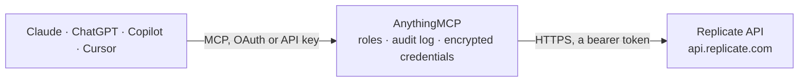

<!-- Generated by scripts/export-github-catalog.mjs in the anythingmcp-website repository. Do not edit by hand. -->

# Replicate MCP connector

Let your AI find and run open AI models on Replicate with your own API token: search models for any task, read their inputs, generate images, video, audio and text, follow and cancel runs, and use … The AnythingMCP connector gives Claude, ChatGPT, Microsoft Copilot, Cursor and Gemini 17 MCP tools for Replicate: 13 read and 4 can change data.

**Category:** [Public Data](../data.md) · **Tools:** 17 · **Setup guide:** [anythingmcp.com](https://anythingmcp.com/guides/replicate-to-mcp) · [Deutsch](https://anythingmcp.com/de/guides/replicate-to-mcp) · [Italiano](https://anythingmcp.com/it/guides/replicate-to-mcp) · [Español](https://anythingmcp.com/es/guides/replicate-to-mcp) · [日本語](https://anythingmcp.com/ja/guides/replicate-to-mcp) · [Русский](https://anythingmcp.com/ru/guides/replicate-to-mcp) · [中文](https://anythingmcp.com/zh/guides/replicate-to-mcp)

## Start without code

No installation and no terminal: AnythingMCP Cloud runs the Replicate connector for you, operated by helpcode.ai in Frankfurt, Germany.

1. **Click the button above** and create an account or sign in. The Replicate connector opens, ready to install.
2. **Paste the API key or token from your Replicate account.** Every click is in the [step-by-step guide](https://anythingmcp.com/guides/replicate-to-mcp).
3. **Click Install.** AnythingMCP shows the address of your MCP server.
4. **Add that address to your assistant:** [Claude](https://anythingmcp.com/guides/connect-replicate-to-claude) · [ChatGPT](https://anythingmcp.com/guides/connect-replicate-to-chatgpt) · [Microsoft Copilot](https://anythingmcp.com/guides/connect-replicate-to-copilot) · [Cursor](https://anythingmcp.com/guides/connect-replicate-to-cursor) · [Gemini CLI](https://anythingmcp.com/guides/connect-replicate-to-gemini) · [Meta Muse](https://anythingmcp.com/guides/connect-replicate-to-muse).
5. **Ask your first question**, for example: *Check status, billed seconds and output link for prediction 7f3c2a6e created 2026-09-28*

Prefer help with the setup? [Talk to us](https://anythingmcp.com/contact).

## How it works

- **The AI client** speaks MCP (Streamable HTTP) to AnythingMCP and only sees tool names, descriptions and results. It never gets the Replicate credentials.
- **AnythingMCP** checks the client's role, builds the call from the tool definition, adds the credentials (a bearer token), calls Replicate, logs the call and returns the result.
- **Replicate** sees an ordinary API client with the rights of the account the credentials belong to.

## Tools

| Tool | What it does | Access |
|---|---|---|
| [`replicate_search`](#replicate_search) | Search Replicate's public models (plus matching collections and documentation pages) with a text query, e.g. 'upscale image', 'text to speech' or 'flux'. | read |
| [`replicate_list_models`](#replicate_list_models) | List public Replicate models, newest first (by latest version, or by creation with sort_by model_created_at), 100 per page. | read |
| [`replicate_get_model`](#replicate_get_model) | Get one Replicate model with its latest version id and its input and output schema (the fields replicate_run_official_model and replicate_create_prediction… | read |
| [`replicate_list_model_versions`](#replicate_list_model_versions) | List the versions of a Replicate model, newest first, with id and creation date. | read |
| [`replicate_get_model_version`](#replicate_get_model_version) | Get one version of a Replicate model with its input and output schema, for running an older or a specific version. | read |
| [`replicate_list_collections`](#replicate_list_collections) | List Replicate's curated collections of models (e.g. text-to-image, super-resolution, speech) with slug, name and description. | read |
| [`replicate_get_collection`](#replicate_get_collection) | Get a Replicate collection by slug with the models in it (owner, name, description, is_official, run_count). | read |
| [`replicate_run_official_model`](#replicate_run_official_model) | Run an official Replicate model (is_official true, e.g. black-forest-labs/flux-schnell) with the given input and wait up to wait_seconds for the result. | write |
| [`replicate_create_prediction`](#replicate_create_prediction) | Run any Replicate model version with the given input and wait up to wait_seconds for the result. | write |
| [`replicate_get_prediction`](#replicate_get_prediction) | Get a Replicate prediction by id: status (starting, processing, succeeded, failed, canceled, aborted), output, error and timing (predict_time is the billed… | read |
| [`replicate_list_predictions`](#replicate_list_predictions) | List the predictions of the account (API and website), newest first, 100 per page, with id, model, status, source, timing and error (no inputs or outputs;… | read |
| [`replicate_cancel_prediction`](#replicate_cancel_prediction) | Cancel a Replicate prediction that is still starting or processing, so it stops using credits. | write |
| [`replicate_list_deployments`](#replicate_list_deployments) | List the account's Replicate deployments (private, always-on endpoints for a fixed model version) with their current release: model, version, hardware and… | read |
| [`replicate_get_deployment`](#replicate_get_deployment) | Get one Replicate deployment with its current release: model, version, hardware and minimum and maximum instances. | read |
| [`replicate_run_deployment`](#replicate_run_deployment) | Run a prediction on one of the account's Replicate deployments and wait up to wait_seconds for the result. | write |
| [`replicate_get_account`](#replicate_get_account) | Get the Replicate account the API token belongs to: type (user or organization), username and name. | read |
| [`replicate_list_hardware`](#replicate_list_hardware) | List the hardware Replicate offers (sku and name, e.g. gpu-t4, gpu-l40s, gpu-a100-large, gpu-h100), as used by deployments and per-second billing. | read |

## Tool reference

Every parameter as the AI client sees it in `tools/list`. Source: [`packages/backend/src/adapters/intl/replicate.json`](../../../packages/backend/src/adapters/intl/replicate.json).

### `replicate_search`

Search Replicate's public models (plus matching collections and documentation pages) with a text query, e.g. 'upscale image', 'text to speech' or 'flux'. Returns models with owner, name, description, is_official, run_count, tags and an AI-written longer description, ranked by relevance. Free: searching costs no credits. Read-only.

**Access:** read · **Call:** `GET /search`

| Parameter | Type | Required | Description |
|---|---|---|---|
| `query` | string | yes | What to look for: a task, a model name or a company, e.g. 'remove background'. |
| `limit` | integer | no | Number of models to return, 1 to 50. Default 10. |

### `replicate_list_models`

List public Replicate models, newest first (by latest version, or by creation with sort_by model_created_at), 100 per page. Use replicate_search to find models for a task; this list is for browsing what is new. Pass cursor from next to page on. Free. Read-only.

**Access:** read · **Call:** `GET /models`

| Parameter | Type | Required | Description |
|---|---|---|---|
| `sort_by` | `latest_version_created_at` \| `model_created_at` | no | latest_version_created_at (default) or model_created_at. |
| `sort_direction` | `desc` \| `asc` | no | desc (default, newest first) or asc. |
| `cursor` | string | no | Page cursor: the cursor value from the next URL of the previous page. Leave out for the first page. |

### `replicate_get_model`

Get one Replicate model with its latest version id and its input and output schema (the fields replicate_run_official_model and replicate_create_prediction accept in input, with types, defaults and allowed values), plus the input of its default example. is_official true means it runs with replicate_run_official_model and is priced per output. Free. Read-only.

**Access:** read · **Call:** `GET /models/{owner}/{name}`

| Parameter | Type | Required | Description |
|---|---|---|---|
| `owner` | string | yes | Model owner, e.g. black-forest-labs. |
| `name` | string | yes | Model name, e.g. flux-schnell. |

### `replicate_list_model_versions`

List the versions of a Replicate model, newest first, with id and creation date. A non-official model is run by version: pass owner/name:version_id to replicate_create_prediction. Free. Read-only.

**Access:** read · **Call:** `GET /models/{owner}/{name}/versions`

| Parameter | Type | Required | Description |
|---|---|---|---|
| `owner` | string | yes | Model owner. |
| `name` | string | yes | Model name. |
| `cursor` | string | no | Page cursor: the cursor value from the next URL of the previous page. Leave out for the first page. |

### `replicate_get_model_version`

Get one version of a Replicate model with its input and output schema, for running an older or a specific version. Free. Read-only.

**Access:** read · **Call:** `GET /models/{owner}/{name}/versions/{version_id}`

| Parameter | Type | Required | Description |
|---|---|---|---|
| `owner` | string | yes | Model owner. |
| `name` | string | yes | Model name. |
| `version_id` | string | yes | The 64-character version id. |

### `replicate_list_collections`

List Replicate's curated collections of models (e.g. text-to-image, super-resolution, speech) with slug, name and description. Open one with replicate_get_collection. Free. Read-only.

**Access:** read · **Call:** `GET /collections`

| Parameter | Type | Required | Description |
|---|---|---|---|
| `cursor` | string | no | Page cursor: the cursor value from the next URL of the previous page. Leave out for the first page. |

### `replicate_get_collection`

Get a Replicate collection by slug with the models in it (owner, name, description, is_official, run_count). Free. Read-only.

**Access:** read · **Call:** `GET /collections/{slug}`

| Parameter | Type | Required | Description |
|---|---|---|---|
| `slug` | string | yes | Collection slug, e.g. text-to-image or super-resolution (see replicate_list_collections). |

### `replicate_run_official_model`

Run an official Replicate model (is_official true, e.g. black-forest-labs/flux-schnell) with the given input and wait up to wait_seconds for the result. COSTS MONEY, billed to the user's Replicate account: official models are priced per output (flux-schnell about $0.003 per image; video and large models up to several dollars per run). Confirm the model, the input and the expected price with the user before calling. Returns id, status, output (file outputs are URLs on replicate.delivery that expire after one hour), error and timing; if status is starting or processing, poll replicate_get_prediction.

**Access:** write · **Call:** `POST /models/{owner}/{name}/predictions`

| Parameter | Type | Required | Description |
|---|---|---|---|
| `owner` | string | yes | Model owner, e.g. black-forest-labs. |
| `name` | string | yes | Model name, e.g. flux-schnell. |
| `input` | object | yes | The model's input as a JSON object, with the field names of the model's input schema (replicate_get_model shows it as input_schema), e.g. {"prompt": "a red bicycle", "aspect_ratio": "16:9"}. Files go in as public HTTPS URLs or, up to 256 KB, as data URLs. |
| `wait_seconds` | integer | no | Seconds to hold the request open for the result (Replicate sync mode, sent as the Prefer: wait=n header). Default 20, at most 25 because a call through this connector is cut after 30 seconds. If the model is not done by then, the answer has status starting or processing: poll replicate_get_prediction. |
| `cancel_after` | string | no | Optional safety limit: cancel the prediction automatically if it runs longer than this, e.g. 90s, 5m or 1h (minimum 5s). Sent as the Cancel-After header. Useful for slow models billed per second. |
| `webhook` | string | no | Optional HTTPS URL that Replicate calls (POST) when the prediction has new output or finishes. |
| `webhook_events_filter` | `start` \| `output` \| `logs` \| `completed`[] | no | Which events trigger the webhook: start, output, logs, completed. Default: output and completed. |

### `replicate_create_prediction`

Run any Replicate model version with the given input and wait up to wait_seconds for the result. version is owner/name:version_id, a bare 64-character version id, or owner/name for an official model. COSTS MONEY, billed to the user's Replicate account: most community models are billed per second of hardware time (from about $0.000225 per second on a T4 to $0.0015 on an H100), so slow models cost more. Confirm the model, the input and the expected price with the user before calling. Returns id, status, output (file URLs expire after one hour), error and timing; poll replicate_get_prediction while status is starting or processing.

**Access:** write · **Call:** `POST /predictions`

| Parameter | Type | Required | Description |
|---|---|---|---|
| `version` | string | yes | owner/name:version_id (e.g. from replicate_get_model latest_version_id), a bare 64-character version id, or owner/name for official models. |
| `input` | object | yes | The model's input as a JSON object, with the field names of the model's input schema (replicate_get_model shows it as input_schema), e.g. {"prompt": "a red bicycle", "aspect_ratio": "16:9"}. Files go in as public HTTPS URLs or, up to 256 KB, as data URLs. |
| `wait_seconds` | integer | no | Seconds to hold the request open for the result (Replicate sync mode, sent as the Prefer: wait=n header). Default 20, at most 25 because a call through this connector is cut after 30 seconds. If the model is not done by then, the answer has status starting or processing: poll replicate_get_prediction. |
| `cancel_after` | string | no | Optional safety limit: cancel the prediction automatically if it runs longer than this, e.g. 90s, 5m or 1h (minimum 5s). Sent as the Cancel-After header. Useful for slow models billed per second. |
| `webhook` | string | no | Optional HTTPS URL that Replicate calls (POST) when the prediction has new output or finishes. |
| `webhook_events_filter` | `start` \| `output` \| `logs` \| `completed`[] | no | Which events trigger the webhook: start, output, logs, completed. Default: output and completed. |

### `replicate_get_prediction`

Get a Replicate prediction by id: status (starting, processing, succeeded, failed, canceled, aborted), output, error and timing (predict_time is the billed compute seconds). Call every 5 to 15 seconds while status is starting or processing. Output file URLs expire one hour after creation, and for API predictions Replicate deletes input, output and logs after one hour (data_removed true, output null). Free. Read-only.

**Access:** read · **Call:** `GET /predictions/{prediction_id}`

| Parameter | Type | Required | Description |
|---|---|---|---|
| `prediction_id` | string | yes | The prediction id returned when it was created. |

### `replicate_list_predictions`

List the predictions of the account (API and website), newest first, 100 per page, with id, model, status, source, timing and error (no inputs or outputs; open one with replicate_get_prediction). Filter by creation time. Pass cursor from next to page on. Free. Read-only.

**Access:** read · **Call:** `GET /predictions`

| Parameter | Type | Required | Description |
|---|---|---|---|
| `created_after` | string | no | Only predictions created at or after this time, ISO 8601, e.g. 2026-10-01T00:00:00Z. |
| `created_before` | string | no | Only predictions created before this time, ISO 8601. |
| `source` | `web` | no | web: only predictions made on the website (last 14 days). Leave out for all. |
| `cursor` | string | no | Page cursor: the cursor value from the next URL of the previous page. Leave out for the first page. |

### `replicate_cancel_prediction`

Cancel a Replicate prediction that is still starting or processing, so it stops using credits. A prediction that never started is not billed; one that ran is billed for the time it ran. It cannot be resumed. Confirm with the user first, and only cancel predictions started in this conversation unless the user names another one.

**Access:** write · **Call:** `POST /predictions/{prediction_id}/cancel`

| Parameter | Type | Required | Description |
|---|---|---|---|
| `prediction_id` | string | yes | The id of the prediction to cancel. |

### `replicate_list_deployments`

List the account's Replicate deployments (private, always-on endpoints for a fixed model version) with their current release: model, version, hardware and instance range. Free. Read-only.

**Access:** read · **Call:** `GET /deployments`

| Parameter | Type | Required | Description |
|---|---|---|---|
| `cursor` | string | no | Page cursor: the cursor value from the next URL of the previous page. Leave out for the first page. |

### `replicate_get_deployment`

Get one Replicate deployment with its current release: model, version, hardware and minimum and maximum instances. Free. Read-only.

**Access:** read · **Call:** `GET /deployments/{owner}/{name}`

| Parameter | Type | Required | Description |
|---|---|---|---|
| `owner` | string | yes | Deployment owner (user or organization). |
| `name` | string | yes | Deployment name. |

### `replicate_run_deployment`

Run a prediction on one of the account's Replicate deployments and wait up to wait_seconds for the result. COSTS MONEY, billed to the user's Replicate account per second of the deployment's hardware (and a deployment scaled to zero may need minutes to boot, which is billed too). Confirm with the user before calling. Returns id, status, output (file URLs expire after one hour) and error; poll replicate_get_prediction while status is starting or processing.

**Access:** write · **Call:** `POST /deployments/{owner}/{name}/predictions`

| Parameter | Type | Required | Description |
|---|---|---|---|
| `owner` | string | yes | Deployment owner. |
| `name` | string | yes | Deployment name. |
| `input` | object | yes | The model's input as a JSON object, with the field names of the model's input schema (replicate_get_model shows it as input_schema), e.g. {"prompt": "a red bicycle", "aspect_ratio": "16:9"}. Files go in as public HTTPS URLs or, up to 256 KB, as data URLs. |
| `wait_seconds` | integer | no | Seconds to hold the request open for the result (Replicate sync mode, sent as the Prefer: wait=n header). Default 20, at most 25 because a call through this connector is cut after 30 seconds. If the model is not done by then, the answer has status starting or processing: poll replicate_get_prediction. |
| `cancel_after` | string | no | Optional safety limit: cancel the prediction automatically if it runs longer than this, e.g. 90s, 5m or 1h (minimum 5s). Sent as the Cancel-After header. Useful for slow models billed per second. |
| `webhook` | string | no | Optional HTTPS URL that Replicate calls (POST) when the prediction has new output or finishes. |
| `webhook_events_filter` | `start` \| `output` \| `logs` \| `completed`[] | no | Which events trigger the webhook: start, output, logs, completed. Default: output and completed. |

### `replicate_get_account`

Get the Replicate account the API token belongs to: type (user or organization), username and name. Free; also a quick check that the token works. Read-only.

**Access:** read · **Call:** `GET /account`

No parameters.

### `replicate_list_hardware`

List the hardware Replicate offers (sku and name, e.g. gpu-t4, gpu-l40s, gpu-a100-large, gpu-h100), as used by deployments and per-second billing. Free. Read-only.

**Access:** read · **Call:** `GET /hardware`

No parameters.

## Run it yourself

AnythingMCP is open source (AGPL-3.0). [Run it with Docker](../../../README.md#run-it-yourself), open **Connectors → Store**, pick **Replicate** and enter `REPLICATE_API_TOKEN`, then add your MCP server URL to the AI client.

[← Public Data connectors](../data.md) · [All categories](../README.md)
