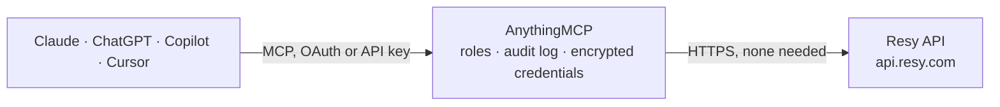

<!-- Generated by scripts/export-github-catalog.mjs in the anythingmcp-website repository. Do not edit by hand. -->

# Resy MCP connector

Search Resy restaurants from any AI assistant. The AnythingMCP connector gives Claude, ChatGPT, Microsoft Copilot, Cursor and Gemini 6 MCP tools for Resy, all read-only.

**Category:** [Food & Drink](../food.md) · **Tools:** 6 · **Setup guide:** [anythingmcp.com](https://anythingmcp.com/guides/resy-to-mcp) · [Deutsch](https://anythingmcp.com/de/guides/resy-to-mcp) · [Italiano](https://anythingmcp.com/it/guides/resy-to-mcp) · [Español](https://anythingmcp.com/es/guides/resy-to-mcp) · [日本語](https://anythingmcp.com/ja/guides/resy-to-mcp) · [Русский](https://anythingmcp.com/ru/guides/resy-to-mcp) · [中文](https://anythingmcp.com/zh/guides/resy-to-mcp)

## Start without code

No installation and no terminal: AnythingMCP Cloud runs the Resy connector for you, operated by helpcode.ai in Frankfurt, Germany.

1. **Click the button above** and create an account or sign in. The Resy connector opens, ready to install.
2. **Nothing to enter:** this connector needs no credentials. Every click is in the [step-by-step guide](https://anythingmcp.com/guides/resy-to-mcp).
3. **Click Install.** AnythingMCP shows the address of your MCP server.
4. **Add that address to your assistant:** [Claude](https://anythingmcp.com/guides/connect-resy-to-claude) · [ChatGPT](https://anythingmcp.com/guides/connect-resy-to-chatgpt) · [Microsoft Copilot](https://anythingmcp.com/guides/connect-resy-to-copilot) · [Cursor](https://anythingmcp.com/guides/connect-resy-to-cursor) · [Gemini CLI](https://anythingmcp.com/guides/connect-resy-to-gemini) · [Meta Muse](https://anythingmcp.com/guides/connect-resy-to-muse).
5. **Ask your first question**, for example: *Check availability for Osteria Lume in NYC on 2026-11-12 for 6 people — show available time slots.*

Prefer help with the setup? [Talk to us](https://anythingmcp.com/contact).

## How it works

- **The AI client** speaks MCP (Streamable HTTP) to AnythingMCP and only sees tool names, descriptions and results. It never gets the Resy credentials.
- **AnythingMCP** checks the client's role, builds the call from the tool definition, adds the credentials (none needed), calls Resy, logs the call and returns the result.
- **Resy** sees an ordinary API client with the rights of the account the credentials belong to.

## Tools

| Tool | What it does | Access |
|---|---|---|
| [`resy_search_venues`](#resy_search_venues) | Geo search Resy venues near a coordinate, with optional party size and date filters. | read |
| [`resy_find_availability`](#resy_find_availability) | Find available slots at one or more venues on a given day for a party size, optionally near a coordinate. | read |
| [`resy_get_venue`](#resy_get_venue) | Full venue detail — name, address, cuisine, photos, menu, hours, descriptions. | read |
| [`resy_get_venue_calendar`](#resy_get_venue_calendar) | Get the booking calendar for one venue across a date range — which days have availability for a given party size. | read |
| [`resy_get_city_list`](#resy_get_city_list) | Get a Resy editorial list for a city — e.g. 'top-rated', 'new-on-resy', 'most-bookmarked'. | read |
| [`resy_get_location_config`](#resy_get_location_config) | Get Resy's configuration for available cities, neighborhoods, and cuisines. | read |

## Tool reference

Every parameter as the AI client sees it in `tools/list`. Source: [`packages/backend/src/adapters/intl/resy.json`](../../../packages/backend/src/adapters/intl/resy.json).

### `resy_search_venues`

Geo search Resy venues near a coordinate, with optional party size and date filters. Returns venues with id, name, neighborhood, cuisine, price band, and available time slots.

**Access:** read · **Call:** `POST /3/venuesearch/search`

| Parameter | Type | Required | Description |
|---|---|---|---|
| `latitude` | number | yes | Search center latitude. |
| `longitude` | number | yes | Search center longitude. |
| `party_size` | integer | no | Party size. |
| `day` | string | no | Date in YYYY-MM-DD, e.g. '2026-05-24'. |

### `resy_find_availability`

Find available slots at one or more venues on a given day for a party size, optionally near a coordinate. Returns slots with start time, table type, and configuration token for booking.

**Access:** read · **Call:** `GET /4/find`

| Parameter | Type | Required | Description |
|---|---|---|---|
| `day` | string | yes | Date in YYYY-MM-DD. |
| `party_size` | integer | yes |  |
| `location` | string | no | City code (e.g. 'ny', 'la', 'lon', 'mia', 'ath'). |
| `venue_id` | integer | no | Optional: limit to one venue. |
| `lat` | number | no | Search center latitude. |
| `long` | number | no | Search center longitude. |

### `resy_get_venue`

Full venue detail — name, address, cuisine, photos, menu, hours, descriptions. Pass venue_id from search or find.

**Access:** read · **Call:** `GET /3/venue`

| Parameter | Type | Required | Description |
|---|---|---|---|
| `id` | integer | yes | Venue ID. |

### `resy_get_venue_calendar`

Get the booking calendar for one venue across a date range — which days have availability for a given party size.

**Access:** read · **Call:** `GET /4/venue/calendar`

| Parameter | Type | Required | Description |
|---|---|---|---|
| `venue_id` | integer | yes |  |
| `num_seats` | integer | no | Party size. |
| `start_date` | string | yes | YYYY-MM-DD. |
| `end_date` | string | yes | YYYY-MM-DD. |

### `resy_get_city_list`

Get a Resy editorial list for a city — e.g. 'top-rated', 'new-on-resy', 'most-bookmarked'. Returns the curated venues.

**Access:** read · **Call:** `GET /3/cities/{city}/list/{list}`

| Parameter | Type | Required | Description |
|---|---|---|---|
| `city` | string | yes | City code, e.g. 'ny', 'la', 'lon', 'ath'. |
| `list` | string | yes | List slug, e.g. 'top-rated', 'new-on-resy', 'climbing' (city-specific lists vary). |

### `resy_get_location_config`

Get Resy's configuration for available cities, neighborhoods, and cuisines. Use first to discover what's queryable.

**Access:** read · **Call:** `GET /3/location/config`

No parameters.

## Run it yourself

AnythingMCP is open source (AGPL-3.0). [Run it with Docker](../../../README.md#run-it-yourself), open **Connectors → Store**, pick **Resy**, then add your MCP server URL to the AI client.

[← Food & Drink connectors](../food.md) · [All categories](../README.md)
