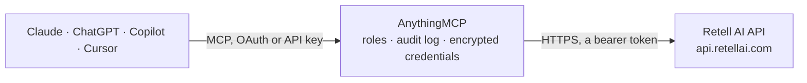

<!-- Generated by scripts/export-github-catalog.mjs in the anythingmcp-website repository. Do not edit by hand. -->

# Retell AI MCP connector

Let your AI work with Retell AI voice agents: review calls with transcripts, recordings, analysis and costs, start and stop outbound calls, edit and publish agents and their prompts, route phone … The AnythingMCP connector gives Claude, ChatGPT, Microsoft Copilot, Cursor and Gemini 29 MCP tools for Retell AI: 21 read and 8 can change data.

**Category:** [Messaging](../messaging.md) · **Tools:** 29 · **Setup guide:** [anythingmcp.com](https://anythingmcp.com/guides/retell-ai-to-mcp) · [Deutsch](https://anythingmcp.com/de/guides/retell-ai-to-mcp) · [Italiano](https://anythingmcp.com/it/guides/retell-ai-to-mcp) · [Español](https://anythingmcp.com/es/guides/retell-ai-to-mcp) · [日本語](https://anythingmcp.com/ja/guides/retell-ai-to-mcp) · [Русский](https://anythingmcp.com/ru/guides/retell-ai-to-mcp) · [中文](https://anythingmcp.com/zh/guides/retell-ai-to-mcp)

## Start without code

No installation and no terminal: AnythingMCP Cloud runs the Retell AI connector for you, operated by helpcode.ai in Frankfurt, Germany.

1. **Click the button above** and create an account or sign in. The Retell AI connector opens, ready to install.
2. **Paste the API key or token from your Retell AI account.** Every click is in the [step-by-step guide](https://anythingmcp.com/guides/retell-ai-to-mcp).
3. **Click Install.** AnythingMCP shows the address of your MCP server.
4. **Add that address to your assistant:** [Claude](https://anythingmcp.com/guides/connect-retell-ai-to-claude) · [ChatGPT](https://anythingmcp.com/guides/connect-retell-ai-to-chatgpt) · [Microsoft Copilot](https://anythingmcp.com/guides/connect-retell-ai-to-copilot) · [Cursor](https://anythingmcp.com/guides/connect-retell-ai-to-cursor) · [Gemini CLI](https://anythingmcp.com/guides/connect-retell-ai-to-gemini) · [Meta Muse](https://anythingmcp.com/guides/connect-retell-ai-to-muse).
5. **Ask your first question**, for example: *Show the call C-2026-0142 transcript and why it ended, I need quotes about scheduling the rooftop install*

Prefer help with the setup? [Talk to us](https://anythingmcp.com/contact).

## How it works

- **The AI client** speaks MCP (Streamable HTTP) to AnythingMCP and only sees tool names, descriptions and results. It never gets the Retell AI credentials.
- **AnythingMCP** checks the client's role, builds the call from the tool definition, adds the credentials (a bearer token), calls Retell AI, logs the call and returns the result.
- **Retell AI** sees an ordinary API client with the rights of the account the credentials belong to.

## Tools

| Tool | What it does | Access |
|---|---|---|
| [`retell_ai_get_concurrency`](#retell_ai_get_concurrency) | Concurrent calls of the organization right now and the limits: current_concurrency, concurrency_limit, base and purchased concurrency, reserved inbound… | read |
| [`retell_ai_get_api_key_info`](#retell_ai_get_api_key_info) | Which organization the API key belongs to: org_id, org_name and the key's name. | read |
| [`retell_ai_list_agents`](#retell_ai_list_agents) | List voice and chat agents (latest version of each): agent_id, agent_name, channel (voice or chat), tags, is_suspended, last change time. | read |
| [`retell_ai_get_agent`](#retell_ai_get_agent) | One agent in full: response_engine (the Retell LLM id or conversation flow it uses), voice, language, webhook, voicemail and call-ending settings, post-call… | read |
| [`retell_ai_list_agent_versions`](#retell_ai_list_agent_versions) | List the stored versions of an agent: version number, is_published, title and description, last change time. | read |
| [`retell_ai_update_agent`](#retell_ai_update_agent) | Change the latest draft version of an agent: name, response engine, voice, language, timing, webhook, post-call analysis fields or voicemail handling. | write |
| [`retell_ai_publish_agent_version`](#retell_ai_publish_agent_version) | Publish a draft version of an agent so that live traffic on numbers bound to the published agent uses it. | write |
| [`retell_ai_list_retell_llms`](#retell_ai_list_retell_llms) | List Retell LLM response engines (the prompt, model and tools behind agents): llm_id, version, model_config, general_prompt, begin_message, tools, states. | read |
| [`retell_ai_get_retell_llm`](#retell_ai_get_retell_llm) | One Retell LLM response engine: model_config, general_prompt, begin_message, start_speaker, general_tools, states, knowledge base ids and default dynamic… | read |
| [`retell_ai_update_retell_llm`](#retell_ai_update_retell_llm) | Change a Retell LLM response engine: prompt, first message, model, tools, states, knowledge bases or default variables. | write |
| [`retell_ai_list_conversation_flows`](#retell_ai_list_conversation_flows) | List conversation flows (node-based agents): conversation_flow_id, version, nodes, global prompt, model. | read |
| [`retell_ai_get_conversation_flow`](#retell_ai_get_conversation_flow) | One conversation flow with its nodes, edges, global prompt, tools and model settings. | read |
| [`retell_ai_list_calls`](#retell_ai_list_calls) | List calls, newest first by default: call_id, call_type, direction, from_number, to_number, agent_id and version, call_status, start and end timestamps… | read |
| [`retell_ai_get_call`](#retell_ai_get_call) | One call in full: transcript (plain text), transcript_with_tool_calls (turns and tool calls), recording_url, public_log_url, call_analysis, call_cost with… | read |
| [`retell_ai_create_phone_call`](#retell_ai_create_phone_call) | Start a real outbound phone call: Retell dials to_number from your number and the agent talks to the person. | write |
| [`retell_ai_stop_call`](#retell_ai_stop_call) | Hang up an ongoing call immediately. | write |
| [`retell_ai_create_batch_call`](#retell_ai_create_batch_call) | Schedule a batch of outbound calls from one number, one task per person called. | write |
| [`retell_ai_list_phone_numbers`](#retell_ai_list_phone_numbers) | List the phone numbers in Retell (bought or imported): phone_number, nickname, type, area code, inbound and outbound agents (calls and SMS) with weights,… | read |
| [`retell_ai_get_phone_number`](#retell_ai_get_phone_number) | One phone number with its bound inbound and outbound agents (calls and SMS), webhooks, allowed countries and fallback number. | read |
| [`retell_ai_update_phone_number`](#retell_ai_update_phone_number) | Change which agents answer or place calls and texts on a number, its nickname, inbound webhook or allowed countries. | write |
| [`retell_ai_list_voices`](#retell_ai_list_voices) | List the voices available to the organization: voice_id, voice_name, provider (elevenlabs, cartesia, openai, ...), accent, gender, age and a preview_audio_url. | read |
| [`retell_ai_get_voice`](#retell_ai_get_voice) | One voice with its provider, accent, gender, age and preview audio URL. | read |
| [`retell_ai_list_knowledge_bases`](#retell_ai_list_knowledge_bases) | List knowledge bases: knowledge_base_id, name, status (in_progress, complete, error), sources (documents, URLs, texts) and auto-refresh settings. | read |
| [`retell_ai_get_knowledge_base`](#retell_ai_get_knowledge_base) | One knowledge base with its status, chunk settings and every source with its id, type and URL. | read |
| [`retell_ai_list_chats`](#retell_ai_list_chats) | List chats (web chat and SMS conversations with chat agents): chat_id, agent_id, chat_type, chat_status, start and end timestamps, transcript,… | read |
| [`retell_ai_get_chat`](#retell_ai_get_chat) | One chat with its transcript, messages with tool calls, collected variables, analysis and cost. | read |
| [`retell_ai_create_sms_chat`](#retell_ai_create_sms_chat) | Start an outbound SMS conversation: the chat agent bound to from_number (or override_agent_id) writes the first text and then answers replies. | write |
| [`retell_ai_list_contacts`](#retell_ai_list_contacts) | List or search the contacts Retell keeps per phone number: contact_id, phone_number, first and last name, do_not_call, tags, custom fields,… | read |
| [`retell_ai_get_contact_by_phone`](#retell_ai_get_contact_by_phone) | The contact for one phone number, with names, do_not_call, tags, custom fields, contact memory and conversation count. | read |

## Tool reference

Every parameter as the AI client sees it in `tools/list`. Source: [`packages/backend/src/adapters/intl/retell-ai.json`](../../../packages/backend/src/adapters/intl/retell-ai.json).

### `retell_ai_get_concurrency`

Concurrent calls of the organization right now and the limits: current_concurrency, concurrency_limit, base and purchased concurrency, reserved inbound concurrency and burst settings. A call beyond the limit is refused with 429.

**Access:** read · **Call:** `GET /get-concurrency`

No parameters.

### `retell_ai_get_api_key_info`

Which organization the API key belongs to: org_id, org_name and the key's name. Useful to confirm the right workspace before changing anything.

**Access:** read · **Call:** `GET /get-api-key-info`

No parameters.

### `retell_ai_list_agents`

List voice and chat agents (latest version of each): agent_id, agent_name, channel (voice or chat), tags, is_suspended, last change time. Read-only, though sent as POST. Paged with pagination_key while has_more is true.

**Access:** read · **Call:** `POST /v2/list-agents`

| Parameter | Type | Required | Description |
|---|---|---|---|
| `limit` | integer | no | Maximum number of items to return (Retell default 50, at most 1000). |
| `sort_order` | `ascending` \| `descending` | no | ascending or descending (default) by creation time. |
| `pagination_key` | string | no | The pagination_key of the previous page, to get the next one. |

### `retell_ai_get_agent`

One agent in full: response_engine (the Retell LLM id or conversation flow it uses), voice, language, webhook, voicemail and call-ending settings, post-call analysis fields, version and is_published.

**Access:** read · **Call:** `GET /get-agent/{agent_id}`

| Parameter | Type | Required | Description |
|---|---|---|---|
| `agent_id` | string | yes | The agent id (agent_...). |
| `version` | integer | no | A specific version number; default the latest. |

### `retell_ai_list_agent_versions`

List the stored versions of an agent: version number, is_published, title and description, last change time. Paged with pagination_key.

**Access:** read · **Call:** `GET /list-agent-versions/{agent_id}`

| Parameter | Type | Required | Description |
|---|---|---|---|
| `agent_id` | string | yes | The agent id. |
| `limit` | integer | no | Maximum number of items to return (Retell default 50, at most 1000). |
| `sort_order` | `ascending` \| `descending` | no | ascending or descending (default) by creation time. |
| `pagination_key` | string | no | The pagination_key of the previous page, to get the next one. |

### `retell_ai_update_agent`

Change the latest draft version of an agent: name, response engine, voice, language, timing, webhook, post-call analysis fields or voicemail handling. Only the fields you send change. Phone numbers bound to a published version keep using it until you publish with retell_ai_publish_agent_version. Confirm the change with the user first.

**Access:** write · **Call:** `PATCH /update-agent/{agent_id}`

| Parameter | Type | Required | Description |
|---|---|---|---|
| `agent_id` | string | yes | The agent id. |
| `agent_name` | string | no | Name of the agent, for your own reference. |
| `response_engine` | object | no | The brain of the agent: {"type": "retell-llm", "llm_id": "llm_..."}, {"type": "conversation-flow", "conversation_flow_id": "..."} or {"type": "custom-llm", "llm_websocket_url": "wss://..."}. |
| `voice_id` | string | no | Voice id from retell_ai_list_voices, e.g. 11labs-Adrian. |
| `language` | string | no | Locale such as en-US, de-DE, es-ES, or multi for multilingual. |
| `voice_speed` | number | no | Speech speed from 0.5 to 2 (default 1). |
| `responsiveness` | number | no | How quickly the agent answers, 0 to 1 (default 1). |
| `interruption_sensitivity` | number | no | How easily the user can interrupt, 0 to 1 (default 1). |
| `begin_message_delay_ms` | integer | no | Wait this long before the first message, in milliseconds. |
| `end_call_after_silence_ms` | integer | no | End the call after this much user silence, in milliseconds (at least 10000). |
| `max_call_duration_ms` | integer | no | Maximum call length in milliseconds (at least 60000, default 3600000). |
| `webhook_url` | string | no | URL that receives call_started, call_ended and call_analyzed events for this agent. |
| `post_call_analysis_data` | object[] | no | Fields to extract after each call, e.g. [{"type": "string", "name": "reason", "description": "Why the customer called"}]. Replaces the whole list. |
| `voicemail_option` | object | no | What to do on voicemail: {"action": {"type": "static_text", "text": "Please call us back."}} or {"action": {"type": "hangup"}}. |
| `version_description` | string | no | Note for this draft version, for your own reference. |

### `retell_ai_publish_agent_version`

Publish a draft version of an agent so that live traffic on numbers bound to the published agent uses it. This changes how real calls are handled: show the user the version and its changes and publish only after a yes.

**Access:** write · **Call:** `POST /publish-agent-version/{agent_id}`

| Parameter | Type | Required | Description |
|---|---|---|---|
| `agent_id` | string | yes | The agent id. |
| `version` | integer | yes | The draft version number to publish (from retell_ai_list_agent_versions). |
| `version_title` | string | no | Title of the version, for your own reference. |
| `version_description` | string | no | Description of what changed. |

### `retell_ai_list_retell_llms`

List Retell LLM response engines (the prompt, model and tools behind agents): llm_id, version, model_config, general_prompt, begin_message, tools, states. Paged with pagination_key.

**Access:** read · **Call:** `GET /v2/list-retell-llms`

| Parameter | Type | Required | Description |
|---|---|---|---|
| `limit` | integer | no | Maximum number of items to return (Retell default 50, at most 1000). |
| `sort_order` | `ascending` \| `descending` | no | ascending or descending (default) by creation time. |
| `pagination_key` | string | no | The pagination_key of the previous page, to get the next one. |

### `retell_ai_get_retell_llm`

One Retell LLM response engine: model_config, general_prompt, begin_message, start_speaker, general_tools, states, knowledge base ids and default dynamic variables.

**Access:** read · **Call:** `GET /get-retell-llm/{llm_id}`

| Parameter | Type | Required | Description |
|---|---|---|---|
| `llm_id` | string | yes | The response engine id (llm_..., from an agent's response_engine). |
| `version` | integer | no | A specific version; default the latest. |

### `retell_ai_update_retell_llm`

Change a Retell LLM response engine: prompt, first message, model, tools, states, knowledge bases or default variables. Only the fields you send change; a list (general_tools, states) is replaced as a whole, so read it first. Agents using this engine pick the change up as described for their version; confirm with the user first.

**Access:** write · **Call:** `PATCH /update-retell-llm/{llm_id}`

| Parameter | Type | Required | Description |
|---|---|---|---|
| `llm_id` | string | yes | The response engine id. |
| `version` | integer | no | Version to edit; default the latest. |
| `general_prompt` | string | no | The main prompt of the agent, used in every state. |
| `begin_message` | string | no | First sentence the agent says. Empty string: the agent waits for the user; leave out to let the model generate it. |
| `start_speaker` | `agent` \| `user` | no | Who speaks first. |
| `model_config` | object | no | Model settings, e.g. {"type": "llm", "primary": {"model": "gpt-4.1"}, "temperature": 0.2}. |
| `general_tools` | object[] | no | Tools the model may call, e.g. [{"type": "end_call", "name": "end_call"}, {"type": "transfer_call", ...}, {"type": "custom", "name": "...", "url": "https://..."}]. Replaces the whole list. |
| `states` | object[] | no | States of a multi-prompt agent, each with name, state_prompt, edges and tools. Replaces the whole list. |
| `starting_state` | string | no | Name of the starting state (required when states is not empty). |
| `knowledge_base_ids` | string[] | no | Knowledge base ids the agent may search. |
| `default_dynamic_variables` | object | no | Default values for {{variables}} in the prompts, as string key/value pairs. |

### `retell_ai_list_conversation_flows`

List conversation flows (node-based agents): conversation_flow_id, version, nodes, global prompt, model. Paged with pagination_key.

**Access:** read · **Call:** `GET /v2/list-conversation-flows`

| Parameter | Type | Required | Description |
|---|---|---|---|
| `limit` | integer | no | Maximum number of items to return (Retell default 50, at most 1000). |
| `sort_order` | `ascending` \| `descending` | no | ascending or descending (default) by creation time. |
| `pagination_key` | string | no | The pagination_key of the previous page, to get the next one. |

### `retell_ai_get_conversation_flow`

One conversation flow with its nodes, edges, global prompt, tools and model settings.

**Access:** read · **Call:** `GET /get-conversation-flow/{conversation_flow_id}`

| Parameter | Type | Required | Description |
|---|---|---|---|
| `conversation_flow_id` | string | yes | The conversation flow id. |

### `retell_ai_list_calls`

List calls, newest first by default: call_id, call_type, direction, from_number, to_number, agent_id and version, call_status, start and end timestamps (epoch ms), duration_ms, disconnection_reason, recording_url, call_analysis (summary, user_sentiment, call_successful, custom data) and call_cost. Read-only, though sent as POST. Paged with pagination_key while has_more is true.

**Access:** read · **Call:** `POST /v3/list-calls`

| Parameter | Type | Required | Description |
|---|---|---|---|
| `filter_criteria` | object | no | Filters, combined with AND. Examples: {"agent": [{"agent_id": "agent_..."}]}, {"call_status": {"type": "enum", "op": "in", "value": ["ended"]}}, {"direction": {"type": "enum", "op": "in", "value": ["outbound"]}}, {"to_number": {"type": "string", "op": "eq", "value": "+14155550123"}}, {"start_timestamp": {"type": "range", "op": "bt", "value": [1761955200000, 1762041600000]}}, {"user_sentiment": {"type": "enum", "op": "in", "value": ["Negative"]}}, {"batch_call_id": {"type": "string", "op": "eq", "value": "batch_..."}}. |
| `sort_order` | `ascending` \| `descending` | no | By start time: descending (default) or ascending. |
| `limit` | integer | no | Maximum number of calls (default 50, at most 1000). |
| `pagination_key` | string | no | The pagination_key of the previous page. |
| `include_total` | boolean | no | Also return total, the number of all matching calls. |

### `retell_ai_get_call`

One call in full: transcript (plain text), transcript_with_tool_calls (turns and tool calls), recording_url, public_log_url, call_analysis, call_cost with its product breakdown, collected dynamic variables, metadata, disconnection_reason and timings. Word-level timestamps and scrubbed duplicates are left out.

**Access:** read · **Call:** `GET /v2/get-call/{call_id}`

| Parameter | Type | Required | Description |
|---|---|---|---|
| `call_id` | string | yes | The call id. |

### `retell_ai_create_phone_call`

Start a real outbound phone call: Retell dials to_number from your number and the agent talks to the person. This reaches a real person and costs money (billed per minute for voice, model and telephony), so show the user the number called, the number called from, the agent and the dynamic variables, and call only after the user confirms. Retell-bought numbers can only call US numbers. Returns the call with call_id and call_status registered; follow it with retell_ai_get_call.

**Access:** write · **Call:** `POST /v2/create-phone-call`

| Parameter | Type | Required | Description |
|---|---|---|---|
| `from_number` | string | yes | Your Retell number to call from, in E.164 format, e.g. +14155550123 (from retell_ai_list_phone_numbers). |
| `to_number` | string | yes | The number to call, in E.164 format, e.g. +14155550123. |
| `override_agent_id` | string | no | Use this agent for this call instead of the number's outbound agent. |
| `override_agent_version` | integer | no | Use this version of the agent. |
| `retell_llm_dynamic_variables` | object | no | Values for {{variables}} in the prompt, as string key/value pairs, e.g. {"customer_name": "Joe", "appointment": "Tuesday 3 pm"}. |
| `metadata` | object | no | Your own data stored with the call, e.g. a CRM id. |
| `honor_internal_dnc` | boolean | no | Refuse the call when the contact is marked do-not-call in Retell. |
| `idempotency_key` | string | no | A key of your own: retrying with the same key within an hour does not place a second call. |

### `retell_ai_stop_call`

Hang up an ongoing call immediately. The person on the line is cut off; confirm with the user first.

**Access:** write · **Call:** `POST /v2/stop-call/{call_id}`

| Parameter | Type | Required | Description |
|---|---|---|---|
| `call_id` | string | yes | The id of the ongoing call. |

### `retell_ai_create_batch_call`

Schedule a batch of outbound calls from one number, one task per person called. Each call reaches a real person and costs money, so this installs switched off: an admin turns it on deliberately. Show the user the list, the number, the time and the calling window and send only after a yes. Returns batch_call_id; the calls appear in retell_ai_list_calls with filter batch_call_id.

**Access:** write · **Call:** `POST /create-batch-call`

| Parameter | Type | Required | Description |
|---|---|---|---|
| `from_number` | string | yes | Your Retell number to call from, in E.164 format, e.g. +14155550123. |
| `tasks` | object[] | yes | One entry per call: {"to_number": "+14155550123", "retell_llm_dynamic_variables": {"name": "Joe"}, "override_agent_id": "agent_...", "metadata": {...}}. |
| `name` | string | no | Name of the batch, for your own reference. |
| `trigger_timestamp` | number | no | When to start, Unix time in milliseconds; default now. |
| `call_time_window` | object | no | Allowed calling windows in a time zone, e.g. {"timezone": "America/New_York", "windows": [{"start": 540, "end": 1080}]} (minutes after midnight). |
| `reserved_concurrency` | integer | no | Concurrent calls kept free for inbound and other calls. |

### `retell_ai_list_phone_numbers`

List the phone numbers in Retell (bought or imported): phone_number, nickname, type, area code, inbound and outbound agents (calls and SMS) with weights, inbound webhook, allowed countries. Paged with pagination_key.

**Access:** read · **Call:** `GET /v2/list-phone-numbers`

| Parameter | Type | Required | Description |
|---|---|---|---|
| `limit` | integer | no | Maximum number of items to return (Retell default 50, at most 1000). |
| `sort_order` | `ascending` \| `descending` | no | ascending or descending (default) by creation time. |
| `pagination_key` | string | no | The pagination_key of the previous page, to get the next one. |

### `retell_ai_get_phone_number`

One phone number with its bound inbound and outbound agents (calls and SMS), webhooks, allowed countries and fallback number.

**Access:** read · **Call:** `GET /get-phone-number/{phone_number}`

| Parameter | Type | Required | Description |
|---|---|---|---|
| `phone_number` | string | yes | The number, in E.164 format, e.g. +14155550123. |

### `retell_ai_update_phone_number`

Change which agents answer or place calls and texts on a number, its nickname, inbound webhook or allowed countries. Live calls follow the change at once; confirm with the user first.

**Access:** write · **Call:** `PATCH /update-phone-number/{phone_number}`

| Parameter | Type | Required | Description |
|---|---|---|---|
| `phone_number` | string | yes | The number, in E.164 format, e.g. +14155550123. |
| `inbound_agents` | object[] | no | Agents for inbound calls with weights, e.g. [{"agent_id": "agent_...", "weight": 1}]. An empty list leaves inbound calls unanswered. |
| `outbound_agents` | object[] | no | Agents for outbound calls with weights, same shape. |
| `inbound_sms_agents` | object[] | no | Agents for inbound SMS with weights. |
| `outbound_sms_agents` | object[] | no | Agents for outbound SMS with weights. |
| `nickname` | string | no | Nickname of the number. |
| `inbound_webhook_url` | string | no | Webhook called on inbound calls to choose the agent or set variables. |
| `allowed_inbound_country_list` | string[] | no | ISO 3166-1 alpha-2 codes allowed to call in, e.g. ["US", "CA"]. |
| `allowed_outbound_country_list` | string[] | no | ISO 3166-1 alpha-2 codes this number may call. |

### `retell_ai_list_voices`

List the voices available to the organization: voice_id, voice_name, provider (elevenlabs, cartesia, openai, ...), accent, gender, age and a preview_audio_url.

**Access:** read · **Call:** `GET /list-voices`

No parameters.

### `retell_ai_get_voice`

One voice with its provider, accent, gender, age and preview audio URL.

**Access:** read · **Call:** `GET /get-voice/{voice_id}`

| Parameter | Type | Required | Description |
|---|---|---|---|
| `voice_id` | string | yes | The voice id, e.g. 11labs-Adrian. |

### `retell_ai_list_knowledge_bases`

List knowledge bases: knowledge_base_id, name, status (in_progress, complete, error), sources (documents, URLs, texts) and auto-refresh settings.

**Access:** read · **Call:** `GET /list-knowledge-bases`

No parameters.

### `retell_ai_get_knowledge_base`

One knowledge base with its status, chunk settings and every source with its id, type and URL.

**Access:** read · **Call:** `GET /get-knowledge-base/{knowledge_base_id}`

| Parameter | Type | Required | Description |
|---|---|---|---|
| `knowledge_base_id` | string | yes | The knowledge base id (knowledge_base_...). |

### `retell_ai_list_chats`

List chats (web chat and SMS conversations with chat agents): chat_id, agent_id, chat_type, chat_status, start and end timestamps, transcript, chat_analysis, cost. Read-only, though sent as POST. Paged with pagination_key.

**Access:** read · **Call:** `POST /v3/list-chats`

| Parameter | Type | Required | Description |
|---|---|---|---|
| `filter_criteria` | object | no | Filters combined with AND, same shapes as for calls, e.g. {"agent": [{"agent_id": "agent_..."}]}. |
| `sort_order` | `ascending` \| `descending` | no | By start time: descending (default) or ascending. |
| `limit` | integer | no | Maximum number of chats (default 50). |
| `pagination_key` | string | no | The pagination_key of the previous page. |

### `retell_ai_get_chat`

One chat with its transcript, messages with tool calls, collected variables, analysis and cost.

**Access:** read · **Call:** `GET /get-chat/{chat_id}`

| Parameter | Type | Required | Description |
|---|---|---|---|
| `chat_id` | string | yes | The chat id. |

### `retell_ai_create_sms_chat`

Start an outbound SMS conversation: the chat agent bound to from_number (or override_agent_id) writes the first text and then answers replies. This texts a real person and costs money, and US recipients must have agreed to receive texts; show the user the numbers and the agent and send only after a yes. Returns the chat with chat_id.

**Access:** write · **Call:** `POST /create-sms-chat`

| Parameter | Type | Required | Description |
|---|---|---|---|
| `from_number` | string | yes | Your Retell number to text from, in E.164 format, e.g. +14155550123. |
| `to_number` | string | yes | The recipient, in E.164 format, e.g. +14155550123. |
| `override_agent_id` | string | no | Use this chat agent instead of the number's outbound SMS agent. |
| `retell_llm_dynamic_variables` | object | no | Values for {{variables}} in the prompt, as string key/value pairs. |
| `metadata` | object | no | Your own data stored with the chat. |
| `honor_internal_dnc` | boolean | no | Refuse when the contact is marked do-not-contact. |

### `retell_ai_list_contacts`

List or search the contacts Retell keeps per phone number: contact_id, phone_number, first and last name, do_not_call, tags, custom fields, conversation_count, last conversation time. Read-only, though sent as POST. Paged with pagination_key; total gives the number of matches.

**Access:** read · **Call:** `POST /list-contacts`

| Parameter | Type | Required | Description |
|---|---|---|---|
| `search_query` | string | no | Case-insensitive text matched against phone number, names, external id and custom fields. |
| `filter_criteria` | object | no | Structured filters combined with AND. |
| `sort_order` | `asc` \| `desc` | no | By creation time: desc (default) or asc. |
| `limit` | integer | no | Maximum number of contacts. |
| `pagination_key` | string | no | The pagination_key of the previous page. |

### `retell_ai_get_contact_by_phone`

The contact for one phone number, with names, do_not_call, tags, custom fields, contact memory and conversation count.

**Access:** read · **Call:** `GET /get-contact-by-phone/{phone_number}`

| Parameter | Type | Required | Description |
|---|---|---|---|
| `phone_number` | string | yes | The phone number, in E.164 format, e.g. +14155550123. |

## Run it yourself

AnythingMCP is open source (AGPL-3.0). [Run it with Docker](../../../README.md#run-it-yourself), open **Connectors → Store**, pick **Retell AI** and enter `RETELL_API_KEY`, then add your MCP server URL to the AI client.

[← Messaging connectors](../messaging.md) · [All categories](../README.md)
