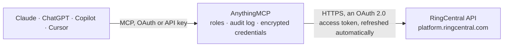

<!-- Generated by scripts/export-github-catalog.mjs in the anythingmcp-website repository. Do not edit by hand. -->

# RingCentral MCP connector

Let your AI work with RingCentral: look up users, numbers and the company directory, review the call log and active calls, place RingOut calls, send SMS and read texts, voicemails and faxes, manage … The AnythingMCP connector gives Claude, ChatGPT, Microsoft Copilot, Cursor and Gemini 28 MCP tools for RingCentral: 20 read and 8 can change data.

**Category:** [Messaging](../messaging.md) · **Tools:** 28 · **Setup guide:** [anythingmcp.com](https://anythingmcp.com/guides/ringcentral-to-mcp) · [Deutsch](https://anythingmcp.com/de/guides/ringcentral-to-mcp) · [Italiano](https://anythingmcp.com/it/guides/ringcentral-to-mcp) · [Español](https://anythingmcp.com/es/guides/ringcentral-to-mcp) · [日本語](https://anythingmcp.com/ja/guides/ringcentral-to-mcp) · [Русский](https://anythingmcp.com/ru/guides/ringcentral-to-mcp) · [中文](https://anythingmcp.com/zh/guides/ringcentral-to-mcp)

## Start without code

No installation and no terminal: AnythingMCP Cloud runs the RingCentral connector for you, operated by helpcode.ai in Frankfurt, Germany.

1. **Click the button above** and create an account or sign in. The RingCentral connector opens, ready to install.
2. **Sign in with your RingCentral account** when AnythingMCP asks. The first time, an admin creates a small app in the RingCentral developer console. Every click is in the [step-by-step guide](https://anythingmcp.com/guides/ringcentral-to-mcp).
3. **Click Install.** AnythingMCP shows the address of your MCP server.
4. **Add that address to your assistant:** [Claude](https://anythingmcp.com/guides/connect-ringcentral-to-claude) · [ChatGPT](https://anythingmcp.com/guides/connect-ringcentral-to-chatgpt) · [Microsoft Copilot](https://anythingmcp.com/guides/connect-ringcentral-to-copilot) · [Cursor](https://anythingmcp.com/guides/connect-ringcentral-to-cursor) · [Gemini CLI](https://anythingmcp.com/guides/connect-ringcentral-to-gemini) · [Meta Muse](https://anythingmcp.com/guides/connect-ringcentral-to-muse).
5. **Ask your first question**, for example: *Fetch the voicemail from Borealis Fabrics GmbH that arrived 2026-10-28 to our extension*

Prefer help with the setup? [Talk to us](https://anythingmcp.com/contact).

## How it works

- **The AI client** speaks MCP (Streamable HTTP) to AnythingMCP and only sees tool names, descriptions and results. It never gets the RingCentral credentials.
- **AnythingMCP** checks the client's role, builds the call from the tool definition, adds the credentials (an OAuth 2.0 access token, refreshed automatically), calls RingCentral, logs the call and returns the result.
- **RingCentral** sees an ordinary API client with the rights of the account the credentials belong to.

## Tools

| Tool | What it does | Access |
|---|---|---|
| [`ringcentral_get_account`](#ringcentral_get_account) | The RingCentral account: id, main number, operator extension, status, service plan and edition (serviceInfo), regional settings (country, time zone,… | read |
| [`ringcentral_get_my_extension`](#ringcentral_get_my_extension) | The signed-in user (extension): id, extensionNumber, name, contact email and phone, type, status, permissions (admin or not), regional settings and time zone. | read |
| [`ringcentral_list_extensions`](#ringcentral_list_extensions) | List the extensions of the account (users, departments, call queues, IVR menus, ...): id, extensionNumber, name, type, status, contact email. | read |
| [`ringcentral_get_extension`](#ringcentral_get_extension) | One extension of the account by id: name, extensionNumber, type, status, contact details, departments, regional settings. | read |
| [`ringcentral_search_directory`](#ringcentral_search_directory) | Search the company directory (users and other extensions, also federated accounts): name, extension number, phone numbers, email, job title, department, site. | read |
| [`ringcentral_list_my_phone_numbers`](#ringcentral_list_my_phone_numbers) | Phone numbers of the signed-in user: phoneNumber (E.164), usageType (DirectNumber, MainCompanyNumber, ...), type (VoiceFax, VoiceOnly, FaxOnly) and features. | read |
| [`ringcentral_list_call_log`](#ringcentral_list_call_log) | Call history of the signed-in user, newest first: id, sessionId, startTime, duration (seconds), direction, type, action, result (Accepted, Missed,… | read |
| [`ringcentral_list_company_call_log`](#ringcentral_list_company_call_log) | Call history of the whole account (every extension), newest first, with the same fields as ringcentral_list_call_log. | read |
| [`ringcentral_get_call_record`](#ringcentral_get_call_record) | One call log record of the signed-in user by id, with legs when view is Detailed. | read |
| [`ringcentral_list_active_calls`](#ringcentral_list_active_calls) | Calls of the signed-in user that are in progress right now: direction, from, to, start time, telephony session id. | read |
| [`ringcentral_ringout_call`](#ringcentral_ringout_call) | Place a phone call with RingOut: RingCentral first rings from_number (the user's own phone), and when the user answers it dials to_number. | write |
| [`ringcentral_get_ringout_status`](#ringcentral_get_ringout_status) | Status of a RingOut call: callStatus and callerStatus / calleeStatus (InProgress, Success, NoAnswer, Busy, Rejected, ...). | read |
| [`ringcentral_cancel_ringout`](#ringcentral_cancel_ringout) | Cancel a RingOut call that is still ringing or connecting. | write |
| [`ringcentral_send_sms`](#ringcentral_send_sms) | Send a text message (SMS) from one of the user's numbers to one number. | write |
| [`ringcentral_list_messages`](#ringcentral_list_messages) | The signed-in user's message store, newest first: SMS, voicemails, faxes and pager messages with id, type, direction, from, to, subject (the SMS text),… | read |
| [`ringcentral_get_message`](#ringcentral_get_message) | One message of the store by id, with its attachments (ids, content type, voicemail duration, fax page count) and, for voicemails with transcription, the… | read |
| [`ringcentral_get_message_attachment`](#ringcentral_get_message_attachment) | Download one attachment of a message: the voicemail audio, the fax document (PDF or TIFF), an MMS image or the text of a voicemail transcription. | read |
| [`ringcentral_mark_message`](#ringcentral_mark_message) | Mark a message (SMS, voicemail or fax) as Read or Unread in the user's message store. | write |
| [`ringcentral_list_contacts`](#ringcentral_list_contacts) | The signed-in user's personal address book: id, name, company, job title, email, phone numbers, addresses, notes. | read |
| [`ringcentral_get_contact`](#ringcentral_get_contact) | One personal contact by id with all its fields: names, company, emails, phone numbers, addresses and notes. | read |
| [`ringcentral_create_contact`](#ringcentral_create_contact) | Add a contact to the signed-in user's personal address book. | write |
| [`ringcentral_update_contact`](#ringcentral_update_contact) | Change fields of a personal contact. | write |
| [`ringcentral_get_presence`](#ringcentral_get_presence) | Presence of one extension: presenceStatus (Available, Busy, Offline), userStatus, dndStatus (TakeAllCalls, DoNotAcceptAnyCalls, ...), telephonyStatus… | read |
| [`ringcentral_list_presence`](#ringcentral_list_presence) | Presence of every extension of the account (who is available, busy, on a call or on do not disturb). | read |
| [`ringcentral_update_presence`](#ringcentral_update_presence) | Set the signed-in user's own status: userStatus (Available, Busy, Offline), do not disturb mode and the status message others see. | write |
| [`ringcentral_list_video_meetings`](#ringcentral_list_video_meetings) | History of RingCentral Video meetings of the signed-in user, newest first: id, displayName, startTime, duration, status, host, participants, recordings and… | read |
| [`ringcentral_get_video_meeting`](#ringcentral_get_video_meeting) | One past RingCentral Video meeting: participants with join and leave times, recordings, chat, keywords and the short and long AI summary when available. | read |
| [`ringcentral_create_video_meeting`](#ringcentral_create_video_meeting) | Create a RingCentral Video meeting room (bridge) for the signed-in user and return its join link (discovery.web), PINs and settings. | write |

## Tool reference

Every parameter as the AI client sees it in `tools/list`. Source: [`packages/backend/src/adapters/intl/ringcentral.json`](../../../packages/backend/src/adapters/intl/ringcentral.json).

### `ringcentral_get_account`

The RingCentral account: id, main number, operator extension, status, service plan and edition (serviceInfo), regional settings (country, time zone, language, currency) and limits.

**Access:** read · **Call:** `GET /restapi/v1.0/account/~`

No parameters.

### `ringcentral_get_my_extension`

The signed-in user (extension): id, extensionNumber, name, contact email and phone, type, status, permissions (admin or not), regional settings and time zone. The starting point for every other call.

**Access:** read · **Call:** `GET /restapi/v1.0/account/~/extension/~`

No parameters.

### `ringcentral_list_extensions`

List the extensions of the account (users, departments, call queues, IVR menus, ...): id, extensionNumber, name, type, status, contact email. Filter by type, status, number or email; paged.

**Access:** read · **Call:** `GET /restapi/v1.0/account/~/extension`

| Parameter | Type | Required | Description |
|---|---|---|---|
| `type` | `User` \| `Department` \| `Announcement` \| `Voicemail` \| `DigitalUser` \| `VirtualUser` \| `FaxUser` \| `PagingOnly` \| `SharedLinesGroup` \| `IvrMenu` \| `ApplicationExtension` \| `ParkLocation` \| `Limited` \| `Bot` \| `Site` \| `Room` \| `ProxyAdmin` \| `DelegatedLinesGroup` \| `GroupCallPickup` | no | Only this type of extension. |
| `status` | `Enabled` \| `Disabled` \| `Frozen` \| `NotActivated` \| `Unassigned` | no | Only extensions in this state. |
| `extension_number` | string | no | Only the extension with this short number. |
| `email` | string | no | Only the extension with this email address. |
| `page` | integer | no | Page number, from 1. |
| `per_page` | integer | no | Items per page (RingCentral default 100). |

### `ringcentral_get_extension`

One extension of the account by id: name, extensionNumber, type, status, contact details, departments, regional settings.

**Access:** read · **Call:** `GET /restapi/v1.0/account/~/extension/{extension_id}`

| Parameter | Type | Required | Description |
|---|---|---|---|
| `extension_id` | string | yes | The extension id (from ringcentral_list_extensions), not the short extension number. |

### `ringcentral_search_directory`

Search the company directory (users and other extensions, also federated accounts): name, extension number, phone numbers, email, job title, department, site. Read-only, though sent as POST.

**Access:** read · **Call:** `POST /restapi/v1.0/account/~/directory/entries/search`

| Parameter | Type | Required | Description |
|---|---|---|---|
| `search_string` | string | no | Text searched in first and last name, extension number, phone number, email, job title and department. |
| `extension_type` | string | no | Only this type, e.g. User or Department. |
| `department` | string | no | Only this department. |
| `page` | integer | no | Page number, from 1. |
| `per_page` | integer | no | Items per page. |

### `ringcentral_list_my_phone_numbers`

Phone numbers of the signed-in user: phoneNumber (E.164), usageType (DirectNumber, MainCompanyNumber, ...), type (VoiceFax, VoiceOnly, FaxOnly) and features. A number can send SMS only when features contains SmsSender, and can be a caller id when it contains CallerId.

**Access:** read · **Call:** `GET /restapi/v1.0/account/~/extension/~/phone-number`

| Parameter | Type | Required | Description |
|---|---|---|---|
| `status` | `Normal` \| `Pending` \| `PortedIn` \| `Temporary` | no | Only numbers in this state. |
| `page` | integer | no | Page number, from 1. |
| `per_page` | integer | no | Items per page (RingCentral default 100). |

### `ringcentral_list_call_log`

Call history of the signed-in user, newest first: id, sessionId, startTime, duration (seconds), direction, type, action, result (Accepted, Missed, Voicemail, ...), from and to with name and number, recording metadata. Default range: the last 24 hours; set date_from for older calls.

**Access:** read · **Call:** `GET /restapi/v1.0/account/~/extension/~/call-log`

| Parameter | Type | Required | Description |
|---|---|---|---|
| `date_from` | string | no | Start of the time range, ISO 8601 with time zone, e.g. 2026-10-01T00:00:00Z. Default: 24 hours ago. |
| `date_to` | string | no | End of the time range, ISO 8601 with time zone. Default: now. |
| `direction` | `Inbound` \| `Outbound` | no | Only Inbound or Outbound calls. |
| `type` | `Voice` \| `Fax` | no | Only Voice or Fax calls. |
| `phone_number` | string | no | Only calls from or to this number, E.164 without the plus sign, e.g. 14155550123. |
| `recording_type` | `Automatic` \| `OnDemand` \| `All` | no | Only calls with a recording of this type. |
| `view` | `Simple` \| `Detailed` | no | Simple (default) or Detailed, which adds the call legs. |
| `session_id` | string | no | Only the call with this session id. |
| `page` | integer | no | Page number, from 1. |
| `per_page` | integer | no | Items per page (RingCentral default 100). |

### `ringcentral_list_company_call_log`

Call history of the whole account (every extension), newest first, with the same fields as ringcentral_list_call_log. Needs a user with the company call log permission (an admin). Default range: the last 24 hours.

**Access:** read · **Call:** `GET /restapi/v1.0/account/~/call-log`

| Parameter | Type | Required | Description |
|---|---|---|---|
| `date_from` | string | no | Start of the time range, ISO 8601 with time zone, e.g. 2026-10-01T00:00:00Z. Default: 24 hours ago. |
| `date_to` | string | no | End of the time range, ISO 8601 with time zone. Default: now. |
| `direction` | `Inbound` \| `Outbound` | no | Only Inbound or Outbound calls. |
| `type` | `Voice` \| `Fax` | no | Only Voice or Fax calls. |
| `phone_number` | string | no | Only calls from or to this number, E.164 without the plus sign, e.g. 14155550123. |
| `extension_number` | string | no | Only calls of this short extension number (company call log), e.g. 101. |
| `recording_type` | `Automatic` \| `OnDemand` \| `All` | no | Only calls with a recording of this type. |
| `view` | `Simple` \| `Detailed` | no | Simple (default) or Detailed, which adds the call legs. |
| `session_id` | string | no | Only the call with this session id. |
| `page` | integer | no | Page number, from 1. |
| `per_page` | integer | no | Items per page (RingCentral default 100). |

### `ringcentral_get_call_record`

One call log record of the signed-in user by id, with legs when view is Detailed.

**Access:** read · **Call:** `GET /restapi/v1.0/account/~/extension/~/call-log/{call_record_id}`

| Parameter | Type | Required | Description |
|---|---|---|---|
| `call_record_id` | string | yes | The call record id (id from ringcentral_list_call_log). |
| `view` | `Simple` \| `Detailed` | no | Simple (default) or Detailed. |

### `ringcentral_list_active_calls`

Calls of the signed-in user that are in progress right now: direction, from, to, start time, telephony session id.

**Access:** read · **Call:** `GET /restapi/v1.0/account/~/extension/~/active-calls`

| Parameter | Type | Required | Description |
|---|---|---|---|
| `direction` | `Inbound` \| `Outbound` | no | Only Inbound or Outbound. |
| `view` | `Simple` \| `Detailed` | no | Simple or Detailed. |
| `page` | integer | no | Page number, from 1. |
| `per_page` | integer | no | Items per page (RingCentral default 100). |

### `ringcentral_ringout_call`

Place a phone call with RingOut: RingCentral first rings from_number (the user's own phone), and when the user answers it dials to_number. This reaches a real person and can cost money (international and premium destinations are billed), so show the user both numbers and the caller id and call only after the user confirms. Returns the RingOut id and status; check it with ringcentral_get_ringout_status.

**Access:** write · **Call:** `POST /restapi/v1.0/account/~/extension/~/ring-out`

| Parameter | Type | Required | Description |
|---|---|---|---|
| `from_number` | string | yes | The user's phone that rings first (a RingCentral number or a forwarding number of the user), in E.164 format with the plus sign, e.g. +14155550123. |
| `to_number` | string | yes | The number to call, in E.164 format with the plus sign, e.g. +14155550123. |
| `caller_id` | string | no | Number shown to the person called (one of the user's numbers with the CallerId feature), in E.164 format with the plus sign, e.g. +14155550123. |
| `play_prompt` | boolean | no | Play the prompt 'press 1 to connect' to the user before dialing (default true). |

### `ringcentral_get_ringout_status`

Status of a RingOut call: callStatus and callerStatus / calleeStatus (InProgress, Success, NoAnswer, Busy, Rejected, ...).

**Access:** read · **Call:** `GET /restapi/v1.0/account/~/extension/~/ring-out/{ringout_id}`

| Parameter | Type | Required | Description |
|---|---|---|---|
| `ringout_id` | string | yes | The RingOut id returned by ringcentral_ringout_call. |

### `ringcentral_cancel_ringout`

Cancel a RingOut call that is still ringing or connecting. Hangs up both legs; confirm with the user first.

**Access:** write · **Call:** `DELETE /restapi/v1.0/account/~/extension/~/ring-out/{ringout_id}`

| Parameter | Type | Required | Description |
|---|---|---|---|
| `ringout_id` | string | yes | The RingOut id. |

### `ringcentral_send_sms`

Send a text message (SMS) from one of the user's numbers to one number. This reaches real people and can cost money, and in the US the sending number must be registered for business texting (10DLC campaign or verified toll-free) and recipients must have agreed to texts; show the user sender, recipients and exact text and send only after the user confirms. Returns the message with id, messageStatus (Queued, Sent, Delivered, DeliveryFailed) and conversationId.

**Access:** write · **Call:** `POST /restapi/v1.0/account/~/extension/~/sms`

| Parameter | Type | Required | Description |
|---|---|---|---|
| `from_number` | string | yes | The sending number, one of the user's numbers with the SmsSender feature (ringcentral_list_my_phone_numbers), in E.164 format with the plus sign, e.g. +14155550123. |
| `to_number` | string | yes | The recipient, in E.164 format with the plus sign, e.g. +14155550123. |
| `text` | string | yes | The message, at most 1000 characters. |

### `ringcentral_list_messages`

The signed-in user's message store, newest first: SMS, voicemails, faxes and pager messages with id, type, direction, from, to, subject (the SMS text), creationTime, readStatus, messageStatus, conversationId and attachments (voicemail audio, fax PDF, with their ids). Default range: the last 24 hours; set date_from for older messages.

**Access:** read · **Call:** `GET /restapi/v1.0/account/~/extension/~/message-store`

| Parameter | Type | Required | Description |
|---|---|---|---|
| `message_type` | `SMS` \| `VoiceMail` \| `Fax` \| `Pager` \| `Text` | no | Only this type. |
| `direction` | `Inbound` \| `Outbound` | no | Only Inbound or Outbound. |
| `read_status` | `Read` \| `Unread` | no | Only Read or Unread messages. |
| `date_from` | string | no | Start of the time range, ISO 8601 with time zone, e.g. 2026-10-01T00:00:00Z. Default: 24 hours ago. |
| `date_to` | string | no | End of the time range, ISO 8601 with time zone. Default: now. |
| `conversation_id` | string | no | Only the messages of this conversation. |
| `phone_number` | string | no | Only messages from or to this number. |
| `distinct_conversations` | boolean | no | Return only the latest message of each conversation (an inbox view). |
| `page` | integer | no | Page number, from 1. |
| `per_page` | integer | no | Items per page (RingCentral default 100). |

### `ringcentral_get_message`

One message of the store by id, with its attachments (ids, content type, voicemail duration, fax page count) and, for voicemails with transcription, the vmTranscriptionStatus.

**Access:** read · **Call:** `GET /restapi/v1.0/account/~/extension/~/message-store/{message_id}`

| Parameter | Type | Required | Description |
|---|---|---|---|
| `message_id` | string | yes | The message id. |

### `ringcentral_get_message_attachment`

Download one attachment of a message: the voicemail audio, the fax document (PDF or TIFF), an MMS image or the text of a voicemail transcription. Files are handed over as attachments of the result.

**Access:** read · **Call:** `GET /restapi/v1.0/account/~/extension/~/message-store/{message_id}/content/{attachment_id}`

| Parameter | Type | Required | Description |
|---|---|---|---|
| `message_id` | string | yes | The message id. |
| `attachment_id` | string | yes | The attachment id from the message's attachments list. |

### `ringcentral_mark_message`

Mark a message (SMS, voicemail or fax) as Read or Unread in the user's message store.

**Access:** write · **Call:** `PUT /restapi/v1.0/account/~/extension/~/message-store/{message_id}`

| Parameter | Type | Required | Description |
|---|---|---|---|
| `message_id` | string | yes | The message id. |
| `read_status` | `Read` \| `Unread` | yes | The new read status. |

### `ringcentral_list_contacts`

The signed-in user's personal address book: id, name, company, job title, email, phone numbers, addresses, notes. Search by the start of a first or last name, or by phone number.

**Access:** read · **Call:** `GET /restapi/v1.0/account/~/extension/~/address-book/contact`

| Parameter | Type | Required | Description |
|---|---|---|---|
| `starts_with` | string | no | Only contacts whose first or last name starts with this text. |
| `phone_number` | string | no | Only contacts with this number, in E.164 format with the plus sign, e.g. +14155550123. |
| `sort_by` | `FirstName` \| `LastName` \| `Company` | no | Sort order. |
| `page` | integer | no | Page number, from 1. |
| `per_page` | integer | no | Items per page (RingCentral default 100). |

### `ringcentral_get_contact`

One personal contact by id with all its fields: names, company, emails, phone numbers, addresses and notes.

**Access:** read · **Call:** `GET /restapi/v1.0/account/~/extension/~/address-book/contact/{contact_id}`

| Parameter | Type | Required | Description |
|---|---|---|---|
| `contact_id` | string | yes | The contact id. |

### `ringcentral_create_contact`

Add a contact to the signed-in user's personal address book. Give at least a name and one phone number or email. Returns the contact with its id.

**Access:** write · **Call:** `POST /restapi/v1.0/account/~/extension/~/address-book/contact`

| Parameter | Type | Required | Description |
|---|---|---|---|
| `first_name` | string | no | First name. |
| `last_name` | string | no | Last name. |
| `company` | string | no | Company name. |
| `job_title` | string | no | Job title. |
| `email` | string | no | Email address. |
| `mobile_phone` | string | no | Mobile number, in E.164 format with the plus sign, e.g. +14155550123. |
| `business_phone` | string | no | Business number, in E.164 format with the plus sign, e.g. +14155550123. |
| `home_phone` | string | no | Home number, in E.164 format with the plus sign, e.g. +14155550123. |
| `notes` | string | no | Free notes about the contact. |
| `business_address` | object | no | Business address: {"street": "...", "city": "...", "state": "...", "zip": "...", "country": "..."}. |

### `ringcentral_update_contact`

Change fields of a personal contact. Only the fields you send change.

**Access:** write · **Call:** `PATCH /restapi/v1.0/account/~/extension/~/address-book/contact/{contact_id}`

| Parameter | Type | Required | Description |
|---|---|---|---|
| `contact_id` | string | yes | The contact id. |
| `first_name` | string | no | First name. |
| `last_name` | string | no | Last name. |
| `company` | string | no | Company name. |
| `job_title` | string | no | Job title. |
| `email` | string | no | Email address. |
| `mobile_phone` | string | no | Mobile number, in E.164 format with the plus sign, e.g. +14155550123. |
| `business_phone` | string | no | Business number, in E.164 format with the plus sign, e.g. +14155550123. |
| `home_phone` | string | no | Home number, in E.164 format with the plus sign, e.g. +14155550123. |
| `notes` | string | no | Free notes about the contact. |
| `business_address` | object | no | Business address: {"street": "...", "city": "...", "state": "...", "zip": "...", "country": "..."}. |

### `ringcentral_get_presence`

Presence of one extension: presenceStatus (Available, Busy, Offline), userStatus, dndStatus (TakeAllCalls, DoNotAcceptAnyCalls, ...), telephonyStatus (NoCall, Ringing, CallConnected, OnHold), meetingStatus and the status message. Use ~ for the signed-in user.

**Access:** read · **Call:** `GET /restapi/v1.0/account/~/extension/{extension_id}/presence`

| Parameter | Type | Required | Description |
|---|---|---|---|
| `extension_id` | string | yes | The extension id, or ~ for the signed-in user. |
| `detailed_telephony_state` | boolean | no | Also return the active calls in detail. |

### `ringcentral_list_presence`

Presence of every extension of the account (who is available, busy, on a call or on do not disturb). Paged.

**Access:** read · **Call:** `GET /restapi/v1.0/account/~/presence`

| Parameter | Type | Required | Description |
|---|---|---|---|
| `detailed_telephony_state` | boolean | no | Also return the active calls in detail. |
| `page` | integer | no | Page number, from 1. |
| `per_page` | integer | no | Items per page (RingCentral default 100). |

### `ringcentral_update_presence`

Set the signed-in user's own status: userStatus (Available, Busy, Offline), do not disturb mode and the status message others see.

**Access:** write · **Call:** `PUT /restapi/v1.0/account/~/extension/~/presence`

| Parameter | Type | Required | Description |
|---|---|---|---|
| `user_status` | `Available` \| `Busy` \| `Offline` | no | The user's status. |
| `dnd_status` | `TakeAllCalls` \| `DoNotAcceptDepartmentCalls` \| `TakeDepartmentCallsOnly` \| `DoNotAcceptAnyCalls` | no | Do not disturb mode. |
| `message` | string | no | Status message shown to colleagues. |

### `ringcentral_list_video_meetings`

History of RingCentral Video meetings of the signed-in user, newest first: id, displayName, startTime, duration, status, host, participants, recordings and AI summaries when available. Paged with pageToken.

**Access:** read · **Call:** `GET /rcvideo/v1/history/meetings`

| Parameter | Type | Required | Description |
|---|---|---|---|
| `text` | string | no | Search text in the meeting name. |
| `type` | `All` \| `My` \| `Deleted` \| `Shared` | no | All (default), My (hosted by the user), Deleted or Shared. |
| `start_time` | integer | no | Only meetings from this time on, Unix milliseconds. |
| `end_time` | integer | no | Only meetings up to this time, Unix milliseconds. |
| `per_page` | integer | no | Items per page. |
| `page_token` | string | no | The nextPageToken of the previous page. |

### `ringcentral_get_video_meeting`

One past RingCentral Video meeting: participants with join and leave times, recordings, chat, keywords and the short and long AI summary when available.

**Access:** read · **Call:** `GET /rcvideo/v1/history/meetings/{meeting_id}`

| Parameter | Type | Required | Description |
|---|---|---|---|
| `meeting_id` | string | yes | The meeting id from ringcentral_list_video_meetings. |

### `ringcentral_create_video_meeting`

Create a RingCentral Video meeting room (bridge) for the signed-in user and return its join link (discovery.web), PINs and settings. Instant rooms are for one meeting; Scheduled rooms can be used at a planned time. Nobody is invited: share the link yourself.

**Access:** write · **Call:** `POST /rcvideo/v2/account/~/extension/~/bridges`

| Parameter | Type | Required | Description |
|---|---|---|---|
| `name` | string | no | Name of the meeting. |
| `type` | `Instant` \| `Scheduled` | no | Instant (default) or Scheduled. |
| `security` | object | no | Security settings: {"passwordProtected": true, "password": "...", "noGuests": false, "sameAccount": false, "e2ee": false}. |
| `preferences` | object | no | Preferences: {"joinBeforeHost": true, "screenSharing": true, "musicOnHold": false, "recordingsMode": "User", "transcriptionsMode": "User"}. |

## Run it yourself

AnythingMCP is open source (AGPL-3.0). [Run it with Docker](../../../README.md#run-it-yourself), open **Connectors → Store**, pick **RingCentral** and enter `RINGCENTRAL_CLIENT_ID`, `RINGCENTRAL_CLIENT_SECRET`, then add your MCP server URL to the AI client.

[← Messaging connectors](../messaging.md) · [All categories](../README.md)
