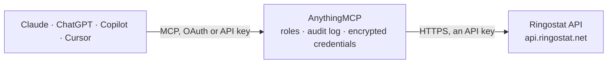

<!-- Generated by scripts/export-github-catalog.mjs in the anythingmcp-website repository. Do not edit by hand. -->

# Ringostat MCP connector

Ringostat call tracking and virtual PBX: call log export with traffic sources, talk time, status, employees and recording links, SIP online and in-call status, employees with departments and … The AnythingMCP connector gives Claude, ChatGPT, Microsoft Copilot, Cursor and Gemini 7 MCP tools for Ringostat: 6 read and 1 can change data.

**Category:** [Analytics](../analytics.md) · **Tools:** 7 · **Setup guide:** [anythingmcp.com](https://anythingmcp.com/guides/ringostat-to-mcp) · [Deutsch](https://anythingmcp.com/de/guides/ringostat-to-mcp) · [Italiano](https://anythingmcp.com/it/guides/ringostat-to-mcp) · [Español](https://anythingmcp.com/es/guides/ringostat-to-mcp) · [日本語](https://anythingmcp.com/ja/guides/ringostat-to-mcp) · [Русский](https://anythingmcp.com/ru/guides/ringostat-to-mcp) · [中文](https://anythingmcp.com/zh/guides/ringostat-to-mcp)

## Start without code

No installation and no terminal: AnythingMCP Cloud runs the Ringostat connector for you, operated by helpcode.ai in Frankfurt, Germany.

1. **Click the button above** and create an account or sign in. The Ringostat connector opens, ready to install.
2. **Paste the API key or token from your Ringostat account.** Every click is in the [step-by-step guide](https://anythingmcp.com/guides/ringostat-to-mcp).
3. **Click Install.** AnythingMCP shows the address of your MCP server.
4. **Add that address to your assistant:** [Claude](https://anythingmcp.com/guides/connect-ringostat-to-claude) · [ChatGPT](https://anythingmcp.com/guides/connect-ringostat-to-chatgpt) · [Microsoft Copilot](https://anythingmcp.com/guides/connect-ringostat-to-copilot) · [Cursor](https://anythingmcp.com/guides/connect-ringostat-to-cursor) · [Gemini CLI](https://anythingmcp.com/guides/connect-ringostat-to-gemini) · [Meta Muse](https://anythingmcp.com/guides/connect-ringostat-to-muse).
5. **Ask your first question**, for example: *Find the call on 2026-10-28 from +44 7123 456789 that reached extension 203, show disposition, billsec and recording.*

Prefer help with the setup? [Talk to us](https://anythingmcp.com/contact).

## How it works

- **The AI client** speaks MCP (Streamable HTTP) to AnythingMCP and only sees tool names, descriptions and results. It never gets the Ringostat credentials.
- **AnythingMCP** checks the client's role, builds the call from the tool definition, adds the credentials (an API key), calls Ringostat, logs the call and returns the result.
- **Ringostat** sees an ordinary API client with the rights of the account the credentials belong to.

## Tools

| Tool | What it does | Access |
|---|---|---|
| [`ringostat_list_calls`](#ringostat_list_calls) | Export the call log of the project for a period: one row per call with the fields you ask for, e.g. date, caller and called number, call type (in, out,… | read |
| [`ringostat_list_online_sip`](#ringostat_list_online_sip) | List the SIP accounts of the project that are online right now (logins as strings). | read |
| [`ringostat_list_speaking_sip`](#ringostat_list_speaking_sip) | List the SIP accounts of the project that are in a call right now (logins as strings). | read |
| [`ringostat_list_employees`](#ringostat_list_employees) | List the employees of the project with their SIP status (status true means online), full name (fio), e-mail, extension number, staffId, departments and call… | read |
| [`ringostat_get_sip_status_report`](#ringostat_get_sip_status_report) | Get how long each employee's SIP account was online and offline per day in a date range (times as HH:MM:SS). | read |
| [`ringostat_list_custom_statuses`](#ringostat_list_custom_statuses) | List the custom employee statuses set up for Ringostat Smart Phone (id and title), e.g. Lunch or Meeting. | read |
| [`ringostat_start_callback`](#ringostat_start_callback) | Start a real phone call that connects two numbers: Ringostat calls from a project number to the destination (a phone number or an employee's SIP login). | write |

## Tool reference

Every parameter as the AI client sees it in `tools/list`. Source: [`packages/backend/src/adapters/intl/ringostat.json`](../../../packages/backend/src/adapters/intl/ringostat.json).

### `ringostat_list_calls`

Export the call log of the project for a period: one row per call with the fields you ask for, e.g. date, caller and called number, call type (in, out, callback, transitin, transitout), status (disposition), talk time (billsec, seconds), total duration, waiting time, employee name and department, number pool, forwarding scheme, proper and repeated flags, UTM source, medium and campaign, landing page, call id and recording link. Filter and sort with Ringostat's own expressions.

**Access:** read · **Call:** `GET /calls/list`

| Parameter | Type | Required | Description |
|---|---|---|---|
| `from` | string | no | Start of the period, 'YYYY-MM-DD HH:MM:SS'. Default: 24 hours before to. |
| `to` | string | no | End of the period, 'YYYY-MM-DD HH:MM:SS'. Default: now. |
| `fields` | string | no | Comma-separated columns to return. Available: calldate, caller, dst, pool_name, disposition, category_mark, duration, call_type, waittime, billsec, connected_with, call_counter, proper_flag, repeated_flag, utm_source, utm_medium, utm_campaign, utm_content, utm_term, uniqueid, category_number, employee_number, employee_mark, client_id, remote_ip, refferrer, landing, recording, recording_wav, call_card, additional_number, has_recording, scheme_name, duration_ms, employee_fio, department, caller_number, missing_reason, who_missed, csat_survey_name, csat_survey, csat_rating. |
| `filters` | string | no | Conditions separated by commas, each field, operator and value: =, <>, >, <, >=, <= or ~ (regular expression, base64-encoded). Examples: call_type=in, billsec>=60. |
| `order` | string | no | Sorting: field and direction separated by a space, several separated by commas. Default calldate asc; e.g. calldate desc. |
| `merge` | `0` \| `1` \| `2` | no | Group calls by caller number: 0 no (default), 1 per day, 2 for the whole period. |

### `ringostat_list_online_sip`

List the SIP accounts of the project that are online right now (logins as strings). An employee whose SIP account is missing cannot take calls on it.

**Access:** read · **Call:** `GET /sipstatus/online`

No parameters.

### `ringostat_list_speaking_sip`

List the SIP accounts of the project that are in a call right now (logins as strings). Compare with ringostat_list_online_sip to see who is free.

**Access:** read · **Call:** `GET /sipstatus/speaking`

No parameters.

### `ringostat_list_employees`

List the employees of the project with their SIP status (status true means online), full name (fio), e-mail, extension number, staffId, departments and call directions (main and backup SIP accounts or phone numbers). Optionally filter by staffId (exact), fio or email (partial match). Read-only, although it is a POST.

**Access:** read · **Call:** `POST /api/json-rpc`

| Parameter | Type | Required | Description |
|---|---|---|---|
| `filter` | object[] | no | Filters, each {"param": "staffId" \| "fio" \| "email", "value": ...}, combined. Leave out for all employees. Example: [{"param": "fio", "value": "Olena"}]. |

### `ringostat_get_sip_status_report`

Get how long each employee's SIP account was online and offline per day in a date range (times as HH:MM:SS). An employee with one SIP online and one in DND counts as online. Read-only, although it is a POST.

**Access:** read · **Call:** `POST /api/json-rpc`

| Parameter | Type | Required | Description |
|---|---|---|---|
| `from` | string | yes | First day, YYYY-MM-DD. |
| `to` | string | yes | Last day, YYYY-MM-DD. |

### `ringostat_list_custom_statuses`

List the custom employee statuses set up for Ringostat Smart Phone (id and title), e.g. Lunch or Meeting. Read-only, although it is a POST.

**Access:** read · **Call:** `POST /rsp-api-v3`

No parameters.

### `ringostat_start_callback`

Start a real phone call that connects two numbers: Ringostat calls from a project number to the destination (a phone number or an employee's SIP login). The call is placed and billed at once, so this tool is installed switched off; confirm both numbers with the user first.

**Access:** write · **Call:** `POST /callback/outward_call`

| Parameter | Type | Required | Description |
|---|---|---|---|
| `extension` | string | yes | Project number to call from, connected as incoming in Virtual PBX, international format without +, e.g. 380441112233. |
| `destination` | string | yes | Number (international format without +) or SIP login to call. |

## Run it yourself

AnythingMCP is open source (AGPL-3.0). [Run it with Docker](../../../README.md#run-it-yourself), open **Connectors → Store**, pick **Ringostat** and enter `RINGOSTAT_AUTH_KEY`, `RINGOSTAT_PROJECT_ID`, then add your MCP server URL to the AI client.

[← Analytics connectors](../analytics.md) · [All categories](../README.md)
