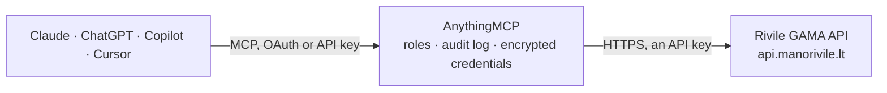

<!-- Generated by scripts/export-github-catalog.mjs in the anythingmcp-website repository. Do not edit by hand. -->

# Rivile GAMA MCP connector

Connect Rivile GAMA, the Lithuanian ERP and accounting system, to Claude or ChatGPT through the Rivile API v2: clients, products, stock balances and prices, purchase and sales documents, debts and … The AnythingMCP connector gives Claude, ChatGPT, Microsoft Copilot, Cursor and Gemini 28 MCP tools for Rivile GAMA: 24 read and 4 can change data.

**Category:** [ERP](../erp.md) · **Tools:** 28 · **Setup guide:** [anythingmcp.com](https://anythingmcp.com/guides/rivile-to-mcp) · [Deutsch](https://anythingmcp.com/de/guides/rivile-to-mcp) · [Italiano](https://anythingmcp.com/it/guides/rivile-to-mcp) · [Español](https://anythingmcp.com/es/guides/rivile-to-mcp) · [日本語](https://anythingmcp.com/ja/guides/rivile-to-mcp) · [Русский](https://anythingmcp.com/ru/guides/rivile-to-mcp) · [中文](https://anythingmcp.com/zh/guides/rivile-to-mcp)

## Start without code

No installation and no terminal: AnythingMCP Cloud runs the Rivile GAMA connector for you, operated by helpcode.ai in Frankfurt, Germany.

1. **Click the button above** and create an account or sign in. The Rivile GAMA connector opens, ready to install.
2. **Paste the API key or token from your Rivile GAMA account.** Every click is in the [step-by-step guide](https://anythingmcp.com/guides/rivile-to-mcp).
3. **Click Install.** AnythingMCP shows the address of your MCP server.
4. **Add that address to your assistant:** [Claude](https://anythingmcp.com/guides/connect-rivile-to-claude) · [ChatGPT](https://anythingmcp.com/guides/connect-rivile-to-chatgpt) · [Microsoft Copilot](https://anythingmcp.com/guides/connect-rivile-to-copilot) · [Cursor](https://anythingmcp.com/guides/connect-rivile-to-cursor) · [Gemini CLI](https://anythingmcp.com/guides/connect-rivile-to-gemini) · [Meta Muse](https://anythingmcp.com/guides/connect-rivile-to-muse).
5. **Ask your first question**, for example: *Show me invoice INV-2026-042 details and whether it's paid for client Siaurys UAB*

Prefer help with the setup? [Talk to us](https://anythingmcp.com/contact).

## How it works

- **The AI client** speaks MCP (Streamable HTTP) to AnythingMCP and only sees tool names, descriptions and results. It never gets the Rivile GAMA credentials.
- **AnythingMCP** checks the client's role, builds the call from the tool definition, adds the credentials (an API key), calls Rivile GAMA, logs the call and returns the result.
- **Rivile GAMA** sees an ordinary API client with the rights of the account the credentials belong to.

## Tools

| Tool | What it does | Access |
|---|---|---|
| [`rivile_list_clients`](#rivile_list_clients) | List clients (N08 client cards: customers and suppliers alike) with code, name, company and VAT codes, address, payment terms and type (N08_RUSIS). | read |
| [`rivile_list_products`](#rivile_list_products) | List product and service cards (N17) with code, name, type (N17_TIPAS 1 product, 2 service), group, units and VAT. | read |
| [`rivile_list_stock_balances`](#rivile_list_stock_balances) | List stock balances (I17): quantity, reserved quantity and value per product, unit, division (warehouse), object and series. | read |
| [`rivile_list_product_prices`](#rivile_list_product_prices) | List product prices per division (I33): sales prices, price lists and validity dates. | read |
| [`rivile_list_documents`](#rivile_list_documents) | List purchase and sales documents (I06 headers): invoices, receipts and returns with type (I06_OP_TIP), number, dates, client, amounts, VAT and currency. | read |
| [`rivile_list_documents_extended`](#rivile_list_documents_extended) | List purchase and sales documents with division, client and product fields joined in (GET_I06_LIST_EXT), for sales by division, client or product without… | read |
| [`rivile_list_document_debts`](#rivile_list_document_debts) | List what is still owed on purchase and sales documents not yet transferred (GET_I06_DEBT): client, document number, currency, debit and credit amounts. | read |
| [`rivile_list_internal_operations`](#rivile_list_internal_operations) | List internal operations (I09 headers with I10 lines): stock transfers between divisions, write-offs and other internal documents. | read |
| [`rivile_list_debt_operations`](#rivile_list_debt_operations) | List debit and credit operations (I31): offsets, debt transfers and other settlements between clients that are not invoices or payments. | read |
| [`rivile_list_debts_detailed`](#rivile_list_debts_detailed) | List detailed debts by document (I44): client, document number, document and due dates, debit and credit, currency and module (I44_MODUL, e.g. RO for sales). | read |
| [`rivile_list_debts_summary`](#rivile_list_debts_summary) | List debt balances (T03): how much each client owes or is owed in total. | read |
| [`rivile_list_payment_operations`](#rivile_list_payment_operations) | List payment operations (I53): bank and cash payments and receipts with their lines and the documents they settle. | read |
| [`rivile_list_receipts_payments_register`](#rivile_list_receipts_payments_register) | List the register of receipts and payments (I04): incoming and outgoing money per date, client and account. | read |
| [`rivile_list_ledger_operations`](#rivile_list_ledger_operations) | List general ledger operations (I02 journal entries with their lines). | read |
| [`rivile_get_account_balances`](#rivile_get_account_balances) | Get general ledger account balances and turnover for a period (GET_I02_LIST_EXT), optionally summed by account, division, object or analytic dimension. | read |
| [`rivile_list_chart_of_accounts`](#rivile_list_chart_of_accounts) | List the chart of accounts (N01): account codes, names and types. | read |
| [`rivile_list_divisions`](#rivile_list_divisions) | List divisions (N07, padaliniai): warehouses, shops and departments that hold stock and prices. | read |
| [`rivile_list_objects`](#rivile_list_objects) | List objects (N06): cost centres or projects used to split documents and postings. | read |
| [`rivile_list_purchase_sales_codes`](#rivile_list_purchase_sales_codes) | List purchase, sales and other codes (N25): service and cost codes used on document lines instead of products. | read |
| [`rivile_list_vat_classifiers`](#rivile_list_vat_classifiers) | List VAT classifiers (N63, PVM klasifikatoriai) used on documents and for the i.SAF and VAT return. | read |
| [`rivile_list_currencies`](#rivile_list_currencies) | List currencies (N45) and their codes as used on documents and debts. | read |
| [`rivile_list_contracts`](#rivile_list_contracts) | List contracts (N51) with client, dates, amounts and terms. | read |
| [`rivile_list_import_export_operations`](#rivile_list_import_export_operations) | List import and export operations (B00): batches loaded into or exported from Rivile GAMA and their state. | read |
| [`rivile_call_read_method`](#rivile_call_read_method) | Call any other read method of the Rivile GAMA API by name (any GET_ method, or an MGAMA_GET_ method of the HR module), for data no dedicated tool covers,… | read |
| [`rivile_edit_client`](#rivile_edit_client) | Create, update or delete a client card (EDIT_N08). | write |
| [`rivile_edit_product`](#rivile_edit_product) | Create, update or delete a product or service card (EDIT_N17). | write |
| [`rivile_edit_document`](#rivile_edit_document) | Update or delete the header of a purchase or sales document (EDIT_I06), or create one without lines. | write |
| [`rivile_create_document`](#rivile_create_document) | Create a purchase or sales document with its lines in one call (EDIT_I06_FULL): header I06 with lines I07. | write |

## Tool reference

Every parameter as the AI client sees it in `tools/list`. Source: [`packages/backend/src/adapters/intl/rivile.json`](../../../packages/backend/src/adapters/intl/rivile.json).

### `rivile_list_clients`

List clients (N08 client cards: customers and suppliers alike) with code, name, company and VAT codes, address, payment terms and type (N08_RUSIS). GET_N08_LIST, 100 per page.

**Access:** read

| Parameter | Type | Required | Description |
|---|---|---|---|
| `list` | `H` \| `A` | no | H: client cards only (default). A: with alternative addresses, delivery and bank details (N33). |
| `fil` | string | no | Filter: a T-SQL WHERE condition on table N08 without the word WHERE, e.g. n08_kodas_ks='121411842' or n08_pav like '%ACME%'. Leave out for no filter. Field names are the table code plus a suffix (see the Rivile field list for N08). |
| `pagenumber` | integer | no | Page number; each page holds up to 100 records. Leave out for the first page (the 100 newest records). For more than a few pages, filter on the key of the last record instead. |

### `rivile_list_products`

List product and service cards (N17) with code, name, type (N17_TIPAS 1 product, 2 service), group, units and VAT. GET_N17_LIST, 100 per page.

**Access:** read

| Parameter | Type | Required | Description |
|---|---|---|---|
| `list` | `H` \| `A` | no | H: main fields only (default). A: with the related tables. |
| `fil` | string | no | Filter: a T-SQL WHERE condition on table N17 without the word WHERE, e.g. n17_kodas_ps='PREKE1' or n17_pav like '%cement%'. Leave out for no filter. Field names are the table code plus a suffix (see the Rivile field list for N17). |
| `pagenumber` | integer | no | Page number; each page holds up to 100 records. Leave out for the first page (the 100 newest records). For more than a few pages, filter on the key of the last record instead. |

### `rivile_list_stock_balances`

List stock balances (I17): quantity, reserved quantity and value per product, unit, division (warehouse), object and series. Use group to sum per product, division, object or series. GET_I17_LIST, 100 per page.

**Access:** read

| Parameter | Type | Required | Description |
|---|---|---|---|
| `fil` | string | no | Filter: a T-SQL WHERE condition on table I17 without the word WHERE, e.g. i17_kodas_ps='PREKE1' and i17_kodas_is='01'. Leave out for no filter. Field names are the table code plus a suffix (see the Rivile field list for I17). |
| `pagenumber` | integer | no | Page number; each page holds up to 100 records. Leave out for the first page (the 100 newest records). For more than a few pages, filter on the key of the last record instead. |
| `group` | string | no | Sum balances by these fields, comma separated: I17_KODAS_PS (product), I17_KODAS_IS (division), I17_KODAS_OS (object), I17_SERIJA (series). Products are always grouped first. Slow on large databases. |

### `rivile_list_product_prices`

List product prices per division (I33): sales prices, price lists and validity dates. GET_I33_LIST, 100 per page.

**Access:** read

| Parameter | Type | Required | Description |
|---|---|---|---|
| `list` | `H` \| `A` | no | H: main fields only (default). A: with the related tables. |
| `fil` | string | no | Filter: a T-SQL WHERE condition on table I33 without the word WHERE, e.g. i33_kodas_ps='PREKE1'. Leave out for no filter. Field names are the table code plus a suffix (see the Rivile field list for I33). |
| `pagenumber` | integer | no | Page number; each page holds up to 100 records. Leave out for the first page (the 100 newest records). For more than a few pages, filter on the key of the last record instead. |

### `rivile_list_documents`

List purchase and sales documents (I06 headers): invoices, receipts and returns with type (I06_OP_TIP), number, dates, client, amounts, VAT and currency. Without a filter, the 100 newest. GET_I06_LIST.

**Access:** read

| Parameter | Type | Required | Description |
|---|---|---|---|
| `list` | `H` \| `A` | no | H: document headers only (default). A: with lines (I07), provisions (I08) and payments (I13). |
| `fil` | string | no | Filter: a T-SQL WHERE condition on table I06 without the word WHERE, e.g. i06_dok_data>='2026-01-01' and i06_kodas_ks='121411842'. Leave out for no filter. Field names are the table code plus a suffix (see the Rivile field list for I06). |
| `pagenumber` | integer | no | Page number; each page holds up to 100 records. Leave out for the first page (the 100 newest records). For more than a few pages, filter on the key of the last record instead. |

### `rivile_list_documents_extended`

List purchase and sales documents with division, client and product fields joined in (GET_I06_LIST_EXT), for sales by division, client or product without extra lookups. 100 per page.

**Access:** read

| Parameter | Type | Required | Description |
|---|---|---|---|
| `list` | `H` \| `A` | no | H: main fields only (default). A: with the related tables. |
| `fil` | string | no | Filter: a T-SQL WHERE condition on table I06 without the word WHERE, e.g. i06_op_data between '2026-01-01' and '2026-01-31'. Leave out for no filter. Field names are the table code plus a suffix (see the Rivile field list for I06). |
| `pagenumber` | integer | no | Page number; each page holds up to 100 records. Leave out for the first page (the 100 newest records). For more than a few pages, filter on the key of the last record instead. |

### `rivile_list_document_debts`

List what is still owed on purchase and sales documents not yet transferred (GET_I06_DEBT): client, document number, currency, debit and credit amounts. 100 per page.

**Access:** read

| Parameter | Type | Required | Description |
|---|---|---|---|
| `list` | `H` \| `A` | no | H: main fields (default). A: all document fields. |
| `fil` | string | no | Filter: a T-SQL WHERE condition on table I06 without the word WHERE, e.g. i06_kodas_ks='121411842'. Leave out for no filter. Field names are the table code plus a suffix (see the Rivile field list for I06). |
| `pagenumber` | integer | no | Page number; each page holds up to 100 records. Leave out for the first page (the 100 newest records). For more than a few pages, filter on the key of the last record instead. |

### `rivile_list_internal_operations`

List internal operations (I09 headers with I10 lines): stock transfers between divisions, write-offs and other internal documents. GET_I09_LIST, 100 per page.

**Access:** read

| Parameter | Type | Required | Description |
|---|---|---|---|
| `list` | `H` \| `A` | no | H: main fields only (default). A: with the related tables. |
| `fil` | string | no | Filter: a T-SQL WHERE condition on table I09 without the word WHERE, e.g. i09_op_data>='2026-01-01'. Leave out for no filter. Field names are the table code plus a suffix (see the Rivile field list for I09). |
| `pagenumber` | integer | no | Page number; each page holds up to 100 records. Leave out for the first page (the 100 newest records). For more than a few pages, filter on the key of the last record instead. |

### `rivile_list_debt_operations`

List debit and credit operations (I31): offsets, debt transfers and other settlements between clients that are not invoices or payments. GET_I31_LIST, 100 per page.

**Access:** read

| Parameter | Type | Required | Description |
|---|---|---|---|
| `list` | `H` \| `A` | no | H: main fields only (default). A: with the related tables. |
| `fil` | string | no | Filter: a T-SQL WHERE condition on table I31 without the word WHERE, e.g. i31_kodas_ks='121411842'. Leave out for no filter. Field names are the table code plus a suffix (see the Rivile field list for I31). |
| `pagenumber` | integer | no | Page number; each page holds up to 100 records. Leave out for the first page (the 100 newest records). For more than a few pages, filter on the key of the last record instead. |

### `rivile_list_debts_detailed`

List detailed debts by document (I44): client, document number, document and due dates, debit and credit, currency and module (I44_MODUL, e.g. RO for sales). Best source for an aging or overdue list. GET_I44_LIST, 100 per page.

**Access:** read

| Parameter | Type | Required | Description |
|---|---|---|---|
| `list` | `H` \| `A` | no | H: main fields (default). A: all fields. |
| `fil` | string | no | Filter: a T-SQL WHERE condition on table I44 without the word WHERE, e.g. i44_kodas_ks='121411842' and i44_modul='RO'. Leave out for no filter. Field names are the table code plus a suffix (see the Rivile field list for I44). |
| `pagenumber` | integer | no | Page number; each page holds up to 100 records. Leave out for the first page (the 100 newest records). For more than a few pages, filter on the key of the last record instead. |

### `rivile_list_debts_summary`

List debt balances (T03): how much each client owes or is owed in total. GET_T03_LIST, 100 per page.

**Access:** read

| Parameter | Type | Required | Description |
|---|---|---|---|
| `list` | `H` \| `A` | no | H: one total per client (default). A: per client, document number, date and currency. |
| `fil` | string | no | Filter: a T-SQL WHERE condition on table T03 without the word WHERE, e.g. t03_kodas_ks='121411842'. Leave out for no filter. Field names are the table code plus a suffix (see the Rivile field list for T03). |
| `pagenumber` | integer | no | Page number; each page holds up to 100 records. Leave out for the first page (the 100 newest records). For more than a few pages, filter on the key of the last record instead. |

### `rivile_list_payment_operations`

List payment operations (I53): bank and cash payments and receipts with their lines and the documents they settle. GET_I53_LIST, 100 per page.

**Access:** read

| Parameter | Type | Required | Description |
|---|---|---|---|
| `list` | `H` \| `A` | no | H: main fields only (default). A: with the related tables. |
| `fil` | string | no | Filter: a T-SQL WHERE condition on table I53 without the word WHERE, e.g. i53_op_data>='2026-01-01'. Leave out for no filter. Field names are the table code plus a suffix (see the Rivile field list for I53). |
| `pagenumber` | integer | no | Page number; each page holds up to 100 records. Leave out for the first page (the 100 newest records). For more than a few pages, filter on the key of the last record instead. |

### `rivile_list_receipts_payments_register`

List the register of receipts and payments (I04): incoming and outgoing money per date, client and account. GET_I04_LIST, 100 per page.

**Access:** read

| Parameter | Type | Required | Description |
|---|---|---|---|
| `list` | `H` \| `A` | no | H: main fields only (default). A: with the related tables. |
| `fil` | string | no | Filter: a T-SQL WHERE condition on table I04 without the word WHERE, e.g. i04_op_data>='2026-01-01'. Leave out for no filter. Field names are the table code plus a suffix (see the Rivile field list for I04). |
| `pagenumber` | integer | no | Page number; each page holds up to 100 records. Leave out for the first page (the 100 newest records). For more than a few pages, filter on the key of the last record instead. |

### `rivile_list_ledger_operations`

List general ledger operations (I02 journal entries with their lines). For account balances on a date use rivile_get_account_balances. GET_I02_LIST, 100 per page.

**Access:** read

| Parameter | Type | Required | Description |
|---|---|---|---|
| `list` | `H` \| `A` | no | H: main fields only (default). A: with the related tables. |
| `fil` | string | no | Filter: a T-SQL WHERE condition on table I02 without the word WHERE, e.g. i02_kodas_dh='010000000001'. Leave out for no filter. Field names are the table code plus a suffix (see the Rivile field list for I02). |
| `pagenumber` | integer | no | Page number; each page holds up to 100 records. Leave out for the first page (the 100 newest records). For more than a few pages, filter on the key of the last record instead. |

### `rivile_get_account_balances`

Get general ledger account balances and turnover for a period (GET_I02_LIST_EXT), optionally summed by account, division, object or analytic dimension. Without dates it uses today. 100 per page.

**Access:** read

| Parameter | Type | Required | Description |
|---|---|---|---|
| `beg_date` | string | no | Period start, YYYY-MM-DD. Leave out for today. |
| `end_date` | string | no | Period end, YYYY-MM-DD. Leave out for today. |
| `group` | string | no | Sum by: kodas_ss (account), kodas_zs, kodas_sm, kodas_is (division), kodas_os (object), kodas_os_c, dim01 to dim15. Leave out for no grouping. |
| `list` | `H` \| `A` | no | H: detail accounts only. A: also group (parent) accounts. |
| `fil` | string | no | Filter: a T-SQL WHERE condition on table I02 without the word WHERE, e.g. i02_kodas_ss like '24%'. Leave out for no filter. Field names are the table code plus a suffix (see the Rivile field list for I02). |
| `pagenumber` | integer | no | Page number; each page holds up to 100 records. Leave out for the first page (the 100 newest records). For more than a few pages, filter on the key of the last record instead. |

### `rivile_list_chart_of_accounts`

List the chart of accounts (N01): account codes, names and types. GET_N01_LIST, 100 per page.

**Access:** read

| Parameter | Type | Required | Description |
|---|---|---|---|
| `list` | `H` \| `A` | no | H: main fields only (default). A: with the related tables. |
| `fil` | string | no | Filter: a T-SQL WHERE condition on table N01 without the word WHERE, e.g. n01_kodas_ss like '6%'. Leave out for no filter. Field names are the table code plus a suffix (see the Rivile field list for N01). |
| `pagenumber` | integer | no | Page number; each page holds up to 100 records. Leave out for the first page (the 100 newest records). For more than a few pages, filter on the key of the last record instead. |

### `rivile_list_divisions`

List divisions (N07, padaliniai): warehouses, shops and departments that hold stock and prices. GET_N07_LIST, 100 per page.

**Access:** read

| Parameter | Type | Required | Description |
|---|---|---|---|
| `list` | `H` \| `A` | no | H: main fields only (default). A: with the related tables. |
| `fil` | string | no | Filter: a T-SQL WHERE condition on table N07 without the word WHERE, e.g. n07_kodas_is='01'. Leave out for no filter. Field names are the table code plus a suffix (see the Rivile field list for N07). |
| `pagenumber` | integer | no | Page number; each page holds up to 100 records. Leave out for the first page (the 100 newest records). For more than a few pages, filter on the key of the last record instead. |

### `rivile_list_objects`

List objects (N06): cost centres or projects used to split documents and postings. GET_N06_LIST, 100 per page.

**Access:** read

| Parameter | Type | Required | Description |
|---|---|---|---|
| `list` | `H` \| `A` | no | H: main fields only (default). A: with the related tables. |
| `fil` | string | no | Filter: a T-SQL WHERE condition on table N06 without the word WHERE, e.g. n06_kodas_os='OBJ1'. Leave out for no filter. Field names are the table code plus a suffix (see the Rivile field list for N06). |
| `pagenumber` | integer | no | Page number; each page holds up to 100 records. Leave out for the first page (the 100 newest records). For more than a few pages, filter on the key of the last record instead. |

### `rivile_list_purchase_sales_codes`

List purchase, sales and other codes (N25): service and cost codes used on document lines instead of products. GET_N25_LIST, 100 per page.

**Access:** read

| Parameter | Type | Required | Description |
|---|---|---|---|
| `list` | `H` \| `A` | no | H: main fields only (default). A: with the related tables. |
| `fil` | string | no | Filter: a T-SQL WHERE condition on table N25 without the word WHERE, e.g. n25_kodas_ss='PASL1'. Leave out for no filter. Field names are the table code plus a suffix (see the Rivile field list for N25). |
| `pagenumber` | integer | no | Page number; each page holds up to 100 records. Leave out for the first page (the 100 newest records). For more than a few pages, filter on the key of the last record instead. |

### `rivile_list_vat_classifiers`

List VAT classifiers (N63, PVM klasifikatoriai) used on documents and for the i.SAF and VAT return. GET_N63_LIST, 100 per page.

**Access:** read

| Parameter | Type | Required | Description |
|---|---|---|---|
| `list` | `H` \| `A` | no | H: main fields only (default). A: with the related tables. |
| `fil` | string | no | Filter: a T-SQL WHERE condition on table N63 without the word WHERE, e.g. n63_kodas='PVM1'. Leave out for no filter. Field names are the table code plus a suffix (see the Rivile field list for N63). |
| `pagenumber` | integer | no | Page number; each page holds up to 100 records. Leave out for the first page (the 100 newest records). For more than a few pages, filter on the key of the last record instead. |

### `rivile_list_currencies`

List currencies (N45) and their codes as used on documents and debts. GET_N45_LIST, 100 per page.

**Access:** read

| Parameter | Type | Required | Description |
|---|---|---|---|
| `list` | `H` \| `A` | no | H: main fields only (default). A: with the related tables. |
| `fil` | string | no | Filter: a T-SQL WHERE condition on table N45 without the word WHERE, e.g. n45_kodas_vl='USD'. Leave out for no filter. Field names are the table code plus a suffix (see the Rivile field list for N45). |
| `pagenumber` | integer | no | Page number; each page holds up to 100 records. Leave out for the first page (the 100 newest records). For more than a few pages, filter on the key of the last record instead. |

### `rivile_list_contracts`

List contracts (N51) with client, dates, amounts and terms. GET_N51_LIST, 100 per page.

**Access:** read

| Parameter | Type | Required | Description |
|---|---|---|---|
| `list` | `H` \| `A` | no | H: contracts only (default). A: with addenda (N52). |
| `fil` | string | no | Filter: a T-SQL WHERE condition on table N51 without the word WHERE, e.g. n51_kodas_ks='121411842'. Leave out for no filter. Field names are the table code plus a suffix (see the Rivile field list for N51). |
| `pagenumber` | integer | no | Page number; each page holds up to 100 records. Leave out for the first page (the 100 newest records). For more than a few pages, filter on the key of the last record instead. |

### `rivile_list_import_export_operations`

List import and export operations (B00): batches loaded into or exported from Rivile GAMA and their state. GET_B00_LIST, 100 per page.

**Access:** read

| Parameter | Type | Required | Description |
|---|---|---|---|
| `list` | `H` \| `A` | no | H: main fields only (default). A: with the related tables. |
| `fil` | string | no | Filter: a T-SQL WHERE condition on table B00 without the word WHERE, e.g. b00_data>='2026-01-01'. Leave out for no filter. Field names are the table code plus a suffix (see the Rivile field list for B00). |
| `pagenumber` | integer | no | Page number; each page holds up to 100 records. Leave out for the first page (the 100 newest records). For more than a few pages, filter on the key of the last record instead. |

### `rivile_call_read_method`

Call any other read method of the Rivile GAMA API by name (any GET_ method, or an MGAMA_GET_ method of the HR module), for data no dedicated tool covers, e.g. GET_I06_DOCS, GET_N32_LIST (price lists), GET_PS_KAIN (prices, promotions and discounts), GET_N18_LIST (units), GET_N19_LIST (groups), GET_N15_LIST (managers), GET_N60_LIST (persons), GET_I11_LIST (stock operations), GET_I15_LIST (production), GET_I25_LIST and GET_N39_LIST (fixed assets), GET_K56_LIST (CRM), GET_A06_LIST (employees). params is passed as the method documents it. GET_USER_PROC and GET_VIEWS_LIST are not accepted.

**Access:** read

| Parameter | Type | Required | Description |
|---|---|---|---|
| `method` | string | yes | Method name, starting with GET_ or MGAMA_GET_. |
| `params` | object | no | The method's params object, e.g. {"list": "H", "fil": "n32_kodas='KAIN1'", "pagenumber": 1}. |

### `rivile_edit_client`

Create, update or delete a client card (EDIT_N08). Without N08_KODAS_KS on create, Rivile numbers the client. Installed switched off: changes the books in Rivile GAMA, confirm with the user first. Each call changes one record.

**Access:** write

| Parameter | Type | Required | Description |
|---|---|---|---|
| `oper` | `I` \| `U` \| `D` | yes | Operation: I create, U update, D delete. |
| `data` | object | yes | The record, keyed by table, as the Rivile field list for N08 documents, e.g. {"N08": {"N08_KODAS_KS": "121411842", "N08_PAV": "UAB Pavyzdys", "N08_RUSIS": "3", "N08_PVM_KODAS": "LT214118411"}}. |

### `rivile_edit_product`

Create, update or delete a product or service card (EDIT_N17). Installed switched off: changes the books in Rivile GAMA, confirm with the user first. Each call changes one record.

**Access:** write

| Parameter | Type | Required | Description |
|---|---|---|---|
| `oper` | `I` \| `U` \| `D` | yes | Operation: I create, U update, D delete. |
| `data` | object | yes | The record, keyed by table, as the Rivile field list for N17 documents, e.g. {"N17": {"N17_KODAS_PS": "PREKE1", "N17_PAV": "Prekė", "N17_TIPAS": "1", "N17_KODAS_US": "VNT"}}. |

### `rivile_edit_document`

Update or delete the header of a purchase or sales document (EDIT_I06), or create one without lines. Installed switched off: changes the books in Rivile GAMA, confirm with the user first. Each call changes one record.

**Access:** write

| Parameter | Type | Required | Description |
|---|---|---|---|
| `oper` | `I` \| `U` \| `D` | yes | Operation: I create, U update, D delete. |
| `data` | object | yes | The record, keyed by table, as the Rivile field list for I06 documents, e.g. {"I06": {"I06_KODAS_PO": "010R00000050", "I06_DOK_NR": "DOK-005"}}. |

### `rivile_create_document`

Create a purchase or sales document with its lines in one call (EDIT_I06_FULL): header I06 with lines I07. Installed switched off: posts to the books in Rivile GAMA, confirm the client, lines and totals with the user first.

**Access:** write

| Parameter | Type | Required | Description |
|---|---|---|---|
| `data` | object | yes | The document: {"I06": {"I06_OP_TIP": "51", "I06_DOK_NR": "DOK-005", "I06_OP_DATA": "2026-10-19", "I06_DOK_DATA": "2026-10-19", "I06_KODAS_KS": "121411842", "I07": [{"I07_KODAS": "PREKE1", "I07_TIPAS": "1", "I07_KODAS_IS": "01", "I07_KIEKIS": "2", "I07_KAINA_BE": "10.00"}]}}. I06_OP_TIP 51 is a sale, 1 a purchase. |
| `errorAction` | `EXIT` \| `CONTINUE` | no | For several lines: EXIT stops at the first faulty line and keeps the rest, CONTINUE skips faulty lines. Leave out to reject the whole document on any error. |

## Run it yourself

AnythingMCP is open source (AGPL-3.0). [Run it with Docker](../../../README.md#run-it-yourself), open **Connectors → Store**, pick **Rivile GAMA** and enter `RIVILE_API_KEY`, then add your MCP server URL to the AI client.

[← ERP connectors](../erp.md) · [All categories](../README.md)
