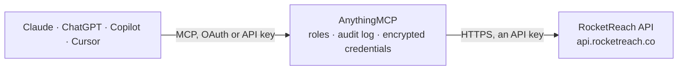

<!-- Generated by scripts/export-github-catalog.mjs in the anythingmcp-website repository. Do not edit by hand. -->

# RocketReach MCP connector

Give your AI RocketReach B2B data: search people and companies by name, title, employer, location, industry and size, check your credits, and look up emails, phone numbers and company profiles only … The AnythingMCP connector gives Claude, ChatGPT, Microsoft Copilot, Cursor and Gemini 6 MCP tools for RocketReach: 4 read and 2 can change data.

**Category:** [Data Enrichment](../enrichment.md) · **Tools:** 6 · **Setup guide:** [anythingmcp.com](https://anythingmcp.com/guides/rocketreach-to-mcp) · [Deutsch](https://anythingmcp.com/de/guides/rocketreach-to-mcp) · [Italiano](https://anythingmcp.com/it/guides/rocketreach-to-mcp) · [Español](https://anythingmcp.com/es/guides/rocketreach-to-mcp) · [日本語](https://anythingmcp.com/ja/guides/rocketreach-to-mcp) · [Русский](https://anythingmcp.com/ru/guides/rocketreach-to-mcp) · [中文](https://anythingmcp.com/zh/guides/rocketreach-to-mcp)

## Start without code

No installation and no terminal: AnythingMCP Cloud runs the RocketReach connector for you, operated by helpcode.ai in Frankfurt, Germany.

1. **Click the button above** and create an account or sign in. The RocketReach connector opens, ready to install.
2. **Paste the API key or token from your RocketReach account.** Every click is in the [step-by-step guide](https://anythingmcp.com/guides/rocketreach-to-mcp).
3. **Click Install.** AnythingMCP shows the address of your MCP server.
4. **Add that address to your assistant:** [Claude](https://anythingmcp.com/guides/connect-rocketreach-to-claude) · [ChatGPT](https://anythingmcp.com/guides/connect-rocketreach-to-chatgpt) · [Microsoft Copilot](https://anythingmcp.com/guides/connect-rocketreach-to-copilot) · [Cursor](https://anythingmcp.com/guides/connect-rocketreach-to-cursor) · [Gemini CLI](https://anythingmcp.com/guides/connect-rocketreach-to-gemini) · [Meta Muse](https://anythingmcp.com/guides/connect-rocketreach-to-muse).
5. **Ask your first question**, for example: *Show me RocketReach profile for the CFO of Helix Solar GmbH in Berlin, title CFO, include LinkedIn teaser*

Prefer help with the setup? [Talk to us](https://anythingmcp.com/contact).

## How it works

- **The AI client** speaks MCP (Streamable HTTP) to AnythingMCP and only sees tool names, descriptions and results. It never gets the RocketReach credentials.
- **AnythingMCP** checks the client's role, builds the call from the tool definition, adds the credentials (an API key), calls RocketReach, logs the call and returns the result.
- **RocketReach** sees an ordinary API client with the rights of the account the credentials belong to.

## Tools

| Tool | What it does | Access |
|---|---|---|
| [`rocketreach_get_account`](#rocketreach_get_account) | Show the RocketReach account the key belongs to: name, email, state, the credits per type (credit_usage: allocated, used, remaining for standard_lookup,… | read |
| [`rocketreach_search_people`](#rocketreach_search_people) | Search RocketReach's 700M professional profiles by facets and get a page of matches: RocketReach id, name, current title and employer, employer domain,… | read |
| [`rocketreach_lookup_person`](#rocketreach_lookup_person) | Look up one person's contact data in RocketReach: work and personal emails with grade (A best) and SMTP check, phone numbers with type and grade, current… | write |
| [`rocketreach_check_lookup_status`](#rocketreach_check_lookup_status) | Check person lookups that are still running and get their contact data once done: status complete (emails and phones included), failed (no contact data… | read |
| [`rocketreach_search_companies`](#rocketreach_search_companies) | Search RocketReach's companies by facets and get a page of matches: RocketReach company id, name, email domain, ticker, industry, city, region and country. | read |
| [`rocketreach_lookup_company`](#rocketreach_lookup_company) | Get the full RocketReach profile of one company: domain, website, ticker, founding year, address, phone, employee count, revenue, industry and keywords, SIC… | write |

## Tool reference

Every parameter as the AI client sees it in `tools/list`. Source: [`packages/backend/src/adapters/intl/rocketreach.json`](../../../packages/backend/src/adapters/intl/rocketreach.json).

### `rocketreach_get_account`

Show the RocketReach account the key belongs to: name, email, state, the credits per type (credit_usage: allocated, used, remaining for standard_lookup, premium_lookup, phone_lookup, person_enrich, person_export, company_export, email_verification; inf means not tracked) and the rate limits with what remains. Use it before lookups to check the credits left. Free: uses no credits. Read-only.

**Access:** read · **Call:** `GET /account/`

No parameters.

### `rocketreach_search_people`

Search RocketReach's 700M professional profiles by facets and get a page of matches: RocketReach id, name, current title and employer, employer domain, location, LinkedIn URL and a teaser (domains of known emails, masked phones) showing whether a lookup is likely to find contact data. Returns no emails or phone numbers. Facets take lists of strings, e.g. {"current_title": ["head of purchasing"], "current_employer": ["Bosch"], "geo": ["Germany"]}. Common facets: name, current_title, current_employer, company_website_url, company_industry, company_size (e.g. 51-200), company_revenue, geo, management_levels, department, skills, keyword, contact_method (work email, mobile, direct dial). Quote a value for an exact match; exclude with exclude_<facet>. Free: no lookup credits. Read-only.

**Access:** read · **Call:** `POST /person/search`

| Parameter | Type | Required | Description |
|---|---|---|---|
| `query` | object | yes | Facets, each a list of strings, e.g. {"current_title": ["CTO"], "company_website_url": ["example.com"]}. Prefix a facet with exclude_ to leave matches out. |
| `start` | integer | no | Index of the first result, from 1. Use pagination.next of the previous page. |
| `page_size` | integer | no | Profiles per page, 1 to 100 (default 10). |
| `order_by` | `relevance` \| `popularity` \| `score` | no | Sort order: relevance (default), popularity (like the web app) or score. |

### `rocketreach_lookup_person`

Look up one person's contact data in RocketReach: work and personal emails with grade (A best) and SMTP check, phone numbers with type and grade, current title and employer and the employer's office phone. Identify the person with id (best, from rocketreach_search_people), linkedin_url, email, or name plus current_employer. COSTS CREDITS: a lookup credit and a person export credit when contact data is found (premium when an A or A- email or a valid phone is found); nothing when no data is found; a repeat lookup of the same person is free. Adds the person to the account's My Contacts. Before calling, tell the user who you will look up and that it costs credits, and wait for their yes. If status is not complete, wait a few seconds and call rocketreach_check_lookup_status. Returns personal data: use it only for a legitimate B2B purpose, under GDPR and CAN-SPAM.

**Access:** write · **Call:** `GET /person/lookup`

| Parameter | Type | Required | Description |
|---|---|---|---|
| `id` | integer | no | RocketReach profile id from a search. |
| `linkedin_url` | string | no | LinkedIn profile URL, e.g. https://www.linkedin.com/in/username. |
| `email` | string | no | A known email address of the person. |
| `name` | string | no | Full name, together with current_employer. |
| `current_employer` | string | no | Current employer, together with name. |
| `title` | string | no | Job title, to tell apart people with the same name at one employer. |
| `lookup_type` | `standard` \| `premium` \| `phone` \| `enrich` | no | Force a credit type: standard (email only), premium (email and phone), phone, or enrich (profile only, no contact data). Omit to use the account's settings. |

### `rocketreach_check_lookup_status`

Check person lookups that are still running and get their contact data once done: status complete (emails and phones included), failed (no contact data found), or progress, searching or waiting (try again in a few seconds; at most every 3 seconds). Pass the ids of profiles you already looked up with rocketreach_lookup_person; an id that is not in your contacts answers 403. Free: uses no credits. Read-only. Returns personal data.

**Access:** read · **Call:** `GET /person/checkStatus`

| Parameter | Type | Required | Description |
|---|---|---|---|
| `ids` | integer[] | yes | RocketReach profile ids of earlier lookups. |

### `rocketreach_search_companies`

Search RocketReach's companies by facets and get a page of matches: RocketReach company id, name, email domain, ticker, industry, city, region and country. Facets take lists of strings, e.g. {"industry": ["Machinery"], "geo": ["Germany"], "employees": ["51-200"]}. Common facets: name, domain, website_url, industry, industry_keywords, employees, revenue, geo, location, techstack, naics_code, sic_code, publicly_traded, keyword. Use the id or the domain with rocketreach_lookup_company, or as company_id in rocketreach_search_people. Free: no lookup credits. Read-only.

**Access:** read · **Call:** `POST /searchCompany`

| Parameter | Type | Required | Description |
|---|---|---|---|
| `query` | object | yes | Facets, each a list of strings, e.g. {"name": ["Siemens"]} or {"techstack": ["SAP"], "geo": ["Austria"]}. |
| `start` | integer | no | Index of the first result, from 1. Use pagination.nextPage of the previous answer. |
| `page_size` | integer | no | Companies per page, 1 to 100 (default 10). |
| `order_by` | `relevance` \| `popularity` \| `score` | no | Sort order: relevance (default), popularity or score. |

### `rocketreach_lookup_company`

Get the full RocketReach profile of one company: domain, website, ticker, founding year, address, phone, employee count, revenue, industry and keywords, SIC and NAICS codes, technologies, competitors, headcount by department, growth and social links. Identify it by domain (best), id, name, ticker or linkedin_url. COSTS CREDITS: a company export credit (company lookups are not part of every plan); adds the company to My Companies. Tell the user it costs a credit and wait for their yes before calling.

**Access:** write · **Call:** `GET /company/lookup/`

| Parameter | Type | Required | Description |
|---|---|---|---|
| `domain` | string | no | Company domain, e.g. example.com (preferred). |
| `id` | integer | no | RocketReach company id from a search. |
| `name` | string | no | Company name. |
| `ticker` | string | no | Stock ticker. |
| `linkedin_url` | string | no | Company LinkedIn URL. |

## Run it yourself

AnythingMCP is open source (AGPL-3.0). [Run it with Docker](../../../README.md#run-it-yourself), open **Connectors → Store**, pick **RocketReach** and enter `ROCKETREACH_API_KEY`, then add your MCP server URL to the AI client.

[← Data Enrichment connectors](../enrichment.md) · [All categories](../README.md)
